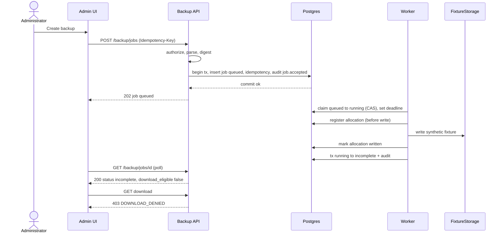
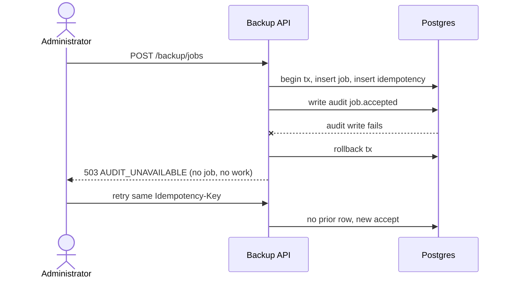
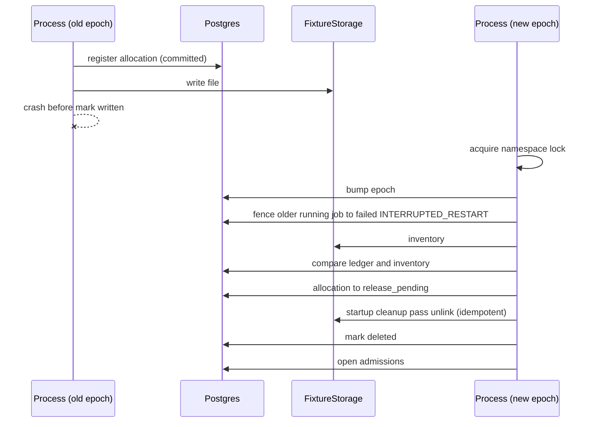
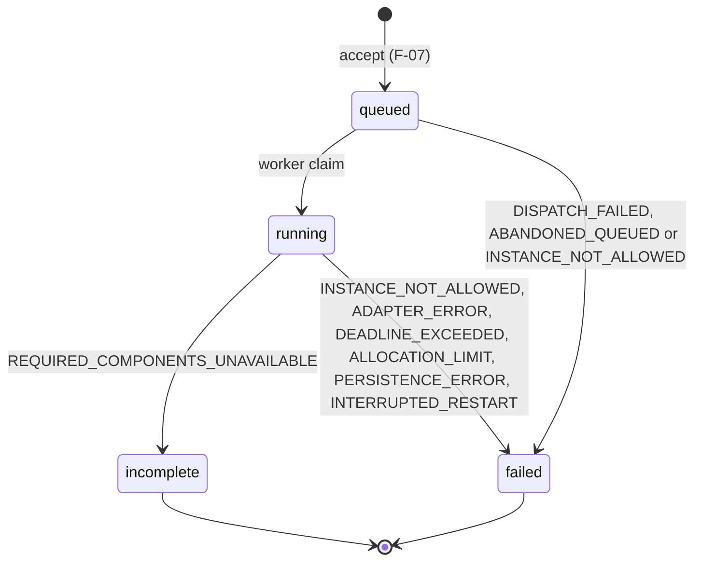
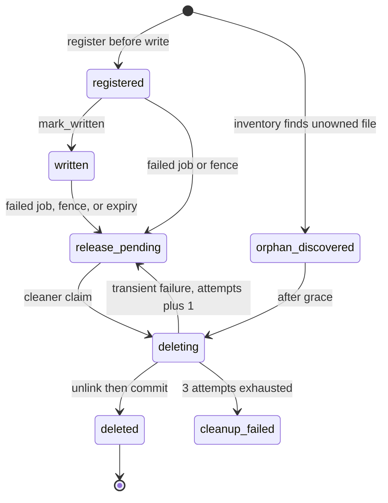

# Functional Design FD-01: Backup/Restore U1

- ID: FD-01 (IEEE 1016 style, template `core/methodology/templates/functional-design.md`)
- Status: Draft — implementation-design stage, pending conductor review
- Date: 2026-11-22
- Slice: U1 (localhost, one configured local instance, synthetic fixtures only, administrator-only)

Provenance labels: [O] Observed (source cited), [UP] User-provided (project owner, 2026-11-22), [A] Assumption (impact and validation stated), [E] Estimate, [D] Design decision proposed here (for the plan gate, not an approval), [Q] Open question.

Identifier conventions: work units are WU-nn (template U-nn); F-nn functions; IF-nn interfaces; TS-nn tests; CFG-nn config keys; T-nn threats; R-nn risks. Ambiguous IDs are written qualified ("Availability A-03" versus "assumption A-03"). Acceptance scenario references S1, S2, S3 mean the first, second and third scenario under that AC heading in `acceptance-criteria.md`.

Nothing here is implemented or tested. No suite baseline exists. Only items marked [UP] are approved.

## Source inputs

- Analyze: [acceptance-criteria](../../analyze/problem-framing/acceptance-criteria.md), [user-stories](../../analyze/problem-framing/user-stories.md), [problem-statement](../../analyze/problem-framing/problem-statement.md), [success-measures](../../analyze/problem-framing/success-measures.md), [stakeholder-map](../../analyze/problem-framing/stakeholder-map.md)
- Context and risk: [constraints-and-assumptions](../../analyze/context-and-risk/constraints-and-assumptions.md), [risk-register](../../analyze/context-and-risk/risk-register.md), [quality-requirements](../../analyze/context-and-risk/quality-requirements.md), [open-questions](../../analyze/context-and-risk/open-questions.md), [evidence-log](../../analyze/context-and-risk/evidence-log.md)
- Ideate: [recommended-direction](../../ideate/direction-selection/recommended-direction.md), [decision-record](../../ideate/direction-selection/decision-record.md), [scope-boundary](../../ideate/direction-selection/scope-boundary.md), [architecture-design](../../ideate/direction-selection/architecture-design.md), [threat-model](../../ideate/direction-selection/threat-model.md), [gate-recommendation](../../ideate/direction-selection/gate-recommendation.md), [solution-options](../../ideate/option-generation/solution-options.md), [trade-off-matrix](../../ideate/option-generation/trade-off-matrix.md)
- Repository context: `docs/features/backup-restore.md`, `docs/architecture/`, `docs/development/agent-team.md`, `README.md`, `.aidlc/knowledge/_codebase-map.md`

## 1. Purpose and trace

- Approved direction: ADR-002, ADR-003, ADR-004 approved as proposed [UP]; ADR-001 scope and ADR-005 role scope confirmed [UP]. Q-05 bounds approved [UP]. Threat model T-01..T-14 accepted as mandatory construction requirements [UP]; T-15..T-17 deferred.
- Purpose: specify behavior, data, interfaces, interaction and state for a safe, truthful U1 backup slice: an administrator creates a synthetic database-slice job that always ends `incomplete` (or `failed`), downloads are always denied, and the allocation lifecycle is durable and fail-closed.
- Acceptance criteria covered: AC-001, AC-002 (S1, S2, S3), AC-003 S3 (staging stays disabled and safe, see 1.2), AC-004 (S1, S2 as synthetic preview), AC-005. AC-006 S2 (unresolved blockers surfaced) is a documentation and gate-checklist scenario covered by TS-58; where config, bounds or cleanup functions are also traced to it (plan and work-units), they carry the behavioural AC-002 S2 / AC-003 S3 trace as well (1.2, C12). AC-006 S1 is explicitly deferred (test-strategy marks it Deferred).
- Explicitly deferred: AC-003 S1 and S2 (rejecting invalid or unsafe packages without changing target data) require real upload acceptance and real preflight validation, which are not authorized [UP: project owner, 2026-11-22]. U1 only proves refusal (IF-06, IF-07) and offers labelled synthetic previews (IF-09, IF-10). No F-xx traces to AC-003 S1 or S2.
- Not covered: AC-004 S3 (restore failure) has no U1 function, because restore execution is not authorized [UP: project owner, 2026-11-22]. test-strategy.md records it as "AC-004 S3: deferred" with that reason (canonical decision C12); no F-xx and no TS id traces to it.

Mandatory invariants:

1. No U1 job may reach `succeeded` or `recovery-required`. The persisted and public status enum keeps every existing documented value and adds `incomplete` (ADR-002 as approved, D-10), so the guarantee is enforced by the state-machine guard, a DB constraint/trigger that rejects those two values for U1 job kinds, and the serializer/API never emitting them for a U1 job (section 7.1).
2. Downloads, real upload, real preflight and real restore are always denied.
3. Audit is consulted before effects. When the audit store is unavailable the operation is refused.
4. Every allocation is registered in the ledger before any file is written.
5. On DB outage the system closes admissions and never deletes or guesses ownership.

### 1.1 Decision status

Approval attribution (canonical decision C13): ADR-002, ADR-003, ADR-004 and T-01..T-14 were approved or accepted by the project owner (solo scope; owner also acts as architect/operations/security approver for this intent), 2026-11-22. No separate architect, operations or security person approved them, and none is claimed here. Wording is kept consistent with implementation-plan section 4.

| Item | Status |
|---|---|
| ADR-002 (Q-01), ADR-003 (Q-02), ADR-004 (Q-03) | APPROVED as proposed by the project owner (solo scope; owner also acts as architect/operations/security approver for this intent), 2026-11-22 [UP] |
| ADR-001, Q-08, Q-09, A-04, A-05 (admin-UI first, one local instance, administrator only) | CONFIRMED [UP] |
| Q-05 bounds CFG-05..CFG-15 | APPROVED [UP]: the exact values are approved; any other value is a new owner decision (FN F-01) |
| T-01..T-14 | ACCEPTED as construction requirements by the project owner (solo scope; owner also acts as architect/operations/security approver for this intent), 2026-11-22 [UP] |
| CFG-04 fixture-storage location and protection | [Q] OPEN owner decision; blocker for WU-04..WU-06 (not decided here) |
| RK-16 migration gating / release effect; RK-15 runtime-start condition | [Q] OPEN owner decisions (hard stops, section 8) |
| CFG-17, CFG-18 ingress request timeout and header-size limit | [Q] required config with no approved default; owner values needed before WU-10, the unit that builds the ingress layers (F-38) and owns TS-55; WU-08 is not blocked (section 4.2) |
| Audit-in-same-transaction mechanism (section 5/6) | [D] awaiting confirmation at plan gate (ADR-005 mechanism) |
| NamespaceLock mechanism and Windows behavior | [D] awaiting confirmation; unproven (RK-06) |
| RED-GREEN-REFACTOR per work unit, 80% coverage as measurement | [D] resolves FEAT-01 section 13 `test-after` versus `docs/development/agent-team.md` |
| Q-04 Auth/Storage recovery, Q-06 RPO/RTO, Q-07 production policy, Q-10 consistency, Q-11 encryption/keys, Q-12 baseline, P-01..P-05 targets | [Q] OPEN. Not represented as decided. |
| Audit retention; JSON body cap 16 KiB; list page size 20 (max 100); fixed fixture size; 60 s DB recovery probe | [Q]/[E] non-owner technical guards or open items |

### 1.2 AC trace rule for the allocation lifecycle (deliberate rule, aligned to the other artifacts)

Single trace rule used by FD, and to be used by interfaces-and-contracts, test-strategy and work-units [D]: the allocation lifecycle, bounds, cleanup and sweep functions (F-21..F-24, F-27..F-30, F-32, F-33) trace to AC-002 S2 (failed or interrupted work ends in a truthful state) and AC-003 S3 (staging stays disabled and safe: synthetic proof that no staged bytes escape the ledger). ADR-004, the Q-05 owner decision and Availability A-03/A-05 are recorded in the T / QR / ADR column as rationale, not as AC identifiers. AC-006 S2 (TS-58 gate check) is never the only trace of a behavioural function: every function that the spine traced to AC-006 S2 for config, bounds or cleanup carries the behavioural AC-002 S2 / AC-003 S3 trace shown here (canonical decision C12). This is the trace that test-strategy (TS-19..TS-32) and IFC section 12 already use for the majority of rows; the AC-003 S3 trace is admittedly indirect, since no AC states the lifecycle requirement itself. Template deviation [Q]: the methodology template wants an AC per function; Analyze may add an AC for the durable allocation lifecycle and Q-05 bounds, after which these rows retarget it without any ID change here.

Within AC-003 S3, F-01 (real staging cannot be configured on) and F-12 (real upload, preflight and restore refused) carry the direct disabled-capability trace, with tests TS-02, TS-09, TS-10.

## 2. Context

### 2.1 Actors

- Administrator: holder of Supabase app role `my-headless-cms-administrator`. Only human actor [UP]. Writers are excluded.
- Backup worker (internal): claims queued jobs, runs the fixture capture.
- Reconciler and cleaner (internal): startup fence, inventory comparison, orphan handling, bounded cleanup.
- Sweeper (internal): periodic sweep, deadline enforcement, retention purge.
- Project owner: escalation recipient, informed through visible admin-UI status [UP].

### 2.2 In scope

Localhost only; one server-configured instance; synthetic fixtures; administrator-only REST surface plus admin UI page; create/list/read/monitor jobs; terminal `incomplete` or `failed`; durable idempotency and audit-before-effect; allocation ledger with startup fence, two-way reconciliation, orphan grace, idempotent bounded cleanup, DB-outage fail-closed; labelled synthetic upload/preflight/restore-confirmation previews with cancel; visible escalation; backup CLI stays fail-closed (tests and doc comments only).

### 2.3 Out of scope

Real DB capture, staging, packaging, ZIP, manifest, upload, download or restore; any `succeeded` job; `recovery-required` outcome; Supabase Auth/Storage recovery; production use; cross-instance and remote instances; scheduled backups; CLI completion; browser-supplied URLs, secrets or DSNs; executing archive commands; CI/coverage repair (only recorded by WU-15); T-15, T-16, T-17 construction (tagged only where previews or migrations touch them).

### 2.4 Existing components and conventions affected

Composition viewpoint. New crate `apps/api/domain_backup` follows `domain_seo` as the structural precedent (a crate that owns migrations and in-crate testcontainers tests [O: `apps/api/domain_seo/src/migrations_cli.rs`, `integration_tests.rs`]; `domain_media` owns no migrations). Crate lint attributes (`#![deny(unsafe_code)]`, `#![warn(missing_debug_implementations)]`), inline `#[cfg(test)]` tests and own `AppError` and response types follow `domain_media` [O: `apps/api/domain_media/src/lib.rs`].

| File | Change | Provenance |
|---|---|---|
| `apps/api/Cargo.toml` | add `domain_backup` to `members` | [O] members list |
| `apps/api/gateway/Cargo.toml` | add dependency | [D] |
| `apps/api/gateway/src/main.rs` | `manifest(...)` gains backup state (6th service); runtime start after `run_orchestrator` (RK-15 condition, section 6.1); loopback guard; Host/Origin and ingress layers on the backup router (T-04, T-13); update test `manifest_with_five_services_returns_five_entries` to 6 | [O] startup sequence |
| `apps/api/gateway/src/migrate_cli.rs` | chain `domain_backup::migrations_cli::list_identities` into `all_migration_identities` | [O] |
| `apps/api/gateway/src/backup_cli.rs` | module-doc note and `handle_args` tests only; no behavior change | [O] |
| `apps/api/test_helpers/src/lib.rs` | no change; backup DB tests use in-crate testcontainers as `domain_seo` does, avoiding a `test_helpers` to `domain_backup` dev-dependency cycle (RK-04) | [O] `test_helpers/Cargo.toml` depends on `domain_posts` |
| `apps/web/src/App.tsx` | route `/admin/backup` in `ProtectedRoute > AdminLayout > AdminOnlyRoute` | [O] |
| `apps/web/src/app/admin/components/left-menu.tsx` and test | "Backup & Restore" item under Administration, guarded by `isAdministrator` | [O] |
| `apps/web/src/config/api.config.ts` | backup URL helpers | [O] |
| `docs/features/backup-restore.md`, `docs/architecture/software-architecture.md` | record `incomplete` contract; add `domain_backup` | [D]/[O] |
| `.github/workflows/ci-my-cms.yml` | read-only | [O] |

Module composition of `domain_backup` (paths under `apps/api/domain_backup/src/`):

- `domain/` pure logic: `status.rs`, `state_machine.rs`, `config.rs`, `error.rs`, `response.rs`, `policy.rs`, `clock.rs`, `idempotency.rs`, `instance.rs`, `fixtures.rs`
- `ports/` traits: `capture.rs`, `job_store.rs`, `allocation_store.rs`, `audit.rs` (created in WU-03, C8), `fixture_storage.rs`, `namespace_lock.rs`
- `infra/` adapters: `db_job_store.rs`, `db_allocation_store.rs`, `db_audit_sink.rs` (created in WU-03, C8; consumed by WU-04 and WU-07), `fs_fixture_storage.rs`, `fs_namespace_lock.rs`
- Router-level ingress layers on the backup router are the request timeout (CFG-17) and the header-size limit (CFG-18), plus the Host/Origin policy (F-03) if it is built as a layer; they are defined in the crate `api/` module and applied by the gateway compose step (F-38, `compose_routers` in `apps/api/gateway/src/main.rs`, section 5), because the gateway applies no CORS or body-limit layer to backup routes (RK-05). The 16 KiB body cap is NOT router-level: it is route-local on IF-02, IF-09 and IF-10 only (F-05, IFC 2.2) and never applies to IF-06..IF-08, which return 403 `CAPABILITY_DISABLED` regardless of `Content-Length` before any body-limit layer (IFC 2.1, TS-09, TS-60). Exact file names are owned by interfaces-and-contracts section 2.
- `lifecycle/`: `runtime.rs`, `worker.rs`, `fixture_capture.rs`, `reconciler.rs`, `cleaner.rs`, `sweeper.rs`
- `handlers/<op>/` (logic plus request/response; deviation D-03): `list_instances`, `create_job`, `get_job`, `list_jobs`, `download_denied`, `disabled_capability`, `preview`, `status`
- `api/` routing only: `routes.rs`, `state.rs`, `extract.rs`; `migrations/`, `entities/`, `service.rs`, `migrations_cli.rs`, `observability/`

Web composition (`apps/web/src`): `domains/backup.ts` (REST client using `authenticatedFetch`/`getApiUrl`, the observed REST precedent `domains/seo-head-asset.ts` with its colocated `seo-head-asset.test.ts` [O]; `infrastructure/das` is not used, D-13), `domains/backup.test.ts`, `app/admin/backup/page.tsx`, `app/admin/backup/components/*` (status banner, instance selector, job create panel, status badge, job list, job detail, synthetic preview panel), `app/admin/backup/hooks/{use-backup-jobs,use-backup-status}.ts`, each with colocated tests.

Dependency viewpoint summary: `domain_backup` depends on `domain_interface` (traits, `Mount`, `AuthenticatedActor`), SeaORM 1.1.20 and sea-orm-migration 1.1.20 [O workspace], plus crates for cancellation and file locking whose exact choice and workspace presence are unverified [A: validate with `cargo check -p domain_backup` in WU-01].

## 3. Functional decomposition

Every F-xx traces to at least one AC identifier. Trace columns: T = threat, QR = quality requirement, ADR.

### 3.1 Function table

| ID | Name (owner path) | Behavior | AC | T / QR / ADR |
|---|---|---|---|---|
| F-01 | `BackupConfig::from_env/validate` (`domain/config.rs`) | Parse CFG keys with owner defaults. Missing or invalid values never abort the CMS: they mark backup disabled with a safe reason code (`NOT_CONFIGURED`, `NON_LOOPBACK_BIND` or `INVALID_CONFIG`) and `validate_config` returns Ok (see FN F-01). No unbounded fallback; any CFG-05..CFG-14 value other than the owner-approved default gives `INVALID_CONFIG`; CFG-16, CFG-17 and CFG-18 are required when enabled and absent or malformed gives `INVALID_CONFIG`. Real staging cannot be configured on. Calls `is_loopback_bind` (F-39). | AC-003 S3 (also AC-002 S2 behavioural trace, 1.2) | T-04, T-13, T-14 / O-07, P-05 / ADR-004, Q-05 |
| F-02 | `InstanceRegistry::list/get` (`domain/instance.rs`) | Return the single configured local instance with safe label. Unknown ids resolve to none. | AC-001 S1 | T-03 / PR-01 / ADR-001 |
| F-03 | `authorize_operation` (`domain/policy.rs`) | Assert administrator role and operation allowed for the instance. Missing actor or role denied before config or job lookup. Then the Host/Origin policy (T-04, CFG-16): `Host` outside the loopback forms with the configured port gives 403 `HOST_NOT_ALLOWED`; on POST routes an `Origin` not exactly matching a CFG-16 entry gives 403 `ORIGIN_NOT_ALLOWED`; absent `Origin` is accepted. Precedence: 401, `ROLE_REQUIRED`, `HOST_NOT_ALLOWED`/`ORIGIN_NOT_ALLOWED`, then (IF-06..IF-08) `CAPABILITY_DISABLED`. | AC-001 S2; AC-005 S1 | T-01, T-02, T-04 / PR-01 / ADR-005 |
| F-04 | `authorize_resource` (`domain/policy.rs`) | Check job belongs to the configured instance. Foreign or unknown ids return non-disclosing 404. Re-run at worker execution against the configured instance only; failure fails the job `INSTANCE_NOT_ALLOWED`. Actor-role revocation after acceptance is not rechecked ([Q], see 7.4). | AC-005 S1 | T-02 / PR-03 / ADR-005 |
| F-05 | `parse_create_request` (`handlers/create_job/request.rs`) | Strict JSON, `deny_unknown_fields`, only `instance_id`, content type `application/json`, body cap 16 KiB. | AC-005 S1 | T-03, T-04 / PR-01 |
| F-06 | `validate_key/digest/fingerprint` (`domain/idempotency.rs`) | Validate `Idempotency-Key` (8..=128 of `[A-Za-z0-9_-]`); scoped SHA-256 digest and request fingerprint; raw key never persisted or logged. | AC-005 S2; AC-002 S1 | T-07, T-09 / Availability A-01, PR-02, PR-04 |
| F-07 | `accept_job` (`handlers/create_job`) | One transaction commits job (`queued`), idempotency row and safe audit `job.accepted`. Failure returns no "accepted" and starts no work. | AC-002 S1; AC-005 S2, S3 | T-07, T-08 / ADR-005 |
| F-08 | `replay_or_conflict` (same handler) | Same key and fingerprint returns existing authorized job; different fingerprint is conflict; otherwise enforce concurrency limit. | AC-002 S1 | T-07, T-13 / Availability A-01, P-05 |
| F-09 | `get_job`, `list_jobs` | Read with F-03 and F-04 on every call. | AC-002 S1; AC-005 S1 | T-02 / PR-03 |
| F-10 | `project_job` (`handlers/*/response.rs`) | Safe projection: `download_eligible` always false, progress null unless measured, no raw errors. | AC-002 S1, S3 | T-06, T-09 / O-02, O-08 |
| F-11 | `deny_download` | After authorization always 403 `DOWNLOAD_DENIED` regardless of status or file presence; denial audit attempted. No URL, no static mapping. | AC-002 S3 | T-05, T-06 / ADR-002 |
| F-12 | `reject_disabled_capability` | Real upload, preflight, restore return 403 `CAPABILITY_DISABLED` without reading the body, touching storage or enqueueing. | AC-003 S3; AC-005 S1 | T-05, T-13 / C-03 / ADR-001 |
| F-13 | `preview_preflight` | Canned result for a trusted fixture id, labelled synthetic. Uploaded files and paths never accepted. Preview only; does not satisfy deferred AC-003 S1 or S2. | AC-004 S1 | T-05 / ADR-001 |
| F-14 | `preview_restore_confirmation` | `confirm` or `cancel` returns a synthetic impact message; enqueues nothing; no mutation port. | AC-004 S1, S2 | T-05, T-15 (preview only) / ADR-001 |
| F-15 | `transition_job` (`ports/job_store.rs`, `infra/db_job_store.rs`, `domain/state_machine.rs`) | Compare-and-set on status and `state_version`. Terminal states immutable. The pure guard has no transition to `succeeded` or `recovery-required` for a U1 job, and the DB constraint/trigger rejects both values for U1 job kinds (section 7.1). | AC-002 S2, S3 | T-06 / ADR-002 |
| F-16 | `claim_next_job`, worker loop (`lifecycle/worker.rs`) | Conditional claim `queued` to `running` sets deadline and epoch. Concurrency 1. | AC-002 S1 | T-07, T-12 / ADR-004 |
| F-17 | `FixtureCaptureAdapter::capture` (`lifecycle/fixture_capture.rs`) | Writes a fixed synthetic fixture via FixtureStorage. Components: `database` synthetic_captured; `auth`, `storage` unavailable. | AC-002 S3 | T-05, T-14 / ADR-001 |
| F-18 | `complete_incomplete` (`lifecycle/worker.rs`) | `running` to `incomplete`, reason `REQUIRED_COMPONENTS_UNAVAILABLE`, same transaction as audit. | AC-002 S3 | T-06 / ADR-002 |
| F-19 | `fail_job` | `running` or `queued` to `failed` with safe reason (including `DISPATCH_FAILED`, section 7.1); releases allocation; audit. | AC-002 S2 | T-06, T-12 / Availability A-02 |
| F-20 | `enforce_deadline` (`worker.rs`, `sweeper.rs`) | `tokio::time::timeout` for remaining deadline; sweeper also fails current-epoch `running` jobs past deadline. | AC-002 S2 | T-13 / P-02 (no target) |
| F-21 | `register_allocation` (`ports/allocation_store.rs`) | Check per-allocation and total byte budgets; commit allocation intent before any file write; refuse if ledger or audit unavailable. | AC-002 S2; AC-003 S3 | T-12, T-13 / Availability A-03 / ADR-004, Q-05 |
| F-22 | `FsFixtureStorage::write/delete/inventory` | Opaque keys under private root; no link following; verified namespace and file types; idempotent delete. `inventory(max_entries)` is bounded and returns a truncation flag (T-13). | AC-002 S2; AC-003 S3 | T-11, T-14 / PR-05 (partial) / ADR-004 |
| F-23 | `mark_allocation_written` | Conditional `registered` to `written`; on failure the job fails. | AC-002 S2; AC-003 S3 | T-12 / ADR-004 |
| F-24 | `FsNamespaceLock::try_acquire` | Exclusive ownership of the root; a second process is refused and backup stays not-ready. | AC-002 S2; AC-003 S3 | T-11, T-12 / ADR-004 |
| F-25 | `bump_epoch_and_fence` (`lifecycle/reconciler.rs`) | Increment epoch in a transaction at startup; older-epoch work is fenced. | AC-002 S2 | T-12 / Availability A-03 / ADR-004 |
| F-26 | `reconcile_jobs` | Older-epoch `running` becomes `failed INTERRUPTED_RESTART`; older `queued` becomes `failed ABANDONED_QUEUED`. No resume. | AC-002 S2 | T-12 / Availability A-03, A-04 |
| F-27 | `reconcile_inventory` | Two-way compare of ledger, jobs and namespace inventory (full reconcile at startup and on DB recovery; each sweep runs only the discover-only scan of F-32). Ledger row without file harmless. File without ledger row persisted as `orphan_discovered`. Ambiguous name never deleted; incident raised. If the inventory is truncated the reconciliation fails closed: no orphan is classified or deleted, the runtime stays `not_ready` (startup) or `degraded` (later), and escalation is visible. | AC-002 S2; AC-003 S3 | T-11, T-12 / ADR-004 |
| F-28 | `discover_orphan` | Persist orphan record with `orphan_grace_until = now + grace` before any deletion. | AC-002 S2; AC-003 S3 | T-12 / ADR-004 |
| F-29 | `clean_allocation` (`lifecycle/cleaner.rs`) | Conditional claim to `deleting`, idempotent unlink (missing counts as removed), then commit `deleted`. | AC-002 S2; AC-003 S3 | T-12 / Availability A-05 / ADR-004 |
| F-30 | `retry_or_exhaust` | At most 3 attempts, 1-minute backoff. Exhaustion becomes `cleanup_failed` with visible safe reason and escalation to project owner. | AC-002 S2; AC-003 S3 | T-12, T-13 / Availability A-05 / ADR-004 |
| F-31 | `db_outage_guard` (`lifecycle/runtime.rs`) | On a DB outage (predicate in 6.6) close admissions, stop allocation and deletion, emit safe health signal; on recovery run the recovery sequence of 6.6 before reopening. | AC-002 S2; AC-005 S3 | T-12 / Availability A-03 |
| F-32 | `schedule_sweeps` (`lifecycle/sweeper.rs`) | Two loops (section 6.7): sweeper at startup then every CFG-07 (900 s) running deadline enforcement, expiry release, orphan grace promotion, retention purge and a bounded discover-only inventory scan (`inventory(max_entries)`; ADR-004 step 4, IFC 6.1a; truncation persists nothing and raises degraded); cleaner tick every CFG-09 (60 s) processing `due_for_cleanup(now)`. | AC-002 S2; AC-003 S3 | T-12 / ADR-004 |
| F-33 | `purge_retention` | Delete rows in the order idempotency, allocations in `deleted`, then jobs, once `retain_until` has passed; audit `retention.purged` first (section 4.1). Audit rows retained (open). | AC-002 S2; AC-003 S3 | T-13 / ADR-004 |
| F-34 | `AuditSink::record` (`ports/audit.rs`, `infra/db_audit_sink.rs`) | Append-only schema-limited record written in caller's transaction. On failure the sensitive operation is refused. | AC-005 S2, S3 | T-08, T-09 / PR-04 |
| F-35 | `project_error` (`domain/response.rs`) | Stable safe code plus correlation id. No SQL, upstream bodies, credentials or raw keys. | AC-005 S2 | T-09 / O-02, PR-02 |
| F-36 | `status_handler` | Runtime state, DB health, reconciliation result, cleanup counts, escalation visibility. Always 200 for an authorized administrator (IFC 2.3). Any metric emitted by the crate uses the closed label set `job_kind`, `outcome`, `error_code` only (no ids, paths or actor; T-13, T-09; TS-57). | AC-002 S1 | T-12 / O-04, O-06 |
| F-37 | `DomainBackupService` (`service.rs`) | Implements `DomainService`: health, `required_env`, `validate_config`, migration descriptors, `register_routes`, `startup_health`, `run_migrations`. | AC-005 S1 | T-17 / ADR-003 |
| F-38 | gateway `compose` changes | Register the backup routes under the new `Mount::AdministratorIngress` variant (WU-08/WU-09 use `Mount::Administrator` until WU-10 switches it); apply the Host/Origin policy and the router-level ingress layers (request timeout CFG-17, header-size limit CFG-18) on the backup router; the 16 KiB body cap is not applied here, it is route-local on IF-02, IF-09 and IF-10 (F-05); start runtime after migrations. Specified change to `compose_routers` [O: `apps/api/gateway/src/main.rs` lines 238-280, which merges every `Mount::Administrator` registration into one router and applies `administrator_layer` once]: add a `Mount` variant `Mount::AdministratorIngress` (in `domain_interface` `Mount`, serde lowercase; chosen over a new `RouteRegistration` field because 14 struct-literal sites of `RouteRegistration {` exist in the workspace [O: grep, 2026-11-22] and the only exhaustive `match` on `Mount` is in `compose_routers`); the backup registration uses it; the gateway builds a SEPARATE administrator router `backup_admin` for it, wrapped outermost to innermost: timeout layer (CFG-17) -> header-size layer (CFG-18) -> administrator auth layer -> backup routes, then merges it with the other routers. Ingress layers are validated for feasibility in WU-10. | AC-002 S1 (ingress layers); AC-005 S1 | T-01, T-04, T-13 / ADR-003, ADR-005 |
| F-39 | `is_loopback_bind(&str) -> bool` (`domain/config.rs`) | IP-only loopback guard: force backup disabled when `HOST` is not a loopback IP literal (reason `NON_LOOPBACK_BIND`). See 6.1. | AC-005 S1 | T-04 / PR-06 |
| F-40 | `backup_cli::handle_args` | Unchanged fail-closed; gains tests. | AC-002 S2 | T-05 / ADR-001 |
| F-41 | `domains/backup.ts` (web REST client) | REST wrappers over `authenticatedFetch`/`getApiUrl`; zod parsing accepting every status value (queued, running, succeeded, failed, recovery-required, incomplete) and tolerating an unknown value. Test at `domains/backup.test.ts`. | AC-001 S1; AC-002 S1 | T-06 |
| F-42 | Route and menu (web) | `AdminOnlyRoute` plus menu item gated by `isAdministrator`. UX only; not evidence for any AC (supports the AC-001 S1 administrator experience). | AC-001 S1 | T-01 (UX only) |
| F-43 | `InstanceSelector` (web) | Lists instances; empty or unavailable list disables submission. | AC-001 S1 | T-03 |
| F-44 | `JobCreatePanel` (web) | Fresh idempotency key per submit (`crypto.randomUUID()`); double-submit guard. | AC-002 S1 | T-07 |
| F-45 | `JobStatusBadge`, `JobDetail` (web) | Text plus icon status, accessible announcement, "synthetic, database-only, not restorable" label, no download control; exhaustive handling of every status value (a `succeeded` or `recovery-required` value is rendered, never offers download) and a safe fallback for an unknown value. | AC-002 S1, S3 | T-06, T-10 / a11y A11Y-01..A11Y-04 |
| F-46 | `useBackupJobs` (web) | Polls with cleanup on unmount; stops at terminal state; backs off on error. | AC-002 S1 | T-13 |
| F-47 | `SyntheticPreviewPanel` (web) | Labelled preflight and confirm/cancel previews; upload shown unavailable. | AC-003 S3; AC-004 S1, S2 | T-05, T-15 (preview) |
| F-48 | Safe error rendering (web) | Server strings only as React text; correlation id shown. | AC-005 S2 | T-09, T-10 |
| F-49 | `BackupStatusBanner` (web) | Shows degraded, not-ready, disabled and cleanup-exhausted with escalation to project owner. | AC-002 S1 | T-12 / O-04 |

### 3.2 Behavior of key functions (template FN format)

#### FN F-07 Accept job (create)
- Traces to: AC-002 S1; AC-005 S2, S3
- Actor: Administrator
- Preconditions: runtime ready and admissions open; F-03 passed; valid `Idempotency-Key`; body parsed by F-05; instance is the configured one.
- Main flow: compute digest and fingerprint (F-06); look up replay (F-08); if new, begin transaction; insert `backup_jobs` row `queued` (partial unique index enforces one active job per instance); insert `backup_idempotency`; write audit `job.accepted` through F-34 in the same transaction; commit; return 202 with job.
- Alternate and error flows: same key and same fingerprint returns 200 with `Idempotent-Replay: true`; same key and different fingerprint returns 409 `IDEMPOTENCY_KEY_REUSED`; active job exists returns 409 `CONCURRENCY_LIMIT` (checked after replay); audit failure returns 503 `AUDIT_UNAVAILABLE` and no job is persisted, using the classification in 6.6 (a rejected audit statement on a reachable DB is `AUDIT_UNAVAILABLE`; a connectivity or timeout failure is the outage path `STORE_UNAVAILABLE`); commit failure returns 503 `STORE_UNAVAILABLE`, an idempotent retry resolves; not ready returns 503 `BACKUP_NOT_READY`.
- Postconditions: exactly one durable job per accepted key; an "accepted" response is only sent after commit.

#### FN F-16..F-20 Run job
- Traces to: AC-002 S1, S2, S3
- Actor: Backup worker
- Preconditions: admissions open, current epoch, F-04 re-check passes at execution.
- Main flow: claim `queued` to `running` (CAS) with `deadline_at = now + CFG-10`; register allocation (F-21, audit-first) then write the fixture (F-22) then `mark_written` (F-23); capture reports components; transition `running` to `incomplete` with audit in one transaction (F-18).
- Alternate and error flows: adapter error gives `failed ADAPTER_ERROR`; timeout gives `failed DEADLINE_EXCEEDED`; budget exceeded gives `failed ALLOCATION_LIMIT`; `mark_written` or persistence failure gives `failed PERSISTENCE_ERROR`; policy re-check failure fails the job `INSTANCE_NOT_ALLOWED` (possible only if the configured instance changed between acceptance and claim); a failed audit write on `running` to `incomplete` or `failed` rolls the transaction back, the worker retries up to 3 times at 1 s intervals (code constants [D]), after which the job stays `running` and the sweeper resolves it to `failed` after the deadline, provided the sweeper can audit; when the sweeper's own transition also cannot be audited, the bounded behaviour in 6.7 applies (runtime `degraded`, admissions closed, escalation visible); allocation registration refused for audit or ledger unavailability is `PERSISTENCE_ERROR`, not `ALLOCATION_LIMIT`; losing a CAS race changes nothing.
- Postconditions: job terminal and immutable; a queued job is bounded by the queued-age rule in 7.1; allocations of failed jobs go to `release_pending`; allocations of `incomplete` jobs retained until `expires_at` (24 h).

#### FN F-03/F-04 Authorize
- Traces to: AC-001 S2 (F-03); AC-005 S1 (F-03 Host/Origin, T-04)
- Actor: Administrator
- Preconditions: request passed the existing `administrator_layer`; `AuthenticatedActor` extension present [O: inserted in `apps/api/domain_auth/src/lib.rs`, extracted in `apps/api/domain_seo/src/api/mod.rs`].
- Main flow: F-03 asserts the role `my-headless-cms-administrator` before any config or job lookup; F-04 loads the job and checks it belongs to the configured instance.
- Alternate and error flows: missing actor or role gives 403 `ROLE_REQUIRED`; after the role check, a `Host` outside the loopback forms with the configured port gives 403 `HOST_NOT_ALLOWED` and, on POST routes, an `Origin` not exactly matching a CFG-16 entry gives 403 `ORIGIN_NOT_ALLOWED` (absent `Origin` accepted); precedence on every route is 401, `ROLE_REQUIRED`, `HOST_NOT_ALLOWED`/`ORIGIN_NOT_ALLOWED`, then `CAPABILITY_DISABLED` for IF-06..IF-08 only; unknown or foreign job gives 404 `JOB_NOT_FOUND` identically (non-disclosing); worker-time failure of F-04 fails the job `INSTANCE_NOT_ALLOWED`.
- Postconditions: no handler logic, audit or store access occurs for an unauthorized caller or a refused Host/Origin. Tests TS-03, TS-04, TS-59 (Host/Origin, T-04).

#### FN F-05/F-06 Parse and key validation
- Traces to: AC-005 S1 (F-05); AC-005 S2, AC-002 S1 (F-06)
- Actor: Administrator
- Preconditions: F-03 passed.
- Main flow: check `Content-Type: application/json`, body at most 16 KiB, strict parse with `deny_unknown_fields` and only `instance_id`; validate the `Idempotency-Key` format; compute digest and fingerprint.
- Alternate and error flows: wrong media type 415 `UNSUPPORTED_MEDIA_TYPE`; oversize 413 `PAYLOAD_TOO_LARGE` (by `Content-Length` and by streamed length; TS-60); unknown field, malformed JSON or bad key 400 (`MALFORMED_REQUEST`, `IDEMPOTENCY_KEY_REQUIRED`, `IDEMPOTENCY_KEY_INVALID`); non-configured `instance_id` 400 `INSTANCE_NOT_ALLOWED`.
- Postconditions: the raw key is never persisted, logged or echoed.

#### FN F-12 Disabled capability
- Traces to: AC-003 S3; AC-005 S1
- Actor: Administrator
- Preconditions: administrator layer passed (IFC precedence rule: 401, role check, Host/Origin check, then this refusal regardless of `BACKUP_ENABLED` and readiness).
- Main flow: IF-06, IF-07, IF-08 return 403 `CAPABILITY_DISABLED` before any body read, body-limit layer, storage access or enqueue; attempt audit `capability.denied`.
- Alternate and error flows: audit failure still returns the denial; a non-administrator gets the layer 401/403 first.
- Postconditions: no state change anywhere. Tests TS-09, TS-10.

#### FN F-22 Fixture storage
- Traces to: AC-002 S2; AC-003 S3 (rationale ADR-004, T-11, T-14)
- Actor: Backup worker, cleaner
- Preconditions: namespace lock held; storage root validated by F-01.
- Main flow: `write` creates `alloc/<uuid>.bin` with create-new semantics under the private root; `delete` unlinks only a verified regular file with the exact name; `inventory(max_entries)` lists the single `alloc/` directory with file types, stops after `max_entries` entries and returns a truncation flag together with the entries read (T-13).
- Alternate and error flows: symlink, junction, reparse point, directory or nested path is reported as ambiguous and never followed or deleted; a missing file on delete counts as removed; a write beyond the reserved bytes is refused; an inventory larger than `max_entries` returns the truncation flag, which F-27 treats as a fail-closed condition.
- Postconditions: only keys derived from a registered UUID are ever written; inventory work is bounded. Tests TS-19, TS-31, TS-32, TS-56.

#### FN F-24 Namespace lock
- Traces to: AC-002 S2; AC-003 S3 (rationale ADR-004, T-11, T-12)
- Actor: Runtime start
- Preconditions: root configured and valid.
- Main flow: acquire an exclusive lock on `<CFG-04>.lock` (outside the namespace) before the epoch bump.
- Alternate and error flows: lock already held, or an acquisition error, leaves runtime `not_ready` with admissions closed and no deletion; Windows behaviour is unproven (RK-06).
- Postconditions: at most one process mutates the namespace.

#### FN F-39 Loopback guard
- Traces to: AC-005 S1
- Actor: Gateway at service construction
- Preconditions: `HOST` read (default `127.0.0.1`).
- Main flow: `domain_backup::domain::config::is_loopback_bind(&str) -> bool` parses `HOST` as an IP literal and returns true only for `127.0.0.0/8` and `::1`.
- Alternate and error flows: `localhost`, any other hostname, `0.0.0.0`, `::`, an empty or unparseable value, or any non-loopback IP returns false and forces backup disabled with `NON_LOOPBACK_BIND`. A DNS name or string match cannot prove locality (threat-model boundary 5).
- Postconditions: a non-loopback bind never serves the backup surface. TS-08a is the unit test of `is_loopback_bind` in `domain/config.rs` (WU-01, red-first with F-39); TS-08b is the gateway wiring check in `gateway/src/main.rs` (WU-10). TS-08 is retired; TS-08a and TS-08b are the adopted ids (decision F2).

#### FN F-11 Download denial
- Traces to: AC-002 S3
- Actor: Administrator
- Preconditions: administrator authenticated; request reached the handler through the administrator layer.
- Main flow: authorize operation and resource (F-03, F-04), attempt audit `download.denied`, return 403 `DOWNLOAD_DENIED` for every status.
- Alternate flows: unknown or foreign job returns 404 `JOB_NOT_FOUND`; audit failure still returns the denial.
- Postconditions: no file read, no URL generated.

#### FN F-27/F-28/F-29/F-30 Reconcile and clean
- Traces to: AC-002 S2; AC-003 S3 (rule in 1.2; rationale ADR-004, Q-05)
- Actor: Reconciler, cleaner
- Preconditions: namespace lock held; epoch bumped; DB healthy; audit available.
- Main flow: at startup after epoch bump read a bounded inventory (`FixtureStorage::inventory(max_entries)`, truncation flag) and compare ledger and namespace inventory in both directions; classify each inventory entry with the table in 4.4; persist orphans with grace; the cleaner claims due allocations (audit `allocation.delete_claimed` in the same transaction as the `deleting` transition), unlinks idempotently, and commits `deleted` with audit `allocation.deleted`. Audit unavailable refuses claim and purge, so no deletion happens without a prior durable audit.
- Alternate and error flows: a truncated inventory fails the reconciliation closed (no orphan classified or deleted, runtime not ready or degraded, escalation visible; TS-56); transient failure increments `cleanup_attempts` and sets `next_attempt_at = now + 60 s`; third failure gives `cleanup_failed` and visible escalation; ambiguous names are never deleted and raise `ownership.ambiguous`; DB outage stops all deletion.
- Postconditions: no active work deleted on expiry alone; ledger is the source of ownership truth.

#### FN F-01 Load and validate configuration
- Traces to: AC-003 S3; AC-002 S2 (rationale Q-05, ADR-004)
- Actor: Gateway at construction of `DomainBackupService`
- Preconditions: process environment readable; `HOST` read here (default `127.0.0.1`, as the gateway does).
- Main flow: parse CFG-01..CFG-18; if `BACKUP_ENABLED` is not true, the capability is disabled (IF-11 `disabled_reason` `NOT_CONFIGURED`, handler code `BACKUP_DISABLED`); otherwise validate each key and apply `is_loopback_bind` (F-39; failure gives `NON_LOOPBACK_BIND`). Enabled but invalid configuration gives `INVALID_CONFIG`.
- Alternate and error flows: any missing or invalid value stores a safe disabled reason in the runtime handle; `validate_config` returns Ok, the CMS starts, and handlers return 503 `BACKUP_DISABLED` (chosen behaviour (a) [D]). The observed gateway aborts on any `validate_config` Err [O: `apps/api/gateway/src/main.rs` lines 184-188], so Err is deliberately not used. Bounds rule (canonical decision C4, the owner approved exact values [UP]): any CFG-05..CFG-14 environment value other than the owner-approved default (CFG-05 86400, CFG-06 3600, CFG-07 900, CFG-08 3, CFG-09 60, CFG-10 600, CFG-11 1, CFG-12 268435456, CFG-13 1073741824, CFG-14 30) makes backup disabled with `disabled_reason` `INVALID_CONFIG`, because a smaller value can loosen safety (CFG-06 orphan grace, CFG-09 backoff, CFG-14 retention window) and a larger one removes a bound. DB CHECKs are safety ceilings only and do not define the allowed values. Changing a bound requires a new owner decision (and a migration where a DB CHECK is coupled). CFG-16 `BACKUP_ALLOWED_ORIGINS` (exact origins, no wildcard) and CFG-17/CFG-18 (ingress request timeout and header-size limit) are required when enabled; absent or malformed gives `INVALID_CONFIG`. CFG-17 and CFG-18 have no approved default and no value is invented here: the owner values are needed before WU-10 (the unit that builds the ingress layers, F-38, and owns TS-55) [Q]; WU-08 is not blocked by them. Unit and fault-injection tests build `BackupConfig` through a `#[cfg(test)]`/`test-util` constructor that is unreachable from the environment path.
- Postconditions: no secret in any message; no key can enable real staging. Tests: TS-02 covers, per key CFG-05..CFG-14, one case each for a value below the default (disabled `INVALID_CONFIG`), above the default (disabled `INVALID_CONFIG`) and the default (accepted), plus CFG-16/17/18 missing or malformed and the case that the gateway still starts and returns 503 `BACKUP_DISABLED`; TS-01 asserts the defaults.

#### FN F-21 Register allocation
- Traces to: AC-002 S2; AC-003 S3 (rationale ADR-004, Q-05)
- Actor: Backup worker
- Preconditions: job `running` at the current epoch; admissions open; DB healthy.
- Main flow: in one transaction check `bytes_reserved <= CFG-12` and that the sum of live allocation bytes (states other than `deleted`, orphans included) plus the request is `<= CFG-13`; insert a `registered` row with `id` = new UUID, `storage_key = alloc/<id>.bin`, `expires_at = now + CFG-05`, current epoch; write audit `allocation.registered` in the same transaction; commit; only then write the file.
- Alternate and error flows: budget exceeded fails the job `ALLOCATION_LIMIT`; ledger or audit unavailable fails the job `PERSISTENCE_ERROR` and nothing is written; DB outage follows 6.6.
- Postconditions: no file exists without a committed ledger row from this path.

#### FN F-25/F-26 Fence and reconcile jobs
- Traces to: AC-002 S2
- Actor: Reconciler at startup
- Preconditions: namespace lock held; admissions closed.
- Main flow: increment `backup_epoch` in a transaction; transition each older-epoch `running` job to `failed INTERRUPTED_RESTART` and each older-epoch `queued` job to `failed ABANDONED_QUEUED` by CAS, writing audit `reconcile.fenced` in the same transaction; move their live allocations to `release_pending`.
- Alternate and error flows: DB or audit failure leaves the runtime `not_ready` and is retried by the 6.6 probe; CAS loss changes nothing.
- Postconditions: no job of an older epoch is non-terminal; no resume is attempted.

#### FN F-31 DB outage guard
- Traces to: AC-002 S2; AC-005 S3
- Actor: Runtime
- Main flow, alternate flows and postconditions: section 6.6.

#### FN F-32 Schedule loops
- Traces to: AC-002 S2; AC-003 S3
- Main flow, alternate flows and postconditions: section 6.7.

#### FN F-33 Purge retention
- Traces to: AC-002 S2; AC-003 S3
- Actor: Sweeper
- Preconditions: DB healthy; audit available.
- Main flow: select jobs with `retain_until < now` whose allocations are all `deleted`; for each, write audit `retention.purged` (job id and counts only) in the purge transaction, delete its `backup_idempotency` rows, then its `backup_allocations` rows, then the `backup_jobs` row. `retain_until = finished_at + CFG-14 days`, set in the terminal transition [D]. FKs `backup_idempotency.job_id` and `backup_allocations.job_id` are RESTRICT, so the order is mandatory.
- Alternate and error flows: audit or DB unavailable refuses the purge and it retries next sweep; a job with any allocation in `cleanup_failed` or not yet `deleted` is not purged, and its bytes still count against CFG-13 until resolved [D]; operator resolution is out of U1 scope [Q].
- Postconditions: audit rows are never purged. Test: TS-42 extended with the order, the `cleanup_failed` exclusion and the audit-refusal cases.

#### FN F-36 Status
- Traces to: AC-002 S1
- Actor: Administrator
- Preconditions: F-03 passed.
- Main flow: return IF-11 (always 200 for an authorized administrator, IFC 2.3) from in-memory runtime flags plus counters read from the ledger.
- Alternate and error flows: with the DB down, answer from the in-memory handle with `db_healthy=false`, state `degraded` (or `not_ready` before the first reconcile) and the DB-derived fields (`reconciliation`, `cleanup` counts) null; when backup is disabled, state `disabled` with `disabled_reason`. IF-11 never returns 503, so the owner-escalation status stays visible during the outage it reports. `escalation.visible` is true when `cleanup.exhausted > 0`, `ownership_incidents > 0` or state is `degraded`.
- Postconditions: read only, no effect.

#### FN F-46 Poll jobs (web)
- Traces to: AC-002 S1
- Actor: Administrator browser
- Preconditions: a job id from IF-02.
- Main flow: poll IF-04 at a fixed interval after create; stop on a terminal status or unmount.
- Alternate and error flows: errors back off and show the safe error with correlation id (F-48); an unknown status shows the "Unknown status" fallback and stops.
- Postconditions: no timers remain after unmount.

## 4. Data

All tables owned by `domain_backup`, prefixed `backup_`, created by migrations `m20261122_000001_backup_core` and `m20261122_000002_backup_terminal_guards`. No existing table is altered. Validation, retention and column-level constraints are listed per entity.

### 4.1 Entities

| Entity | Key fields | Validation and constraints | Retention |
|---|---|---|---|
| `backup_jobs` | id uuid PK; actor_sub; instance_id; operation (CHECK `backup_db_slice`); status (CHECK over the full enum: queued, running, succeeded, failed, recovery-required, incomplete; wire spelling per IFC 3.1); state_version; synthetic (CHECK true); reason_code; components jsonb; counters jsonb (measured fixture counters only); epoch; correlation_id; created_at, updated_at, started_at, finished_at, deadline_at; retain_until | CHECK terminal status iff `finished_at` not null; partial unique index on `(instance_id)` where status in queued, running (durable concurrency 1, CFG-11); trigger `backup_jobs_terminal_immutable` rejects updates from a terminal state and transitions outside section 7 (D-08, [A] validate in WU-02); a CHECK or trigger rejects `succeeded` and `recovery-required` for the U1 job kind `backup_db_slice` on insert and update (D-10, [A] validate in WU-02, TS-11 DB part) | 30 days (CFG-14) [UP] |
| `backup_idempotency` | id; actor_sub; operation; key_digest char(64); request_fingerprint char(64); job_id FK RESTRICT; created_at; expires_at | UNIQUE `(actor_sub, operation, key_digest)`; raw key never stored | 30 days [UP] |
| `backup_audit` | id; occurred_at; actor_sub (null for system); instance_id; job_id; allocation_id; operation; event; outcome; reason_code; digest; correlation_id | Append-only via BEFORE UPDATE OR DELETE trigger; no payload column, so no place for credentials, tokens, content, raw keys or raw paths | [Q] not owner-approved. U1 retains all rows; F-33 skips audit. |
| `backup_allocations` | id uuid PK opaque; job_id nullable; storage_key unique `alloc/<id>.bin`; state (registered, written, release_pending, deleting, deleted, orphan_discovered, cleanup_failed); state_version; epoch; bytes_reserved CHECK 0..268435456; expires_at; orphan_grace_until; cleanup_attempts CHECK <= 3; next_attempt_at; last_reason_code; created_at, updated_at, deleted_at | Conditional (CAS) transitions only | Retained with its job metadata; purge only after cleanup completes |
| `backup_epoch` | id int PK CHECK 1; epoch bigint; started_at | Single row, incremented in a transaction at startup | Permanent |

Audit events: `job.accepted`, `job.running`, `job.incomplete`, `job.failed`, `dispatch.failed`, `download.denied`, `capability.denied`, `allocation.registered`, `allocation.delete_claimed`, `allocation.deleted`, `orphan.discovered`, `cleanup.exhausted`, `ownership.ambiguous`, `reconcile.fenced`, `retention.purged`.

Sensitive operations that require audit success before the effect (T-08, ADR-005): job acceptance, allocation registration, every job transition, deletion claim (`allocation.delete_claimed`, written in the same transaction as the `deleting` transition), `allocation.deleted`, and retention purge. Cleanup and purge are refused while audit is unavailable. `download.denied` and `capability.denied` attempt audit but still return the denial. [D, for confirmation at the plan gate; TS-15 covers acceptance, and TS-65 covers that an unavailable audit store refuses the deletion claim, the deletion commit and the purge (T-08), with no deletion claim made]

Migration table separation: override `migration_table_name()` to `seaql_migrations_backup` so the posts and backup migrators do not disagree [D, D-02]. [O] No `migration_table_name` override exists anywhere in `apps/api` (a grep for `migration_table_name|seaql_migrations` returns only a comment at `apps/api/domain_posts/src/migrations_cli.rs:103`); posts and seo share the default `seaql_migrations` table. The override is therefore new, with no precedent to copy, and needs a WU-02 test (TS-34) showing it works with `Migrator` and `test_helpers`. Descriptors use `depends_on: &[]` [O convention]. TS-66 asserts that a revert of the backup migrations keeps the `backup_audit` rows.

### 4.2 Configuration (CFG)

| ID | Env key | Default | Provenance |
|---|---|---|---|
| CFG-01 | `BACKUP_ENABLED` | `false`; forced false on non-loopback bind | [D] (D-09) |
| CFG-02 | `BACKUP_INSTANCE_ID` | required when enabled | [D] |
| CFG-03 | `BACKUP_INSTANCE_LABEL` | required when enabled | [D] |
| CFG-04 | `BACKUP_STORAGE_ROOT` | required when enabled; absolute, private, not under static assets or web build path | [D]; the location and its protection are an OPEN owner approval, blocker for WU-04..WU-06 [Q] |
| CFG-05 | `BACKUP_STAGING_EXPIRY_SECS` | 86400 | [UP] 24 h |
| CFG-06 | `BACKUP_ORPHAN_GRACE_SECS` | 3600 | [UP] 1 h |
| CFG-07 | `BACKUP_SWEEP_INTERVAL_SECS` | 900 (plus sweep at startup) | [UP] 15 min |
| CFG-08 | `BACKUP_CLEANUP_MAX_ATTEMPTS` | 3 | [UP] |
| CFG-09 | `BACKUP_CLEANUP_BACKOFF_SECS` | 60 | [UP] |
| CFG-10 | `BACKUP_JOB_DEADLINE_SECS` | 600 | [UP] 10 min |
| CFG-11 | `BACKUP_MAX_CONCURRENT_JOBS` | 1 [UP]; the refuse-other-values rule is [D] (as for CFG-05..CFG-14, FN F-01) | [UP] default, [D] rule |
| CFG-12 | `BACKUP_ALLOC_MAX_BYTES` | 268435456 | [UP] 256 MiB |
| CFG-13 | `BACKUP_TOTAL_MAX_BYTES` | 1073741824 | [UP] 1 GiB |
| CFG-14 | `BACKUP_RETENTION_DAYS` | 30 | [UP] |
| CFG-15 | `BACKUP_ESCALATION_OWNER` | `project_owner` | [UP] |
| CFG-16 | `BACKUP_ALLOWED_ORIGINS` | none; required when enabled (comma-separated exact origins, no wildcard); absent or malformed gives `INVALID_CONFIG`. Drives the Origin allow-list for POST routes (T-04); the Host allow-list is derived from the bind (loopback forms plus configured port) | [D] (IFC 8) |
| CFG-17 | `BACKUP_REQUEST_TIMEOUT_SECS` (name proposed [D]) | none approved; required when enabled; absent gives `INVALID_CONFIG`. Ingress request timeout layer on the backup router (T-13, TS-55) | [Q] owner value needed before WU-10 (builds the ingress layers, owns TS-55); no number is invented here |
| CFG-18 | `BACKUP_MAX_HEADER_BYTES` (name proposed [D]) | none approved; required when enabled; absent gives `INVALID_CONFIG`. Ingress header-size limit layer on the backup router (T-13, TS-55) | [Q] owner value needed before WU-10 (builds the ingress layers, owns TS-55); no number is invented here |

Validation: when `BACKUP_ENABLED=true`, missing or invalid required values do not abort the process. They set a secret-free disabled reason (O-07) and handlers return 503 `BACKUP_DISABLED`; `validate_config` returns Ok (see FN F-01 for allowed ranges and why Err is not used). Bound keys CFG-05..CFG-14 that are non-numeric, zero or different from the approved default are invalid in U1 and give `INVALID_CONFIG` (C4); DB CHECKs are safety ceilings only. Defaults are enforced by TS-01 and per-key default/below/above cases by TS-02. CFG-04 (fixture-storage location and protection) is an OPEN owner approval and a blocker for WU-04..WU-06 [Q]. Non-owner technical guards, flagged [Q]/[E]: fixed fixture size constant well under CFG-12; JSON body cap 16 KiB; list page size 20 (max 100).

### 4.3 Retention fields

`retain_until = finished_at + CFG-14 days`, set in the terminal transition; non-terminal jobs hold `created_at + CFG-14 days` as a floor [D]. See FN F-33 for purge order and FK rules.

### 4.4 Inventory classification and orphan rows

Namespace is the single directory `<CFG-04>/alloc/`. The lock file lives outside the root at `<CFG-04>.lock` (sibling path) [D], so inventory never sees it; TS-23 and TS-32 assert that the lock raises no ownership incident.

| Entry | Ledger match | Class | Action |
|---|---|---|---|
| regular file named `alloc/<lowercase uuid>.bin` | row in `registered`, `written`, `release_pending` | owned | normal lifecycle only |
| same name | row in `deleting` | owned, in cleanup | leave to cleaner |
| same name | row in `deleted` or `cleanup_failed` | ambiguous | never delete; audit `ownership.ambiguous`; incident |
| same name | no row | orphan | insert orphan row, grace, then delete |
| any other name, uppercase UUID, nested path, temp file, name outside `alloc/` | any | ambiguous | never delete; incident |
| directory, symlink, junction, reparse point, non-regular file | any | ambiguous | never followed or deleted; incident |
| ledger row `registered` or `written` with no file | n/a | missing file | `release_pending` then `deleted` (harmless) |
| inventory read hit `max_entries` (truncation flag) | n/a | incomplete view | reconciliation fails closed: no classification, no orphan insert, no deletion; runtime not ready or degraded; escalation visible |

Orphan row values [D]: `id` = UUID parsed from the file name, `storage_key = alloc/<id>.bin`, `state = orphan_discovered`, `bytes_reserved = min(observed size, CFG-12)`, `expires_at = orphan_grace_until = now + CFG-06`, `epoch` = current epoch, `job_id` null. Orphan bytes count toward CFG-13. [Q] `AllocationStore::insert_orphan(key, now)` in interfaces-and-contracts.md section 9 carries no size or id, so the interface owner must extend it, and `FixtureStorage::inventory` takes `max_entries` and returns a truncation flag (C10); `NamespaceLock::try_acquire(root)` must place its lock file as stated above.

## 5. Interfaces

All routes use prefix `/backup` and register under `Mount::AdministratorIngress` from WU-10 (under `Mount::Administrator` during WU-08/WU-09). `compose_routers` places them in a separate `backup_admin` router wrapped, outermost to innermost: timeout layer (CFG-17, 408 `REQUEST_TIMEOUT`) -> header-size layer (CFG-18, 431 `HEADER_TOO_LARGE`) -> administrator auth layer (`my-headless-cms-administrator`, same role as the existing `administrator_layer` [O: `apps/api/gateway/src/main.rs`]) -> backup routes (F-38, IFC 2.1); handlers re-assert the role (defense in depth). Auth is a Bearer token. JSON bodies are snake_case and bare (no envelope) in this contract [D, deviation D-11, plan-gate item]; the Observed convention in existing responses is a camelCase envelope [O: `apps/api/domain_posts/src/domain/response.rs` `#[serde(rename_all = "camelCase")]`]. Error body: `{error_code, errors:[message], reason_code, correlation_id}`. Every route can also return 431 (oversized headers, before auth), 401 (layer), 408 (CFG-17 timeout on a slow authenticated request) and 403 `ROLE_REQUIRED`, `HOST_NOT_ALLOWED` or `ORIGIN_NOT_ALLOWED` (POST routes) in that precedence (F-03, T-04); the ingress layers (CFG-17 timeout, CFG-18 header size) return a safe crate error body without reaching a handler; the 16 KiB body cap is route-local on IF-02, IF-09 and IF-10 (F-05), not an ingress layer. Schemas are defined once in the spine and implemented in handler `request.rs`/`response.rs`; they are referenced here by IF id.

| ID | Method and path | Input | Output | Errors observable by the actor | Idempotency |
|---|---|---|---|---|---|
| IF-01 | `GET /backup/instances` | none | 200 instances list with capabilities (create true; upload, preflight, restore, download false), `synthetic:true` | 401, 403, 503 `BACKUP_DISABLED`/`BACKUP_NOT_READY`/`STORE_UNAVAILABLE` | safe read |
| IF-02 | `POST /backup/jobs` | header `Idempotency-Key`, `Content-Type: application/json`, body `{instance_id}`, cap 16 KiB | 202 `{job}` new; 200 plus `Idempotent-Replay: true` on replay | 400 `IDEMPOTENCY_KEY_REQUIRED`/`IDEMPOTENCY_KEY_INVALID`/`MALFORMED_REQUEST`/`INSTANCE_NOT_ALLOWED`; 401; 403 `ROLE_REQUIRED`/`HOST_NOT_ALLOWED`/`ORIGIN_NOT_ALLOWED`; 409 `IDEMPOTENCY_KEY_REUSED`/`CONCURRENCY_LIMIT`; 413 `PAYLOAD_TOO_LARGE`; 415 `UNSUPPORTED_MEDIA_TYPE`; 503 `AUDIT_UNAVAILABLE`/`STORE_UNAVAILABLE`/`BACKUP_DISABLED`/`BACKUP_NOT_READY` | durable; key window 30 days |
| IF-03 | `GET /backup/jobs?limit&cursor` | limit default 20, max 100 [E] | 200 `{jobs, next_cursor}` | 400 `MALFORMED_REQUEST` (limit above 100 or bad cursor, TS-61), 401, 403, 503 `BACKUP_DISABLED`/`BACKUP_NOT_READY`/`STORE_UNAVAILABLE` | safe read |
| IF-04 | `GET /backup/jobs/{job_id}` | UUID | 200 `{job}` | 401, 403, 404 `JOB_NOT_FOUND` (unknown and foreign alike), 503 `BACKUP_DISABLED`/`BACKUP_NOT_READY`/`STORE_UNAVAILABLE` | safe read |
| IF-05 | `GET /backup/jobs/{job_id}/download` | none | none | 403 `DOWNLOAD_DENIED` always after authorization (backup enabled and ready, job exists); 404 `JOB_NOT_FOUND`; 503 `BACKUP_DISABLED`/`BACKUP_NOT_READY`/`STORE_UNAVAILABLE` | denial, no effect |
| IF-06 | `POST /backup/packages` | not read | none | 403 `CAPABILITY_DISABLED` before body handling | no effect |
| IF-07 | `POST /backup/preflight` | not read | none | 403 `CAPABILITY_DISABLED` | no effect |
| IF-08 | `POST /backup/restore` | not read | none | 403 `CAPABILITY_DISABLED` | no effect |
| IF-09 | `POST /backup/previews/preflight` | `{fixture_id}` one of `fixture-valid`, `fixture-incompatible`, `fixture-corrupt` | 200 `{synthetic:true, result, fixture_label, target_instance_id, target_instance_label, target_environment, data_scope, impact_summary}` (IFC 2.9; target fields read from the configured instance, never the request) | 400 `MALFORMED_REQUEST` (including unknown fixture id), 401, 403, 413, 415, 503 `BACKUP_DISABLED`/`BACKUP_NOT_READY` | stateless |
| IF-10 | `POST /backup/previews/restore-confirmation` | `{fixture_id, decision: confirm or cancel}` | 200 `{synthetic:true, executed:false, decision, fixture_label, target_instance_id, target_instance_label, target_environment, data_scope, message}` (IFC 2.9) | 400 `MALFORMED_REQUEST`, 401, 403, 413, 415, 503 `BACKUP_DISABLED`/`BACKUP_NOT_READY` | stateless |
| IF-11 | `GET /backup/status` | none | 200 always (IFC 2.3, 2.10): `state` (ready, not_ready, degraded, disabled), `disabled_reason` (closed set `NOT_CONFIGURED` or `NON_LOOPBACK_BIND` or `INVALID_CONFIG` or null), db_healthy, admissions_open, synthetic_only, reconciliation and cleanup counts (null when the DB is down), escalation (owner project_owner, visible) | 401, 403 only; never 503 | safe read |

Job shape (IF-02..IF-04): id, instance_id, instance_label, operation `backup_db_slice`, status (a value of the full enum; U1 jobs only ever carry queued, running, incomplete or failed), reason_code, `synthetic:true`, `download_eligible:false`, components (database, auth, storage with state synthetic_captured or unavailable), progress (null unless measured), correlation_id, created_at, started_at, finished_at.

Status enum contract [D, D-10; consistent with ADR-002 as approved, canonical decision C3]: ADR-002 was approved as proposed and says to add terminal `incomplete` while retaining existing values, so the enum is NOT narrowed. The persisted and public enum is `queued | running | succeeded | failed | recovery-required | incomplete` in Rust, DB column and TS (exact spelling per IFC 3.1; existing documented values from `docs/features/backup-restore.md` section 12 [O: line 239] plus `incomplete`). U1 makes `succeeded` and `recovery-required` unreachable: the pure state-machine guard has no transition to them, a DB CHECK or trigger on `backup_jobs` rejects them for U1 job kinds, and the serializer/API never emits them for a U1 job (TS-11: no transition, write or projection can produce `succeeded` or `recovery-required` for a U1 job). A later slice relaxes only the guard, trigger and serializer rules, not the type. The CLI `Manifest.outcome` ("success"/"failed") is a separate legacy vocabulary, documented as such, never mapped to job status [O: `apps/api/gateway/src/backup_cli.rs`]. The web zod schema and UI accept and render every value with exhaustive handling, an unknown value falls back to "Unknown status", and download is always denied (no download control for any status).

Error mapping: existing `ErrorCode` maps NotFound 404, Conflict 409, ValidationError 400, UnAuthorized 401, ForBidden 403, UnknownError and ConnectionError 500 [O: `apps/api/domain_posts/src/domain/response.rs`]. The crate's own copy adds `Unavailable` 503 and `UnsupportedMediaType` 415 (D-04).

Idempotency details: `key_digest = hex(sha256(actor_sub || 0x1f || operation || 0x1f || key))`; `request_fingerprint = hex(sha256(canonical JSON of {operation, instance_id}))`; `actor_sub` is `AuthenticatedActor.user_id` [O: `domain_interface`]; the unique constraint serializes concurrent replays and the loser re-reads. Replay and conflict check precede the concurrency check.

Internal ports (`ports/`): `Clock`, `CaptureAdapter`, `JobStore` (accept, get, list, transition CAS, claim_next, fence_older_epochs), `AllocationStore` (register, mark_written, release, claim_for_delete, mark_deleted, record_cleanup_failure, insert_orphan, due_for_cleanup, totals), `AuditSink::record(optional tx, event)`, `FixtureStorage` (write, delete, inventory), `NamespaceLock::try_acquire`. Signatures are in the design spine and are not duplicated here. `BackupRuntime::start` hard-wires `FixtureCaptureAdapter` and `FsFixtureStorage`; no other `CaptureAdapter` exists, and no client input or env switch selects a real adapter (T-05). Fault-injecting test doubles live behind `#[cfg(test)]` or a `test-util` feature.

Audit failure rules: failure on a sensitive operation refuses it; denial events (`download.denied`, `capability.denied`) attempt audit but still return the denial.

## 6. Interaction

### 6.1 Startup order (text)

1. Gateway builds services; `BackupConfig::from_env` (inside `DomainBackupService` construction) reads `HOST` and `BACKUP_*` and evaluates the loopback guard (F-01, F-39). This reads `HOST` earlier than the gateway's own bind read, which comes after `compose_routers` [O: `apps/api/gateway/src/main.rs` line 204]; the gateway order is not changed.
2. Observed gateway order [O: same file, lines 158-200]: `run_orchestrator` (migrations), then `validate_config` and `startup_health` for each service (backup returns Ok per F-01), then `compose_routers`, then bind.
3. After migrations and `validate_config`, and only once the owner has decided the RK-15 path (runtime-start condition, section 8.1), the gateway calls `BackupRuntime::start` with admissions closed: 3a acquire namespace lock (failure keeps runtime not-ready); 3b bump epoch (F-25); 3c reconcile jobs (F-26), then inventory (F-27, F-28); 3d startup cleanup pass (runs to completion before admissions open); 3e open admissions, start worker, cleaner tick and sweeper.
4. Until 3e completes, handlers return 503 `BACKUP_NOT_READY`.

The service is built before migrations, so the runtime handle starts not-ready [D]. Accepted loopback forms (IP-only, F-39): IP literals in `127.0.0.0/8` or `::1`. `localhost`, other hostnames, `0.0.0.0` and `::` force disabled `NON_LOOPBACK_BIND` (identical to TS-08a, TS-08b and the threat model). The Host allow-list and the CFG-16 Origin allow-list (F-03, IFC 2.1, TS-59) are a separate request-time check. `DomainService` has no start hook; the gateway calls `runtime::start` after `run_orchestrator` (D-05).

### 6.2 Main scenario: create and complete

Caller Administrator (via UI), callee API, then worker. Mermaid:

Text fallback: (1) the administrator submits create; (2) the API authorizes, validates, and in one transaction stores the job as queued with its idempotency row and audit; (3) it returns 202 only after commit; (4) the worker claims the job, registers the allocation in the ledger, writes the fixture, marks it written; (5) the worker moves the job to `incomplete` with audit in one transaction; (6) the UI polls and shows `incomplete`; (7) any download attempt returns 403.

### 6.3 Failure scenario: audit store unavailable at acceptance

Text fallback: audit failure rolls back the whole acceptance transaction; the actor sees 503 `AUDIT_UNAVAILABLE`; no job, allocation or "accepted" response exists; a retry with the same key starts clean.

### 6.4 Failure scenario: deadline exceeded

Text: the worker wraps capture in a timeout for `deadline_at - now`; on expiry it performs a CAS `running` to `failed DEADLINE_EXCEEDED` and releases the allocation. If the worker is stuck, the sweeper applies the same CAS to current-epoch running jobs past deadline; a late worker loses the race and changes nothing.

### 6.5 Crash scenario: restart with active job and orphan file

Text fallback: the old process registers the allocation, writes the file, and crashes. The new process takes the lock, bumps the epoch, fails the interrupted job `INTERRUPTED_RESTART`, compares ledger with inventory, moves the allocation to `release_pending`, runs the startup cleanup pass that unlinks idempotently and commits `deleted`, and only then opens admissions (same order as 6.1 steps 3d and 3e). A file with no ledger row is recorded `orphan_discovered` and deleted only after the 1 h grace. A ledger row without a file is harmless and is marked deleted. An ambiguous name is never deleted and raises an incident.

Mermaid validation: all diagrams use only `sequenceDiagram` and `stateDiagram-v2` constructs with standard arrows (`->>`, `-->>`, `--x`, `--xP`), no unsupported syntax. Not rendered with a tool in this stage [A: impact is cosmetic; validate by rendering in the docs preview]. Text fallbacks carry the full content.

### 6.6 DB outage (F-31)

- Outage predicate [D]: connection failure, pool exhaustion or statement timeout on any DB call, on lifecycle paths and request paths alike. Constraint violations, CAS losses and not-found are ordinary errors and do not flip health.
- Audit versus outage classification [D]: the audit insert shares the job's database and transaction. If the audit statement is rejected while the connection is healthy (constraint, trigger or schema rejection, `AuditError::Rejected`), the operation returns 503 `AUDIT_UNAVAILABLE`, rolls back, and `db_healthy` is unchanged. If the audit statement or any other statement fails on connection loss, pool exhaustion or statement timeout, the outage predicate applies: 503 `STORE_UNAVAILABLE`, `db_healthy=false`, admissions closed. When the failure kind cannot be told apart it is treated as the outage (fail closed). Tests: TS-15 and TS-16 each extended with one rejected-audit case (`AUDIT_UNAVAILABLE`, health unchanged), TS-29 with one connection-loss-during-audit case (`STORE_UNAVAILABLE`, admissions closed), and TS-65 for an unavailable audit store refusing the deletion claim, the deletion commit and the purge.
- On outage: `db_healthy=false`, admissions closed (requests get 503 `STORE_UNAVAILABLE`), no new allocation, no deletion, no ownership guess; a safe local health event without raw paths or content. The in-flight worker keeps its deadline timer but cannot commit; its file stays; terminal writes retry per FN F-16..F-20 and otherwise leave the job `running`.
- Recovery probe: fixed code constant 60 s [E; not a CFG key and independent of CFG-09]. On the first successful probe: inventory reconcile and a cleanup pass without an epoch bump (the process did not restart); then a sweeper run so current-epoch `running` jobs past deadline become `failed DEADLINE_EXCEEDED`; then reopen admissions. Reconcile may delay release beyond expiry (no unconditional expiry SLA).
- Test TS-29 asserts the predicate, closed admissions, retained files and the recovery order.

### 6.7 Scheduler model (F-32)

- Cleaner tick every CFG-09 seconds (default 60 s) runs `due_for_cleanup(now)`, so the approved 1-minute retry backoff holds in practice. A startup cleanup pass runs once before admissions open.
- Sweeper runs at startup and every CFG-07 seconds (default 900 s), in order: (1) deadline enforcement for current-epoch `running` jobs past `deadline_at` and `queued` jobs older than the queued-age bound; (2) expiry release (`written` past `expires_at` to `release_pending`); (3) orphan grace promotion (`orphan_discovered` past grace becomes claimable); (4) retention purge; (5) bounded discover-only inventory scan: `inventory(max_entries)` (IFC 9 cap, 10 000), each unowned entry persisted as `orphan_discovered` with `orphan_grace_until = now + grace` (F-28), nothing deleted or fenced by the scan; if the inventory is truncated the scan persists nothing, the runtime raises the degraded signal (escalation visible) and the scan retries on the next sweep. This implements approved ADR-004 step 4 ("on startup and recurring sweeps, compare ledger, job state and namespace inventory") and IFC 6.1a, so a file appearing in the namespace after startup is discovered without a restart; the full reconcile (F-27) still runs only at startup and on DB recovery. Test: TS-23 is extended with a sweep-time case (an unowned file added after startup is persisted as `orphan_discovered` by the next sweep, not deleted before grace; a truncated inventory persists nothing and raises degraded), plus the TS-56 truncation behaviour; no new TS id.
- Audit blocked bound [D]: if the sweeper's `DEADLINE_EXCEEDED` transition (or the worker's terminal transition) cannot be audited while the DB is otherwise healthy, the transition stays refused (audit before effect, no unaudited effect). After 3 consecutive refused sweeps or 3 worker retries the runtime goes `degraded` with admissions closed and IF-11 `escalation.visible` true, and the job remains `running` holding the slot until audit recovers; the audit-blocked state is therefore visible and bounded in state, while its duration depends on audit recovery and is not given a time bound [Q]. The recovery probe (6.6) re-runs the sweeper on first success. Test: TS-29 extended with an audit-blocked case asserting degraded state, closed admissions and visible escalation.
- Maximum delay: the normal deadline path is the worker timer (about CFG-10). If the worker is stuck, the sweeper backstop adds up to CFG-07, so the concurrency-1 slot may be held about 25 minutes (CFG-10 + CFG-07) [E]. Whether deadline enforcement should also run on the cleaner tick is [Q] for the plan gate.
- TS-30 asserts 3 attempts at 1-minute spacing from the cleaner tick and the sweeper step order and timing (steps 1 to 5).

## 7. State

### 7.1 Job state machine

Text fallback:

- States reachable by a U1 job: `queued`, `running`, `incomplete` (terminal), `failed` (terminal). The persisted and public enum also contains `succeeded` and `recovery-required` (existing documented values retained, ADR-002 as approved, D-10); they are unreachable for U1 jobs and not drawn in the diagram.
- `DISPATCH_FAILED` triggers [D]: worker spawn failure at runtime start, or a `queued` job not claimed within the queued-age bound (equal to CFG-10, 600 s) enforced by sweeper step 1; this stops an unclaimed job holding the concurrency-1 slot until restart. `ABANDONED_QUEUED` is the restart-fence case.
- Job-level reason code added by this design: `INSTANCE_NOT_ALLOWED` (claim-time re-check); the interface owner should add it to the IF reason-code list [Q].
- Transitions (all CAS on status and `state_version`): none to `queued` (F-07, durable commit); `queued` to `running` (claim at current epoch, admissions open, sets `started_at` and `deadline_at`, re-runs F-04); `running` to `incomplete` (fixture slice finished, required components unavailable); `running` to `failed` (adapter error, deadline, allocation refused, persistence error, fenced at restart); `queued` to `failed` (dispatch failure or abandoned at restart).
- Forbidden transitions: anything out of a terminal state; any other pair; any target `succeeded` or `recovery-required` for a U1 job. The loser of a race neither replays effects nor overwrites a terminal result. Enforced by the pure guard (F-15), the DB constraint/trigger rejecting those two values for U1 job kinds, and a serializer that never emits them for a U1 job. TS-11 asserts that no transition, write or projection can produce `succeeded` or `recovery-required` for a U1 job.
- Meaning (ADR-002 [UP]): `incomplete` is normal U1 constrained completion; `failed` means an attempted step failed, timed out or was interrupted with unknown result. Success is never inferred from a subprocess exit or file existence.
- Component reason codes: `DB_SYNTHETIC_ONLY`, `AUTH_NOT_CAPTURED`, `STORAGE_NOT_CAPTURED`.

### 7.2 Allocation state machine

Text fallback: normal path `registered`, `written`, `release_pending`, `deleting`, `deleted`. Side paths: `registered` or `written` to `release_pending` on failed job or fence; `deleting` back to `release_pending` on transient failure with `cleanup_attempts+1` and `next_attempt_at = now + 60 s`; `deleting` to `cleanup_failed` after 3 attempts; `orphan_discovered` to `deleting` after the 1 h grace.

Rules: a `written` allocation of an `incomplete` job stays until `expires_at` (24 h) then moves to `release_pending`; allocations of `failed` jobs release immediately; expiry alone never authorizes deleting a `running` job's work; an active worker cannot reacquire an allocation in `deleting`; if `registered` to `written` fails the job fails `PERSISTENCE_ERROR`; ambiguous ownership is never deleted (`ownership.ambiguous`, counter `ownership_incidents`).

### 7.3 Runtime state

`not_ready` (startup, lock refused, reconcile running), `ready` (admissions open, DB healthy), `degraded` (DB unhealthy, cleanup exhausted, or audit blocked per 6.7; admissions closed on DB or audit failure), `disabled` (backup not enabled, invalid configuration or non-loopback bind). Reported by IF-11 (always 200) and F-49. `disabled_reason` is the closed set `NOT_CONFIGURED | NON_LOOPBACK_BIND | INVALID_CONFIG | null` (C5, IFC 2.3): `NOT_CONFIGURED` is a flag that is not set, `NON_LOOPBACK_BIND` a non-loopback `HOST`, `INVALID_CONFIG` enabled-but-invalid configuration (any CFG-05..CFG-14 value other than the approved default, missing or malformed CFG-02..CFG-04 or CFG-16..CFG-18), with no secret in any of them. The web zod schema uses the same set (TS-50). Handlers on IF-01..IF-05, IF-09, IF-10 return 503 `BACKUP_DISABLED` in this state.

### 7.4 Residual: actor revocation

[Q/A] If the administrator role of the accepting actor is revoked after acceptance, U1 does not recheck it at execution, because the worker holds no actor token. The claim-time re-check covers the configured instance only. The job is synthetic and downloads are denied, so the effect is bounded; the residual is recorded against T-02 (revocation semantics) for owner or security review. TS-05 covers the instance re-check, not role revocation.

## 8. Dependencies

| Dependency | Failure behavior |
|---|---|
| Postgres (metadata DB) | Close admissions; no allocation or deletion; 503 `STORE_UNAVAILABLE`; reconcile on recovery (F-31) |
| Audit store (same DB) | Sensitive operation refused with 503 `AUDIT_UNAVAILABLE`; denials still returned |
| Local filesystem root (CFG-04) | Invalid or non-private root refuses capability at validation; write or delete failure fails job or retries cleanup within bounds |
| Namespace lock (F-24) | Second process refused; runtime stays not-ready |
| Supabase JWT/role layer `auth_layer_from_env` [O] | Existing layer returns 401/403 before handlers; handlers re-assert role |
| `domain_interface` `DomainService`, `Mount`, `AuthenticatedActor` [O] | Compile-time contract |
| SeaORM / sea-orm-migration 1.1.20 [O] | Migration failure aborts startup per existing orchestrator |
| `test_helpers` (Docker Postgres) | DB-backed tests need Docker; unavailable host means those tests cannot run [Q: report at baseline] |
| Web: `authenticatedFetch`, `useAuth`, `UserRoleEnum.Administrator` [O] | Missing token or role hides UI (UX only); server enforces |

### 8.1 Hard stops (OPEN owner decisions, not decided here)

- WU-02 and WU-10: "Blocked by [Q]: owner decision on migration gating / release effect (RK-16); no merge to main until decided." Merging to `main` auto-releases an image that could apply backup migrations to production databases [O: plan RK-16].
- WU-10 additionally carries the RK-15 runtime-start condition: the runtime start after `run_orchestrator` (section 6.1) and the TS-34 upgrade-beside-posts-and-seo case run only after the owner decides the RK-15 path (posts and seo share `seaql_migrations`) [Q].
- WU-04, WU-05, WU-06: blocked on the owner approval of the CFG-04 fixture-storage location and protection [Q].
- WU-04: T-14 is partial on Windows (no owner-only ACL check in TS-31); hard stop on WU-04 done until the owner accepts the limitation or an ACL inspection test is added.
- WU-10: owner values for CFG-17 and CFG-18 (ingress request timeout and header-size limit; no approved default) are needed before WU-10, which builds the ingress layers (F-38) and owns TS-55; WU-08 is not blocked by them [Q].
- Done-when bullets (mirrored in work-units.md and implementation-plan.md): WU-02 and WU-10 "Done when" each include "Blocked by [Q]: owner decision on migration gating / release effect (RK-16); no merge to main until decided." WU-10 "Done when" also includes "RK-15 runtime-start condition resolved by owner or recorded as descoped residual" and "owner values for CFG-17/CFG-18 recorded".

## 9. Work units

Dependency edges (identical in implementation-plan.md and work-units.md): WU-01 -> WU-02; WU-01 -> WU-11; WU-02 -> WU-03; WU-02 -> WU-04; WU-03 -> WU-04 (the audit port `ports/audit.rs` and sink `infra/db_audit_sink.rs` are created in WU-03, C8); WU-03 -> WU-05; WU-04 -> WU-05; WU-03 -> WU-07; WU-05 -> WU-06; WU-06 -> WU-08; WU-07 -> WU-08; WU-08 -> WU-09; WU-08 -> WU-12; WU-09 -> WU-10; WU-12 -> WU-13; WU-13 -> WU-14; WU-14 -> WU-15; WU-10 -> WU-15; WU-11 -> WU-15.

| WU | Goal | F | IF / CFG | Stories (C11) | TS ids | Depends |
|---|---|---|---|---|---|---|
| WU-01 | Crate scaffold, domain types, config (CFG-01..CFG-16 plus CFG-17/18 presence), clock, errors | F-01, F-15 (pure), F-39 | CFG-01..18 | US-02, US-03, US-04, US-06 | TS-01, TS-02, TS-08a (unit, `is_loopback_bind`), TS-11 (pure) | none |
| WU-02 | Migrations, entities, trigger guards, migrator table | F-37 (migrations) | section 4 | US-02, US-05, US-06 | TS-34, TS-11 (DB), TS-66 | WU-01 |
| WU-03 | Job store CAS, claim, concurrency index; audit port and sink (`ports/audit.rs`, `infra/db_audit_sink.rs`) | F-15, F-16, F-34 | none | US-02, US-06 | TS-14a, CAS race tests, TS-69 (audit sink records in caller transaction; rollback leaves no audit row; TS-15 and TS-16 consume the sink in WU-07) | WU-02 |
| WU-04 | Allocation ledger, bounded-inventory fixture storage, namespace lock | F-21..F-24 | none | US-02, US-03, US-04 | TS-19, TS-30 (budget), TS-31, TS-32 (lock), TS-56 | WU-02, WU-03 |
| WU-05 | Worker, fixture capture, terminal rules, deadline | F-16..F-20 | none | US-02, US-06 | TS-05a, TS-47, TS-48, TS-67 (claim CAS), TS-68 (deadline), TS-44b (job.running, job.incomplete, job.failed audit fields) | WU-03, WU-04 |
| WU-06 | Reconciler, fence, cleaner, sweeper, retention, runtime, crash matrix | F-25..F-33 | none | US-02, US-03, US-04, US-06 | TS-20..TS-26, TS-27a, TS-28, TS-29, TS-30, TS-32, TS-42, TS-56 (reconcile fail-closed part), TS-65, TS-23 sweep-time discovery case, TS-44b (allocation audit events) | WU-05 |
| WU-07 | Idempotency, atomic acceptance (uses the WU-03 audit sink) | F-05..F-08 (F-34 consumed (owned by WU-03)) | IF-02 logic | US-02, US-05, US-06 | TS-13, TS-14b, TS-15, TS-16, TS-44a (`job.accepted` audit fields) | WU-03 |
| WU-08 | Policy incl. Host/Origin, registry, REST read/create, status, error projection, body cap, closed metric labels, service | F-02..F-04, F-09, F-10, F-35..F-37 | IF-01..IF-04, IF-11 | US-01, US-02, US-05, US-06 | TS-04, TS-05b, TS-06, TS-12b, TS-17 (API), TS-27b, TS-45, TS-49, TS-57, TS-59, TS-60, TS-61, TS-62, TS-63 | WU-06, WU-07 |
| WU-09 | Disabled capabilities, download denial, previews | F-11..F-14 | IF-05..IF-10 | US-02, US-03, US-04, US-06 | TS-09, TS-10, TS-43, TS-53, TS-64 | WU-08 |
| WU-10 | Gateway integration, runtime start, ingress layers (CFG-17/18), loopback guard wiring (F-39 unit in WU-01) | F-37..F-39 | all REST | US-01, US-05, US-06 | TS-03, TS-07, TS-08b (wiring), TS-55 | WU-09 |
| WU-11 | CLI fail-closed tests and doc reconciliation | F-40 | none | US-02, US-06 | TS-33 | WU-01 |
| WU-12 | Web foundation: types, URL helpers, `domains/backup.ts` REST client (all status values) | F-41 | consumer | US-01, US-02, US-05, US-06 | TS-52 (client part, `domains/backup.test.ts`) | WU-08 |
| WU-13 | Web page, route, menu, selector, create panel | F-42..F-44 | consumer | US-01, US-02, US-05, US-06 | TS-35, TS-38, TS-46, TS-52 (panel part) | WU-12 |
| WU-14 | Web status, polling, preview, banner, accessibility | F-45..F-49 | consumer | US-02, US-03, US-04, US-05, US-06 | TS-12a, TS-18, TS-36, TS-37, TS-50, TS-51 | WU-13 |
| WU-15 | Verification sweep: canary, e2e, docs, release-candidate evidence | F-35 (canary) | all | US-02, US-04, US-05, US-06 | TS-17 (full), TS-39..TS-41, TS-58 | WU-10, WU-11, WU-14 |

Hard stops per WU are in 8.1. Story ids are from `analyze/problem-framing/user-stories.md` and match implementation-plan.md [D].

Test sequencing [D, D-07]: RED-GREEN-REFACTOR per work unit; 80% line coverage is a measurement, not a gate, until CI is verified. The test strategy artifact owns TS details; the mapping below is the traceability seed.

### 9.1 Threat to test traceability (T-01..T-14)

Full sets, copied from the test-strategy threat table (and equal to implementation-plan section 6):

| T | Primary | Additional |
|---|---|---|
| T-01 | TS-03 | TS-35 (UX only) |
| T-02 | TS-04 | TS-05a, TS-05b |
| T-03 | TS-06 | TS-38, TS-45, TS-46, TS-63 |
| T-04 | TS-08a, TS-08b (loopback guard F-39), TS-59 (Host/Origin, CFG-16), TS-07 (content type, no cookie-only auth, no CORS) | TS-02 (CFG-16 validation), TS-62; residual: reverse proxy, see test-strategy T-04 note |
| T-05 | TS-09 | TS-10, TS-33, TS-41, TS-43, TS-47, TS-53, TS-64 |
| T-06 | TS-11 | TS-12a, TS-12b, TS-41, TS-47, TS-49 |
| T-07 | TS-13 | TS-14a, TS-14b, TS-52, TS-67 |
| T-08 | TS-15 | TS-16, TS-65, TS-66, TS-69 |
| T-09 | TS-17 (including bundle scan) | TS-44a, TS-44b, TS-49, TS-57, TS-66 |
| T-10 | TS-18 | TS-12a |
| T-11 | TS-19 | TS-32 |
| T-12 | TS-20..TS-29 (with TS-27a, TS-27b; TS-23 includes the sweep-time case) | TS-32, TS-47, TS-48, TS-50, TS-67, TS-68 |
| T-13 | TS-30 | TS-01, TS-02, TS-14a, TS-14b, TS-27a, TS-27b, TS-36, TS-40, TS-42, TS-48, TS-50, TS-55 (CFG-17/CFG-18 ingress limits, F-38), TS-56 (bounded inventory, F-22/F-27), TS-57 (closed metric labels, F-36), TS-60 (16 KiB cap), TS-61, TS-68 |
| T-14 | TS-31 (partial on Windows: no owner-only ACL check; hard stop on WU-04 until the owner accepts the limitation or an ACL inspection test is added) | TS-02 |

Other test ids: TS-61 (IF-03 limit/cursor 400, WU-08), TS-62 (415 unsupported media type, WU-08), TS-63 (malformed JSON or non-UUID path, WU-08), TS-64 (IF-09/IF-10 identification fields for AC-004 S1, WU-09), TS-65 (audit unavailable refuses deletion claim, deletion commit and purge, T-08, WU-06), TS-66 (revert keeps audit rows, WU-02), TS-67 (worker claim CAS, WU-05), TS-68 (deadline test `worker::tests::deadline_exceeded_fails_job`, WU-05), TS-69 (audit sink records in caller transaction; rollback leaves no audit row, WU-03, AC-005 S2, T-08), TS-44a (`job.accepted` audit event fields populated, WU-07) and TS-44b (`job.running`, `job.incomplete`, `job.failed` and allocation audit event fields populated, WU-05 and WU-06; AC-005 S2, T-09); all are in the test-strategy case table. The body-cap test is TS-60 (no new id). TS-08 is retired in favour of TS-08a (unit, WU-01) and TS-08b (gateway wiring, WU-10); TS-44 is retired in favour of TS-44a and TS-44b. Also TS-01, TS-02 (config), TS-10, TS-12a/b, TS-14a/b, TS-16, TS-32..TS-43 as in the test-strategy case table. TS-54 stays unused. test-strategy.md numbering is canonical for TS-01..TS-69.

## 10. Deviations and risks carried forward

Deviations: D-01 new crate with own migrator [UP ADR-003]; D-02 migration table `seaql_migrations_backup` [O: no existing override; new]; D-03 handlers and routes share `handlers/<op>/`; D-04 own response copy with 503 and 415; D-05 `manifest(...)` gains backup state and gateway starts runtime; D-06 WU-nn naming; D-07 RED-GREEN-REFACTOR; D-08 raw-SQL triggers [A]; D-09 `BACKUP_ENABLED` defaults false; D-10 status enum handling: ADR-002 approved as proposed (add `incomplete`, retain existing values), so the enum is not narrowed and `succeeded` and `recovery-required` are made unreachable for U1 by guard, DB constraint/trigger and serializer; D-11 wire format: snake_case fields and bare, non-enveloped bodies, unlike the observed camelCase `{message, data}` convention; D-12 new `hooks/` directory for polling hooks in `app/admin/backup/`; D-13 web REST client placed at `apps/web/src/domains/backup.ts` (tests `domains/backup.test.ts`), following the observed REST precedent `domains/seo-head-asset.ts`, with `infrastructure/das` not used.

Risks: RK-01 baseline unknown (Q-12, R-07); RK-02 Docker availability; RK-03 `AuthenticatedActor` is inserted as an extension by the auth middleware and extracted as `Extension<AuthenticatedActor>` [O: `apps/api/domain_auth/src/lib.rs:179-185`, `apps/api/domain_seo/src/api/mod.rs:37`]; RK-04 test helper applies only `domain_posts` migrations [O: `apps/api/test_helpers/src/lib.rs:3,68`], so backup uses in-crate testcontainers; RK-05 `cors_layer` and `body_limit_layer` are defined but never applied [O: only `apps/api/domain_posts/src/domain/layers.rs:14,33` by grep], so the backup body cap and Origin policy are implemented in the crate; RK-06 NamespaceLock crate and Windows behavior unproven; RK-07 Bearer auth with the cookie manager installed at the gateway boundary [O: `apps/api/gateway/src/main.rs:284-289`]; RK-08 `migrate down` and `status` forward only to `domain_posts`; RK-09 CI disabled, no green CI claim; RK-10 `AGENTS.md` referenced but not found at repo root; RK-11 no enum consumers today [O]; RK-12 non-owner technical guards; RK-13 audit retention open; RK-14 Q-04, Q-06, Q-07, Q-10, Q-11 remain open, so no claim of production, consistency, encryption or recovery readiness; RK-15 posts and seo share `seaql_migrations` (owner decision pending); RK-16 merge to `main` auto-releases an image that could apply backup migrations to production (owner decision pending).

## Uncertainty and limits

- Nothing is implemented or run. No test results, baseline or coverage are claimed.
- Spine claims about code were relayed from research reports; only the AC headings, scenario ordering and the `ErrorCode` mapping were re-checked directly by the writer.
- Mermaid diagrams were not rendered; text fallbacks are authoritative.
- Mechanism designs for atomic audit, NamespaceLock and triggers are proposals pending the plan gate.
- Hard stops in 8.1 (RK-15, RK-16, CFG-04, CFG-17/CFG-18, T-14 Windows ACL) are OPEN owner decisions, not decided here. CFG-17/CFG-18 environment key names are proposals and carry no approved value.
- Open decisions (Q-04, Q-06, Q-07, Q-10, Q-11, Q-12, P-01..P-05, audit retention) are not decided here; passing synthetic tests does not authorize real staging, upload, preflight acceptance, restore, downloads or production use.

## Spine discrepancies

Resolved by the conductor's canonical reconciliation decisions (2026-11-22) and no longer open (also: the WU-05 TS ids and the TS-67/TS-68 collision, F-34 owned by WU-03, router-level versus route-local body cap, the sweep-time discover-only scan): the enum narrowing (C3, D-10 now documents the non-narrowing), deviation numbering D-10..D-13 (C2), web client placement `domains/backup.ts` instead of `infrastructure/das` (C6), CFG-16 and Host/Origin (C7), audit port ownership WU-03 and the WU-15 predecessors (C8), `disabled_reason` set (C5), bounds rule (C4), AC-004 S3 deferral (C12), and the lifecycle trace rule plus AC-006 S2 handling (1.2, C12).

Still open:

1. The spine's section 1.1 marks ADR-005 as both "covered by decision 3 for role scope" and a mechanism still awaiting confirmation; this document treats the role scope as confirmed and the audit-transaction and lock mechanisms as [D] pending.
2. The spine maps T-12 to TS-20..TS-29 while WU-04 lists TS-19 and TS-32 under the lock; no ID conflict, and no identifier was changed here.
3. The `all_migration_identities_include_seo_after_posts` decision is recorded in WU-10 of the plan; its content depends on the RK-15 owner decision.
4. CFG-17 and CFG-18 have no approved values; WU-10 (ingress layers, TS-55) cannot be done until the owner records them. WU-08 is not blocked.
