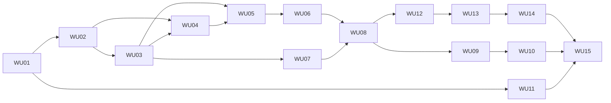

# PLAN-01 Implementation Plan: Backup/Restore U1

- **ID:** PLAN-01
- **Status:** Draft — implementation-design stage, pending conductor review. This is not a gate approval.
- **Date:** 2026-11-22
- **Slice:** U1 (localhost, one configured local instance, synthetic fixtures only, administrator-only).

Provenance labels: **[O]** Observed (source cited), **[UP]** User-provided (project owner, 2026-11-22, via conductor AskUserQuestion), **[A]** Assumption (impact and validation given), **[E]** Estimate, **[D]** Design decision proposed here (not approved), **[Q]** Open question.

## 1. Purpose

Turn the approved U1 direction into an ordered, test-first build plan. It names the work units (WU-01..WU-15), the existing files each one changes, and the new files each one creates. It also covers rollout, rollback, risks and the handoff to the builder-verifier. Identifiers (F-xx, IF-xx, TS-xx, CFG-xx, T-xx, R-xx) follow the design spine used by the conductor. Qualified forms are used where an ID is ambiguous: "Availability A-03" versus "assumption A-03", and "a11y A11Y-01" versus "acceptance AC-001". Work units are WU-nn because analysis already uses U-01..U-07 for unknowns.

## 2. Source inputs

Relative to this file (`develop/implementation-design/`):

- Analysis, problem framing: [acceptance-criteria](../../analyze/problem-framing/acceptance-criteria.md), [user-stories](../../analyze/problem-framing/user-stories.md), [problem-statement](../../analyze/problem-framing/problem-statement.md), [success-measures](../../analyze/problem-framing/success-measures.md), [stakeholder-map](../../analyze/problem-framing/stakeholder-map.md)
- Analysis, context and risk: [constraints-and-assumptions](../../analyze/context-and-risk/constraints-and-assumptions.md), [risk-register](../../analyze/context-and-risk/risk-register.md), [quality-requirements](../../analyze/context-and-risk/quality-requirements.md), [open-questions](../../analyze/context-and-risk/open-questions.md), [evidence-log](../../analyze/context-and-risk/evidence-log.md)
- Ideate, direction selection: [recommended-direction](../../ideate/direction-selection/recommended-direction.md), [decision-record](../../ideate/direction-selection/decision-record.md), [scope-boundary](../../ideate/direction-selection/scope-boundary.md), [architecture-design](../../ideate/direction-selection/architecture-design.md), [threat-model](../../ideate/direction-selection/threat-model.md), [gate-recommendation](../../ideate/direction-selection/gate-recommendation.md)
- Ideate, option generation: [solution-options](../../ideate/option-generation/solution-options.md), [trade-off-matrix](../../ideate/option-generation/trade-off-matrix.md)
- Repository context: `docs/features/backup-restore.md`, `docs/architecture/`, `docs/development/agent-team.md`, `README.md`, `.aidlc/knowledge/_codebase-map.md`, `PROJECT.md` (placeholder).
- Backend and frontend research reports, relayed by the conductor. **[O]** by relay. Claims that matter were re-checked where noted, and a builder should open the cited file before relying on the rest.

## 3. Owner decisions recorded

Attribution for every item below: **project owner (solo scope; owner also acts as architect/operations/security approver for this intent), 2026-11-22, via conductor AskUserQuestion [UP]**. In solo scope the project owner is the sole approver. No separate architect, operations or security person approved anything; none is claimed.

1. **ADR-002 (Q-01), ADR-003 (Q-02), ADR-004 (Q-03) APPROVED as proposed.**
   - Public terminal `incomplete` status, with downloads always denied.
   - A new `domain_backup` crate owns jobs, migrations, the state machine and lifecycle integration. The gateway only composes.
   - A durable allocation ledger: register-before-write, inventory reconciliation, bounded idempotent cleanup, fail-closed on DB outage.
2. **Q-05 finite bounds APPROVED for U1** (localhost, synthetic fixtures only). Implement as configuration with exactly these defaults, enforced by tests (TS-01, TS-30):
   - Staging expiry 24 h (CFG-05).
   - Orphan grace 1 h (CFG-06).
   - Sweep at startup, then every 15 min (CFG-07).
   - Cleanup retry 3 attempts with 1-minute backoff (CFG-08, CFG-09).
   - Job deadline 10 min (CFG-10).
   - Temporary bytes 256 MiB per allocation and 1 GiB total (CFG-12, CFG-13).
   - 1 concurrent job (CFG-11).
   - Job metadata and idempotency-key retention 30 days (CFG-14).
   - Escalation to the project owner via a visible admin-UI status (CFG-15).
   - **Validation rule (functional-design F-01) [D]:** the owner approved exact values. Any CFG-05..CFG-14 value other than its owner-approved default makes backup disabled with `disabled_reason` `INVALID_CONFIG`. DB CHECK constraints are safety ceilings only. Changing a bound requires a new owner decision. TS-02 covers default, below and above cases per key.
3. **Scope and authorization CONFIRMED (Q-08, Q-09, Assumption A-04).**
   - Admin-UI first. There is no CLI work beyond keeping the existing backup CLI fail-closed.
   - One configured local instance, with no cross-instance mapping.
   - Every backup endpoint and resource is restricted to the existing `my-headless-cms-administrator` Supabase app role. Writers are excluded.
4. **Threat model T-01..T-14 ACCEPTED as mandatory construction requirements** (recorded as approved by the project owner (solo scope; owner also acts as architect/operations/security approver for this intent), 2026-11-22).
   - Each is traced to a test in section 6 ("Test traceability for T-01..T-14").
   - A final security evidence check happens at the release-candidate gate.
   - T-15..T-17 remain deferred with real packages.

### 3.1 Still open or not authorized (do not represent as decided)

- **Open [Q]:** Q-04 Supabase Auth/Storage recovery, Q-06 RPO/RTO, Q-07 production policy, Q-10 consistency, Q-11 encryption and keys. Q-12 baseline is also open, because no suite has been run.
- **Open [Q], missing owner approval (hard stop for WU-04, WU-05, WU-06; same blocker in functional-design 1.1 and 4.2, interfaces-and-contracts 8 and work-units WU-04..WU-06):** the CFG-04 fixture storage location and its protection. The owner approved numeric bounds only; CFG-04 private permissions is a design choice [D], not an owner-approved protection. Either the owner approves a storage location and protection, or records that CFG-04 private permissions are sufficient for synthetic U1 data. Still OPEN, not decided.
- **Open [Q], T-14 on Windows (hard stop on WU-04):** the host is Windows 11 and U1 verifies no owner-only ACL, so TS-31 is partial evidence for T-14. Before WU-04 is done, the owner must accept the ACL limitation, or an ACL inspection test must be added. Still OPEN.
- **Open [Q], owner decision needed before WU-10 is done (T-13 ingress limits):** CFG-17 (`BACKUP_REQUEST_TIMEOUT_SECS`) and CFG-18 (`BACKUP_MAX_HEADER_BYTES`) have NO approved default and are not Q-05 values. They are required config: when backup is enabled and either is absent or invalid, backup is disabled with `disabled_reason` `INVALID_CONFIG`. The ingress layers and TS-55 are built in WU-10 (single owning unit), so the owner must supply values before WU-10 can be completed (it may be coded against test values, but no default ships). Config validation of CFG-17/CFG-18 is in WU-01 (TS-02).
- **Open [Q], release effect (hard stop before WU-02 and WU-10 merge to `main`):** `.github/workflows/release-my-cms-image.yml` releases a Docker image on every push to `main` touching `apps/api/**` [O: lines 3-10], and `apps/api/Dockerfile` runs `my-cms-api`. If backup migrations run unconditionally, a released image would create `backup_*` tables in any database it connects to, including production. Production use and release are not authorized. The owner must decide before merge (keep U1 off `main`, or accept conditional migration registration, see section 7).
- **Open, unnumbered [Q]:**
  - Audit-record retention. U1 keeps all audit rows.
  - Non-owner technical guards: JSON body cap 16 KiB, list page size 20 (max 100), fixed fixture size, 60 s DB recovery probe interval. The owner may confirm or replace them.
- **Not authorized:** real-data staging, upload or preflight acceptance, restore execution, downloads, production use, any `succeeded` job, any `recovery-required` outcome. No U1 job may terminate `succeeded`.
- **Hard stop, needs an owner decision now (RK-15, now Observed):** posts and seo share the default `seaql_migrations` table, and sea-orm-migration 1.1.20 `Migrator::up` returns `DbErr::Custom("Migration file of version ... is missing")` for any applied version the migrator does not know [O: `~/.cargo/registry/.../sea-orm-migration-1.1.20/src/migrator.rs:98-133`, `exec_up` around line 360-374; `apps/api/domain_seo/src/migrations/mod.rs` and `domain_posts/src/migrations/mod.rs` have no `migration_table_name` override]. The gateway runs posts then seo on one connection (`gateway/src/main.rs:89-106`), so by the code seo's `up` should fail on any database where posts has run, and `main` would exit before serving; the docker-swarm `migrate up` command has the same exposure. Gateway boot is a prerequisite for the WU-10 runtime start, TS-41 and release-candidate E2E evidence. The baseline must still confirm it by running (not yet run). Owner decision needed before WU-02's "upgrade beside posts and seo" case, WU-10 and WU-15: either (a) authorize a separate-table fix for seo or posts as a prerequisite outside U1, or (b) descope gateway-boot evidence (TS-41 and the runtime start) and record it as a residual for the release-candidate gate.
- **Open [Q, E2E-ENV-01], blocks WU-13/WU-14 browser verification:** locally the admin UI runs on `localhost:3002` and calls the API cross-origin at `localhost:8989` [O: `apps/web/rsbuild.config.ts` server.port 3002 with no proxy; `apps/web/public/config.js` `restApiUrl`]. The gateway applies no CORS layer (RK-05), so preflighted requests (Authorization, JSON Content-Type, Idempotency-Key) cannot succeed from a browser. In the docker-swarm stack Traefik allows only `Authorization,Content-Type,apikey` (no `Idempotency-Key`) and exposes no `Idempotent-Replay` header [O: `deployments/docker-swarm/apps/docker-compose.yaml:147`; `deployments/docker-swarm/traefik/dynamic/my-cms.yml:119-124`], and `HOST=0.0.0.0` [O: `deployments/docker-swarm/apps/.env.example:39`] would trip the F-39 loopback guard. The conductor or owner must choose: (a) same-origin dev proxy (rsbuild `server.proxy`), (b) a loopback-only CORS allowance for the `/backup` routes that allows `Idempotency-Key` and exposes `Idempotent-Replay` (this conflicts with the TS-07 no-CORS-exception rule and would need that test revised), or (c) API-level E2E only, with the UI covered by component tests. CFG-16 origins must match the chosen path. Until decided, only the API-level part of TS-41 is specified.
- **Decided by approval, documented as D-10: the status enum is NOT narrowed.** ADR-002 was approved as proposed [UP] and says to add terminal `incomplete` "retaining existing values for compatibility" [O: decision-record.md line 41]. The public and persisted enum therefore keeps every existing documented value (including `succeeded` and `recovery-required`) and adds `incomplete`. U1 makes `succeeded` and `recovery-required` unreachable by three structural means: the state-machine guard, a DB constraint or trigger on `backup_jobs` that rejects those values for U1 job kinds, and a serializer/API that never emits them for U1 jobs. The web zod schema and UI accept and render all values with exhaustive handling, and download is always denied. The WU-01/TS-11 test is "no transition, write or projection can produce `succeeded` or `recovery-required` for a U1 job". Nothing in this plan is contingent on D-10.
- **[D] awaiting confirmation at the plan gate (ADR-005 mechanisms):**
  - Audit written in the same DB transaction as job acceptance.
  - The NamespaceLock mechanism and its Windows behaviour.
  - The RED-GREEN-REFACTOR-per-work-unit test sequencing rule. It resolves the conflict between `docs/features/backup-restore.md` §13 (`test-after`) and `docs/development/agent-team.md`.
  - The T-13 mitigation designs: ingress timeout and header-size layers (CFG-17, CFG-18), bounded inventory with a truncation flag, and the closed metric label set.
- **Hard stops applied to work units (copy for the builder; work-units.md carries the same):** WU-04, WU-05, WU-06 blocked on the CFG-04 storage location and protection approval; WU-04 also blocked on the T-14 Windows ACL acceptance or an added ACL inspection test; WU-02 and WU-10 "Blocked by [Q]: owner decision on migration gating / release effect (RK-16); no merge to main until decided"; WU-10 also carries the RK-15 runtime-start condition (WU-02 upgrade case too); WU-10 Done when also requires owner values for CFG-17 and CFG-18 to be recorded (WU-08 is not blocked by them); WU-13, WU-14 browser verification blocked on E2E-ENV-01. Each affected unit in section 6 repeats its blocker.

## 4. Ideate gate pre-construction conditions: current status

Source: [gate-recommendation](../../ideate/direction-selection/gate-recommendation.md), "Before construction can resume" (items 1..5). Status below is as of this draft.

| # | Condition | Current status | Evidence |
|---|---|---|---|
| 1 | Written approvals of ADR-002, ADR-003, ADR-004 | **Satisfied in solo scope.** Approved by the project owner (solo scope; owner also acts as architect/operations/security approver for this intent), 2026-11-22. No separate architect or operations person approved, and none is claimed. | Owner decision 1 [UP] |
| 2 | Finite values for Q-05 (the gate text includes storage protection) | **Partly satisfied.** Numeric bounds and the escalation owner are approved [UP]. Storage location and protection are NOT owner-approved [Q]; private permissions (CFG-04, T-14) is only a design choice [D]. Encryption is not claimed (Q-11 open). WU-04, WU-05 and WU-06 are blocked until the owner approves a location and protection, or records that CFG-04 is enough for synthetic U1. | Owner decision 2 [UP]; gate-recommendation line 220; scope-boundary Q-05 blocker row |
| 3 | Threat-model security review and approval | **Satisfied in solo scope for acceptance; evidence pending.** T-01..T-14 accepted as mandatory by the project owner (solo scope; owner also acts as architect/operations/security approver for this intent), 2026-11-22. No separate security reviewer approved, and none is claimed. T-14 is only partly evidenced on Windows (hard stop on WU-04). T-15..T-17 are deferred. The final evidence check is at the release-candidate gate. | Owner decision 4 [UP] |
| 4 | Owner confirmation of Q-08/Q-09 and the authorization matrix (A-04) | **Satisfied.** | Owner decision 3 [UP] |
| 5 | Toolchain readiness (Q-12) | **Still open.** Toolchain is present: cargo 1.100.0, rustc 1.100.0, pnpm 10.30.3, node v24.18.0 [O by conductor, 2026-11-22]. No baseline has been run. Docker availability for testcontainers is unverified. The red-tests stage runs the baseline (RK-01, RK-02). | Conductor observation |

## 5. Approach and sequencing

**Approach.** Build bottom-up behind ports with the fail-closed posture first. The pure domain (types, state machine, config) comes first. Persistence, then the lifecycle, then the HTTP surface and gateway composition, then the web UI, then the verification sweep. Each work unit is a RED-GREEN-REFACTOR loop [D, D-07]: the red-tests stage writes failing tests, build makes them pass, and verify records evidence. The 80% coverage figure is a measurement, not a gate. CI is only marked disabled by a comment (RK-09); its PR trigger is active, so no green CI is claimed.

**Structural invariants (enforced by construction, not convention):**
- **[D, D-10, consistent with approved ADR-002]** The status enum is not narrowed: it keeps every existing documented value and adds `incomplete`. `succeeded` and `recovery-required` are unreachable for U1 jobs by the state-machine guard, a DB constraint or trigger on `backup_jobs`, and a serializer/API that never emits them (TS-11, TS-12b). The web side handles all values exhaustively and always denies download (TS-12a).
- Only `FixtureCaptureAdapter` and `FsFixtureStorage` exist in the crate. No input or env switch selects a real adapter (TS-10).
- Real upload, preflight, restore and download always deny (IF-05..IF-08). The body is not read.
- Audit is consulted before effects. When the audit store is unavailable the operation is refused (TS-15).
- `BACKUP_ENABLED` defaults to false and is forced false on a non-loopback bind (CFG-01, F-39). `disabled_reason` is the closed set `NOT_CONFIGURED | NON_LOOPBACK_BIND | INVALID_CONFIG | null` (`INVALID_CONFIG` = enabled but invalid configuration, including any CFG-05..CFG-14 value other than its approved default and missing CFG-16, CFG-17 or CFG-18).
- Host and Origin control (T-04): CFG-16 `BACKUP_ALLOWED_ORIGINS`, 403 `HOST_NOT_ALLOWED` and 403 `ORIGIN_NOT_ALLOWED`, evaluated after authentication and role assertion (TS-59).
- T-13 mitigations are designed, not deferred: ingress request-timeout and header-size layers on the backup router (CFG-17, CFG-18; no approved default), bounded inventory (`FixtureStorage::inventory` takes a max-entries bound and returns a truncation flag; reconciliation fails closed on truncation), and a closed metric label set (`job_kind`, `outcome`, `error_code` only; no ids, paths or actor). Traced to TS-55, TS-56, TS-57.

Dependency graph (Mermaid):

Text fallback (edge list, identical in this plan, functional-design section 9 and work-units.md): WU-01 -> WU-02; WU-01 -> WU-11; WU-02 -> WU-03; WU-02 -> WU-04; WU-03 -> WU-04 (the audit port and sink are created in WU-03); WU-03 -> WU-05; WU-04 -> WU-05; WU-03 -> WU-07; WU-05 -> WU-06; WU-06 -> WU-08; WU-07 -> WU-08; WU-08 -> WU-09; WU-08 -> WU-12; WU-09 -> WU-10; WU-12 -> WU-13; WU-13 -> WU-14; WU-14 -> WU-15; WU-10 -> WU-15; WU-11 -> WU-15. `work-units.json`, if produced, must use this list.

**Startup order at runtime (design, section 5.3 of the spine):** validate config and loopback guard; gateway runs migrations; `BackupRuntime::start` with admissions closed (namespace lock, epoch bump, job and inventory reconcile, cleanup pass); open admissions and start worker and 15-minute sweeper. Until the last step, handlers return 503 `BACKUP_NOT_READY`.

## 6. Work-unit task breakdown

All new Rust paths are under `apps/api/domain_backup/` unless stated. Web paths are under `apps/web/src/`. Tests are inline `#[cfg(test)]` (Rust) or colocated `*.test.ts(x)` (web), per observed convention. [O]

### WU-01 Scaffold, domain types, config, clock, errors
- **Existing files changed:** `apps/api/Cargo.toml` (add `"domain_backup"` to members).
- **New files:** `Cargo.toml`, `src/lib.rs`, `src/domain/{mod,status,state_machine,config,error,response,clock}.rs`.
- **Covers:** F-01 (config, including the F-39 loopback guard evaluated in `BackupConfig::from_env`, owner path `domain/config.rs`; the closed `disabled_reason` set `NOT_CONFIGURED | NON_LOOPBACK_BIND | INVALID_CONFIG | null`; any CFG-05..CFG-14 value other than its owner-approved default gives `INVALID_CONFIG`), F-15 (pure guards), CFG-01..CFG-18 (CFG-16 `BACKUP_ALLOWED_ORIGINS`; CFG-17 and CFG-18 ingress limits with no approved default, required when enabled). **AC:** acceptance AC-002 S3; AC-002 S2 and AC-003 S3 (bounds and cleanup behaviour, traced together with AC-006 S2); AC-006 S2. **Stories:** US-02, US-03, US-04, US-06. **Tests:** TS-01, TS-02 (per-key default, below and above cases; CFG-16..CFG-18 validation), TS-08a (unit test of `is_loopback_bind` in `domain/config.rs`; AC-005 S1, T-04; the F-39 guard itself lives here), TS-11 (pure part: no transition, write or projection can produce `succeeded` or `recovery-required` for a U1 job; the enum itself is not narrowed, D-10).
- **Notes:** `domain_seo` is the structural precedent [O] (administrator-only domain with its own migrations, entities, `migrations_cli`, and a `run_migrations` and `startup_health` override in `service.rs`); follow its lib attributes and layout. `domain_media` owns no migrations [O: `service.rs:79-82` returns an empty Vec] and is only a precedent for the HTTP layout. Neither `fd-lock` nor `fs4` is in `apps/api/Cargo.lock` [O], so adding one is a new network dependency. Prefer std `File::try_lock` (available in the observed rustc 1.100.0; confirm in `cargo check`). `tokio-util` is already in the lockfile [O]. Validate with `cargo check -p domain_backup`.

### WU-02 Migrations, entities, trigger guards, migrator table name
- **Existing files changed:** none planned. Follow `domain_seo`: start the testcontainer in-crate (dev-dependency `testcontainers`), and do not change `apps/api/test_helpers/src/lib.rs` unless a reason is recorded (it depends on `domain_posts` and is a dev-dependency of several crates) (RK-04).
- **New files:** `src/migrations/{mod,m20261122_000001_backup_core,m20261122_000002_backup_terminal_guards}.rs` (`mod.rs` holds `BACKUP_MIGRATION_IDS` and `migration_descriptors()`, like `SEO_MIGRATION_IDS`), `src/entities/{mod,backup_jobs,backup_idempotency,backup_audit,backup_allocations,backup_epoch}.rs`, `src/migrations_cli.rs` (`run`, `revert`, `list_identities` only, as in `domain_seo`; `connect` and `handle_args` exist only in `domain_posts`).
- **Covers:** F-37 (migrations part), tables in spine section 4.4. **AC:** acceptance AC-002 S3; AC-005 S1. **Stories:** US-02, US-05, US-06. **Depends on:** WU-01. **Tests:** TS-34, TS-11 (DB part: a constraint or trigger on `backup_jobs` rejects `succeeded` and `recovery-required` for U1 job kinds while the existing values stay valid), TS-66 (down migration and revert keep audit rows).
- **Blocked by [Q]:** owner decision on migration gating / release effect (RK-16); no merge to main until decided. The "upgrade beside posts and seo" case is also blocked by the RK-15 owner decision (section 3.1).
- **Notes:** the `MigratorTrait::migration_table_name()` override hook exists [O: sea-orm-migration 1.1.20 `src/migrator.rs:65`]. No override exists anywhere in `apps/api` [O: grep finds only a comment at `domain_posts/src/migrations_cli.rs:103`]; `domain_seo/src/migrations/mod.rs` is a plain `impl MigratorTrait`. WU-02 therefore introduces the first override, `seaql_migrations_backup` (D-02), and must test it beside the shared default `seaql_migrations` table used by posts and seo. Raw SQL through `execute_unprepared` has precedent in sibling migrations [O: `domain_seo/.../m20260822_000001_seo_head_assets.rs:11,26-27`; `domain_posts/.../m20260531_000001_pgvector.rs:14,108`]; the trigger behaviour itself is still to be tested (D-08). **Pre-existing risk RK-15** (below): posts and seo share the default table.

- **Done when:** the migrations are proven on the real Postgres version, `seaql_migrations_backup` is tested beside the shared default table, and TS-34 and TS-66 are recorded green. Blocked by [Q]: owner decision on migration gating / release effect (RK-16); no merge to main until decided.

### WU-03 Job store with CAS, claim, concurrency index
- **New files:** `src/ports/{mod,job_store,audit}.rs`, `src/infra/{mod,db_job_store,db_audit_sink}.rs`. The audit port and `DbAuditSink` are created here (not in WU-07) so that WU-04 and WU-05 can write audit rows in the same transaction; this creates the dependency edge WU-03 -> WU-04.
- **Covers:** F-15, F-16 (claim), F-34 (audit port and sink). **AC:** acceptance AC-002 S2, S3; AC-005 S2. **Stories:** US-02, US-06. **Depends on:** WU-02. **Tests:** TS-14a, CAS race tests (unit-owned, no TS id), TS-69 (audit sink records in the caller's transaction; rollback leaves no audit row; AC-005 S2, T-08). F-34 (`AuditSink::record`, `ports/audit.rs`, `infra/db_audit_sink.rs`) is owned here.
- **Notes:** compare-and-set on status plus `state_version`. The partial unique index on `(instance_id) WHERE status IN ('queued','running')` enforces concurrency 1 durably.

### WU-04 Allocation ledger, fixture storage, namespace lock
- **New files:** `src/ports/{allocation_store,fixture_storage,namespace_lock}.rs`, `src/infra/{db_allocation_store,fs_fixture_storage,fs_namespace_lock}.rs`.
- **Covers:** F-21..F-24. **AC:** acceptance AC-003 S3; AC-002 S2 (budgets and cleanup, traced together with AC-006 S2); AC-006 S2. **Stories:** US-02, US-03, US-04. **Depends on:** WU-02, WU-03 (audit port and sink). **Tests:** TS-19, TS-30 (budget part), TS-31, TS-32 (lock part), TS-56 (store part; the reconciler part is in WU-06: `FixtureStorage::inventory` takes a max-entries bound and returns a truncation flag; reconciliation fails closed on truncation).
- **Blocked by [Q]:** owner approval of the CFG-04 fixture storage location and protection, or an owner record that CFG-04 private permissions suffice for synthetic U1 (section 3.1). Still OPEN.
- **Hard stop (T-14, partial on Windows):** TS-31 gives no owner-only ACL check on Windows, so T-14 is only partly evidenced. WU-04 is not done until the owner accepts the ACL limitation or an ACL inspection test is added.
- **Notes:** Windows path, junction and reparse-point tests are required. The lock crate choice and Windows behaviour are unproven (RK-06); include a two-process test.

### WU-05 Worker, fixture capture, terminal rules, deadline
- **New files:** `src/lifecycle/{mod,worker,fixture_capture}.rs`, `src/ports/capture.rs`.
- **Covers:** F-16..F-20. **AC:** acceptance AC-002 S1..S3. **Stories:** US-02, US-06. **Depends on:** WU-03, WU-04. **Tests:** TS-05a, TS-47, TS-48, TS-67 (worker claim CAS: one winner under duplicate dispatch, a late worker cannot overwrite a terminal job), TS-68 (deadline test `worker::tests::deadline_exceeded_fails_job`: a job reaches `incomplete` or `failed` with `DEADLINE_EXCEEDED`, never `succeeded`), TS-44b (job part: `job.running`, `job.incomplete`, `job.failed` audit events have actor, instance, job, time and outcome populated; no excluded fields; AC-005 S2, T-09). **Blocked by [Q]:** the CFG-04 storage location and protection approval (section 3.1).

### WU-06 Reconciler, fence, cleaner, retry, sweeper, retention, runtime, crash matrix
- **New files:** `src/lifecycle/{runtime,reconciler,cleaner,sweeper}.rs`.
- **Covers:** F-25..F-33. **AC:** acceptance AC-002 S2; AC-003 S3; AC-006 S2 (cleanup and bounds, traced together with AC-002 S2 and AC-003 S3). **Stories:** US-02, US-03, US-04, US-06. **Depends on:** WU-05. **Tests:** TS-20..TS-26, TS-27a, TS-28, TS-29 (ten crash windows), TS-30, TS-32, TS-42, TS-56 (reconciler fail-closed on truncation; the store part is in WU-04), TS-65 (audit unavailable refuses the deletion claim, the deletion commit and the retention purge, T-08), TS-44b (allocation part: allocation audit events have actor, instance, job, time and outcome populated; no excluded fields; AC-005 S2, T-09). **Blocked by [Q]:** the CFG-04 storage location and protection approval (section 3.1).
- **Notes:** uses `FakeClock` and fault-injecting wrappers behind `#[cfg(test)]` or a `test-util` feature.

### WU-07 Idempotency, atomic acceptance
- **New files:** `src/domain/idempotency.rs`, `src/handlers/create_job/{create_job_handler,request,response}.rs` (logic). `ports/audit.rs` and `infra/db_audit_sink.rs` now live in WU-03; this unit uses them.
- **Covers:** F-05..F-08; F-34 consumed (owned by WU-03). **AC:** acceptance AC-002 S1; AC-005 S2, S3. **Stories:** US-02, US-05, US-06. **Depends on:** WU-03. **Tests:** TS-13, TS-14b, TS-15, TS-16, TS-44a (`job.accepted` audit event has actor, instance, job, time and outcome populated; no excluded fields; AC-005 S2, T-09).
- **Notes:** job, idempotency row and `job.accepted` audit commit in one transaction [D, awaiting ADR-005 confirmation]. The replay check runs before the concurrency check.

### WU-08 Authorization, instance registry, REST read/create adapters, status, error projection
- **New files:** `src/service.rs` (overrides `run_migrations` and `startup_health`, as `domain_seo` does), `src/domain/{policy,instance}.rs`, `src/api/{mod,routes,state,extract}.rs`, `src/handlers/{create_job,list_instances,get_job,list_jobs,status}/...` (`create_job` HTTP adapter here; its logic is WU-07), `src/observability/` (functional-design lists this module; assigned to WU-08).
- **Covers:** F-02..F-04, F-09, F-10, F-35, F-36, F-37; IF-01..IF-04, IF-11. Host/Origin control (CFG-16, 403 `HOST_NOT_ALLOWED` / `ORIGIN_NOT_ALLOWED`, precedence after 401 and `ROLE_REQUIRED`); route-local 16 KiB body cap; closed metric label set (`job_kind`, `outcome`, `error_code`). **AC:** acceptance AC-001; AC-002 S1; AC-005 S1, S2. **Stories:** US-01, US-02, US-05, US-06. **Depends on:** WU-06, WU-07. **Tests:** TS-04, TS-05b, TS-06, TS-12b, TS-17 (API outputs), TS-27b, TS-45, TS-49, TS-57, TS-59 (Host/Origin), TS-60 (16 KiB body cap, 413 `PAYLOAD_TOO_LARGE`), TS-61 (IF-03 limit/cursor 400), TS-62 (415 unsupported media type), TS-63 (malformed JSON, unknown field, non-UUID path). The CFG-17/CFG-18 ingress layers and TS-55 belong to WU-10 (one owning unit, see WU-10); WU-08 handlers must not depend on them, and WU-08 is not blocked by the CFG-17/CFG-18 owner values.
- **Notes:** actor extraction is Observed (RK-03): handlers take `Extension<AuthenticatedActor>` [O: `domain_seo/src/api/mod.rs:37`], inserted by `SupabaseAuthMiddleware` [O: `domain_auth/src/lib.rs:179-185`]. Re-assert in the handler with `actor.has_any_role(&["my-headless-cms-administrator"])` from a non-empty constant, because `has_any_role(&[])` returns true [O: `domain_interface/src/lib.rs:140-146`]; add a unit test that an empty role list cannot be passed. The error body adds `reason_code` and `correlation_id`.

### WU-09 Disabled capabilities, download denial, previews
- **New files:** `src/handlers/{download_denied,disabled_capability,preview}/...`, `src/domain/fixtures.rs`.
- **Covers:** F-11..F-14; IF-05..IF-10. **AC:** acceptance AC-002 S3; AC-003 S3; AC-004 S1, S2 (AC-004 S3, restore failure, is deferred in test-strategy: restore execution is not authorized in U1). **Stories:** US-02, US-03, US-04, US-06. **Depends on:** WU-08. **Tests:** TS-09, TS-10, TS-43, TS-53, TS-64 (IF-09/IF-10 identification fields for AC-004 S1), with body-not-read spies.

### WU-10 Gateway integration, runtime start, loopback guard, composed-router security
- **Existing files changed:** `apps/api/gateway/Cargo.toml` (add `domain_backup`); `apps/api/gateway/src/main.rs` (extend `manifest(...)`, register a sixth service under `Mount::Administrator` whose routers declare absolute `/backup/...` paths (the registration `prefix` is only a diagnostics label and the gateway merges routers without nesting, as seo does), call runtime start after `run_orchestrator`, call `BackupConfig::from_env` (which evaluates the loopback guard), update test `manifest_with_five_services_returns_five_entries` to 6); `apps/api/gateway/src/migrate_cli.rs` (chain backup identities into `all_migration_identities`; also the `run_up_orchestrator` call `crate::manifest(media_config, user_state)` at line 99, which must build a disabled, not-started backup state because the new `manifest(...)` parameter changes the `migrate up` path too). Existing tests to update by name: `all_migration_identities_include_seo_after_posts` (asserts the last identity is `m20260822_000001_seo_head_assets`, `migrate_cli.rs:171-174`; it breaks if backup identities are chained after seo, so update it, or chain backup before seo and say why). Existing-test edits are limited to this and the manifest-count test.
- **Existing files changed:** `apps/api/domain_interface/src/lib.rs` (new `Mount` variant, see Ingress layer ordering below; extend its `Mount` serde test), `apps/api/gateway/src/main.rs` (`compose_routers`, ingress layers, tests).
- **Covers:** F-37..F-39; ingress request-timeout (CFG-17) and header-size (CFG-18) gateway layers on the backup router (F-38), built here in `gateway/src/main.rs` (T-13 design). **AC:** acceptance AC-001; AC-005 S1; AC-002 S1 (ingress limits). **Stories:** US-01, US-05, US-06. **Depends on:** WU-09. **Tests:** TS-03, TS-07, TS-08b (gateway wiring / effective loopback bind test in `gateway/src/main.rs`; the F-39 guard and its unit test TS-08a live in `BackupConfig::from_env`, WU-01, `domain/config.rs`, and `main.rs` only calls it), TS-55 (red test for the CFG-17/CFG-18 ingress layers: oversized headers get 431 before 401; a slow authenticated request past CFG-17 gets 408; a violating request gets a safe error and never reaches the handler, and non-backup routes are unaffected), manifest test updated to 6. TS-34 ("upgrade beside posts and seo"), TS-41 (E2E) and the runtime start after `run_orchestrator` are blocked by RK-15, which is Observed from the library and gateway code (section 3.1): seo's `up` should fail wherever posts has run. This is a pre-existing defect, not caused by U1, and needs an owner decision (separate-table prerequisite fix, or descope and record a residual). Do not fix seo or posts inside U1 without it.
- **Blocked by [Q]:** owner decision on migration gating / release effect (RK-16); no merge to main until decided. **RK-15 runtime-start condition:** the runtime start after `run_orchestrator`, the TS-34 upgrade case and TS-41 run only after the owner decides the RK-15 path (a) or (b) (section 3.1). Both remain OPEN, not decided.
- **Ingress layer ordering (F6, gateway change specified, option a) [D]:** today `compose_routers` (`apps/api/gateway/src/main.rs`) merges every `Mount::Administrator` registration into one router and applies the single `administrator_layer` (`auth_layer_from_env` with role `my-headless-cms-administrator`) to the merge, so no per-registration layer can sit outside authentication. `RouteRegistration` has exactly the fields `mount`, `router`, `prefix` and is built by struct literal at 14 sites [O: grep, 2026-11-22], so adding a field would force edits in every domain. Decision: add a new `Mount` variant `Mount::AdministratorIngress` in `domain_interface/src/lib.rs` (the backup domain registers with it; every other domain is untouched; its serde form follows the existing lowercase rule and the `Mount` serde tests are extended). `compose_routers` gets a match arm that merges these registrations into a SEPARATE router `backup_admin`. That router is wrapped, outermost to innermost: timeout layer (CFG-17, 408 `REQUEST_TIMEOUT`) -> header-size layer (CFG-18, 431 `HEADER_TOO_LARGE`) -> administrator auth layer (a second `auth_layer_from_env` call with the same role) -> backup routes; the result is then merged with `public`, `protected` and `administrator`. Expected effect, to be proved by TS-55: an oversized-header request on a backup route is answered 431 before 401; a request whose inner processing exceeds CFG-17 is answered 408 (a 408-before-401 ordering is not observable because auth rejects from the header alone; slow header delivery is handled by hyper and is a T-13 residual); and non-backup routes (public, protected, other administrator routes) are unaffected. With no backup registration, `backup_admin` is empty and behaviour is unchanged. Existing tests that must stay green (rerun, in `gateway/src/main.rs`): `compose_routers_supplies_cookie_extractor_to_domain_routes`, `compose_routers_traces_health_requests_without_changing_response`, `compose_routers_traces_rejected_protected_requests_without_calling_handler`. Not yet implemented or run.
- **Done when:** TS-03, TS-07, TS-08b, TS-55 green; the three `compose_routers_*` tests above green; `manifest_with_five_services_returns_five_entries` updated to 6. Blocked by [Q]: owner decision on migration gating / release effect (RK-16); no merge to main until decided. RK-15 runtime-start condition resolved by owner or recorded as descoped residual. Owner values for CFG-17/CFG-18 recorded (the layers and TS-55 live here; WU-10 may be coded against test values, no default ships).
- **Migration gating [Q, owner decision blocks WU-10 merge]:** the baseline design in functional-design F-37 and interfaces-and-contracts 5.6 registers the migrations and chains `list_identities` into `all_migration_identities` unconditionally. This plan does not choose gating. Options: (1) keep U1 off `main` and register unconditionally; (2) conditional registration, in which case `migration_descriptors`, `run_migrations` and `all_migration_identities` must return the empty set when `BACKUP_ENABLED` is false or the loopback guard fails, with tests for enabled, disabled and non-loopback cases, and the `migrate up` path building a disabled state. Until decided, WU-02 must prove the migrations on the real Postgres version before any merge, and a failure in them aborts gateway start (`main.rs:158-161`).
- **Notes:** confirmed [O] by grep on 2026-11-22 that `cors_layer` and `body_limit_layer` are defined in `domain_posts/src/domain/layers.rs` but not applied in the gateway (RK-05). Backup adds neither; the 16 KiB cap is route-local. RK-07: prove no cookie authorizes a mutation. Env documentation: `README.md` has no environment section [O]; document the U1 runtime keys (CFG-01..CFG-18; CFG-17 and CFG-18 have no default) in `deployments/docker-swarm/apps/.env.example` and the `migrate_cli` USAGE text, or add a new README section (builder to choose and record). Keep them clearly separate from the legacy CLI keys `BACKUP_S3_ENDPOINT` and `BACKUP_LOCAL_ROOT` read by `gateway/src/backup_cli.rs:74,101-102`; `BACKUP_LOCAL_ROOT` is easy to confuse with the new `BACKUP_STORAGE_ROOT` (CFG-04). work-units WU-10 "every `BACKUP_*` key" should read "every U1 key".

### WU-11 CLI fail-closed tests and doc reconciliation
- **Existing files changed:** `apps/api/gateway/src/backup_cli.rs` (tests and a module-doc note only; no behaviour change).
- **Covers:** F-40. **AC:** acceptance AC-002 S2. **Stories:** US-02, US-06. **Depends on:** WU-01. **Tests:** TS-33. The CLI `Manifest.outcome` ("success"/"failed") is documented as a separate legacy vocabulary, never mapped to job status. The tautological test `reports_missing_credentials_without_echoing_secrets` is noted and not touched.

### WU-12 Web foundation: types, API helpers, REST client
- **Existing files changed:** `apps/web/src/config/api.config.ts` (backup URL helpers).
- **New files:** `domains/backup.ts` (zod schemas, types and the typed `authenticatedFetch(getApiUrl(...))` REST client) and `domains/backup.test.ts`. **[O]** The REST precedent is `domains/seo-head-asset.ts` with `seo-head-asset.test.ts`; `infrastructure/das/` holds only the Apollo GraphQL helper `categories.das.ts` and is not used (D-13).
- **Covers:** F-41. **AC:** acceptance AC-001 S1; AC-002 S1. **Stories:** US-01, US-02, US-05, US-06. **Depends on:** WU-08 (contract). **Tests:** TS-52 (client part: strict zod parsing and unknown-status tolerance, in `domains/backup.test.ts`); feeds TS-12a. The zod status schema accepts every existing documented status value plus `incomplete` (D-10) and the `disabled_reason` closed set `NOT_CONFIGURED | NON_LOOPBACK_BIND | INVALID_CONFIG | null`. JSON is sent with an explicit `Content-Type`, because `authenticatedFetch` does not set one [O].

### WU-13 Web page, route, menu, instance selector, create panel
- **Existing files changed:** `apps/web/src/App.tsx` (route `/admin/backup` inside `ProtectedRoute > AdminLayout > AdminOnlyRoute`); `apps/web/src/app/admin/components/left-menu.tsx` and `left-menu.test.tsx` ("Backup & Restore" under Administration, gated by `isAdministrator`).
- **New files:** `app/admin/backup/page.tsx` (+ test), `components/{instance-selector,job-create-panel}.tsx` (+ tests).
- **Covers:** F-42..F-44. **AC:** acceptance AC-001; AC-002 S1. **Stories:** US-01, US-02, US-05, US-06. **Depends on:** WU-12. **Tests:** TS-35, TS-38, TS-46, TS-52 (panel part). Browser verification blocked on E2E-ENV-01. The client guard is UX only; the server enforces.

### WU-14 Web status, polling, preview, banner, accessibility
- **New files:** `components/{backup-status-banner,job-status-badge,job-list,job-detail,synthetic-preview-panel}.tsx`, `hooks/{use-backup-jobs,use-backup-status}.ts` (each with tests). No `hooks/` directory exists anywhere in `apps/web/src` [O], so this is a new pattern, recorded as deviation D-12.
- **Covers:** F-45..F-49. **AC:** acceptance AC-002 S1, S3; AC-003 S3; AC-004 S1, S2; AC-005 S2; AC-006 S2. **Stories:** US-02, US-03, US-04, US-05, US-06. **Depends on:** WU-13. **Tests:** TS-12a, TS-18, TS-36, TS-37, TS-50, TS-51. Browser verification blocked on E2E-ENV-01. No polling hook exists in the app [O], so this is new code using `vi.useFakeTimers`. All server strings render as React text. There is no download control for any status, and every status value (including `succeeded` and `recovery-required`) renders through exhaustive handling.

### WU-15 Verification sweep
- **Existing files changed:** `docs/features/backup-restore.md` (record the `incomplete` contract, §12), `docs/architecture/software-architecture.md` (add `domain_backup`; it lists four domains while its closing text says five [O]).
- **Depends on:** WU-10, WU-11, WU-14. **AC:** acceptance AC-002; AC-005; AC-006. **Stories:** US-02, US-04, US-05, US-06.
- **Activities:** canary and end-to-end evidence, latency measurement (no target claimed), record the CI and coverage state (RK-09) and the `migrate down`/`status` limit (RK-08). **Tests:** TS-17 (full, including bundle scan), TS-39..TS-41, TS-58. TS-41 UI part blocked by E2E-ENV-01 and the gateway-boot part by RK-15. Final security evidence check for T-01..T-14.
- `.github/workflows/ci-my-cms.yml` stays read-only.

### Test traceability for T-01..T-14
Full sets, equal to the test-strategy threat table:

| T | Primary | Additional |
|---|---|---|
| T-01 | TS-03 | TS-35 (UX only) |
| T-02 | TS-04 | TS-05a, TS-05b |
| T-03 | TS-06 | TS-38, TS-45, TS-46, TS-63 |
| T-04 | TS-08a, TS-08b (loopback guard F-39), TS-59 (Host/Origin, CFG-16), TS-07 | TS-02 (CFG-16 validation), TS-62; residual: reverse proxy |
| T-05 | TS-09 | TS-10, TS-33, TS-41, TS-43, TS-47, TS-53, TS-64 |
| T-06 | TS-11 | TS-12a, TS-12b, TS-41, TS-47, TS-49 |
| T-07 | TS-13 | TS-14a, TS-14b, TS-52, TS-67 |
| T-08 | TS-15 | TS-16, TS-65, TS-66, TS-69 |
| T-09 | TS-17 (including bundle scan) | TS-44a, TS-44b, TS-49, TS-57, TS-66 |
| T-10 | TS-18 | TS-12a |
| T-11 | TS-19 | TS-32 |
| T-12 | TS-20..TS-29 (with TS-27a, TS-27b) | TS-32, TS-47, TS-48, TS-50, TS-67, TS-68 |
| T-13 | TS-30 | TS-01, TS-02, TS-14a, TS-14b, TS-27a, TS-27b, TS-36, TS-40, TS-42, TS-48, TS-50, TS-55 (CFG-17/CFG-18 ingress limits), TS-56 (bounded inventory), TS-57 (closed metric labels), TS-60 (16 KiB cap), TS-61, TS-68 |
| T-14 | TS-31 (**partial on Windows**: no owner-only ACL check) | TS-02; hard stop on WU-04 until the owner accepts the limitation or an ACL inspection test is added |

Test-id numbering follows the test-strategy case table, TS-01..TS-69 (TS-54 unused; TS-08 and TS-44 are retired and replaced by TS-08a/TS-08b and TS-44a/TS-44b). Ids beyond the original TS-01..TS-60 and their units: TS-61 (IF-03 400, WU-08), TS-62 (415, WU-08), TS-63 (malformed JSON or non-UUID path, WU-08), TS-64 (IF-09/IF-10 identification fields, WU-09), TS-65 (audit-unavailable deletion and purge, WU-06), TS-66 (revert keeps audit rows, WU-02), TS-67 (worker claim CAS, WU-05), TS-68 (deadline test, WU-05), TS-69 (audit sink records in the caller's transaction; rollback leaves no audit row, WU-03).

## 7. Rollout, rollback and feature-disable

- **Rollout [D]:** localhost only, run through `cargo run` on the host with a loopback `HOST`, not through the documented docker-swarm stack (its `HOST=0.0.0.0` trips the F-39 guard and its Traefik CORS allow-list lacks `Idempotency-Key`; see E2E-ENV-01 in section 3.1). The feature is off unless `BACKUP_ENABLED=true`, with `BACKUP_INSTANCE_ID`, `BACKUP_INSTANCE_LABEL` and `BACKUP_STORAGE_ROOT` set. The storage root must be absolute, private and outside static or web build paths. Missing or invalid values refuse the capability with a secret-free message.
- **Loopback guard:** if `HOST` is not loopback, the backup capability is forced disabled (reason `NON_LOOPBACK_BIND`). Handlers then return 503 `BACKUP_DISABLED`.
- **Feature disable:** unset `BACKUP_ENABLED` or set it to `false` and restart. Admissions stay closed and the UI shows the disabled state. No existing tables are altered. Limit: if the backup migrations are registered unconditionally, they still run when disabled, and a failure in them (the raw-SQL triggers, D-08) would abort gateway startup (`main.rs:158-161` returns `ExitCode::FAILURE`), so disabling the flag would not help and rollback would need a code revert. Hence the migration-gating decision in WU-10 (section 3.1, owner decision): conditional registration, or keep U1 off `main` and prove the migrations on real Postgres in WU-02. While disabled, no cleaner runs: queued or running jobs and existing allocations wait and are fenced and reconciled at the next enabled start.
- **Release effect [Q]:** merging to `main` auto-releases an image (`release-my-cms-image.yml`) that would apply backup migrations to any database it connects to, including production, if registered unconditionally. Not authorized; see section 3.1 and RK-16.
- **Rollback:** revert the code. The `backup_*` tables and `seaql_migrations_backup` are left in place, which is harmless because nothing else reads them. Dropping them is manual and is not automated. `migrate down` and `status` forward only to `domain_posts` [O], so they do not cover the backup migrator (RK-08). Files in the storage root are synthetic and non-sensitive, and are removed by the cleaner while the feature is enabled, or manually.
- **Data safety:** U1 stages synthetic bytes only, so no production data is at risk. Passing U1 tests does not enable real staging.

## 8. Risks carried forward

| ID | Risk | Mitigation |
|---|---|---|
| RK-01 | Test baseline unknown (Q-12, risk R-07). Historical baseline [O, unverified]: 8 `domain_posts` failures and 2 Docker-ignored tests. | Red-tests stage runs `cargo test`, `pnpm test`, lint and fmt before WU-01 tests, and records pre-existing failures. |
| RK-02 | Docker may be unavailable on the host. | Ports are designed so pure logic tests need no Docker. Baseline reports Docker status. DB-backed tests are reported as not run, never as passed. |
| RK-03 | Actor extraction: Observed. `Extension<AuthenticatedActor>` inserted by `SupabaseAuthMiddleware` [O: `domain_auth/src/lib.rs:179-185`; `domain_seo/src/api/mod.rs:37`]; `has_any_role(&[])` is true [O: `domain_interface/src/lib.rs:140-146`]. | WU-08 re-asserts with a non-empty role constant and a unit test. |
| RK-04 | `test_helpers` migrates `domain_posts` only [O] and depends on `domain_posts`. | Prefer in-crate testcontainers as `domain_seo` does; change `test_helpers` only with a stated reason. |
| RK-05 | CORS and body-limit layers unused in gateway [O: grep of `apps/api`, 2026-11-22]. Browser admin UI cannot call the API cross-origin without a decision (E2E-ENV-01). | Route-local 16 KiB cap; no CORS exception (TS-07) unless the owner chooses option (b) in section 3.1. |
| RK-06 | NamespaceLock and Windows behaviour unproven. | Two-process test and Windows link tests in WU-04. Use std `File::try_lock` to avoid a new crate (`fd-lock` and `fs4` are absent from `Cargo.lock` [O]). |
| RK-07 | Cookie manager is installed though auth is Bearer. | Composed-router test that no cookie authorizes mutation. |
| RK-08 | `migrate down`/`status` skip the backup migrator. | Rollback by disable plus retain ledger; documented in WU-15. |
| RK-09 | `ci-my-cms.yml` is marked `TEMPORARY DISABLED` by a comment only; its `pull_request` (to `main`) and `workflow_dispatch` triggers are active and it runs `cargo test --all --all-features --no-fail-fast` on nightly with `-Zpanic_abort_tests` [O: `.github/workflows/ci-my-cms.yml:3-7,28-34`]. Whether it actually runs is unverified. | Do not claim a green CI. Record the state. `--all-features` compiles any `test-util` feature, so fault wrappers (WU-06) must stay unreachable in production composition even with it enabled; prefer `#[cfg(test)]`. |
| RK-10 | `AGENTS.md` referenced by `docs/development/agent-team.md` but not found at the repo root. | Verification commands come from `README.md` and `package.json`. |
| RK-11 | Enum consumers. | None found in code [O]; the consumer inventory stays in the ADR-002 evidence. |
| RK-12 | Non-owner technical guards. | Flag to the owner; keep configurable constants. |
| RK-13 | Audit retention undecided. | U1 keeps all audit rows; purge skips them. |
| RK-14 | Q-04, Q-06, Q-07, Q-10, Q-11 open. | Make no claim of production, consistency, encryption or recovery readiness. |
| RK-15 | **Observed (derived from code; baseline still to confirm by running):** posts and seo share the default `seaql_migrations` table. Neither migrator overrides the table name [O: `domain_seo/src/migrations/mod.rs`, `domain_posts/src/migrations/mod.rs`]; sea-orm-migration 1.1.20 `up` fails with `DbErr::Custom("Migration file of version ... is missing")` for applied versions the migrator does not know [O: `migrator.rs:98-133`, `exec_up` ~360-374]; `gateway/src/main.rs:89-106` runs posts then seo on one connection; `deployments/docker-swarm/apps/docker-compose.yaml:78` runs `migrate up`. `domain_seo/src/integration_tests.rs:31` runs only the seo migrator on a fresh DB, which hides it. | Owner decision before WU-02 upgrade case, WU-10 and WU-15 (section 3.1). Baseline confirms by running `migrate up` twice on one DB or booting the gateway. Do not fix seo or posts in U1 without that decision. |
| RK-16 | Merging to `main` auto-releases an image (`release-my-cms-image.yml`, `Dockerfile` CMD `my-cms-api`) that may apply backup migrations to production databases [O]. Release is not authorized. | Owner decision on migration gating (conditional registration or keep U1 off `main`) before WU-02 and WU-10 merge (section 3.1). |

## 9. Deviations from existing conventions

| ID | Deviation | Reason |
|---|---|---|
| D-01 | New `domain_backup` crate with its own migrator | ADR-003 approved [UP] |
| D-02 | Migration table `seaql_migrations_backup` | Avoid version disagreement with other migrators. No existing override exists to copy [O]; this is the first one (hook at `migrator.rs:65`) |
| D-03 | Handlers and routes share `handlers/<op>/` (media splits `api/<op>` and `handlers/<op>`) | Keeps the crate small; no behavioural impact |
| D-04 | Crate-local response copy adds `Unavailable` (503) and `UnsupportedMediaType` (415) | Existing `ErrorCode` has no 503; media mirrors posts the same way |
| D-05 | `manifest(...)` gains a backup state parameter; gateway calls `runtime::start` after migrations | `DomainService` has no start hook; changing it would touch every domain |
| D-06 | Work units named WU-nn | Avoid collision with analysis U-01..U-07 |
| D-07 | RED-GREEN-REFACTOR per work unit; coverage is a measurement | Resolves the test-after conflict; pending plan-gate confirmation |
| D-08 | Raw-SQL triggers on `backup_jobs` and `backup_audit` | Defense in depth; **[A]** validate in WU-02 |
| D-09 | `BACKUP_ENABLED` defaults to false | Fail-closed; not an owner value |
| D-10 | Status enum handling: the enum is NOT narrowed. Existing documented values (including `succeeded` and `recovery-required`) are kept and `incomplete` is added, per approved ADR-002. U1 makes the two unreachable (state-machine guard, DB constraint or trigger for U1 job kinds, serializer never emits them); web accepts and renders all values and always denies download | Makes "no U1 job may succeed" structural without departing from the owner-approved ADR-002 |
| D-11 | (interfaces-and-contracts D-11) Backup wire format keeps snake_case and bare, non-enveloped bodies, unlike existing camelCase `{message, data}` / `{errorCode, errors}` | Unambiguous, testable contract; `ForBidden` and `UnAuthorized` both serialize to "401". Plan-gate item |
| D-12 | New `hooks/` directory for polling hooks in `app/admin/backup/` | No polling hook or `hooks/` directory exists [O] |
| D-13 | Web REST client placement: `apps/web/src/domains/backup.ts` with tests in `apps/web/src/domains/backup.test.ts`; `infrastructure/das` is not used | Observed REST precedent is `domains/seo-head-asset.ts` and its test; `das/` holds only an Apollo helper [O]. This follows the observed convention, so it is a placement decision rather than a departure |

## 10. Handoff to builder-verifier

1. Run the baseline first (RK-01, RK-02): `cargo check`, `cargo test`, `cargo fmt -- --check`, `cargo clippy` from `apps/api`; `pnpm test`, `pnpm lint`, `pnpm exec tsc --noEmit` (the last is **[A]**, there is no typecheck script), `pnpm build` from `apps/web`. Record pre-existing failures separately from new ones.
2. Execute WU-01..WU-15 in the order of section 5. Write failing tests first (the TS ids on each unit equal the test-strategy work-unit mapping), then implement, then refactor.
3. Never add a path that makes `succeeded` or `recovery-required` reachable for a U1 job (the enum keeps its existing values, D-10), a download path, a real adapter, or a browser-supplied URL, secret or DSN.
4. Treat any missing approval in section 3.1 as a hard stop for the affected work. Do not invent defaults for open items.
5. Do not edit `.github/workflows/ci-my-cms.yml` or existing tests beyond those listed. Report evidence honestly, including tests that could not run.

## 11. Spine discrepancies

- **Resolved by the conductor (2026-11-22):** approval attribution (solo scope, C13), enum handling (D-10, no narrowing), deviation IDs (D-10..D-13), test-id numbering (test-strategy canonical, TS-01..TS-69), the web client path, the audit port placement, the WU-15 edges and the T-13 designs are settled in this plan. The earlier entries about gate-text roles, the das path, the D-10 contingency and the missing WU-15 edge no longer apply.
- **RK-05 Observed.** The spine and other artifacts label it `[A]` or mixed; a grep of `apps/api` found only the definitions of `cors_layer` and `body_limit_layer` in `domain_posts/src/domain/layers.rs` and no application in the gateway. Other artifacts should use the same Observed label. No ID changed.
- **F-37 spans three units.** WU-02 (migrations), WU-08 (service) and WU-10 (gateway composition), as in work-units and functional-design.
- **`domain_seo` migration-table handling.** `domain_seo` has no table-name override [O]; any artifact saying otherwise is wrong and must be aligned to interfaces-and-contracts' note.
- **Not re-verified.** The `DomainService` trait tail (the research report truncated the read) and the `left-menu.test.tsx` contents were not opened. They remain **[A]** items.
- **TS-56 is split:** store part in WU-04, reconciler fail-closed part in WU-06 (functional-design 9 should list it on both rows).
- **New test ids TS-61..TS-68** are all present in the test-strategy case table (AC, T, WU) and WU mapping; none is introduced by this plan.

## 12. Uncertainty and limits

- No test, build or baseline has been run. Nothing here is implemented. Evidence is limited to the relayed research reports, the inputs listed in section 2, and one grep.
- Dependency versions, trigger behaviour in SeaORM migrations (raw-SQL precedent is Observed), `File::try_lock` behaviour on Windows, whether RK-15 actually fails, and Docker availability are **[A]**.
- Estimates (body cap, page size, probe interval, fixture size) are **[E]** and not owner-approved. CFG-17 and CFG-18 carry no value at all until the owner supplies one.
- Open owner decisions that remain open: CFG-04 storage location and protection, T-14 Windows ACL acceptance, migration gating and release effect (RK-16), RK-15, E2E-ENV-01, CFG-17/CFG-18 values.
- AC-004 S3 (restore failure) is deferred in test-strategy because restore execution is not authorized in U1.
- The Mermaid diagram was not rendered by a tool; the text fallback is the authoritative order.
