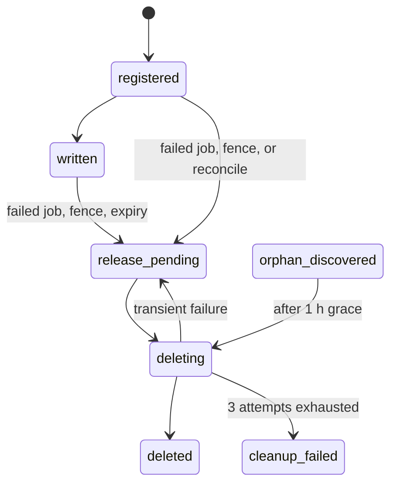

# Interfaces and Contracts (IFC-01)

- ID: IFC-01
- Stage: Develop / implementation-design
- Status: Draft — implementation-design stage, pending conductor review
- Slice: Backup/Restore U1 (localhost, one configured local instance, synthetic fixtures only)

## Purpose

This artifact fixes every interface contract for U1: REST endpoints (IF-01..IF-11), the job status enum and its consumer compatibility plan, the idempotency contract, the database schema, the allocation ledger protocol and crash matrix, the audit record schema, configuration keys, internal Rust traits, the error taxonomy, and versioning. Identifiers (F-xx, IF-xx, WU-xx, TS-xx, CFG-xx, T-xx) follow the design spine. Qualified IDs are used where ambiguous (for example "acceptance AC-002 S1").

## Source inputs

Relative links from this file's directory (`develop/implementation-design/`):

- [Acceptance criteria](../../analyze/problem-framing/acceptance-criteria.md)
- [User stories](../../analyze/problem-framing/user-stories.md)
- [Constraints and assumptions](../../analyze/context-and-risk/constraints-and-assumptions.md)
- [Risk register](../../analyze/context-and-risk/risk-register.md)
- [Quality requirements](../../analyze/context-and-risk/quality-requirements.md)
- [Open questions](../../analyze/context-and-risk/open-questions.md)
- [Decision record (ADR-001..ADR-005)](../../ideate/direction-selection/decision-record.md)
- [Architecture design](../../ideate/direction-selection/architecture-design.md)
- [Threat model T-01..T-17](../../ideate/direction-selection/threat-model.md)
- [Scope boundary](../../ideate/direction-selection/scope-boundary.md)
- Repository context: `D:\orca\my-cms\makara\docs\features\backup-restore.md`, `apps/api/gateway/src/main.rs`, `apps/api/gateway/src/backup_cli.rs`, `apps/api/domain_interface/src/lib.rs`, `apps/api/domain_media/src/api/routes.rs`.

## Provenance labels

- [O] Observed (source cited, or relayed from the parallel research reports; open the file before relying on it heavily).
- [UP] User-provided: "project owner, 2026-11-22".
- [A] Assumption (impact and validation given).
- [E] Estimate.
- [D] Design decision proposed here; a proposal for the plan gate, not an approval.
- [Q] Open question.

This is a design artifact, not a phase-gate approval. Baseline and implementation evidence are maintained separately: `develop/baseline.md` records the 2026-11-22 baseline (290 normal passes; 39/39 ignored passes); WU-01..WU-05 have completed build-and-verify records; WU-06 store implementation and focused tests are recorded green, while its full regression gate remains pending WU-17/18/19; WU-17/18/19 lifecycle tests are present and failing pending its own work. Only [UP] items are approved.

## 1. Approval status and boundaries

| Item | Status | Provenance |
|---|---|---|
| ADR-002 (Q-01) add public terminal `incomplete`, retaining the existing documented status values, downloads always denied | APPROVED as proposed | [UP] |
| ADR-003 (Q-02) new `domain_backup` crate owns jobs, migrations, state machine, lifecycle; gateway composes only | APPROVED as proposed | [UP] |
| ADR-004 (Q-03) durable allocation ledger, fail-closed on DB outage | APPROVED as proposed | [UP] |
| Q-05 bounds (CFG-05..CFG-14 exact values; CFG-15 owner value `project_owner`) | APPROVED for U1; changing a bound requires a new owner decision | [UP] |
| Scope: admin-UI first, one local instance, administrator role only (Q-08, Q-09, A-04) | CONFIRMED | [UP] |
| Threat model T-01..T-14 | ACCEPTED as mandatory construction requirements | [UP] |
| Attribution of the above approvals | project owner (solo scope; owner also acts as architect/operations/security approver for this intent), 2026-11-22. No separate architect or security person approved anything. | [UP] |
| Mechanism designs: audit in the acceptance transaction; NamespaceLock and its Windows behaviour (ADR-005) | Proposed, awaiting plan-gate confirmation | [D] |

Still open and not decided: Q-04 (Supabase Auth/Storage recovery), Q-06 (RPO/RTO), Q-07 (production policy), Q-10 (consistency), Q-11 (encryption/keys), Q-12 (test baseline), P-01..P-05 performance targets, audit-record retention. Real-data staging, upload/preflight acceptance, restore execution, downloads and production use are NOT authorized. No U1 job may terminate `succeeded`.

Non-owner technical guards used in this document (flagged, owner may confirm or replace) [E]: JSON body cap 16 KiB; list page size 20 (max 100); fixed synthetic fixture size (code constant, well under CFG-12); recovery probe interval 60 s; `Idempotency-Key` format 8..=128 chars of `[A-Za-z0-9_-]` (RK-12); UI polling constants (section 3.2); allowed Host/Origin policy (section 2.1, CFG-16); inventory entry cap (section 9). CFG-17 and CFG-18 (ingress timeout and header size) deliberately have NO proposed value (section 8).

Deviation IDs used consistently across all five artifacts (D-01..D-09 unchanged, see the plan) [D]:

| ID | Deviation | Reason |
|---|---|---|
| D-10 | Status enum handling. ADR-002 was approved as proposed and says to add terminal `incomplete` while retaining existing values, so the public and persisted enum is NOT narrowed: it keeps every documented value (including `succeeded` and `recovery-required`) and adds `incomplete`. U1 makes `succeeded` and `recovery-required` unreachable by a state-machine guard, a DB constraint and trigger on backup jobs, and a serializer that never emits them for U1 jobs. | Makes "no U1 job may succeed" structural without departing from the approved ADR. This documents the choice; it is not a narrowing awaiting confirmation. |
| D-11 | Backup wire format keeps snake_case fields and bare (non-enveloped) success bodies, unlike the observed camelCase `{message, data}` / `{errorCode, errors}` convention of existing domains. | See section 2.1 for the evidence and consequences. |
| D-12 | New `hooks/` directory for polling hooks in `app/admin/backup/` (owned by the plan; listed for ID consistency only). | No polling hook directory exists [O]. |
| D-13 | Web REST client placement: `apps/web/src/domains/backup.ts`, tests in `apps/web/src/domains/backup.test.ts`; `infrastructure/das` is not used. | Observed REST precedent: `domains/seo-head-asset.ts` with `seo-head-asset.test.ts` [O]; `infrastructure/das` holds only an Apollo helper [O]. |

## 2. REST contract

### 2.1 Conventions [D]

- All routes: prefix `/backup`; registered with `Mount::Administrator` during WU-08/WU-09 and switched to the new `Mount::AdministratorIngress` in WU-10 (see Ingress layers below). The administrator auth layer is the existing `administrator_layer` (`auth_layer_from_env(audience, ["my-headless-cms-administrator"])`) applies; writers receive 403 from that layer [O: gateway/src/main.rs]. The handler re-asserts the administrator role through `AuthenticatedActor.has_any_role` (defense in depth) [O: domain_interface/src/lib.rs].
- Auth: `Authorization: Bearer <access token>`. Cookies never authorize mutations (T-04).
- Content type: `application/json` for bodies; other types on POST /backup/jobs, IF-09 and IF-10 return 415 `UNSUPPORTED_MEDIA_TYPE`.
- JSON wire style (D-11) [D]. Observed convention of existing domains: success is wrapped `ApiResponseWith {message, data}` and errors are `ApiResponseError {errorCode, errors}`, all `#[serde(rename_all = "camelCase")]`; `ErrorCode` serializes to numeric strings (`UnknownError` "0", `UnAuthorized` and `ForBidden` both "401", `NotFound` "404", `Conflict` "409", `ValidationError` "10000") [O: apps/api/domain_posts/src/domain/response.rs lines 18-73; same shape in domain_seo, domain_media, domain_user response.rs]. The web client reads `payload.errorCode` and `payload.data` [O: apps/web/src/domains/seo-head-asset.ts:37-39]. The backup contract deliberately deviates: snake_case fields, bare success bodies (for example `{"job": {...}}`), and a crate-local error body whose `error_code` is a stable coarse NAME string (not the numeric strings, because `ForBidden` and `UnAuthorized` both serialize to "401", which would emit "401" for a 403). Consequence: the web REST client `apps/web/src/domains/backup.ts` (F-41, D-13; tests in `apps/web/src/domains/backup.test.ts`) must parse the backup shapes separately from the existing `{message, data}` / `{errorCode, errors}` parsers (the existing `seo-head-asset.ts` is the REST-in-`domains/` precedent [O]); this is accepted as the cost of an unambiguous, testable contract and is a plan-gate item (D-11). Alternative if the owner prefers consistency: camelCase fields plus the envelope, with new numeric codes for 503 and 415; only names change, not semantics.
- Handler extraction (T-13, D-11): existing sibling handlers use plain `Json<T>` with no custom rejection [O: domain_seo/src/api/mod.rs:38,52], and axum 0.8.9 defaults [O: gateway/Cargo.toml] answer a wrong content type with 415 plain text, a deserialization or unknown-field error with 422 plain text, a bad `Path<Uuid>` with 400 plain text, and an oversized body with 413 plain text. Backup handlers must not copy that pattern. They use `Result<Json<T>, JsonRejection>`, `Result<Path<String>, PathRejection>` and `Result<Query<T>, QueryRejection>` (or custom extractors) and map every rejection to the crate error body: JSON syntax, unknown field or bad type -> 400 `MALFORMED_REQUEST`; wrong content type -> 415 `UNSUPPORTED_MEDIA_TYPE`; non-UUID job path -> 404 `JOB_NOT_FOUND`; body over the cap -> 413 `PAYLOAD_TOO_LARGE`. Each mapping has its own test (test-strategy numbering is canonical): TS-60 (413, 16 KiB body cap), TS-61 (IF-03 limit and cursor 400), TS-62 (415), TS-63 (malformed JSON, unknown field, bad type, non-UUID path). TS-59 is the Host/Origin policy test (T-04).
- Ingress layers (T-13) (F-38, WU-10, AC-002 S1) [D]. Two gateway layers are applied on the backup routes only, outermost (before authentication, so no handler or auth work is done for an abusive request): a request timeout (CFG-17 `BACKUP_REQUEST_TIMEOUT_SECS`) answering 408 `REQUEST_TIMEOUT`, and a header-size limit (CFG-18 `BACKUP_MAX_HEADER_BYTES`, total size of all header names and values) answering 431 `HEADER_TOO_LARGE`; both use the crate error body and never reach a handler (TS-55). CFG-17 and CFG-18 have NO approved default and are not Q-05 values; when `BACKUP_ENABLED=true` and either is absent or invalid, backup is disabled with `INVALID_CONFIG`. Owner values for them are needed before WU-10 (the unit that builds these layers and owns TS-55) [Q]; WU-08 is not blocked by them. [A] The header-size layer inspects the parsed `HeaderMap` (hyper's own pre-parse buffer limit is server-level and not per-route); layer feasibility is validated in WU-10.
- Gateway change that realises the layering (F6, option a; WU-10) [D]. Read from the real code [O: apps/api/gateway/src/main.rs `compose_routers`, lines 238-281; apps/api/domain_interface/src/lib.rs `Mount`, `RouteRegistration`]: today `compose_routers` merges every `Mount::Administrator` registration into ONE router and applies `administrator_layer` (`auth_layer_from_env`, administrator role) to the merge, so a layer placed ahead of authentication for backup alone cannot be expressed. Specified change: (1) add a new variant `Mount::AdministratorIngress` to `domain_interface::Mount` (a mount variant, chosen over a new `RouteRegistration` field because `RouteRegistration {mount, router, prefix}` is built as a struct literal at 14 sites [O: grep, 2026-11-22] and a new field would touch every domain, while the only exhaustive `match` on `Mount` is in `compose_routers` [O: grep; the `Mount` serde tests in `domain_interface` list the three existing variants and stay valid; one case for the new variant is added]). (2) `compose_routers` collects `AdministratorIngress` registrations into a SEPARATE router `backup_admin` and builds it as `backup_admin.layer(administrator_layer.clone()).layer(header_size_layer).layer(timeout_layer)`; in axum the last `.layer` is outermost, so from outermost to innermost the order is: timeout layer (CFG-17) -> header-size layer (CFG-18) -> administrator auth layer -> backup routes. (3) That wrapped router is then merged next to `public`, `protected` and the existing `administrator.layer(administrator_layer)` router, all inside `with_cookie_manager` and the otel layers as today. `Mount::Administrator` registrations (media buckets, SEO and others) are unchanged and receive no ingress layers. `administrator_layer` must be cloneable or built twice [A: `auth_layer_from_env` is called once today; building it a second time is the fallback]. The two ingress layers are implemented as `axum::middleware::from_fn` middlewares so they return the crate error body (a bare `tower_http` timeout returns an empty 408) [A]; their CFG-17/CFG-18 values come from the loaded `BackupConfig`, and when the config state is `Disabled` the layers are not installed because every backup route answers 503 `BACKUP_DISABLED` [A]. Sequencing: the `domain_backup` service registers its routes with `Mount::Administrator` while WU-08 and WU-09 build the handlers (the service is not composed into the gateway until WU-10), and WU-10 changes the registration to `Mount::AdministratorIngress`. Existing gateway tests that must stay green [O: apps/api/gateway/src/main.rs tests]: `compose_routers_supplies_cookie_extractor_to_domain_routes`, `compose_routers_traces_health_requests_without_changing_response`, `compose_routers_traces_rejected_protected_requests_without_calling_handler`. TS-55 asserts that for backup routes oversized headers give 431 before any 401, that a slow authenticated request past CFG-17 gets 408 with the crate error body (a 408-before-401 ordering is not observable because auth decides from the Authorization header alone; slow header delivery is handled by hyper before the router and is a T-13 residual), and that non-backup routes (public, protected, `Mount::Administrator`) are unaffected.
- Host and Origin policy (T-04) [D]. Test TS-59. After authentication and role assertion, every route checks (a) `Host` header: allowed values are the loopback forms (`127.0.0.1`, `localhost`, `[::1]`) with the configured listening port; any other value returns 403 `HOST_NOT_ALLOWED`; (b) `Origin` header on POST requests: if present it must exactly match an entry of CFG-16 `BACKUP_ALLOWED_ORIGINS`, else 403 `ORIGIN_NOT_ALLOWED`; an absent `Origin` is accepted because authorization is a bearer token that a browser does not attach implicitly (cookies never authorize, above). No custom request header is required; the earlier "custom header" wording in TS-07 is dropped in favour of bearer-only auth plus JSON content type [A: impact if the owner wants an additional CSRF header: one added check and one test; validate at the plan gate]. CFG-16 is required when `BACKUP_ENABLED=true`.
- Precedence on every route (first match wins): 431 (header-size layer, CFG-18) -> 401 (layer) -> 408 (timeout layer, CFG-17, can fire at any later point while the inner service runs) -> 403 `ROLE_REQUIRED` (role) -> 403 `HOST_NOT_ALLOWED` / `ORIGIN_NOT_ALLOWED` -> for IF-06..IF-08 only, 403 `CAPABILITY_DISABLED` (returned regardless of `BACKUP_ENABLED`, readiness and `Content-Length`, before any body-limit layer or body read) -> 503 `BACKUP_DISABLED` / `BACKUP_NOT_READY` (IF-01..IF-05, IF-09, IF-10; never IF-11, see 2.10) -> 413 / 415 / 400 request validation -> resource authorization (F-04, 404) -> work. So `DOWNLOAD_DENIED` (IF-05) is only reachable when backup is enabled and ready and the job exists; when disabled, IF-05 returns 503 `BACKUP_DISABLED`. TS-09 is extended with the full precedence matrix (disabled, not ready, unknown job, writer, bad Host, each with its expected code). Note for FD F-11: `DOWNLOAD_DENIED` applies when enabled and ready; the precedence list above governs otherwise.
- Authorization order summary: authenticate (layer) -> role assertion (F-03) -> config and readiness -> resource authorization (F-04) -> work, with the exceptions in the precedence list above. Missing actor or role is denied before config or job lookup.
- Error body (all non-2xx from this crate, including the in-handler role failure):

```json
{
  "error_code": "Forbidden",
  "errors": ["Download is not permitted for backup jobs."],
  "reason_code": "DOWNLOAD_DENIED",
  "correlation_id": "c-7f3a9e12"
}
```

`error_code` is the crate-local coarse name (section 10.1: `ValidationError`, `Unauthorized`, `Forbidden`, `NotFound`, `Conflict`, `PayloadTooLarge`, `UnsupportedMediaType`, `RequestTimeout`, `HeaderTooLarge`, `Unavailable`; D-04 and D-11); `reason_code` is the stable backup code (section 10.1); `errors` carries safe, fixed messages only. A 401 produced by the existing auth layer keeps the layer's own body shape and is outside this contract; the in-handler role failure uses this body with `reason_code` `ROLE_REQUIRED`.

### 2.2 Endpoint table

All error lists below also include 401 (layer), 403 (`ROLE_REQUIRED`, `HOST_NOT_ALLOWED`, `ORIGIN_NOT_ALLOWED`; Origin on POST only) and the ingress-layer errors 408 `REQUEST_TIMEOUT` / 431 `HEADER_TOO_LARGE` (CFG-17, CFG-18) as in the precedence rule; they are repeated only where they matter. This table is the single source for the FD error lists (FD IF-03 must add 400 `MALFORMED_REQUEST`; FD IF-11 must list 401, 403 only).

| ID | Method and path | Auth | Request | Success | Errors | Trace |
|---|---|---|---|---|---|---|
| IF-01 | GET /backup/instances | Admin | none | 200 | 401, 403, 503 BACKUP_DISABLED / BACKUP_NOT_READY / STORE_UNAVAILABLE | F-02; acceptance AC-001 S1; T-03; ADR-001 |
| IF-02 | POST /backup/jobs | Admin | headers Idempotency-Key, Content-Type; body `{instance_id}` | 202 new, 200 replay | 400, 401, 403, 409, 413, 415, 503 | F-05..F-08; acceptance AC-002 S1, AC-005 S2/S3; T-07, T-08, T-13; ADR-005 |
| IF-03 | GET /backup/jobs | Admin | query `limit`, `cursor` | 200 | 400 MALFORMED_REQUEST, 401, 403, 503 BACKUP_DISABLED / BACKUP_NOT_READY / STORE_UNAVAILABLE | F-09; acceptance AC-002 S1; T-02, T-13 |
| IF-04 | GET /backup/jobs/{job_id} | Admin | UUID path | 200 | 401, 403, 404 JOB_NOT_FOUND, 503 BACKUP_DISABLED / BACKUP_NOT_READY / STORE_UNAVAILABLE | F-09; acceptance AC-005 S1; T-02 |
| IF-05 | GET /backup/jobs/{job_id}/download | Admin | none | never | 403 DOWNLOAD_DENIED, 404 JOB_NOT_FOUND, 503 BACKUP_DISABLED / BACKUP_NOT_READY / STORE_UNAVAILABLE | F-11; acceptance AC-002 S3; T-05, T-06; ADR-002 |
| IF-06 | POST /backup/packages | Admin | body not read | never | 403 CAPABILITY_DISABLED (always, even if backup is disabled) | F-12; acceptance AC-003 S3; T-05, T-13 |
| IF-07 | POST /backup/preflight | Admin | body not read | never | 403 CAPABILITY_DISABLED (always) | F-12; acceptance AC-003 S3 |
| IF-08 | POST /backup/restore | Admin | body not read | never | 403 CAPABILITY_DISABLED (always) | F-12; acceptance AC-004 (direct restore denied) |
| IF-09 | POST /backup/previews/preflight | Admin | body `{fixture_id}` | 200 | 400, 401, 403, 413, 415, 503 BACKUP_DISABLED / BACKUP_NOT_READY | F-13; acceptance AC-003 S3, AC-004 S1; T-05, T-13 |
| IF-10 | POST /backup/previews/restore-confirmation | Admin | body `{fixture_id, decision}` | 200 | 400, 401, 403, 413, 415, 503 BACKUP_DISABLED / BACKUP_NOT_READY | F-14; acceptance AC-004 S1, S2; T-05, T-13, T-15 (preview only) |
| IF-11 | GET /backup/status | Admin | none | 200 always (see 2.10) | 401, 403 | F-36; acceptance AC-002 S1, AC-006 S2; T-12 |

Body cap (T-13) [E, D]: routes that read a body (IF-02, IF-09, IF-10) enforce a 16 KiB route-local limit; larger bodies, by declared `Content-Length` or by streamed length, return 413 `PAYLOAD_TOO_LARGE` (tested by TS-60; no separate id). IF-06..IF-08 never read a body and return 403 `CAPABILITY_DISABLED` regardless of `Content-Length`. `limit` above 100 or non-numeric on IF-03 returns 400 `MALFORMED_REQUEST`. [O] The `body_limit_layer` and `cors_layer` factories are defined in `domain_posts/src/domain/layers.rs` (lines 14, 33); a grep of the gateway shows the gateway does not apply them (RK-05 is Observed, not an assumption; the label in FD and the plan should read Observed). The backup crate applies its own route-local limit and adds no CORS layer.

### 2.3 Shared schemas

Job object (IF-02, IF-03, IF-04):

```json
{
  "id": "uuid",
  "instance_id": "string",
  "instance_label": "string",
  "operation": "backup_db_slice",
  "status": "queued | running | incomplete | failed | succeeded | recovery-required",
  "reason_code": "string | null",
  "synthetic": true,
  "download_eligible": false,
  "components": [
    {"name": "database | auth | storage",
     "state": "synthetic_captured | unavailable",
     "reason_code": "string | null"}
  ],
  "progress": {"completed": 0, "total": 0},
  "correlation_id": "string",
  "created_at": "RFC 3339",
  "started_at": "RFC 3339 | null",
  "finished_at": "RFC 3339 | null"
}
```

Rules: `status` documents the full retained enum (D-10); for U1 jobs only `queued`, `running`, `incomplete` and `failed` are ever emitted, `succeeded` and `recovery-required` never are. `synthetic` is always true and `download_eligible` always false (F-10). `progress` is null unless measured fixture counters exist. `components` is `[]` until the worker records outcomes. No raw error text, paths, SQL or keys appear in any field.

Status object (IF-11):

```json
{
  "state": "ready | not_ready | degraded | disabled",
  "disabled_reason": "NOT_CONFIGURED | NON_LOOPBACK_BIND | INVALID_CONFIG | null",
  "db_healthy": true,
  "admissions_open": true,
  "synthetic_only": true,
  "reconciliation": {"last_completed_at": "RFC 3339 | null", "last_result": "string | null"},
  "cleanup": {"pending": 0, "exhausted": 0, "orphan_discovered": 0, "ownership_incidents": 0},
  "escalation": {"owner": "project_owner", "visible": false}
}
```

`escalation.visible` is true when `cleanup.exhausted > 0` or `ownership_incidents > 0` or state is degraded. Rule (IF-11 never returns 503): the response is always 200 for an authorized administrator and is answered from the in-memory runtime handle. When backup is disabled, `state` is `disabled` with `disabled_reason`; when the DB is down, `db_healthy` is false, `state` is `degraded` (or `not_ready` before first reconcile), and the DB-derived values (`reconciliation`, `cleanup` counts) are `null`. The UI shows the disabled state and the banner from this body (F-49). One disabled-reason vocabulary is used everywhere (FD F-01, the 503 `BACKUP_DISABLED` handling, IF-11): `NOT_CONFIGURED` (`BACKUP_ENABLED` not true), `NON_LOOPBACK_BIND`, `INVALID_CONFIG` (enabled but a required value is missing or invalid, or any CFG-05..CFG-14 bound differs from the owner-approved default, or CFG-16/CFG-17/CFG-18 is absent or malformed; no value is echoed). The closed set is exactly `NOT_CONFIGURED | NON_LOOPBACK_BIND | INVALID_CONFIG | null`; the web zod schema uses the same set. Cross-artifact alignment required [D]: FD section 5 IF-01/IF-03/IF-11, FN F-36 and FD 7.3 must add the `disabled` state and state that IF-11 never returns 503 (FD IF-11 currently allows 503 `STORE_UNAVAILABLE`; this document supersedes it because the answer comes from the in-memory handle); TS-50 and TS-27b are extended to assert the `disabled` state and each `disabled_reason`.

### 2.4 IF-01 GET /backup/instances

Response 200:

```json
{
  "synthetic": true,
  "instances": [
    {"id": "local-1", "label": "Local development instance", "environment": "local",
     "operations": ["backup_db_slice"],
     "capabilities": {"create": true, "upload": false, "preflight": false,
                      "restore": false, "download": false}}
  ]
}
```

Exactly zero or one instance. When `BACKUP_ENABLED` is false or the bind is non-loopback: 503 `BACKUP_DISABLED`. The UI disables submission on an empty or failed list (F-43).

### 2.5 IF-02 POST /backup/jobs

Request:

```
POST /backup/jobs
Authorization: Bearer <token>
Idempotency-Key: 6b0c1f52-3d34-4e0b-9a8c-0f1d2c3b4a59
Content-Type: application/json

{"instance_id": "local-1"}
```

Body rules (F-05): strict `deny_unknown_fields`; only `instance_id` accepted; any URL, DSN, key, target or `synthetic` field is rejected with 400 `MALFORMED_REQUEST` (T-03, T-05). An `instance_id` not equal to the configured instance returns 400 `INSTANCE_NOT_ALLOWED`.

Response 202 (new job, example of the accepted state):

```json
{"job": {"id": "0b6f0f0e-6a9c-4f51-8f3c-3d2a1c9e7a10", "instance_id": "local-1",
  "instance_label": "Local development instance", "operation": "backup_db_slice",
  "status": "queued", "reason_code": null, "synthetic": true, "download_eligible": false,
  "components": [], "progress": null, "correlation_id": "c-7f3a9e12",
  "created_at": "2026-11-22T10:00:00Z", "started_at": null, "finished_at": null}}
```

Replay (same key, same fingerprint): 200 with header `Idempotent-Replay: true` and the current state of the existing job, after F-04 authorization.

Incomplete example (IF-04 later in the same job's life; the normal U1 terminal outcome):

```json
{"job": {"id": "0b6f0f0e-6a9c-4f51-8f3c-3d2a1c9e7a10", "instance_id": "local-1",
  "instance_label": "Local development instance", "operation": "backup_db_slice",
  "status": "incomplete", "reason_code": "REQUIRED_COMPONENTS_UNAVAILABLE",
  "synthetic": true, "download_eligible": false,
  "components": [
    {"name": "database", "state": "synthetic_captured", "reason_code": "DB_SYNTHETIC_ONLY"},
    {"name": "auth", "state": "unavailable", "reason_code": "AUTH_NOT_CAPTURED"},
    {"name": "storage", "state": "unavailable", "reason_code": "STORAGE_NOT_CAPTURED"}],
  "progress": {"completed": 1, "total": 1}, "correlation_id": "c-7f3a9e12",
  "created_at": "2026-11-22T10:00:00Z", "started_at": "2026-11-22T10:00:01Z",
  "finished_at": "2026-11-22T10:00:02Z"}}
```

Failed example (deadline):

```json
{"job": {"id": "5c1e8d2a-1b7f-4c3d-8a55-9e0f6b7d2c31", "instance_id": "local-1",
  "instance_label": "Local development instance", "operation": "backup_db_slice",
  "status": "failed", "reason_code": "DEADLINE_EXCEEDED", "synthetic": true,
  "download_eligible": false, "components": [], "progress": null,
  "correlation_id": "c-aa01b2c3", "created_at": "2026-11-22T11:00:00Z",
  "started_at": "2026-11-22T11:00:01Z", "finished_at": "2026-11-22T11:10:01Z"}}
```

Error examples:

- 400 missing key: `{"error_code":"ValidationError","errors":["Idempotency-Key header is required."],"reason_code":"IDEMPOTENCY_KEY_REQUIRED","correlation_id":"c-1"}`
- 409 reuse: `{"error_code":"Conflict","errors":["Idempotency key was used for a different request."],"reason_code":"IDEMPOTENCY_KEY_REUSED","correlation_id":"c-2"}`
- 409 concurrency: reason `CONCURRENCY_LIMIT` (1 queued or running job per instance).
- 413 oversize: `{"error_code":"PayloadTooLarge","errors":["Request body is too large."],"reason_code":"PAYLOAD_TOO_LARGE","correlation_id":"c-4"}`
- 503 audit down: `{"error_code":"Unavailable","errors":["Service temporarily unavailable."],"reason_code":"AUDIT_UNAVAILABLE","correlation_id":"c-3"}` and no job, no allocation, no "accepted" is produced (T-08).

Status code and code map for IF-02: 400 `IDEMPOTENCY_KEY_REQUIRED`, `IDEMPOTENCY_KEY_INVALID`, `MALFORMED_REQUEST`, `INSTANCE_NOT_ALLOWED`; 401; 403 (`ROLE_REQUIRED`, `HOST_NOT_ALLOWED`, `ORIGIN_NOT_ALLOWED`); 409 `IDEMPOTENCY_KEY_REUSED`, `CONCURRENCY_LIMIT`; 413 `PAYLOAD_TOO_LARGE`; 415 `UNSUPPORTED_MEDIA_TYPE`; 503 `AUDIT_UNAVAILABLE`, `STORE_UNAVAILABLE`, `BACKUP_DISABLED`, `BACKUP_NOT_READY`.

### 2.6 IF-03 and IF-04

IF-03: `GET /backup/jobs?limit=20&cursor=<opaque>`. `limit` default 20, max 100 [E]; larger values or non-numeric return 400 `MALFORMED_REQUEST`. Response `{"jobs":[job...],"next_cursor":"opaque|null"}` ordered by `created_at DESC`, scoped to the configured instance. Cursor is opaque base64 of (created_at, id); invalid cursors return 400.

IF-04: `GET /backup/jobs/{job_id}`. A non-UUID path returns 404 `JOB_NOT_FOUND` (via the `PathRejection` mapping in 2.1, in the crate error body). Unknown and foreign ids are indistinguishable (non-disclosing 404, F-04, T-02).

### 2.7 IF-05 download-denied behaviour

Always 403 `DOWNLOAD_DENIED` after authorization, for every status including `incomplete`, regardless of file presence. No redirect, no URL, no static mapping (F-11, T-05, T-06). An unknown or foreign job returns 404 `JOB_NOT_FOUND` (not 403) so existence is not disclosed. A `download.denied` audit write is attempted; if audit fails the denial is still returned (section 6.3).

```json
{"error_code":"Forbidden","errors":["Download is not permitted for backup jobs."],
 "reason_code":"DOWNLOAD_DENIED","correlation_id":"c-9d41e0aa"}
```

### 2.8 IF-06..IF-08 disabled capabilities

Return 403 `CAPABILITY_DISABLED` without reading the request body, touching storage, creating ledger rows or enqueueing, and regardless of `Content-Length`, `BACKUP_ENABLED` and readiness (F-12; TS-09 uses body-stream-not-polled and side-effect spies, and covers the precedence pairs in 2.1). Audit event `capability.denied` is attempted (denial rule as above). The role layer still runs first, so unauthenticated callers get 401 and writers 403 from the layer.

### 2.9 IF-09 and IF-10 synthetic previews

AC-004 S1 coverage [D]: the scenario requires that the confirmation identify the package, the target environment and the data in scope. U1 delivers this for synthetic fixtures only, as labelled canned values; no real package exists. The IF-09 and IF-10 responses therefore carry `fixture_label`, `target_instance_id`, `target_instance_label`, `target_environment` and `data_scope`. These identify what a real confirmation would show; nothing is replaced, because restore execution is not authorized.

IF-09 request `{"fixture_id": "fixture-valid" | "fixture-incompatible" | "fixture-corrupt"}`. Response 200:

```json
{"synthetic": true, "result": "compatible | incompatible | corrupt",
 "fixture_label": "Synthetic valid fixture",
 "target_instance_id": "local-1",
 "target_instance_label": "Local development instance",
 "target_environment": "local",
 "data_scope": ["database (synthetic rows only)"],
 "impact_summary": "Synthetic preview only. No file was uploaded or read."}
```

Canned results keyed by fixture id (`domain/fixtures.rs`); uploaded files, paths and unknown ids are never accepted (unknown id: 400 `MALFORMED_REQUEST`). The target fields are read from the configured instance (CFG-02, CFG-03; `target_environment` is the constant `local` in U1), never from the request.

IF-10 request `{"fixture_id": "fixture-valid", "decision": "confirm" | "cancel"}`. Response 200:

```json
{"synthetic": true, "executed": false, "decision": "confirm",
 "fixture_label": "Synthetic valid fixture",
 "target_instance_id": "local-1",
 "target_instance_label": "Local development instance",
 "target_environment": "local",
 "data_scope": ["database (synthetic rows only)"],
 "message": "Synthetic preview only. Nothing was recorded and no restore was performed."}
```

`executed` is always false. The handler is stateless, has no mutation port, records nothing and enqueues nothing (TS-43, which must also assert the message text). The identification fields are asserted at API level by TS-64 (IF-09 and IF-10; TS-51 stays the web component test of F-47) and in the UI by F-47's component test. The preview touches T-15 only as a labelled preview. AC-004 S2 (cancel) is covered by `decision: "cancel"` returning the same shape with no side effect.

### 2.10 IF-11 GET /backup/status

Returns the status object in 2.3; always 200 for an authorized administrator (see the rule there). Example when cleanup exhausted:

```json
{"state": "degraded", "disabled_reason": null, "db_healthy": true, "admissions_open": true, "synthetic_only": true,
 "reconciliation": {"last_completed_at": "2026-11-22T10:15:00Z", "last_result": "ok"},
 "cleanup": {"pending": 0, "exhausted": 1, "orphan_discovered": 0, "ownership_incidents": 0},
 "escalation": {"owner": "project_owner", "visible": true}}
```

## 3. Status enum contract and consumer compatibility

### 3.1 Contract [D, documents D-10; consistent with the approved ADR-002]

ADR-002 (approved as proposed [UP]) adds terminal `incomplete` while retaining the existing values. This contract follows it: the enum is NOT narrowed (D-10).

- Rust `BackupJobStatus` and TS `BackupJobStatus`: `queued | running | succeeded | failed | recovery-required | incomplete` (the documented values at `docs/features/backup-restore.md` line 239 [O] plus `incomplete`). Wire and DB spelling of the existing values is kept as documented, including `recovery-required` (explicit serde rename) [A: validate in WU-01].
- DB column: text with CHECK over all six values. U1 unreachability of `succeeded` and `recovery-required` is enforced in three independent places: (1) the pure state-machine guard `is_allowed(from, to)` has no edge to either value for U1 job kinds; (2) a DB CHECK `NOT (operation = 'backup_db_slice' AND status IN ('succeeded','recovery-required'))` plus the trigger in 5.1, so no write can set them for a U1 job; (3) the serializer and API projection never emit them for a U1 job (a projection that would emit one is a bug caught by TS-11/TS-12). The WU-01/WU-02 test (TS-11) is "no transition, write or projection can produce `succeeded` or `recovery-required` for a U1 job".
- Web zod schema and UI accept and render all six values with exhaustive handling (a `switch` with a `never` check, plus an unknown-value fallback); download is denied for every value. BR-07's `recovery-required` reporting stays a later-slice rule; the value is retained in the type but unreachable in U1. A later slice that needs `succeeded` removes the guard, DB constraint and projection rule with a new ADR.
- `incomplete` and `failed` are terminal. `incomplete` is normal constrained completion; `failed` means an attempted step failed, timed out or was interrupted with unknown result. Success is never inferred from process exit or file existence.
- `docs/features/backup-restore.md` is updated to state this contract (WU-15); the scope covers every vocabulary site [O: docs/features/backup-restore.md]: line 152 (BR-07 `recovery-required`), line 211 (section 10.2, "U1 jobs end only `incomplete` or `failed`"), line 239 (section 12 enum `queued | running | succeeded | failed | recovery-required`) and line 247 (section 13 `test-after` practice, reconciled with RED-GREEN-REFACTOR, D-07).

### 3.2 Consumer inventory and handling of `incomplete`

Research [O] found no existing code consumer of a backup status enum in `apps/api`, `apps/web` or `packages`; the only definition is documentation. The enum is green-field, so the change is not breaking. Consumers that will exist after U1:

| Consumer | Location | Handling of `incomplete` | Handling of unknown value | Test |
|---|---|---|---|---|
| Rust serializer / DTO projection | `domain_backup/src/handlers/*/response.rs` (F-10) | Emits `incomplete` with `download_eligible:false`; never emits `succeeded` or `recovery-required` for a U1 job | Unrepresentable in the closed Rust enum for unknown values | TS-11, TS-12 |
| DB CHECK and trigger | migrations 000001/000002 | Allowed terminal; no further update | `succeeded` and `recovery-required` rejected for U1 jobs; unknown text rejected | TS-11 (DB part), TS-34 |
| Web types and REST client | `apps/web/src/domains/backup.ts` (F-41, D-13; tests `backup.test.ts`) | zod union includes all six values incl. `incomplete` | zod fallback maps to `unknown` | TS-12, TS-52 |
| `JobStatusBadge`, `JobDetail` | web (F-45) | Text plus icon "Incomplete", label "synthetic, database-only, not restorable", no download control | Exhaustive render of all six values; unknown renders "Unknown status"; download never offered | TS-12, TS-37 |
| `useBackupJobs` polling | web (F-46) | Stops polling at terminal | Treats unknown as non-terminal for at most 10 polls then stops with error banner [D, E] | TS-36 |
| `BackupStatusBanner` | web (F-49) | Not affected | n/a | TS-12 |
| `backup_cli.rs` `Manifest.outcome` | gateway | Not consumed; legacy manifest vocabulary ("success"/"failed") unrelated to job status; documented in module doc; no code coupling | n/a | TS-33 |
| Docs | `docs/features/backup-restore.md` lines 152, 211, 239, 247 | Updated (WU-15); BR-07 stays a later-slice rule | n/a | review |
| Unrelated `JobStatus` | `domain_posts/src/entities/translation_jobs.rs` | Unrelated; no change | n/a | none |

`useBackupJobs` constants [E] (TS-36 asserts them with fake timers): poll every 2 s while any job is non-terminal; on a request error back off by doubling from 2 s to a 30 s ceiling; reset on success; at most 10 polls for an unknown status, then stop with an error banner.

Compatibility rules for later widening: clients must treat unknown status as non-downloadable and non-terminal-success; servers must not emit `succeeded` until a later ADR approves it.

## 4. Idempotency contract

Traces: F-06, F-07, F-08; acceptance AC-005 S2, AC-002 S1; T-07, T-09; Availability A-01, PR-02, PR-04.

- Header `Idempotency-Key` required on POST /backup/jobs; 8..=128 chars of `[A-Za-z0-9_-]` [D, E: not an owner value; a non-owner technical guard for owner confirmation, RK-12]; missing -> 400 `IDEMPOTENCY_KEY_REQUIRED`; malformed -> 400 `IDEMPOTENCY_KEY_INVALID`.
- Scope: `(actor_sub, operation, key)` where `actor_sub = AuthenticatedActor.user_id` [O].
- `key_digest = hex(sha256(actor_sub || 0x1f || operation || 0x1f || key))`. The raw key is never persisted or logged (TS-13, TS-44a).
- `request_fingerprint = hex(sha256(canonical JSON of {operation, instance_id}))`.
- Replay (same digest, same fingerprint): 200, `Idempotent-Replay: true`, existing job after F-04. Different fingerprint: 409 `IDEMPOTENCY_KEY_REUSED`.
- Check order: replay and conflict first, then the concurrency check, so a replay of an accepted job is never answered `CONCURRENCY_LIMIT`.
- Concurrent duplicates and unique violations [D]: the acceptance transaction inserts `backup_jobs` before `backup_idempotency` (F-07), so a racing same-key loser can hit the active-job partial unique index first. Rule: on ANY unique violation (partial index or idempotency UNIQUE) the transaction is rolled back and the handler re-reads `backup_idempotency` by `key_digest` in a fresh transaction. If a row is found: same fingerprint -> replay (200, `Idempotent-Replay: true`), different fingerprint -> 409 `IDEMPOTENCY_KEY_REUSED`. Only if no row is found is the result 409 `CONCURRENCY_LIMIT`. So a replay is never answered `CONCURRENCY_LIMIT`.
- Expiry semantics: replay is decided by row existence AND `expires_at > now` (injected `Clock`). A row past `expires_at` that the sweeper has not yet purged is treated as absent: the request is a new request, and the expired idempotency row is deleted inside the acceptance transaction before the insert so the UNIQUE index does not block it (the old job row remains until its own retention purge). TS-13 gets cases for: concurrent same-key same-body (one 202, one 200 replay), concurrent same-key different-body (202 and 409 `IDEMPOTENCY_KEY_REUSED`), concurrent different keys (202 and 409 `CONCURRENCY_LIMIT`), and expired-but-unpurged key (new request).
- Atomicity: job (`queued`), idempotency row and audit `job.accepted` commit in one transaction (F-07). A failed commit returns no "accepted"; a retry with the same key resolves (TS-16).
- Validity window: 30 days, equal to metadata retention (CFG-14) [UP]. `expires_at = created_at + retention`.
- Deterministic replay of non-2xx outcomes is not stored: only accepted jobs create idempotency rows.

## 5. Database schema

All tables are owned by `domain_backup`, prefixed `backup_`. No existing table is altered [D]. PostgreSQL via SeaORM 1.1.20 migrations [O: `sea-orm` and `sea-orm-migration` 1.1.20 pinned per crate, for example apps/api/domain_seo/Cargo.toml lines 20-21; the workspace apps/api/Cargo.toml has only a `members` list and no dependency versions].

### 5.1 `backup_jobs`

| Column | Type | Constraint |
|---|---|---|
| id | uuid | PK |
| actor_sub | text | NOT NULL |
| instance_id | text | NOT NULL |
| operation | text | NOT NULL, CHECK = 'backup_db_slice' |
| status | text | NOT NULL, CHECK in ('queued','running','succeeded','failed','recovery-required','incomplete') (D-10); plus table CHECK `NOT (operation = 'backup_db_slice' AND status IN ('succeeded','recovery-required'))` |
| state_version | bigint | NOT NULL DEFAULT 0 |
| synthetic | boolean | NOT NULL DEFAULT true, CHECK (synthetic = true) |
| reason_code | text | NULL |
| components | jsonb | NOT NULL DEFAULT '[]' |
| counters | jsonb | NOT NULL DEFAULT '{}' (measured fixture counters only) |
| epoch | bigint | NOT NULL |
| correlation_id | text | NOT NULL |
| created_at, updated_at | timestamptz | NOT NULL |
| started_at, finished_at, deadline_at | timestamptz | NULL |
| retain_until | timestamptz | NOT NULL |

- Terminal check: `CHECK ((status IN ('incomplete','failed')) = (finished_at IS NOT NULL))`.
- Indexes: `(instance_id, created_at DESC)`, `(status)`, `(retain_until)`.
- Concurrency: partial unique index on `(instance_id) WHERE status IN ('queued','running')` is the durable enforcement of 1 concurrent job (CFG-11, T-07, T-13). A violation maps to 409 `CONCURRENCY_LIMIT`.
- Trigger `backup_jobs_terminal_immutable` (migration 000002): raises on UPDATE when OLD.status is terminal, and on any status transition outside: queued->running, queued->failed, running->incomplete, running->failed; it never permits a target of `succeeded` or `recovery-required` for a U1 job. [A] Raw-SQL triggers are workable inside a SeaORM migration; validate in WU-02. Impact if wrong: guard falls back to CAS in code plus CHECK.

### 5.2 `backup_idempotency`

| Column | Type | Constraint |
|---|---|---|
| id | uuid | PK |
| actor_sub | text | NOT NULL |
| operation | text | NOT NULL |
| key_digest | char(64) | NOT NULL |
| request_fingerprint | char(64) | NOT NULL |
| job_id | uuid | NOT NULL, FK backup_jobs(id) ON DELETE RESTRICT |
| created_at, expires_at | timestamptz | NOT NULL |

UNIQUE `(actor_sub, operation, key_digest)`; index `(expires_at)`. Retention purge deletes idempotency rows before their job rows (F-33).

### 5.3 `backup_audit` (append-only)

See section 7 for the record schema and trigger.

### 5.4 `backup_allocations`

| Column | Type | Constraint |
|---|---|---|
| id | uuid | PK (opaque) |
| job_id | uuid | NULL FK backup_jobs(id); NULL for a discovered orphan |
| storage_key | text | NOT NULL UNIQUE, derived `alloc/<id>.bin` |
| state | text | NOT NULL, CHECK in ('registered','written','release_pending','deleting','deleted','orphan_discovered','cleanup_failed') |
| state_version | bigint | NOT NULL DEFAULT 0 |
| epoch | bigint | NOT NULL |
| bytes_reserved | bigint | NOT NULL, CHECK (bytes_reserved >= 0 AND bytes_reserved <= 268435456) |
| expires_at | timestamptz | NOT NULL |
| orphan_grace_until | timestamptz | NULL |
| cleanup_attempts | int | NOT NULL DEFAULT 0, CHECK (cleanup_attempts <= 3) [D safety ceiling, see note] |
| next_attempt_at | timestamptz | NULL |
| last_reason_code | text | NULL |
| created_at, updated_at | timestamptz | NOT NULL |
| deleted_at | timestamptz | NULL |

Indexes: `(state, next_attempt_at)`, `(job_id)`, `(expires_at)`. The 268435456 literal in the CHECK equals the CFG-12 default; the runtime budget check uses the configured value and the CHECK is an upper safety bound [D]. Note [D]: the owner approved exact values (Q-05). Per FD F-01, any CFG-05..CFG-14 value other than the owner-approved default makes backup disabled with `disabled_reason` `INVALID_CONFIG` (TS-02 covers per-key default, below and above cases); the DB CHECKs here are safety ceilings only, never the validation rule. Changing a bound requires a new owner decision (and, for CFG-12 and CFG-08, a migration to change the corresponding CHECK). The other bounds are not hard-coded in the schema.

### 5.5 `backup_epoch`

Single row: `id int PK CHECK (id = 1)`, `epoch bigint NOT NULL`, `started_at timestamptz NOT NULL`. Each startup increments the epoch in a transaction (F-25) and seeds the row if absent.

### 5.6 Migrations

| Migration name | Content | Convention basis |
|---|---|---|
| `m20261122_000001_backup_core` | Create backup_jobs, backup_idempotency, backup_audit, backup_allocations, backup_epoch, constraints and indexes | `m<YYYYMMDD>_<NNNNNN>_<name>.rs` sequence style [O: domain_seo/src/migrations/m20260822_000001_seo_head_assets.rs; domain_posts/src/migrations/m20260531_000001_pgvector.rs] |
| `m20261122_000002_backup_terminal_guards` | Create triggers `backup_jobs_terminal_immutable` and `backup_audit_append_only` | same |

- `Migrator` implements `MigratorTrait`; `migrations/mod.rs` defines `BACKUP_MIGRATION_IDS` and `migration_descriptors()` returning `MigrationDescriptor{id, depends_on: &[]}`, like `SEO_MIGRATION_IDS` [O: apps/api/domain_seo/src/migrations/mod.rs:5]. (`POST_MIGRATION_IDS` is the domain_posts constant and is not reused.)
- `migrations_cli` mirrors domain_seo: `run`, `revert`, `list_identities` only [O: apps/api/domain_seo/src/migrations_cli.rs lines 4-10]; `connect` and `handle_args` exist only in domain_posts and are not copied.
- Migration gating (RK-16, plan 3.1) [D]: `list_identities` is chained into `gateway/src/migrate_cli.rs::all_migration_identities`, and the backup migrations are registered only when `BACKUP_ENABLED=true` and the loopback guard passes, or U1 stays off `main` until the project owner decides the release effect. Merging to `main` auto-releases an image (`.github/workflows/release-my-cms-image.yml`) and the gateway aborts on migration failure [O: gateway/src/main.rs:158-161]; unconditional registration would create `backup_*` tables in any connected database, which the production-use non-authorization (C-03) does not permit. Hard stop, carried in plan, work-units WU-02/WU-10 Done-when and FD 6.1 and 8: "Blocked by [Q]: owner decision on migration gating / release effect (RK-16); no merge to main until decided" (OPEN, not decided). WU-10 also carries the RK-15 runtime-start/TS-41 scope: migration investigation has red/green evidence for the original failure and a separately applied after-fix, which is not presumed part of U1 and does not resolve the owner disposition. WU-10 must record/adhere to that owner disposition (or a clearly descoped residual) and record CFG-17/CFG-18 owner values.
- `domain_seo` is the reference migrator structure [O: apps/api/domain_seo/Cargo.toml pins sea-orm-migration 1.1.20].
- Migration table: `MigratorTrait::migration_table_name()` overridden to `seaql_migrations_backup` (deviation D-02). See "Spine discrepancies" on evidence for this.
- Rollback: `migrate down` and `status` forward only to `domain_posts` [O]; backup rollback is by disabling admissions and keeping the ledger (RK-08).
- Down migrations drop triggers and tables in reverse dependency order for `backup_allocations`, `backup_idempotency`, `backup_jobs` and `backup_epoch`, and are refused (documented) while any allocation is not `deleted` [D]. The down migration must NOT drop `backup_audit` or its append-only trigger, and must refuse entirely while `backup_audit` has rows, because audit retention and purge authority are open (section 7, RK-13, T-08). Test TS-66: `revert` leaves audit rows intact [D].

## 6. Allocation ledger protocol and crash matrix

Traces: F-21..F-33; ADR-004 [UP]; T-11, T-12, T-13, T-14.

### 6.1 Protocol

1. Register before write: `AllocationStore::register` checks budgets (<= 256 MiB per allocation, total of non-`deleted` allocations <= 1 GiB) and commits state `registered` with `storage_key`, `expires_at = now + 24 h`. Refused if the ledger or audit is unavailable (fail-closed).
2. Write: `FixtureStorage::write` creates the file under the private root using the opaque key only.
3. Mark written: conditional `registered -> written` (CAS on `state_version`). Failure fails the job `PERSISTENCE_ERROR`.
4. Release: failed jobs release immediately (`registered|written -> release_pending`). A `written` allocation of an `incomplete` job stays until `expires_at`, then `release_pending`. Expiry alone never deletes work of a `running` job.
5. Cleaner claims `release_pending -> deleting` (or `orphan_discovered -> deleting` after `orphan_grace_until`, 1 h) conditionally; an active worker cannot reacquire a `deleting` allocation.
6. Unlink idempotently (missing file counts as removed), then commit `deleted`.
7. Transient failure: `deleting -> release_pending` with `cleanup_attempts+1`, `next_attempt_at = now + 60 s`. After 3 attempts: `cleanup_failed`, safe reason, audit `cleanup.exhausted`, visible escalation to the project owner via IF-11.
8. Startup: acquire NamespaceLock; atomically advance epoch; obtain complete job, allocation-owner and filesystem inventories; reconcile/fence only after inventory completeness is established; run startup cleanup; open admissions only after success. Any truncated inventory fails closed before classification, orphan insertion, partial-view fencing or deletion; admissions stay closed and state remains `not_ready`/`degraded` (T-13, TS-56). Sweeps run every 900 s.
9. Orphans: a namespace file with a valid feature-owned name but no ledger row is persisted as `orphan_discovered` with `orphan_grace_until = now + 1 h` before any deletion. A file with an invalid or ambiguous name is never deleted; audit `ownership.ambiguous` and counter `ownership_incidents`.
10. DB outage: set `db_healthy=false`, close admissions, no allocation and no deletion; retain files; emit a safe health signal; probe every 60 s [E]; reconcile before reopening.

Allocation state diagram (Mermaid):



Text fallback: registered -> written -> release_pending -> deleting -> deleted; side paths: registered or written -> release_pending (failed job or fence); deleting -> release_pending (retry, attempts+1, 60 s backoff); deleting -> cleanup_failed (3 attempts); orphan_discovered -> deleting (after 1 h).

### 6.1a Deterministic reconcile table [D]

**Design clarification (2026-11-23; existing C/D revision convention; no D identifier slot is registered in `ids.json`):** add `allocation.reconciled` for applied allocation-reconciliation CAS operations with existing `success` outcome and reason code `RECONCILED`. Keep `reconcile.fenced` for the separate job-fence transaction and add no `observed` outcome. Implementation and test status are tracked in WU build-and-verify records, not inferred from this contract.

There is no `written -> deleted` shortcut and no `deleting -> release_pending` crash shortcut other than the rows below; every transition is a CAS on `state_version`. Each applied allocation-reconciliation CAS writes `allocation.reconciled` with outcome `success` and the fixed reason code `RECONCILED` in the same transaction; a lost CAS emits no event. `reconcile.fenced` records only the separately committed job-fence transaction. For TS-20/TS-21/TS-22 old-epoch running owners, the sequence is `reconcile.fenced` in the job-fence transaction, allocation CAS to `release_pending` with `allocation.reconciled` reason `RECONCILED`, `allocation.delete_claimed` before unlink, then `allocation.deleted` in the transaction committing the deleted state after unlink. `allocation.delete_claimed` is mandatory before every unlink, including retry/recovery, and `allocation.deleted` follows the committed deleted state. Reconcile (two-way inventory plus the table below) runs at startup after the epoch bump and on DB recovery before admissions reopen. The periodic sweep (FD 6.7: deadline, expiry, orphan grace, purge) does not run the full reconcile, but each sweep performs a discover-only inventory scan so an orphan appearing after startup is persisted as `orphan_discovered` (TS-23 trigger) [D]; the scan uses the same entry cap and, if truncated, persists nothing, raises the degraded signal and retries next sweep. The `deleting -> release_pending` reset below applies only to rows whose `epoch` is older than the current epoch (a crashed claim); a `deleting` row of the current epoch belongs to the live cleaner and is never reset.

| Allocation state | Owning job status and epoch | File | Resulting state | `cleanup_attempts` delta | Audit event |
|---|---|---|---|---|---|
| registered | running, current epoch | any | unchanged (worker owns it) | 0 | none |
| registered | failed, or old-epoch job just fenced, or no job | present or absent | release_pending by conditional allocation CAS | 0 | `allocation.reconciled` outcome `success` in the same transaction as this allocation CAS; `reconcile.fenced` records only the separately committed job fence |
| written | failed, or old-epoch job just fenced | present or absent | release_pending by conditional allocation CAS | 0 | `allocation.reconciled` outcome `success` in the same transaction as this allocation CAS; `reconcile.fenced` records only the separately committed job fence |
| written | incomplete, `expires_at` not reached | present | unchanged (retained until expiry; downloads stay denied) | 0 | none |
| written | incomplete, `expires_at` not reached | absent | allocation row unchanged (state, `state_version`, and `updated_at`); increment `ReconcileReport.missing_files` once for this allocation in this full scan | 0 | existing closed event `reconcile.missing_file`, outcome `success`, reason_code `MISSING_FILE`, system actor null, instance/job/allocation ids, operation `reconciliation`, null digest, and owning job correlation id; append every complete full scan without deduplication via injected `AuditSink`; audit failure fails reconciliation and admissions stay closed |
| written | any, `expires_at` reached | present or absent | release_pending by conditional allocation CAS | 0 | `allocation.reconciled` with outcome `success` in the same transaction as this allocation CAS |
| release_pending | any | present or absent | claimed to deleting when due (`next_attempt_at <= now`); the unlink reports Removed or AlreadyAbsent, then deleted | 0 | require `allocation.delete_claimed` in the same transaction as the claim, before every unlink attempt (including retry/recovery); then `allocation.deleted` in the same transaction as the `deleted` commit |
| deleting, older epoch | any | present | release_pending (a crash is not an unlink failure) | 0 | prior audited claim remains; next unlink requires a fresh `allocation.delete_claimed` |
| deleting, older epoch | any | absent | deleted | 0 | `allocation.deleted`; prior claim was audited before the unlink that may have removed the file |
| orphan_discovered | none | present | deleting after `orphan_grace_until` | 0 | require `allocation.delete_claimed` before every unlink, then `allocation.deleted` after the deleted commit |
| cleanup_failed | any | any | unchanged: terminal for automation, never retried after restart | 0 | none |

A transient unlink failure (not a crash) goes `deleting -> release_pending` with `cleanup_attempts + 1` and `next_attempt_at = now + CFG-09`; the CFG-08-th failure goes to `cleanup_failed` with audit `cleanup.exhausted`. `cleanup_failed` rows keep the IF-11 escalation visible (`cleanup.exhausted > 0`) for as long as they exist; U1 has no operator-clear action, and clearing is a manual database action outside U1 [D, Q]. Window 5 (ledger row without file) therefore follows `written -> release_pending -> deleting -> deleted` at expiry, or at once for a failed job, with the unlink reporting AlreadyAbsent; it never shortens the 24 h retention of an incomplete job's allocation.

### 6.2 Crash matrix

| Window | Crash or fault point | Durable state after crash | Recovery behaviour | Test |
|---|---|---|---|---|
| 1 | Ledger commit done, file not created | `registered`, no file | Job fenced at restart; allocation `release_pending`; unlink of absent file counts as removed | TS-20 |
| 2 | File created, ledger not updated to `written` | `registered` plus file | Same as window 1; file removed through the ledger row | TS-21 |
| 3 | Worker interrupted mid-job | job `running` of old epoch | Fenced to `failed INTERRUPTED_RESTART`; allocation released | TS-22 |
| 4 | Namespace entry without ledger row | none | Persisted as `orphan_discovered`, grace 1 h, then cleanup; ambiguous names never deleted | TS-23 |
| 5 | Ledger row without file | `written` | Harmless; per the 6.1a table: retained (audit `reconcile.missing_file`) while an incomplete job is unexpired; for a failed job or after expiry `written -> release_pending -> deleting -> deleted` with unlink AlreadyAbsent | TS-24 |
| 6 | Cleaner claimed `deleting`, crash before unlink | `deleting` | Reconcile returns it to `release_pending` with `cleanup_attempts` unchanged (a crash is not a failure), then the normal cleaner path; idempotent | TS-25 |
| 7 | Unlink done, crash before `deleted` commit | `deleting`, no file | Retry unlinks (already absent) and commits `deleted` | TS-26 |
| 8 | Repeated unlink failure | attempts reach 3 | `cleanup_failed`, audit, visible escalation | TS-27 |
| 9 | Active worker vs sweeper race | `written` of `running` job | Expiry does not delete active work; CAS losers do not overwrite | TS-28 |
| 10 | Metadata DB outage | unknown | No deletion, safe signal, reconcile before admissions reopen | TS-29 |

Bounds verified with a fake clock: TS-30. Retention purge: TS-42.

### 6.3 Audit and refusal rules

Sensitive operations require audit success before the effect, and failure refuses the operation: job acceptance, allocation registration, job transitions, deletion claim (`allocation.delete_claimed`, written in the same transaction as the `deleting` claim and before any unlink), deletion commit (`allocation.deleted`) and retention purge (`retention.purged`, written first in the purge transaction). Cleanup and purge are refused while audit is unavailable, so no deletion happens without a prior durable audit (FD 4.1, ADR-005, T-08). Tests: TS-15 extended and TS-65 (audit unavailable refuses claim, deletion commit and purge, with no unlink and no row removal). Denial events (`download.denied`, `capability.denied`) attempt audit but still return the denial.

## 7. Audit record schema

Table `backup_audit` (append-only; traces F-34, T-08, T-09, PR-04):

| Column | Type | Constraint |
|---|---|---|
| id | uuid | PK |
| occurred_at | timestamptz | NOT NULL |
| actor_sub | text | NULL (system events null) |
| instance_id | text | NOT NULL |
| job_id | uuid | NULL |
| allocation_id | uuid | NULL |
| operation | text | NOT NULL |
| event | text | NOT NULL |
| outcome | text | NOT NULL |
| reason_code | text | NULL |
| digest | char(64) | NULL |
| correlation_id | text | NOT NULL |

- Events: `job.accepted`, `job.running`, `job.incomplete`, `job.failed`, `dispatch.failed`, `download.denied`, `capability.denied`, `allocation.registered`, `allocation.reconciled`, `allocation.delete_claimed`, `allocation.deleted`, `orphan.discovered`, `cleanup.exhausted`, `ownership.ambiguous`, `reconcile.fenced`, `reconcile.missing_file`, `retention.purged`. This is the fixed closed event set; the `AuditEvent` enum, TS-44a, TS-44b and TS-65 use only these events. The owner-approved `allocation.reconciled` event is included for each applied allocation-reconciliation CAS, with existing outcome `success`, system actor (`actor_sub = null`), exact fixed reason code `RECONCILED`, and the CAS in the same transaction; a lost CAS emits no event. `instance_id` is sourced from the configured `DbAllocationStore` instance id. `job_id` is the allocation's owning job id when present, otherwise NULL (including orphan allocations or NULL/missing owners). Since audit `correlation_id` is NOT NULL, use the extant owning job's non-null `backup_jobs.correlation_id` when an owner row exists; when no owner row exists, use the allocation UUID string as a deterministic non-null fallback. The outcome set remains `success`, `failure`, `denied`; no `observed` outcome is added. `reconcile.fenced` records only the separately committed job-fence transaction. Each `reconcile.missing_file` row uses the section 7 fields only: system actor (`actor_sub = null`), `instance_id` from configured `DbAllocationStore`, extant owning `job_id` and its non-null `correlation_id`, allocation id, operation `reconciliation`, event `reconcile.missing_file`, outcome `success` (the existing closed outcome; there is no `observed` outcome), reason_code `MISSING_FILE`, and null digest. This case requires an extant owning incomplete job, so its correlation id is always available; no fallback or nullable correlation is permitted. It contains no paths or file data. For an unexpired `written` allocation owned by an incomplete job with an absent file, append one row on every complete full reconciliation scan, without deduplication; this remains a distinct audit-only observation, not a state CAS or allocation-row update. An audit failure fails reconciliation and admissions stay closed. Audit-gated (refuse on audit failure): `job.accepted`, `allocation.registered`, job transitions, `allocation.delete_claimed`, `allocation.deleted`, `allocation.reconciled`, `retention.purged`, and `reconcile.missing_file`. Attempt-only: `download.denied`, `capability.denied`.
- Indexes `(job_id)`, `(occurred_at)`. Trigger raises on UPDATE or DELETE (migration 000002).
- Written in the caller's transaction where a transaction exists (`AuditSink::record(tx: Option<&DatabaseTransaction>, ...)`).
- Excluded fields (must never appear in any column, log or metric): credentials, bearer tokens, DSNs and connection strings, API keys, the raw Idempotency-Key, raw filesystem paths, file or backup content, request bodies, upstream error bodies, SQL text, email addresses, and the full JWT or claims. There is no payload or free-text column. TS-44a (`job.accepted`, WU-07) and TS-44b (`job.running`, `job.incomplete`, `job.failed`, WU-05; allocation events, WU-06) assert the column set and populated fields; TS-69 asserts the audit sink writes in the caller transaction (WU-03); TS-17 asserts a secret canary is absent.
- `digest` carries only a SHA-256 of a non-secret identifier (for example the idempotency key digest), never the raw value.
- Retention [Q]: audit retention and purge authority are not owner-approved. U1 retains all audit rows; the F-33 purge skips them (RK-13). Note: the FK to jobs is intentionally absent on `job_id` so job purge does not break audit rows [D].

## 8. Configuration keys

The Q-05 default VALUES are owner-approved [UP] and enforced by TS-01. Each row carries its own provenance; nothing inherits [UP] by default.

| ID | Env key | Default | Provenance | Notes |
|---|---|---|---|---|
| CFG-01 | BACKUP_ENABLED | false | [D] | explicit opt-in; forced false on a non-loopback bind (reason `NON_LOOPBACK_BIND`) |
| CFG-02 | BACKUP_INSTANCE_ID | none; required when enabled | [D] | the single local instance (one instance per Q-08 [UP]; the key itself is a design choice) |
| CFG-03 | BACKUP_INSTANCE_LABEL | none; required when enabled | [D] | safe label |
| CFG-04 | BACKUP_STORAGE_ROOT | none; required when enabled | [D] | absolute, private, not under static assets or web build path; validated at startup. Resolved by owner decision in WU-01/WU-04 red evidence (2026-11-22): dedicated configured directory, no default, private permissions on Unix; Windows owner-only ACL gap accepted as T-14 residual for synthetic-only U1 |
| CFG-05 | BACKUP_STAGING_EXPIRY_SECS | 86400 | [UP] | 24 h |
| CFG-06 | BACKUP_ORPHAN_GRACE_SECS | 3600 | [UP] | 1 h |
| CFG-07 | BACKUP_SWEEP_INTERVAL_SECS | 900 | [UP] | 15 min, plus a sweep at startup |
| CFG-08 | BACKUP_CLEANUP_MAX_ATTEMPTS | 3 | [UP] | exactly 3; any other value gives `INVALID_CONFIG` (DB CHECK <= 3 is a safety ceiling, 5.4) |
| CFG-09 | BACKUP_CLEANUP_BACKOFF_SECS | 60 | [UP] | 1 min |
| CFG-10 | BACKUP_JOB_DEADLINE_SECS | 600 | [UP] | 10 min |
| CFG-11 | BACKUP_MAX_CONCURRENT_JOBS | 1 | [UP] | exactly 1; any other value gives `INVALID_CONFIG` (the partial unique index enforces 1) |
| CFG-12 | BACKUP_ALLOC_MAX_BYTES | 268435456 | [UP] | 256 MiB per allocation; exactly this value, else `INVALID_CONFIG` (DB CHECK <= 268435456 is a safety ceiling, 5.4) |
| CFG-13 | BACKUP_TOTAL_MAX_BYTES | 1073741824 | [UP] | 1 GiB total |
| CFG-14 | BACKUP_RETENTION_DAYS | 30 | [UP] | job metadata and idempotency retention |
| CFG-15 | BACKUP_ESCALATION_OWNER | project_owner | [UP] value; configurability [D] | shown in IF-11; the owner decision fixes the value `project_owner`, the env key is a design choice and may be replaced by a constant |
| CFG-16 | BACKUP_ALLOWED_ORIGINS | none; required when enabled (comma-separated exact origins) | [D] | Origin allow-list for POST (2.1, T-04); the Host allow-list is derived from the bind (loopback forms plus the configured port), not configured separately |
| CFG-17 | BACKUP_REQUEST_TIMEOUT_SECS | NO approved default; required when enabled | [D] design; value [Q] | ingress request timeout layer on the backup router (2.1, T-13). Absent or invalid: backup disabled, `INVALID_CONFIG`. OWNER DECISION NEEDED before WU-10 (the unit that builds the ingress layers, F-38); not a Q-05 value and no number is proposed here |
| CFG-18 | BACKUP_MAX_HEADER_BYTES | NO approved default; required when enabled | [D] design; value [Q] | ingress header-size limit layer on the backup router (2.1, T-13). Absent or invalid: backup disabled, `INVALID_CONFIG`. OWNER DECISION NEEDED before WU-10 (F-38); no number proposed here |

Validation (F-01): `validate_config` returns Ok in every case, because the gateway exits the whole CMS on any `validate_config` Err [O: apps/api/gateway/src/main.rs:184-188]. When `BACKUP_ENABLED=true` and a required value is missing or invalid, the capability is disabled: `BackupConfig::load(lookup)` returns `BackupConfigState::Disabled { reason }` with `reason` one of `NOT_CONFIGURED`, `NON_LOOPBACK_BIND`, `INVALID_CONFIG` (secret-free, no value echoed), the runtime handle stores it, handlers return 503 `BACKUP_DISABLED`, and IF-11 reports `state: disabled` with that `disabled_reason`. Bound keys that are non-numeric or zero are invalid; there is never an unbounded fallback; real staging cannot be configured on. Bounds rule (FD F-01 is canonical): the owner approved exact values, so any CFG-05..CFG-14 value other than its owner-approved default makes backup disabled with `INVALID_CONFIG`; the DB CHECKs are safety ceilings only, and changing a bound requires a new owner decision. TS-02 covers, per key, the default (accepted), a below-default and an above-default value (each yields `Disabled { INVALID_CONFIG }`), plus a case that the gateway still starts and answers 503 `BACKUP_DISABLED`. CFG-16 entries must be well-formed origins with no wildcard. CFG-17 and CFG-18 must be present and positive when enabled, otherwise `INVALID_CONFIG`. These config functions trace to AC-006 S2 (gate trace) and also to the behavioural AC-002 S2 (job creation refused when disabled) and AC-003 S3 (no staging beyond bounds).

Non-owner guards (code constants, not keys) [E, Q]: body cap 16 KiB, page size 20 / max 100, fixed fixture size, probe interval 60 s, idempotency-key format, UI polling constants, inventory entry cap (section 9).

## 9. Internal Rust traits (`ports/`)

### 9.1 WU-06 store contract and WU-17/18/19 lifecycle clarification (2026-11-23)

WU-06 owns allocation recovery/CAS persistence semantics and the RetentionStore port/PostgreSQL adapter. WU-17/18/19 owns lifecycle orchestration. `BackupRuntime`, `Reconciler`, `Cleaner` and `Sweeper` receive `Arc<dyn JobStore>`, `Arc<dyn AllocationStore>`, `Arc<dyn RetentionStore>` (sweeper), `Arc<dyn FixtureStorage>`, `Arc<dyn AuditSink>`, `Arc<dyn NamespaceLock>` (runtime/reconciler as applicable), and an injected `Arc<dyn Clock>` plus immutable lifecycle configuration. They do not open or construct concrete stores internally. Keep all existing identifiers; this is a design clarification, not evidence that tests have run.

Ownership is split by durable row ownership. `JobStore` owns the complete job inventory, job epoch fencing, and deadline enumeration. `AllocationStore` owns allocation recovery rows and allocation state changes. Its reconciliation query uses LEFT JOIN semantics from allocations to jobs: every allocation is returned, including `job_id IS NULL`, missing-job references if legacy/corrupt data permits them, and discovered orphans; nullable owner status/epoch mean no extant job was found. It must not inner-join away rows with absent owners. Storage inventory is independently obtained from `FixtureStorage` and compared against these complete durable inventories.

Add these contracts to the existing traits (signatures are indicative of the required behavior; use the crate's existing typed result/error conventions):

```rust
#[async_trait]
pub trait JobStore: Send + Sync {
    async fn advance_epoch(&self, now: DateTime<Utc>) -> Result<i64, StoreError>;
    async fn list_for_reconciliation(&self) -> Result<Vec<JobRow>, StoreError>;
    async fn fence_job(
        &self,
        id: Uuid,
        expected_epoch: i64,
        expected_status: JobStatus,
        expected_state_version: i64,
        target_status: JobStatus,
        reason: ReasonCode,
        now: DateTime<Utc>,
    ) -> Result<TransitionResult, StoreError>;
    async fn list_deadline_expired(&self, now: DateTime<Utc>, epoch: i64)
        -> Result<Vec<JobRow>, StoreError>;
}

pub struct AllocationRecoveryRow {
    pub allocation: Allocation,
    pub owner_status: Option<JobStatus>,
    pub owner_epoch: Option<i64>,
}
```

`JobStore::fence_job` is a compare-and-set requiring all three expected values (`expected_epoch`, `expected_status`, `expected_state_version`); it returns `Lost` without an audit event if the row no longer matches. When applied, the job status transition and its corresponding `reconcile.fenced` audit row are written in the same database transaction. That event records the job-fencing effect only. A later allocation release/reconcile is separately committed by `AllocationStore` with `allocation.reconciled` in the same transaction as every applied allocation-reconciliation CAS; it is not implicitly included in `reconcile.fenced`. The reconciliation caller fences each job through this operation; the job inventory method is read-only and returns the complete set or an error, never an empty list on query failure. `advance_epoch(now)` atomically creates/increments and returns the durable epoch. `list_deadline_expired(now, epoch)` includes jobs whose deadline is exactly `now` (`deadline_at <= now`), not only deadlines strictly earlier than `now`.

`AllocationStore::list_for_reconciliation()` returns the complete `Vec<AllocationRecoveryRow>` using LEFT JOIN semantics as above and is not filtered by epoch; epoch is returned as row data for classification. Allocation reconcile operations are individual CAS operations keyed by allocation id and expected state, state version, and epoch. The caller supplies no audit reason; each applied allocation reconciliation CAS atomically writes `allocation.reconciled` with outcome `success`, system actor null, `instance_id` from configured `DbAllocationStore`, allocation id, owning job id when present (otherwise NULL), and `correlation_id` from the extant owning job when present or the allocation UUID string otherwise (non-null fallback for NULL/missing owners), operation `reconciliation`, and exact fixed reason code `RECONCILED` in the same transaction; these satisfy the audit schema's NOT NULL `instance_id` and `correlation_id` constraints. This is distinct from `reconcile.fenced`, which records only the job fence transaction. A lost CAS creates no audit row and does not replay side effects. Stale `deleting` recovery returns to `release_pending` without incrementing cleanup attempts, while eligible `written` rows move to `release_pending` only when expired or their owner is failed/fenced. For an unexpired `written` allocation owned by `incomplete` whose file is absent, every complete full reconciliation scan appends `reconcile.missing_file` through the injected `AuditSink` without deduplication, using only the section 7 fields: system actor null, instance/job/allocation ids, operation `reconciliation`, event `reconcile.missing_file`, outcome `success`, reason_code `MISSING_FILE`, null digest, and the owning job's correlation id. No paths or file data are recorded. This is an audit-only observation, not a state CAS; allocation state, `state_version`, and `updated_at` remain unchanged. Audit failure fails reconciliation and leaves admissions closed. Increment only the in-memory `ReconcileReport.missing_files` count, once per matching allocation per full scan; it is not exposed through IF-11/status, and there is no persistent counter or schema field. Existing `claim_for_delete` and `mark_deleted` retain their meaning, with `allocation.delete_claimed`/`allocation.deleted` inserted in the same transaction as their respective CAS state changes.

Retention purge is a cross-table persistence operation, not an `AllocationStore` method. Expose `purge_retained(now) -> Result<PurgeReport, StoreError>` on a dedicated `RetentionStore`, owned by the lifecycle/retention service, implemented in the DB adapter and injected into `Sweeper`. In one transaction it writes `retention.purged` before deleting eligible idempotency rows, deleted allocation rows, and finally eligible jobs in FK-safe order. It is idempotent, excludes queued/running jobs and any job with allocations not `deleted` (including `cleanup_failed`), and never deletes audit rows. Database and audit errors roll back the whole purge.

`FixtureStorage::inventory` remains bounded. A `truncated` page is an all-or-nothing failure for reconciliation and discovery: before any classification, orphan insertion, partial-inventory fence, or deletion decision, fail closed; preserve durable state, keep admissions closed, and leave runtime `not_ready` at startup or `degraded` after startup. No classification based on a prefix is allowed.

Runtime startup and recovery sequencing are explicit: startup acquires `NamespaceLock` -> advances epoch -> obtains complete job and allocation inventories plus storage inventory -> reconciles/fences -> performs startup cleanup -> opens admissions only after every preceding operation succeeds. On a DB/audit outage, close admissions and stop allocation and delete work. Recovery performs complete reconcile -> cleanup -> deadline/expiry/orphan sweep; only successful completion reopens admissions. A failed/truncated recovery leaves admissions closed and status degraded/not-ready. `CleanOne` is claim (audited CAS with `allocation.delete_claimed` before every unlink attempt, including retries/recovery) -> unlink (missing file counts as success) -> audited deleted commit (`allocation.deleted`). An unlink error increments attempts with configured backoff; attempt three transitions to `cleanup_failed` and writes `cleanup.exhausted`. Failure to commit the audited deleted state after unlink leaves the row `deleting`; later recovery retries idempotently without treating the prior unlink as an attempt failure.

Store contracts/adapters are owned and red/green tested in WU-06 (TS-42 adapter transaction, TS-44b allocation CAS audit, TS-56 complete owner-joined allocation recovery inventory including null/missing owner data, TS-65 store rollback). The focused WU-06 store evidence is already green; failures in the full-workspace regression that are owned by WU-17/18/19 are deferred to WU-17/18/19 and do not block WU-06. WU-04 owns TS-56 bounded filesystem inventory/truncation production; WU-17/18/19 owns TS-56 truncated-inventory fail-closed lifecycle behavior and the use of those store ports (TS-20..TS-30, TS-32, TS-42 injection, TS-44b lifecycle ordering, TS-65 lifecycle failure path); TS-20, TS-21 and TS-22 are lifecycle tests owned by WU-17/18/19. WU-17/18/19 depends on WU-06 and consumes WU-06's existing adapters; it neither moves nor absorbs their implementation/tests. The required normal and ignored full workspace suites are compared to the unchanged baseline with failures attributed by owner; a failure owned by WU-17/18/19 is deferred to WU-17/18/19, and a failure with no owner blocks only the final sweep. Tests assert durable pre/post rows, audit rows and filesystem contents, not only port calls or returned values.

### 9.2 Port signatures

Provenance [D]. Exact versions of `async-trait` and `tokio-util` were subject to WU-01/WU-04 build validation. Rust check commands from repository root use `--manifest-path apps/api/Cargo.toml` (for example `cargo check --manifest-path apps/api/Cargo.toml -p domain_backup`); from `apps/api`, omit `--manifest-path`. `NamespaceLock` uses std `File::try_lock` (no new crate; `fd-lock` and `fs4` are absent from `apps/api/Cargo.lock` [O]; the Dockerfile builds on `rust:1.97`), with build and two-process evidence in WU-01/WU-04 records. Adding `fd-lock` or `fs4` would be a new dependency and needs a recorded reason (plan RK-06).

```rust
pub trait Clock: Send + Sync { fn now(&self) -> DateTime<Utc>; }

#[async_trait]
pub trait CaptureAdapter: Send + Sync {
    async fn capture(&self, ctx: &CaptureContext) -> Result<CaptureOutcome, CaptureError>;
}

#[async_trait]
pub trait JobStore: Send + Sync {
    async fn accept(&self, tx: &DatabaseTransaction, new: NewJob, idem: IdemRecord)
        -> Result<AcceptResult, StoreError>;
    async fn get(&self, id: Uuid) -> Result<Option<JobRow>, StoreError>;
    async fn list(&self, instance: &str, page: PageReq) -> Result<Vec<JobRow>, StoreError>;
    async fn transition(&self, id: Uuid, expect: (JobStatus, i64), to: JobStatus,
        reason: Option<ReasonCode>, comps: Option<Components>)
        -> Result<TransitionResult, StoreError>; // compare-and-set
    async fn claim_next(&self, epoch: i64, deadline: Duration)
        -> Result<Option<JobRow>, StoreError>;
    async fn advance_epoch(&self, now: DateTime<Utc>) -> Result<i64, StoreError>;
    async fn list_for_reconciliation(&self) -> Result<Vec<JobRow>, StoreError>;
    async fn fence_job(&self, id: Uuid, expected_epoch: i64,
        expected_status: JobStatus, expected_state_version: i64,
        to: JobStatus, reason: ReasonCode, now: DateTime<Utc>)
        -> Result<TransitionResult, StoreError>;
    async fn list_deadline_expired(&self, now: DateTime<Utc>, epoch: i64)
        -> Result<Vec<JobRow>, StoreError>;
}

#[async_trait]
pub trait AllocationStore: Send + Sync {
    async fn register(&self, job: Option<Uuid>, bytes: u64, epoch: i64,
        expires: DateTime<Utc>) -> Result<Allocation, StoreError>; // checks budgets
    async fn mark_written(&self, id: Uuid, ver: i64) -> Result<(), StoreError>;
    async fn release(&self, id: Uuid, ver: i64) -> Result<(), StoreError>;
    async fn claim_for_delete(&self, id: Uuid, ver: i64) -> Result<Option<Allocation>, StoreError>;
    async fn mark_deleted(&self, id: Uuid, ver: i64) -> Result<(), StoreError>;
    async fn record_cleanup_failure(&self, id: Uuid, ver: i64, reason: ReasonCode,
        now: DateTime<Utc>) -> Result<CleanupFailureOutcome, StoreError>; // Retry | Exhausted
    async fn insert_orphan(&self, id: Uuid, key: &StorageKey, bytes: u64,
        now: DateTime<Utc>) -> Result<(), StoreError>; // carries id and size (FD 4.4)
    async fn due_for_cleanup(&self, now: DateTime<Utc>) -> Result<Vec<Allocation>, StoreError>;
    async fn list_for_reconciliation(&self)
        -> Result<Vec<AllocationRecoveryRow>, StoreError>;
    async fn reconcile_state(&self, id: Uuid, expected: (AllocationState, i64, i64),
        to: AllocationState, now: DateTime<Utc>)
        -> Result<TransitionResult, StoreError>; // applied CAS always audits exact fixed RECONCILED; no caller-supplied reason
    async fn totals(&self) -> Result<AllocationTotals, StoreError>;
}

#[async_trait]
pub trait RetentionStore: Send + Sync {
    async fn purge_retained(&self, now: DateTime<Utc>) -> Result<PurgeReport, StoreError>;
}

#[async_trait]
pub trait AuditSink: Send + Sync {
    async fn record(&self, tx: Option<&DatabaseTransaction>, ev: AuditEvent)
        -> Result<(), AuditError>;
}

#[async_trait]
pub trait FixtureStorage: Send + Sync {
    async fn write(&self, key: &StorageKey, bytes: &[u8]) -> Result<(), StorageError>;
    async fn delete(&self, key: &StorageKey) -> Result<DeleteOutcome, StorageError>; // Removed | AlreadyAbsent
    /// Bounded: returns at most `max_entries` entries and `truncated = true` if more existed.
    async fn inventory(&self, max_entries: usize) -> Result<InventoryPage, StorageError>;
}

pub struct AllocationRecoveryRow {
    pub allocation: Allocation,
    pub owner_status: Option<JobStatus>,
    pub owner_epoch: Option<i64>,
}

pub struct PurgeReport {
    pub jobs_purged: u64,
    pub idempotency_rows_purged: u64,
    pub allocations_purged: u64,
}

pub struct InventoryPage { pub entries: Vec<InventoryEntry>, pub truncated: bool }

pub trait NamespaceLock { fn try_acquire(root: &Path) -> Result<LockGuard, LockError>; }
```

Contract notes:

- Port ownership (C8): `ports/audit.rs` (`AuditSink`) and `infra/db_audit_sink.rs` are created in WU-03 (F-34 is owned by WU-03; WU-07 lists F-34 as consumed, owned by WU-03; TS-69 "audit sink records in caller transaction; rollback leaves no audit row" is WU-03, AC-005 S2, T-08); WU-04 depends on WU-03 for them, and WU-07 consumes them. All other ports are created in the unit that first needs them, per the plan.
- Bounded inventory (T-13, TS-56) [D]: `max_entries` is a code constant, 10 000 [E: non-owner guard, owner may replace; it is not a Q-05 value and is far above the number of allocations reachable under CFG-13/CFG-12]. The implementation stops enumerating after `max_entries + 1` entries (never materializing the whole directory) and sets `truncated`. Callers treat `truncated = true` as fail-closed (6.1 step 8, 6.1a): reconcile does not open admissions, no orphan is persisted and no deletion is decided from the partial view.
- `StorageKey` is constructed only from an allocation id (`alloc/<uuid>.bin`); it cannot hold separators, `..` or absolute components (T-11). `FsFixtureStorage` does not follow links, verifies file type and namespace, and rejects Windows junction and reparse points (TS-19).
- `transition` returns `TransitionResult::{Applied, Lost}`; `Lost` means another actor won the CAS and the caller must not replay effects. The state-machine guard rejects any target outside the U1 edges (queued->running, queued->failed, running->incomplete, running->failed), so `succeeded` and `recovery-required` are never reachable for a U1 job even though they exist in the enum (D-10).
- T-14 on Windows is PARTIAL: owner-only permissions are checked on Unix modes only; there is no owner-only ACL check on Windows. The owner accepted this as a residual for synthetic-only U1 in WU-04 red evidence (2026-11-22); no ACL inspection test is required. Recheck the residual at the release-candidate security gate.
- Production composition selects `FixtureCaptureAdapter` and `FsFixtureStorage`; no other `CaptureAdapter` implementation exists and no client input or env switch selects one (T-05, TS-10). Lifecycle services receive these through injected ports; tests can substitute deterministic/fault-injecting implementations.
- Fault-injecting wrappers and `FakeClock` live behind `#[cfg(test)]` or feature `test-util`.
- `NamespaceLock` mechanism and Windows behaviour are unproven [A]; WU-04 includes a two-process test (RK-06). A second process is refused ownership and the runtime stays not-ready.

## 10. Error taxonomy and safe projection

Traces: F-35; T-09; O-02, PR-02.

### 10.1 Stable reason codes and HTTP mapping

| reason_code | HTTP | error_code (coarse) | Used by |
|---|---|---|---|
| IDEMPOTENCY_KEY_REQUIRED | 400 | ValidationError | IF-02 |
| IDEMPOTENCY_KEY_INVALID | 400 | ValidationError | IF-02 |
| MALFORMED_REQUEST | 400 | ValidationError | IF-02, 03, 09, 10 |
| INSTANCE_NOT_ALLOWED | 400 | ValidationError | IF-02 |
| (auth failure from layer) | 401 | layer's own body | all (outside this crate's body contract) |
| ROLE_REQUIRED (in-handler role re-assertion) | 403 | Forbidden | all except IF-11's 200 path |
| HOST_NOT_ALLOWED | 403 | Forbidden | all |
| ORIGIN_NOT_ALLOWED | 403 | Forbidden | POST routes |
| DOWNLOAD_DENIED | 403 | Forbidden | IF-05 |
| CAPABILITY_DISABLED | 403 | Forbidden | IF-06..08 |
| JOB_NOT_FOUND | 404 | NotFound | IF-04, 05 |
| IDEMPOTENCY_KEY_REUSED | 409 | Conflict | IF-02 |
| CONCURRENCY_LIMIT | 409 | Conflict | IF-02 |
| REQUEST_TIMEOUT (ingress layer, CFG-17) | 408 | RequestTimeout | all `/backup` routes |
| HEADER_TOO_LARGE (ingress layer, CFG-18) | 431 | HeaderTooLarge | all `/backup` routes |
| PAYLOAD_TOO_LARGE | 413 | PayloadTooLarge | IF-02, 09, 10 |
| UNSUPPORTED_MEDIA_TYPE | 415 | UnsupportedMediaType | IF-02, 09, 10 |
| AUDIT_UNAVAILABLE | 503 | Unavailable | IF-02 |
| STORE_UNAVAILABLE | 503 | Unavailable | IF-01..05 and other DB paths (never IF-11) |
| BACKUP_DISABLED | 503 | Unavailable | IF-01..05, 09, 10 (never IF-06..08, never IF-11) |
| BACKUP_NOT_READY | 503 | Unavailable | IF-01..05, 09, 10 (never IF-06..08, never IF-11) |

The existing `ErrorCode` serializes numeric strings and maps `UnAuthorized` and `ForBidden` both to "401", with no 503, 413 or 415 [O: apps/api/domain_posts/src/domain/response.rs:67-73]. This crate therefore defines its own coarse error enum serialized as the name strings above (deviations D-04 and D-11) and does not reuse the numeric serialization.

Job-level reason codes (in job `reason_code`, never HTTP): `REQUIRED_COMPONENTS_UNAVAILABLE` (incomplete); `ADAPTER_ERROR`, `DEADLINE_EXCEEDED`, `ALLOCATION_LIMIT`, `PERSISTENCE_ERROR`, `INTERRUPTED_RESTART`, `DISPATCH_FAILED`, `ABANDONED_QUEUED`, `INSTANCE_NOT_ALLOWED` (failed). `INSTANCE_NOT_ALLOWED` is produced by the F-04 claim-time re-check, which runs after the claim CAS, so the transition is `running -> failed` (TS-05a); the `queued -> failed` edge is used only for `DISPATCH_FAILED` and `ABANDONED_QUEUED` [D]. Component codes: `DB_SYNTHETIC_ONLY`, `AUTH_NOT_CAPTURED`, `STORAGE_NOT_CAPTURED`. Config and runtime disabled reasons: `NOT_CONFIGURED`, `NON_LOOPBACK_BIND`, `INVALID_CONFIG`.

### 10.2 Safe projection rules

- Internal `AppError` (variants copied from the media/posts pattern [O]) is mapped by `project_error` to {coarse code, stable reason_code, fixed safe message, correlation_id}.
- Never projected: SQL or DB driver text, upstream bodies, file paths, credentials, tokens, raw idempotency keys, stack traces. Detail goes to tracing with the same safe field set only (observability module).
- Unknown or foreign resource: 404 with no distinction.
- Correlation id: generated per request, stored on job and audit rows, returned in body and shown in the UI (F-48).
- UI renders server strings only as React text (T-10).

### 10.3 Metrics label set (T-13) [D]

Backup metrics (counters and histograms) may carry only these labels: `job_kind` (closed set, U1: `backup_db_slice`), `outcome` (closed set: `accepted`, `incomplete`, `failed`, `denied`, `refused`), and `error_code` (the closed `reason_code` set in 10.1). No job id, allocation id, instance id, storage path, actor, key digest or correlation id is ever a metric label, so label cardinality is bounded by the product of three closed sets. Enforced by a typed `MetricLabels` struct with no free-string fields (TS-57).

## 11. Versioning

- API: no path version segment in U1 [D]; the `/backup` surface is an additive, administrator-only localhost contract, versioned by this document and the migration identities. Breaking changes (for example widening the status enum to `succeeded`) require a new ADR, a new migration to widen the CHECK, TS/Rust type changes and a documented client-compatibility note. [Q] Whether to introduce `/backup/v1` later is open.
- Responses may gain optional fields in later slices; clients must ignore unknown fields. Requests reject unknown fields.
- Schema: migrations are append-only, named `m<YYYYMMDD>_<NNNNNN>_<name>` (sequence style, as in domain_seo and the domain_posts pgvector migration); the backup migration table is separate (`seaql_migrations_backup`).
- Config: new keys are additive with fail-closed defaults.
- Crate: `domain_backup` health descriptor version is `env!("CARGO_PKG_VERSION")` [O pattern from domain_posts].
- Gateway manifest grows to six services; test `manifest_with_five_services_returns_five_entries` becomes six [O].
- Traceability to ADR: ADR-002 (status), ADR-003 (crate and migrations), ADR-004 (ledger, bounds), ADR-005 (authorization, audit mechanism, proposed).

## 12. Traceability summary

| Contract item | Functions | Acceptance | ADR | Threats | Tests | Work unit |
|---|---|---|---|---|---|---|
| IF-01 | F-02 | AC-001 S1 | ADR-001 | T-03 | TS-38, TS-45, TS-46 | WU-08, WU-13 |
| IF-02 | F-05..F-08, F-34 (consumed, owned by WU-03) | AC-002 S1; AC-005 S2, S3 | ADR-005 | T-07, T-08 | TS-13..16 | WU-07, 08 |
| IF-03, IF-04 | F-09 | AC-002 S1; AC-005 S1 | ADR-005 | T-02 | TS-04 | WU-08 |
| IF-05 | F-11 | AC-002 S3 | ADR-002 | T-05, T-06 | TS-09 | WU-09 |
| IF-06..IF-08 | F-12 | AC-003 S3; AC-005 S1 (direct restore denied is traced here, not to AC-004 S3) | ADR-001 | T-05, T-13 | TS-09 | WU-09 |
| IF-09, IF-10 | F-13, F-14 | AC-003 S3; AC-004 S1 (identification fields), S2 | ADR-001 | T-05, T-15 (preview) | TS-43, TS-53, TS-64 (API identification fields), TS-51 (web) | WU-09, WU-14 |
| Loopback guard (F-39) | F-39 | AC-005 S1 | ADR-005 | T-04 | TS-08a (unit, `is_loopback_bind` in `domain_backup` `domain/config.rs`, WU-01), TS-08b (gateway wiring, effective loopback bind in `apps/api/gateway/src/main.rs`, WU-10) | WU-01, WU-10 |
| Host/Origin policy (CFG-16) | F-03 area | AC-005 S1 | ADR-005 | T-04 | TS-59 (Host, Origin, CFG-16), TS-07 (content type, no cookie-only auth, no custom header) | WU-08 |
| Request limits and rejection mapping | F-05, F-09 | AC-002 S1; AC-005 S1 | ADR-005 | T-13 | TS-60 (body > 16 KiB, 413), TS-61 (limit > 100 or bad cursor, 400), TS-62 (wrong content type, 415), TS-63 (malformed JSON, unknown field, bad type, non-UUID path) | WU-08, WU-10 |
| Ingress layers (CFG-17, CFG-18) | F-38 | AC-002 S1 | ADR-005 | T-13 | TS-55 (431 precedes 401; 408 on slow inner processing; non-backup routes unaffected) | WU-10 |
| Bounded inventory | F-22, F-27 | AC-003 S3; AC-006 S2 | ADR-004 | T-13 | TS-56 | WU-04 (storage), WU-17/18/19 (reconciliation) |
| Metric label set | F-36 | AC-005 S2 (TS-57); AC-006 S2 (extra gate trace) | ADR-004 | T-13 | TS-57 | WU-08 |
| IF-11 | F-36 | AC-002 S1; AC-006 S2 | ADR-004 | T-12 | TS-27, 29, TS-27b and TS-50 (incl. `disabled`) | WU-08, WU-14 |
| Status enum (retained values plus `incomplete`, D-10) | F-10, F-15 | AC-002 S3 | ADR-002 | T-06 | TS-11 (no transition, write or projection yields `succeeded` or `recovery-required` for a U1 job), TS-12, TS-52 (web client, zod) | WU-01, 02, 12, 14 |
| Idempotency | F-06..F-08 | AC-005 S2; AC-002 S1 | ADR-005 | T-07, T-09 | TS-13 | WU-07 |
| DB schema | F-37 | AC-002 S3; AC-005 S1 | ADR-003 | T-06, T-17 | TS-34, TS-11 | WU-02 |
| Ledger and crash matrix | F-21..F-33 | AC-003 S3; AC-002 S2; AC-006 S2 | ADR-004 | T-11..T-14 | TS-19..32, 42 | WU-04, WU-06 (store), WU-17/18/19 (lifecycle) |
| Audit schema | F-34 (owned by WU-03) | AC-005 S2, S3 | ADR-005 | T-08, T-09 | TS-15, TS-44a, TS-44b, TS-69 (audit sink records in caller transaction; rollback leaves no audit row), TS-17, TS-65 (audit unavailable refuses deletion claim, deletion commit and purge; store portion WU-06, lifecycle portion WU-17/18/19), TS-66 (revert keeps audit) | WU-02, WU-03, WU-05, WU-06, WU-07 |
| Config (CFG-01..CFG-18) | F-01 | AC-002 S2; AC-003 S3; AC-006 S2 (gate trace) | ADR-004 | T-04, T-13, T-14 | TS-01, TS-02 (per-key default, below, above; `Disabled` state with `INVALID_CONFIG`; gateway still starts) | WU-01 |
| Traits | F-15..F-34 | various | ADR-003, 004 | T-05, T-11, T-12 | TS-10, 19, 20..29; WU-05 worker: TS-05a, TS-47 and the further WU-05 ids assigned in test-strategy (TS-67, TS-68); TS-69 (WU-03) | WU-03..07 |
| Errors | F-35 | AC-005 S2 | ADR-005 | T-09 | TS-17 | WU-08 |

## Spine discrepancies

1. Migration table separation (D-02, RK-04). Evidence: a grep of `apps/api/**/*.rs` for `migration_table_name` and `seaql_migrations` found no override anywhere; the only hit is a comment in `domain_posts/src/migrations_cli.rs` (line 103) referring to the default `seaql_migrations` table [O]. The spine's note that `domain_seo` "appears to already handle this" is therefore not supported by the grep: posts and seo appear to share the default table. The override to `seaql_migrations_backup` remains the recommended design (no existing convention to follow, but SeaORM supports it [A]); WU-02 must confirm the override works with the `Migrator` and test_helpers, and must check whether sharing the default table with posts and seo has caused or would cause version-validation conflicts. IDs unchanged.
2. Audit/job FK. The spine's `backup_audit.job_id` is a plain nullable uuid; this document states there is no FK so job retention purge (F-33) does not violate or cascade into the append-only audit table. This clarifies rather than conflicts with the spine.
3. `bytes_reserved` CHECK literal. The spine hard-codes 268435456 in the DB CHECK; this document flags that raising CFG-12 later needs a migration. Not a conflict at the U1 default.
4. Not verified against code: the actual `domain_seo` migrator structure and the `AuthenticatedActor` extractor usage in handlers (RK-03; WU-08, not WU-05, is the unit that exercises it). The JSON style of existing responses is Observed (camelCase envelope) and the backup deviation is recorded as D-11.
5. Test IDs (resolved by C1): test-strategy.md numbering is canonical for TS-01..TS-69 (TS-59 Host/Origin, TS-60 body cap; TS-54 unused; TS-08 and TS-44 retired). The earlier IFC-local numbering is withdrawn and renumbered: body cap merges into TS-60; IF-03 limit/cursor 400 = TS-61; 415 = TS-62; malformed JSON, unknown field, bad type, non-UUID path = TS-63; IF-09/IF-10 identification fields = TS-64; audit unavailable refuses deletion claim, deletion commit and purge = TS-65; revert keeps audit rows = TS-66. TS-54 stays reserved. test-strategy, the WU mapping, work-units and plan section 6 must list each surviving id; TS-61..TS-66 must be added to the test-strategy case table (with AC, T, WU) if not yet there.
6. Deviation IDs (resolved by C2): D-10 status enum handling, D-11 wire format, D-12 `hooks/` directory, D-13 web client placement; D-01..D-09 unchanged. RK-05 is Observed.
7. FD error lists for IF-03 and IF-11 and FD CFG-provenance/idempotency-key labels must follow section 2.2 and section 8 here (IF-03 adds 400 `MALFORMED_REQUEST`; IF-11 lists 401, 403 only; all lists add 408/431 and the Host/Origin 403s).
8. Config validation: FD F-01 behaviour (Ok plus a disabled state, never Err) is adopted; the earlier IFC wording that failed `validate_config` is withdrawn. Bounds rule: any CFG-05..CFG-14 value other than the owner-approved default gives `INVALID_CONFIG` (C4, C5); the earlier "lowering allowed" wording is withdrawn.
9. Migration gating and the audit-safe down migration are stated here and in plan 3.1/RK-16 as an OPEN owner decision; work-units WU-02/WU-10 Done-when and FD 6.1/8 carry the hard stop.
10. Status enum (resolved by C3): the earlier IFC narrowing to four values and the "contingent on D-10" language are withdrawn; ADR-002 retains existing values and D-10 documents that U1 makes `succeeded` and `recovery-required` unreachable.
11. AC-004 S3 (restore failure) is explicitly DEFERRED in test-strategy: restore execution is not authorized in U1, so no IFC endpoint traces to it.
12. T-13 mitigations that were undesigned in the FD/IFC spine (ingress timeout and header-size, bounded inventory, metric labels) are now designed here (2.1, 8, 9, 10.3); CFG-17/CFG-18 values remain an OPEN owner decision before WU-10.

## Uncertainty and limits

- This contract was drafted from the spine and relayed research reports plus source checks; the contract itself does not claim tests ran. Separate observed implementation state (2026-11-25): WU-01..WU-05 have completed build-and-verify records; WU-06 store implementation and assigned focused PostgreSQL tests are recorded green, with full regression pending WU-17/18/19; WU-17/18/19 lifecycle tests are present and fail pending WU-17/18/19 implementation. See `develop/build-and-verify/WU-06/{green-verification-report.md,regression-report.md}` and `develop/build-and-verify/evidence/`. Claims labelled [O] from research should be reopened before heavy reliance.
- The F6 gateway change (new `Mount::AdministratorIngress` variant, separate backup administrator router, middleware layer order) is a design read from `compose_routers` and `Mount`; WU-10 has not yet compiled or tested this gateway change. Layer feasibility (header-size via `HeaderMap`, crate error body on 408/431, cloning `administrator_layer`) remains to be validated in WU-10.
- Crate/build validation was recorded in WU-01/WU-04/WU-06 evidence; it does not establish validation of later changed files. Raw-SQL trigger behavior was tested by WU-02 migration tests. NamespaceLock platform caveats (including Windows-specific behavior) remain documented in WU-04 verification/limitations. Docker availability varied: focused WU-06 PostgreSQL tests passed while available; later replays were blocked when Docker Desktop could not start. Re-check prerequisites before future DB-backed runs.
- Non-owner guards (body cap, page size, fixture size, probe interval, idempotency-key format, UI polling constants, Host/Origin policy, inventory entry cap) and audit retention are not owner decisions. CFG-17 and CFG-18 values (needed before WU-10), the fixture-storage location and protection (CFG-04), migration gating (RK-16) and the T-14 Windows ACL gap are OPEN owner decisions. D-11 and D-13 are design proposals; D-10 follows the approved ADR-002. Approvals recorded here are by the project owner (solo scope; owner also acts as architect/operations/security approver for this intent), 2026-11-22.
- Q-04, Q-06, Q-07, Q-10, Q-11, Q-12 stay open; nothing here claims production, consistency, encryption or recovery readiness. No U1 job can reach `succeeded`; downloads, real upload, preflight and restore remain unauthorized.
- Mermaid diagram was written by hand and not rendered; the text fallback is authoritative.

## WU-17/18/19 split (2026-11-26)

The owner split the sixteenth work unit into WU-17 (lifecycle reconciler: TS-20..TS-25, TS-56, TS-44 reconcile ordering), WU-18 (lifecycle cleaner: TS-26, TS-27, TS-30 backoff, TS-44 delete-claim ordering, TS-65 claim and deleted paths) and WU-19 (lifecycle sweeper and runtime: TS-28, TS-29, TS-30 expiry/grace/sweep, TS-32, TS-42, TS-65 purge path). Every earlier reference to WU-17/18/19 in this document means those three slices, and `work-units.md` and `work-units.json` are authoritative for ownership and order. Correction: the argument-free shell tests in `lifecycle/lifecycle_tests.rs` are not red evidence for them. They assert counts for rows that no shell can see and cannot pass without hard-coding, so each slice writes tests against injected stores, audit, clock, lock and storage and replaces the shell tests for its own TS. No new FN, IF, TS or CFG identifier was added.
