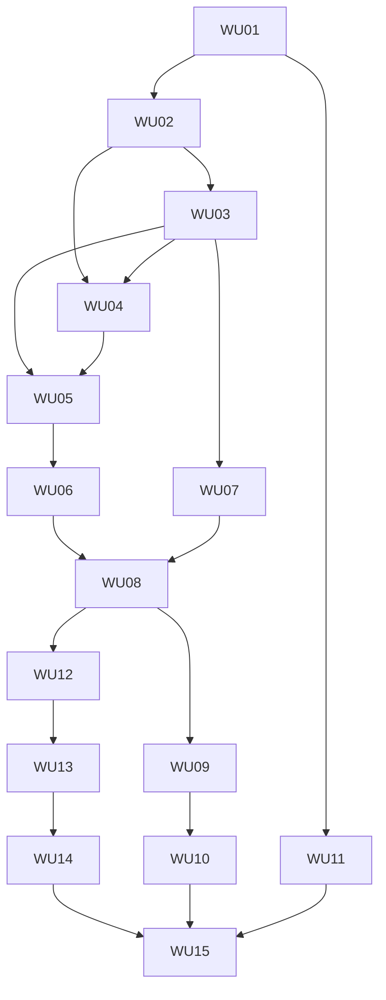

# Work units (WU-01): Backup/Restore U1

- **ID:** WU-01 (artifact id for this document). Units inside are numbered WU-01..WU-15 by the design spine, a rename of the template's U-nn (spine D-06, to avoid collision with analysis unknowns U-01..U-07). The artifact id WU-01 and the unit WU-01 are different things.
- **Status:** Draft — implementation-design stage, pending conductor review.
- **Purpose:** Break U1 (localhost, synthetic fixtures only, administrator-only, terminal states `incomplete` or `failed`) into small units, each one red-tests then build-and-verify loop, in dependency order.
- **Template:** C:\Users\Admin\AppData\Local\dtech-aidlc\lib\dtech-aidlc\core\methodology\templates\work-units.md (Stories, Criteria, Depends on, Done when per unit; extended here with goal, files, F, IF, T, TS and status as the brief requires).

## Sources (relative links from this file's directory)

- [acceptance-criteria](../../analyze/problem-framing/acceptance-criteria.md), [user-stories](../../analyze/problem-framing/user-stories.md)
- [risk-register](../../analyze/context-and-risk/risk-register.md), [open-questions](../../analyze/context-and-risk/open-questions.md), [quality-requirements](../../analyze/context-and-risk/quality-requirements.md)
- [decision-record](../../ideate/direction-selection/decision-record.md), [architecture-design](../../ideate/direction-selection/architecture-design.md), [threat-model](../../ideate/direction-selection/threat-model.md), [scope-boundary](../../ideate/direction-selection/scope-boundary.md)
- Repository: `D:\orca\my-cms\makara\docs\features\backup-restore.md`, `apps/api/gateway/src/main.rs`, `apps/api/domain_interface/src/lib.rs`.
- Authoritative identifiers (F, IF, TS, CFG, T, D, RK): the design spine relayed by the conductor for this stage.

## Provenance labels

- **[O]** Observed (cited or relayed from the spine and research reports; the conductor relayed them, so verify before relying heavily).
- **[UP]** User-provided: project owner, 2026-11-22. Approvals are attributed as "project owner (solo scope; owner also acts as architect/operations/security approver for this intent), 2026-11-22"; no separate architect or security person approved anything.
- **[A]** Assumption (impact and validation named).
- **[D]** Design decision proposed for the plan gate, not an approval.
- **[Q]** Open question.

## Ground rules for every unit

- **Loop [D, spine D-07]:** red tests first (failing tests for the unit's TS ids), then build, then verify (`cargo test -p <crate>`, `cargo fmt -- --check`, `cargo clippy` in `apps/api`; `pnpm test`, `pnpm lint`, `pnpm exec tsc --noEmit` in `apps/web`). The 80% line coverage is a measurement, not a gate.
- **Status of every unit:** not started. No test has been run and no baseline exists (RK-01, Q-12).
- **Stories line [O]:** story ids come from the `Criteria:` lines of user-stories.md (read 2026-11-22): US-01 AC-001; US-02 AC-002, AC-006; US-03 AC-003; US-04 AC-004, AC-006; US-05 AC-001, AC-005; US-06 AC-002, AC-005. Inverted: AC-001 US-01, US-05; AC-002 US-02, US-06; AC-003 US-03; AC-004 US-04; AC-005 US-05, US-06; AC-006 US-02, US-04. A unit lists the union for its AC references (an earlier version mapped AC-006 to US-03 as well; user-stories.md does not).
- **Aliases:** unit WU-nn is the template U-nn (WU-01 = U-01, and so on); the alias is to be recorded in work-units.json (not written by this single-file writer; see discrepancy 2).
- **AC notation:** S1, S2, S3 are the first, second and third scenario in the AC block, in the order the requirements digest lists them. Use qualified ids (acceptance AC-00x versus a11y AC-0x).
- **Never claimed:** no unit makes a job `succeeded`; Q-04, Q-06, Q-07, Q-10, Q-11 stay open.
- **Deviation ids [O, canonical across the five artifacts]:** D-01..D-09 unchanged; D-10 status enum handling (existing values retained, `incomplete` added, `succeeded` and `recovery-required` unreachable for U1 jobs); D-11 wire format (snake_case, bare bodies); D-12 new `hooks/` directory in `app/admin/backup/`; D-13 web REST client at `apps/web/src/domains/backup.ts`.
- **Open owner decisions that stay open (not decided here):** CFG-04 fixture storage location and protection (blocks WU-04..WU-06); migration gating and release effect (RK-16) and RK-15 (blocks WU-02 merge and WU-10); T-14 Windows ACL acceptance (blocks WU-04 done); CFG-17 and CFG-18 ingress limit values (owner values needed before WU-10, the unit that builds the ingress layers, F-38, and owns TS-55; WU-08 is not blocked by them); E2E-ENV-01 (browser verification in WU-13, WU-14).

## Dependency graph

Text fallback: WU-01 then WU-02; WU-01 then WU-11. WU-02 then WU-03. WU-02 and WU-03 then WU-04 (the audit port lives in WU-03). WU-03 and WU-04 then WU-05. WU-03 then WU-07. WU-05 then WU-06. WU-06 and WU-07 then WU-08. WU-08 then WU-09 and WU-12. WU-09 then WU-10. WU-12 then WU-13 then WU-14 then WU-15. WU-15 also depends on WU-10 and WU-11 (gateway and CLI evidence, same edge list as the plan and FD).

Suggested execution order: WU-01, 02, 03, 04, 05, 06, 07, 08, 09, 10, 11, 12, 13, 14, 15.

## WU-01 Crate scaffold, domain types, config, clock, errors
- **Goal:** `domain_backup` compiles; pure types, state-machine guards, config with owner defaults and fail-closed bounds validation, clock, error and response projection exist.
- **Files:** `apps/api/Cargo.toml` (members), `apps/api/domain_backup/Cargo.toml`, `src/lib.rs`, `src/domain/{status,state_machine,config,error,response,clock}.rs`.
- **F:** F-01 (config, bounds validation, CFG-16 Host/Origin allow-list config, F-39 parse), F-15 (pure guards only). **IF:** CFG-01..CFG-18 (CFG-16 `BACKUP_ALLOWED_ORIGINS`; CFG-17 ingress request timeout and CFG-18 header-size limit, both with no approved default), job status enum (D-10, spine 4.2). **AC:** acceptance AC-002 S3 and AC-003 S3 (behavioural: fail-closed config, bounds, no real staging); AC-005 S1 (TS-08a); AC-006 S2 (gate trace only; bounds also trace to the Q-05 owner decision, ADR-004, T-13 and TS-58). **T:** T-04 (CFG-16 validation; loopback guard unit test TS-08a), T-06, T-13, T-14.
- **TS:** TS-01, TS-02 (per key default, below and above cases for CFG-05..CFG-14; CFG-16, CFG-17 and CFG-18 missing or malformed; storage root checks), TS-08a (unit test of `is_loopback_bind` in `apps/api/domain_backup` `domain/config.rs`: non-loopback IP, `0.0.0.0`, `::` and non-IP hostnames are not loopback; AC-005 S1; T-04), TS-11 (pure part).
- **Stories:** US-02, US-03, US-04, US-06.
- **Depends on:** none.
- **Done when:** TS-01, TS-02, TS-08a and the pure part of TS-11 are green; `cargo check -p domain_backup` exits 0 with `apps/api/Cargo.lock` updated and the dependency choices (sea-orm-migration 1.1.20, tokio-util) recorded in the crate manifest [A in spine]; the lock mechanism is a single decision, std `File::try_lock` with no new crate (implementation-plan.md RK-06; `fd-lock` and `fs4` are absent from `Cargo.lock` [O]); interfaces-and-contracts.md section 9 names the same std lock; bounds rule (FD F-01, canonical): any CFG-05..CFG-14 value other than the owner-approved default makes backup `disabled` with `disabled_reason` `INVALID_CONFIG` (the DB CHECKs are safety ceilings only; changing a bound needs a new owner decision), and the closed `disabled_reason` set is `NOT_CONFIGURED | NON_LOOPBACK_BIND | INVALID_CONFIG | null`; CFG-17 or CFG-18 absent gives `INVALID_CONFIG`; `BackupJobStatus` keeps every existing documented value (including `succeeded` and `recovery-required`) and adds `incomplete` (ADR-002 approved as proposed, D-10), and the state-machine guard admits no transition into `succeeded` or `recovery-required` for U1 jobs (TS-11 pure part: no transition, write or projection can produce them).
- **Status:** not started.

## WU-02 Migrations, entities, trigger guards, migrator table name
- **Goal:** Durable schema with structural guarantees (constraint or trigger rejecting `succeeded` and `recovery-required` for U1 job kinds, terminal and audit triggers, partial unique concurrency index) and an isolated migration table.
- **Files:** `domain_backup/src/migrations/{mod.rs,m20261122_000001_backup_core.rs,m20261122_000002_backup_terminal_guards.rs}`, `src/entities/*`, `src/migrations_cli.rs`. No `test_helpers` change (the plan advises against it; the backup Migrator is applied from the backup crate's own tests).
- **F:** F-37 (migrations part). **IF:** tables `backup_jobs`, `backup_idempotency`, `backup_audit`, `backup_allocations`, `backup_epoch` (spine 4.4). **AC:** acceptance AC-002 S3; AC-005 S1. **T:** T-06, T-08 (audit retained), T-17.
- **TS:** TS-34, TS-11 (DB-level part), TS-66 (migration `revert` keeps `backup_audit` rows and its append-only trigger).
- **Stories:** US-02, US-05, US-06.
- **Depends on:** WU-01.
- **Blocked by [Q]:** owner decision on migration gating / release effect (RK-16); no merge to main until decided (merging to `main` auto-releases an image that may apply backup migrations). Open, not decided.
- **Done when:** Blocked by [Q]: owner decision on migration gating / release effect (RK-16); no merge to main until decided. TS-34, DB-level TS-11 (the constraint or trigger rejects `succeeded` and `recovery-required` for U1 job kinds while the status column keeps existing values, D-10) and TS-66 green (needs Docker, RK-02); migrations apply on a fresh database; applying as an upgrade beside posts and seo is blocked on the RK-15 decision (a pre-existing shared `seaql_migrations` table conflict, not a U1 defect; no seo or posts fix inside U1 without an owner decision); no `migration_table_name` override precedent exists in `apps/api` [O: grep of apps/api, 2026-11-22], so WU-02 introduces the first override, `seaql_migrations_backup` [A, D-02]; raw-SQL triggers confirmed workable [A, D-08].
- **Status:** not started.

## WU-03 Job store with CAS, claim, concurrency index
- **Goal:** Compare-and-set transitions, conditional claim, durable concurrency 1.
- **Files:** `domain_backup/src/ports/job_store.rs`, `src/infra/db_job_store.rs`, `src/ports/audit.rs`, `src/infra/db_audit_sink.rs` (the audit port and DbAuditSink are owned by WU-03 so that WU-04 and WU-05 can write audit rows in the same transaction; canonical placement, discrepancy 4).
- **F:** F-15, F-16 (claim), F-34 (`AuditSink::record`, `ports/audit.rs`, `infra/db_audit_sink.rs`; owned here, consumed by WU-04, WU-05, WU-06 and WU-07). **IF:** none. **AC:** acceptance AC-002 S2, S3; AC-005 S2 (TS-69). **T:** T-06, T-07, T-08 (TS-69), T-12.
- **TS:** TS-14a (store level: a second queued or running job for the same instance violates the partial unique index and the store returns a concurrency-conflict error; the 409 `CONCURRENCY_LIMIT` API projection is TS-14b in WU-07) plus CAS race tests (no separate TS id; the unit's own tests) and TS-69 (audit sink records in the caller's transaction; rollback leaves no audit row; AC-005 S2; T-08; `infra/db_audit_sink.rs`).
- **Stories:** US-02, US-06.
- **Depends on:** WU-02.
- **Done when:** CAS race tests green; TS-69 green (audit row written in the caller's transaction; a rollback leaves no audit row; an audit write failure refuses the transition); second concurrent create yields the concurrency conflict durably (TS-14a); terminal states immutable; the loser of a race never overwrites a terminal result.
- **Status:** not started.

## WU-04 Allocation ledger, fixture storage, namespace lock
- **Goal:** Register-before-write ledger with budgets, private opaque-key file storage, exclusive namespace ownership.
- **Files:** `domain_backup/src/ports/{allocation_store,fixture_storage,namespace_lock}.rs`, `src/infra/{db_allocation_store,fs_fixture_storage,fs_namespace_lock}.rs`.
- **F:** F-21, F-22, F-23, F-24. **IF:** none. **AC:** acceptance AC-003 S3 (behavioural); AC-006 S2 (gate trace only for budgets; also Q-05, ADR-004, T-13). **T:** T-11, T-12, T-13, T-14 (partial on Windows).
- **TS:** TS-19, TS-30 (budget part), TS-31, TS-32 (lock part), TS-56 (bounded inventory: `FixtureStorage::inventory(max_entries)` returns the entries and a `truncated` flag; over-cap yields a safe degraded signal; T-13).
- **Stories:** US-02, US-03, US-04.
- **Depends on:** WU-02, WU-03 (audit port and sink for same-transaction `allocation.registered` audit, F-21).
- **Blocked by [Q]:** owner approval of the fixture storage location and its protection, or an owner record that CFG-04 private permissions suffice for synthetic U1 data (implementation-plan.md section 3.1, hard stop for WU-04, WU-05, WU-06; ADR-004). The owner approved numeric bounds only. Do not code around this. The same blocker is carried in FD 1.1/4.2, IFC section 8 and the plan. Open owner decision, not decided.
- **Hard stop [Q, T-14]:** T-14 is only partially evidenced on Windows (TS-31 cannot check an owner-only ACL there). Before WU-04 is done, the owner either accepts the ACL limitation or an ACL inspection test is added.
- **Done when:** the five TS groups green, including Windows path, junction and reparse tests; two-process lock test passes (RK-06); 256 MiB per-allocation and 1 GiB total budgets enforced [UP]; `inventory` never returns more than `max_entries` and sets `truncated` (TS-56); the T-14 hard stop above is resolved and recorded; a file that is not a ledger-registered opaque key is classified `ambiguous` and left on disk (the TS-19 and TS-23 classification cases).
- **Status:** not started.

## WU-05 Worker, fixture capture, terminal rules, deadline
- **Goal:** A queued job runs through the fixture adapter and ends `incomplete` or `failed`, never `succeeded`.
- **Files:** `domain_backup/src/lifecycle/{worker,fixture_capture}.rs`, `src/ports/capture.rs`.
- **F:** F-16, F-17, F-18, F-19, F-20. **IF:** none. **AC:** acceptance AC-002 S1..S3; AC-005 S2 (TS-44b). **T:** T-05, T-06, T-09 (TS-44b), T-12, T-13.
- **TS:** TS-44b (job audit events `job.running`, `job.incomplete`, `job.failed`: actor, instance, job, time and outcome populated, no excluded fields; AC-005 S2; T-09; the allocation events half is in WU-06), TS-05a (claim re-check through the policy port with a test double), TS-47 (happy path ends `incomplete`, exact components array, never `succeeded`; evidence for T-05/T-06), TS-48 (failure outcomes `ADAPTER_ERROR`, `PERSISTENCE_ERROR`, `ALLOCATION_LIMIT`, `DISPATCH_FAILED`), TS-67 (claim CAS: queued-to-running has one winner under duplicate dispatch; a late worker cannot overwrite a terminal job; AC-002 S1, S2; T-07, T-12) and TS-68 (10-minute deadline, `worker::tests::deadline_exceeded_fails_job`, `DEADLINE_EXCEEDED`, a late worker does not overwrite the sweeper result; AC-002 S2; T-12, T-13).
- **Stories:** US-02, US-06.
- **Depends on:** WU-03, WU-04.
- **Blocked by [Q]:** same CFG-04 fixture storage location and protection approval as WU-04 (open).
- **Done when:** TS-05a, TS-44b (job events), TS-47, TS-48, TS-67 and TS-68 green; job reaches `incomplete` with `REQUIRED_COMPONENTS_UNAVAILABLE` or `failed` with a safe reason; TS-67 green with a duplicate-dispatch test double and TS-68 green with FakeClock plus paused tokio time; only `FixtureCaptureAdapter` exists in the crate. The resource re-check (F-04) at claim is a port stub here and is completed in WU-08 (see discrepancy 1).
- **Status:** not started.

## WU-06 Reconciler, fence, cleaner, retry, sweeper, retention, runtime, crash matrix
- **Goal:** Full allocation lifecycle and runtime start/outage behaviour, proven by the ten crash windows.
- **Files:** `domain_backup/src/lifecycle/{runtime,reconciler,cleaner,sweeper}.rs`.
- **F:** F-25..F-33 (includes F-31 outage guard, F-32 sweeps, F-33 retention). **IF:** none. **AC:** acceptance AC-002 S2 and AC-003 S3 (behavioural: cleanup, expiry, outage); AC-006 S2 (gate trace only for retry, expiry and sweep bounds; also Q-05, ADR-004, T-13); AC-005 S2 (TS-44b). **T:** T-08, T-09 (TS-44b), T-11, T-12, T-13.
- **TS:** TS-44b (allocation audit events, for example `allocation.registered`: actor, instance, job, time and outcome populated, no excluded fields; the job events half is in WU-05), TS-20..TS-26, TS-27a, TS-28, TS-29, TS-30, TS-32, TS-42, TS-65 (audit unavailable refuses deletion claim, deletion commit and purge: no unlink, no row removal; T-08), and the reconciler half of TS-56 (reconciliation fails closed when the inventory reports `truncated`) [D, test-strategy to confirm placement]. TS-27a (cleanup-exhaustion state and counter, `lifecycle/cleaner.rs`) is here; TS-27b (the IF-11 status projection of that flag) is in WU-08.
- **Stories:** US-02, US-03, US-04, US-06.
- **Depends on:** WU-05.
- **Blocked by [Q]:** same CFG-04 fixture storage location and protection approval as WU-04 (open).
- **Done when:** TS-20..TS-26, TS-27a, TS-28, TS-29, TS-30, TS-32, TS-42, TS-44b (allocation events), TS-65 and the reconciler fail-closed assertion green; cleanup retry 3 attempts at 1 minute, orphan grace 1 h, expiry 24 h, sweep 15 min enforced by tests [UP]; cleanup exhaustion becomes `cleanup_failed` with escalation visibility; audit rows kept by the purge [Q, RK-13].
- **Status:** not started.

## WU-07 Idempotency, atomic acceptance
- **Goal:** Durable idempotent acceptance with audit written in the same transaction; refuse when audit is unavailable.
- **Files:** `domain_backup/src/domain/idempotency.rs`, `src/handlers/create_job/{request,create_job_handler}.rs` (logic). The audit port and `DbAuditSink` come from WU-03 and are not created here.
- **F:** F-05, F-06, F-07, F-08; F-34 consumed (owned by WU-03). **IF:** IF-02 (logic). **AC:** acceptance AC-002 S1; AC-005 S2, S3. **T:** T-07, T-08, T-09.
- **TS:** TS-13, TS-14b (409 `CONCURRENCY_LIMIT` projection of the WU-03 store conflict, durable under races), TS-15, TS-16, TS-44a (`job.accepted` audit event: actor, instance, job, time and outcome populated, no excluded fields; AC-005 S2; T-09; the other job and allocation events are TS-44b in WU-05 and WU-06). Uses the audit port and DbAuditSink delivered in WU-03.
- **Stories:** US-02, US-05, US-06.
- **Depends on:** WU-03.
- **Done when:** TS-13, TS-14b, TS-15, TS-16 and TS-44a green; raw idempotency key absent from every table; replay check runs before the concurrency check. Same-transaction audit is a [D] mechanism awaiting plan-gate confirmation (ADR-005 mechanism).
- **Status:** not started.

## WU-08 Authorization policy, instance registry, REST read and create adapters, status endpoint, error projection
- **Goal:** Administrator-only REST surface (create, list, read, instances, status) with non-disclosing errors, wired through `DomainBackupService`.
- **Files:** `domain_backup/src/domain/{policy,instance}.rs`, `src/api/*`, `src/handlers/{list_instances,create_job,get_job,list_jobs,status}/*`, `src/service.rs`, the closed metric label type (job_kind, outcome, error_code only; no ids, paths or actor).
- **F:** F-02, F-03 (with Host/Origin precedence: 401, `ROLE_REQUIRED`, then 403 `HOST_NOT_ALLOWED` / `ORIGIN_NOT_ALLOWED`), F-04, F-09, F-10, F-35, F-36, F-37. **IF:** IF-01, IF-02, IF-03, IF-04, IF-11 (`disabled_reason` closed set `NOT_CONFIGURED | NON_LOOPBACK_BIND | INVALID_CONFIG | null`). **AC:** acceptance AC-001; AC-002 S1; AC-005 S1, S2. **T:** T-01, T-02, T-03, T-04, T-09, T-13.
- **TS:** TS-04, TS-05b (real `policy.rs` re-check), TS-06, TS-12b (Rust serializers: `download_eligible` false, never emit `succeeded` or `recovery-required` for a U1 job), TS-17 (API outputs), TS-27b, TS-45 (IF-01), TS-49 (job projection), TS-57 (closed metric label set: job_kind, outcome, error_code), TS-59 (Host/Origin policy, T-04), TS-60 (16 KiB body cap, 413 `PAYLOAD_TOO_LARGE`, T-13), TS-61 (IF-03 limit and cursor 400), TS-62 (415 unsupported media type), TS-63 (malformed JSON, unknown field, bad type, non-UUID path).
- **Stories:** US-01, US-02, US-05, US-06.
- **Depends on:** WU-06, WU-07.
- **Done when:** TS-04, TS-05b, TS-06, TS-12b, TS-17 (API outputs), TS-27b (asserts the `disabled` state and each `disabled_reason`), TS-45, TS-49, TS-57, TS-59, TS-60, TS-61, TS-62, TS-63 green; actor extraction confirmed against the extractor used by `domain_media` or `domain_user` (RK-03 [A]); `download_eligible` always false in projections (field name per IFC 2.3); unknown and foreign job ids return the same 404.
- **Status:** not started.

## WU-09 Disabled capabilities, download denial, previews
- **Goal:** Real upload, preflight, restore and download are denied; labelled synthetic previews exist with cancel paths.
- **Files:** `domain_backup/src/handlers/{download_denied,disabled_capability,preview}/*`, `src/domain/fixtures.rs`.
- **F:** F-11, F-12, F-13, F-14. **IF:** IF-05..IF-10. **AC:** acceptance AC-002 S3; AC-003 S3; AC-004 S1, S2. AC-004 S3 (restore failure) is explicitly deferred: restore execution is not authorized in U1 (reason recorded in test-strategy). **T:** T-05, T-06, T-15 (preview only).
- **TS:** TS-09, TS-10, TS-43, TS-53 (`preview_preflight` returns a canned result only for a trusted fixture id; uploads and paths never accepted), TS-64 (IF-09 and IF-10 API-level identification fields for AC-004 S1: fixture package, target instance label, data in scope).
- **Stories:** US-02, US-03, US-04, US-06.
- **Depends on:** WU-08.
- **Done when:** TS-09, TS-10, TS-43, TS-53, TS-64 green, including body-not-read spies and no ledger rows or files created; download is 403 `DOWNLOAD_DENIED` for every status; confirm and cancel previews enqueue nothing.
- **Status:** not started.

## WU-10 Gateway integration, runtime start, loopback guard, composed-router security
- **Goal:** Backup service mounted under the administrator layer, runtime started after migrations, non-loopback bind forces disabled.
- **Files:** `apps/api/gateway/Cargo.toml`, `apps/api/gateway/src/main.rs`, `apps/api/gateway/src/migrate_cli.rs`, `apps/api/domain_interface/src/lib.rs` (one new `Mount` variant, see the gateway change below); `README.md` env section (BACKUP_* keys).
- **F:** F-37, F-38 (ingress layers; builds them), F-39. **IF:** all REST (composed). **AC:** acceptance AC-001; AC-002 S1 (TS-55); AC-005 S1. **T:** T-01, T-04, T-13 (TS-55), T-17.
- **TS:** TS-03, TS-07, TS-08b (gateway wiring: effective loopback bind test in `apps/api/gateway/src/main.rs`; a non-loopback `HOST` forces backup `disabled` with `NON_LOOPBACK_BIND` in the composed gateway; AC-005 S1; T-04), TS-55 (see the gateway change below; AC-002 S1; T-13).
- **Gateway change [D, F6 option (a)]:** [O: `compose_routers` in `apps/api/gateway/src/main.rs`, read 2026-11-22] today `compose_routers` merges every `Mount::Administrator` registration into one `administrator` router and applies `administrator_layer` once, so no per-route ingress layer is possible. The backup registration is selected by a new `Mount` variant in `apps/api/domain_interface/src/lib.rs`, `Mount::AdministratorIngress` (a mount variant, not a new `RouteRegistration` field: `RouteRegistration` has only `mount`, `router` and `prefix`, and a new field would force every domain's struct literal to change, while the variant only affects the `match reg.mount` in `compose_routers`; implementation must grep for any other exhaustive `match` on `Mount`). `compose_routers` collects those registrations into a separate `backup_admin` router, wraps it, from outermost to innermost, as timeout layer (CFG-17) then header-size layer (CFG-18) then the administrator auth layer (`administrator_layer`) then the backup routes, and merges the result with the public, protected and ordinary administrator routers before `with_cookie_manager` and the otel layers. Effect: oversized headers (431) are rejected before authentication (401); a request whose inner processing exceeds CFG-17 gets 408. A 408-before-401 ordering is not observable (auth decides from the Authorization header alone) and slow header delivery is handled by hyper before the router (T-13 residual). Other `Mount::Administrator` routes and all other routes keep their current layering. [A] the 431 mechanism (tower or hyper limit) is validated in WU-10.
- **Existing tests that must stay green [O: names from `apps/api/gateway/src/main.rs`]:** `compose_routers_supplies_cookie_extractor_to_domain_routes`, `compose_routers_traces_health_requests_without_changing_response`, `compose_routers_traces_rejected_protected_requests_without_calling_handler`; `manifest_with_five_services_returns_five_entries` is updated to 6 (below).
- **TS-55 asserts:** for backup routes, an unauthenticated request over the CFG-18 header limit gets 431 (not 401) and never reaches auth or the handler; a slow authenticated request (test stub inner service) past CFG-17 gets 408 with the crate error body; an unauthenticated request within limits gets 401; non-backup routes (public, protected, other administrator) are unaffected by these layers (T-13).
- **Stories:** US-01, US-05, US-06.
- **Depends on:** WU-09.
- **Blocked by [Q]:** owner decision on migration gating / release effect (RK-16); no merge to main until decided.
- **Blocked by [Q]:** owner values for the CFG-17 ingress request timeout and CFG-18 header-size limit (no approved defaults; backup is `disabled` with `INVALID_CONFIG` while either is absent). Needed before WU-10 (this unit builds the layers and owns TS-55); open, not decided.
- **Runtime-start condition [Q, RK-15]:** the backup runtime start after migrations is conditional on the RK-15 decision (posts and seo share `seaql_migrations`; gateway-boot evidence is either enabled by an owner-authorized prerequisite fix outside U1 or descoped as a recorded residual). Open, not decided.
- **Done when:** Blocked by [Q]: owner decision on migration gating / release effect (RK-16); no merge to main until decided. RK-15 runtime-start condition resolved by owner or recorded as descoped residual. Owner values for CFG-17/CFG-18 recorded. Layer feasibility (F-38 ingress layers: 431 before 401, 408 on slow inner processing) validated here. TS-03, TS-07, TS-08b, TS-55 green (layers read CFG-17 and CFG-18); README env section lists every `BACKUP_*` key with its default; `manifest_with_five_services_returns_five_entries` updated to 6 and `compose_routers_*` tests re-run green; unused `cors_layer` and `body_limit_layer` checked by grep (RK-05); cookie-only authorization of mutations tested (RK-07); backup identities chained into `all_migration_identities` with the `migrate down|status` limit documented (RK-08).
- **Status:** not started.

## WU-11 CLI fail-closed tests and doc reconciliation
- **Goal:** Lock in that `backup_cli` stays fail-closed and document that its manifest vocabulary is unrelated to job status.
- **Files:** `apps/api/gateway/src/backup_cli.rs` (tests and comments only).
- **F:** F-40. **IF:** none. **AC:** acceptance AC-002 S2. **T:** T-05.
- **TS:** TS-33.
- **Stories:** US-02, US-06.
- **Depends on:** WU-01.
- **Done when:** TS-33 green (`create`, `list`, `restore`, unknown input all fail closed, no DB or S3 contact); no behaviour change; the six existing tests unchanged.
- **Status:** not started.

## WU-12 Web foundation: types, API helpers, REST client
- **Goal:** Typed, defensive client for the backup REST surface, exhaustive over every status value.
- **Files:** `apps/web/src/domains/backup.ts` (zod schemas, types and REST client) with `apps/web/src/domains/backup.test.ts`, and `apps/web/src/config/api.config.ts` (D-13). The REST precedent is `domains/seo-head-asset.ts` with `seo-head-asset.test.ts` [O: both present under `apps/web/src/domains`]; `infrastructure/das` is not used. F-41 lives in `domains/backup.ts`.
- **F:** F-41. **IF:** consumer of IF-01..IF-11. **AC:** acceptance AC-001 S1; AC-002 S1. **T:** T-06.
- **TS:** TS-52 (client part: strict zod parsing, unknown-status tolerance, in `domains/backup.test.ts`); feeds TS-12a.
- **Stories:** US-01, US-02, US-05, US-06.
- **Depends on:** WU-08 (contract).
- **Done when:** client tests (TS-52 client part) green including unknown status tolerance; the zod status schema accepts every existing documented value plus `incomplete` (D-10) and the `disabled_reason` set `NOT_CONFIGURED | NON_LOOPBACK_BIND | INVALID_CONFIG | null`; `pnpm lint` and `pnpm exec tsc --noEmit` pass for the touched files.
- **Status:** not started.

## WU-13 Web page, route, menu, instance selector, create panel
- **Goal:** Administrator can reach `/admin/backup`, select the instance and create a job with a fresh idempotency key.
- **Files:** `apps/web/src/App.tsx`, `apps/web/src/app/admin/components/left-menu.tsx` (+ test), `apps/web/src/app/admin/backup/{page.tsx,components/instance-selector.tsx,components/job-create-panel.tsx}` (+ colocated tests).
- **F:** F-42, F-43, F-44. **IF:** consumer. **AC:** acceptance AC-001; AC-002 S1. **T:** T-01 (UX only), T-03, T-07.
- **TS:** TS-35, TS-38, TS-46 (selector renders instance label and environment), TS-52 (panel part: fresh `crypto.randomUUID()` key per submit, double-submit guard).
- **Stories:** US-01, US-02, US-05, US-06.
- **Depends on:** WU-12.
- **Browser verification:** blocked by E2E-ENV-01 (open); component tests only until decided.
- **Done when:** TS-35, TS-38, TS-46 and TS-52 (panel part) green; menu item gated by `isAdministrator`; route inside `ProtectedRoute > AdminLayout > AdminOnlyRoute`; empty or unavailable instance list disables submission; double-submit guard present.
- **Status:** not started.

## WU-14 Web status, polling, preview, banner, accessibility
- **Goal:** Job status, detail, list, polling, synthetic previews and escalation banner, with no download control anywhere.
- **Files:** `apps/web/src/app/admin/backup/components/{job-status-badge,job-detail,job-list,synthetic-preview-panel,backup-status-banner}.tsx`, `hooks/{use-backup-jobs,use-backup-status}.ts` (+ colocated tests); the `hooks/` directory is a new pattern (D-12).
- **F:** F-45, F-46, F-47, F-48, F-49. **IF:** consumer. **AC:** acceptance AC-002 S1, S3; AC-003 S3; AC-004 S1, S2; AC-005 S2; AC-006 S2. **T:** T-05, T-06, T-09, T-10, T-13, T-15 (preview only).
- **TS:** TS-12a, TS-18, TS-36, TS-37, TS-50 (`BackupStatusBanner` renders IF-11 payloads including `disabled` with each `disabled_reason` (`NOT_CONFIGURED`, `NON_LOOPBACK_BIND`, `INVALID_CONFIG`) and names the project owner for escalation; owner decision Q-05), TS-51 (`SyntheticPreviewPanel` labelled synthetic; names fixture package, target instance label and data in scope; the fields come from the IF-09/IF-10 identification fields asserted at API level by TS-64).
- **Stories:** US-02, US-03, US-04, US-05, US-06.
- **Depends on:** WU-13.
- **Done when:** TS-12a, TS-18, TS-36, TS-37, TS-50, TS-51 green; every status value (including `succeeded` and `recovery-required`, which U1 never emits) renders through exhaustive handling with download always denied; unknown status shows a safe fallback; browser verification stays blocked by E2E-ENV-01; server strings render only as React text; polling stops at a terminal state and cleans up on unmount. Manual assistive-technology review is recorded separately, not claimed here.
- **Status:** not started.

## WU-15 Verification sweep: canary, e2e, doc updates, evidence for the release-candidate gate
- **Goal:** Collect the evidence the release-candidate gate needs and update docs.
- **Files:** `docs/features/backup-restore.md`, `docs/architecture/software-architecture.md`, evidence collection records (no application code).
- **F:** F-35 (canary). **IF:** all. **AC:** acceptance AC-002; AC-005; AC-006. **T:** T-01..T-14.
- **TS:** TS-17 (full, including bundle scan), TS-39, TS-40, TS-41, TS-58 (AC-006 S2 gate check: Q-04, Q-06, Q-07, Q-10, Q-11, Q-12, audit retention and non-owner guards listed as open; synthetic-only labels present).
- **Stories:** US-02, US-04, US-05, US-06.
- **Depends on:** WU-10, WU-11, WU-14 (composed-router evidence TS-03, TS-07, TS-08b; CLI evidence TS-33 for T-05; gateway mount for TS-41).
- **Done when:** TS-17 (full), TS-39..TS-41, TS-58 recorded with real results; an evidence record lists a recorded test result (TS id and outcome) for each of T-01..T-14 (T-14 recorded as partial on Windows; T-04 evidence TS-08a, TS-08b, TS-59, TS-07, TS-02; T-13 evidence TS-55, TS-56, TS-57, TS-60) for the release-candidate gate, whose decision is not made here; `succeeded` shown unreachable across API, UI and serializers; CI state (RK-09) and backup rollback limit (RK-08) recorded without claiming a green CI; performance numbers reported without a target (P-01..P-05 open).
- **Status:** not started.

## Coverage cross-check (from the spine)

- **F-01..F-49:** each assigned to at least one unit (F-15 to WU-01 and WU-03; F-16 to WU-03 and WU-05; F-37 to WU-02, WU-08, WU-10).
- **TS-01..TS-69 (TS-54 reserved and unused; TS-08 and TS-44 retired and replaced by the splits below; TS-69 added by F3):** each assigned to a unit per the test-strategy "Work unit to test mapping" table, with the splits TS-05a/b (WU-05, WU-08), TS-08a/b (WU-01, WU-10), TS-12a/b (WU-14, WU-08), TS-14a/b (WU-03, WU-07), TS-27a/b (WU-06, WU-08), TS-44a/b (WU-07; WU-05 and WU-06), and TS-11 (WU-01, WU-02), TS-17 (WU-08, WU-15), TS-30 (WU-04, WU-06), TS-32 (WU-04, WU-06), TS-52 (WU-12, WU-13), TS-56 (WU-04 inventory, WU-06 reconciler fail-closed). Other ids: TS-45 WU-08; TS-46 WU-13; TS-47, TS-48 WU-05; TS-49 WU-08; TS-50, TS-51 WU-14; TS-53 WU-09; TS-55 WU-10; TS-57 WU-08; TS-58 WU-15; TS-59, TS-60 WU-08; TS-61, TS-62, TS-63 WU-08; TS-64 WU-09; TS-65 WU-06; TS-66 WU-02; TS-67 and TS-68 WU-05; TS-69 WU-03. TS-35 and TS-38 (WU-13), TS-36 and TS-37 (WU-14), TS-39..TS-41 (WU-15).
- **Hard stops by unit:** WU-02 and WU-10 (RK-16 gating, RK-15 runtime start); WU-04..WU-06 (CFG-04 approval); WU-04 (T-14 Windows); WU-10 (CFG-17/18 owner values); WU-13, WU-14 (E2E-ENV-01 for browser verification).
- **AC coverage notes:** AC-004 S3 (restore failure) is deferred (restore execution not authorized in U1). AC-006 S2 is covered as a gate only by TS-58 (WU-15); config, bounds and cleanup tests carry the behavioural AC-002/AC-003 trace in their units.
- **IF-01..IF-11:** IF-01..04 and IF-11 in WU-08, IF-05..10 in WU-09, consumers in WU-12..14.
- **T-01..T-14:** each mapped to at least one TS (spine section 7.2).

## Spine discrepancies

1. **Dependency inversion for F-04.** The worker (WU-05, F-16) must re-run `authorize_resource` (F-04) at claim, and TS-05 verifies it, but F-04 and `policy.rs` are built in WU-08. WU-05 uses a narrow port or stub for the check (TS-05a) and WU-08 supplies the real policy (TS-05b). Open for the conductor: moving `domain/policy.rs` earlier is an alternative.
2. **`work-units.json`.** The template says to write `work-units.json` beside this file. This writer owns exactly one file, so it was not written; the producer uses the ids, the WU-nn/U-nn alias and the edges in the graph above (identical to the plan and FD edge list, including WU-03 to WU-04, WU-01 to WU-11, and WU-10, WU-11, WU-14 to WU-15).
3. **Concurrency index placement.** The partial unique index is created in migration 000001 (WU-02) but its behaviour is tested in WU-03 (TS-14a) and used by WU-07 acceptance (TS-14b). Assumed, not verified, that it belongs to 000001 and not 000002.
4. **Resolved by canonical decisions of 2026-11-22 (kept as a record):** audit port and sink are created in WU-03 with the edge WU-03 to WU-04 (C8); WU-15 depends on WU-10, WU-11 and WU-14 (C8); web client is `domains/backup.ts` (C6, D-13); status enum is not narrowed (C3, D-10); story ids are filled from user-stories.md (C11); the fixture storage blocker is carried in every affected artifact (C9); WU-05 has TS-67 (claim CAS) and TS-68 (deadline) per test-strategy (C1).

## Uncertainty and limits

- No test, build or baseline has been run; all statuses are not started. Docker availability is unknown (RK-02), so DB-backed units (WU-02, 03, 04, 06, 07) may not run on this host.
- Crate choices (file lock, tokio-util), trigger viability, migration-table behaviour and actor extraction are [A] and are validated inside the named units.
- Non-owner guards (16 KiB body cap, page size 20 max 100, fixture size, 60 s outage probe) are [Q] pending owner confirmation. CFG-17 and CFG-18 have no approved defaults; their values are an owner decision needed before WU-10 (WU-08 is not blocked by them). The 431-before-401 layering and 408 timeout behaviour and the 431 mechanism are [D]/[A] until WU-10 validates them; the new `Mount` variant is a proposed change to `domain_interface`, not yet made.
- Windows T-14 evidence is partial (no owner-only ACL check); WU-04 is not done until the owner accepts that or an ACL test is added.
- Approvals are by the project owner as sole approver in solo scope (also acting as architect, operations and security approver), 2026-11-22.
- Still open and not represented as decided: Q-04, Q-06, Q-07, Q-10, Q-11, audit retention. Real-data staging, upload, preflight, restore, downloads and production use are not authorized.
- Mechanism designs for same-transaction audit and NamespaceLock are [D] awaiting plan-gate confirmation. No test in this file has been run; every status is not started.
