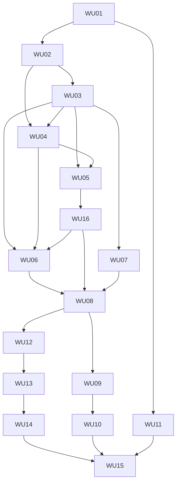

# Work units (WU-01): Backup/Restore U1

- **ID:** WU-01 (artifact id for this document). Units inside are numbered WU-01..WU-16 after the approved WU-06 split, a rename of the template's U-nn (spine D-06, to avoid collision with analysis unknowns U-01..U-07). The artifact id WU-01 and the unit WU-01 are different things.
- **Status:** Draft — implementation-design stage, pending conductor review.
- **Purpose:** Break U1 (localhost, synthetic fixtures only, administrator-only, terminal states `incomplete` or `failed`) into small units, each one red-tests then build-and-verify loop, in dependency order.
- **Template:** C:\Users\Admin\AppData\Local\dtech-aidlc\lib\dtech-aidlc\core\methodology\templates\work-units.md (Stories, Criteria, Depends on, Done when per unit; extended here with goal, files, F, IF, T, TS and status as the brief requires).

## Sources (relative links from this file's directory)

- [acceptance-criteria](../../analyze/problem-framing/acceptance-criteria.md), [user-stories](../../analyze/problem-framing/user-stories.md)
- [risk-register](../../analyze/context-and-risk/risk-register.md), [open-questions](../../analyze/context-and-risk/open-questions.md), [quality-requirements](../../analyze/context-and-risk/quality-requirements.md)
- [decision-record](../../ideate/direction-selection/decision-record.md), [architecture-design](../../ideate/direction-selection/architecture-design.md), [threat-model](../../ideate/direction-selection/threat-model.md), [scope-boundary](../../ideate/direction-selection/scope-boundary.md)
- Repository: `D:\orca\my-cms\makara\docs\features\backup-restore.md`, `apps/api/gateway/src/main.rs`, `apps/api/domain_interface/src/lib.rs`.
- Authoritative identifiers (F, IF, TS, CFG, T, D, RK): the design spine relayed by the conductor for this stage.

## Provenance labels

- **[O]** Observed (cited or relayed from the spine and research reports; the conductor relayed them, so verify before relying heavily).
- **[UP]** User-provided: project owner, 2026-11-22. Approvals are attributed as "project owner (solo scope; owner also acts as architect/operations/security approver for this intent), 2026-11-22"; no separate architect or security person approved anything.
- **[A]** Assumption (impact and validation named).
- **[D]** Design decision proposed for the plan gate, not an approval.
- **[Q]** Open question.

## Ground rules for every unit

- **Loop [D, spine D-07]:** red tests first (failing tests for the unit's TS ids), then build, then verify. Rust commands may run from the repository root using `--manifest-path apps/api/Cargo.toml` (for example `cargo test --manifest-path apps/api/Cargo.toml -p domain_backup`, `cargo fmt --manifest-path apps/api/Cargo.toml -- --check`, `cargo clippy --manifest-path apps/api/Cargo.toml --workspace --all-targets`) or from `apps/api` with the manifest flag omitted; do not mix working-directory conventions. Web commands (`pnpm test`, `pnpm lint`, `pnpm exec tsc --noEmit`) run from `apps/web`. The 80% line coverage is a measurement, not a gate.
- **Status convention:** statuses below are per-unit observations from the referenced stage evidence, not workflow approval. The historical intent baseline is recorded once in `develop/baseline.md` (2026-11-22: 290 normal passes / 0 failures / 39 ignored; 39/39 ignored pass); do not rerun or rewrite it as the baseline. Later WU regressions are distinct observations.
- **Stories line [O]:** story ids come from the `Criteria:` lines of user-stories.md (read 2026-11-22): US-01 AC-001; US-02 AC-002, AC-006; US-03 AC-003; US-04 AC-004, AC-006; US-05 AC-001, AC-005; US-06 AC-002, AC-005. Inverted: AC-001 US-01, US-05; AC-002 US-02, US-06; AC-003 US-03; AC-004 US-04; AC-005 US-05, US-06; AC-006 US-02, US-04. A unit lists the union for its AC references (an earlier version mapped AC-006 to US-03 as well; user-stories.md does not).
- **Aliases:** unit WU-nn is the template U-nn (WU-01 = U-01, and so on); the alias is to be recorded in work-units.json (not written by this single-file writer; see discrepancy 2).
- **AC notation:** S1, S2, S3 are the first, second and third scenario in the AC block, in the order the requirements digest lists them. Use qualified ids (acceptance AC-00x versus a11y AC-0x).
- **Never claimed:** no unit makes a job `succeeded`; Q-04, Q-06, Q-07, Q-10, Q-11 stay open.
- **Deviation ids [O, canonical across the five artifacts]:** D-01..D-09 unchanged; D-10 status enum handling (existing values retained, `incomplete` added, `succeeded` and `recovery-required` unreachable for U1 jobs); D-11 wire format (snake_case, bare bodies); D-12 new `hooks/` directory in `app/admin/backup/`; D-13 web REST client at `apps/web/src/domains/backup.ts`.
- **Owner decisions still open (not decided here):** migration gating and release effect (RK-16) and RK-15 (blocks WU-02 merge and WU-10); CFG-17 and CFG-18 ingress limit values (owner values needed before WU-10, the unit that builds the ingress layers, F-38, and owns TS-55; WU-08 is not blocked by them); E2E-ENV-01 (browser verification in WU-13, WU-14). CFG-04 is resolved: dedicated configured directory, no default, private permissions on Unix; the missing Windows owner-only ACL verification is accepted as a residual for synthetic-only data. T-14 remains partially evidenced on Windows but is non-blocking; Ubuntu CI verification is a follow-up at the release-candidate gate. WU-04..WU-06 are not blocked by CFG-04 or Windows ACL acceptance.

## Dependency graph

Dependencies in `work-units.json` are completion/report prerequisites. For this recovery rework, WU-16 is ordered before WU-06's strict full-regression completion/report because WU-16-owned failures are already in the tested tree. WU-16 consumes the existing WU-06 store adapters after WU-05; it does not own them or complete WU-06. WU-06 must remain incomplete while the required full regression is red. The order is stated in source; this graph uses only standard Mermaid flowchart syntax.

Text fallback: WU-01 then WU-02; WU-01 then WU-11. WU-02 then WU-03. WU-02 and WU-03 then WU-04 (the audit port lives in WU-03). WU-03 and WU-04 then WU-05. WU-03 then WU-07. WU-03 and WU-04 supply the store schema/contracts to WU-06; WU-05 then WU-16, which consumes the already-implemented WU-06 stores under WU-16's own directive. WU-16 must precede WU-06's first strict full-workspace regression closure/report; this order resolves current WU-16-owned failures without transferring WU-06 store/test ownership or claiming WU-06 complete while its required gate is red. WU-06 and WU-16 then feed WU-08. WU-07 also precedes WU-08. WU-08 then WU-09 and WU-12. WU-09 then WU-10. WU-12 then WU-13 then WU-14 then WU-15. WU-15 also depends on WU-10 and WU-11.

Suggested execution order: WU-01, 02, 03, 04, 05, 16, 06, 07, 08, 09, 10, 11, 12, 13, 14, 15. The directed graph encodes the report/dependency order with `WU-16 -> WU-06` so the selector can advance WU-16 before WU-06's gate; WU-06 store code/tests are consumed as pre-existing inputs, and its strict full regression gate/report occurs after WU-16.

## WU-01 Crate scaffold, domain types, config, clock, errors
- **Goal:** `domain_backup` compiles; pure types, state-machine guards, config with owner defaults and fail-closed bounds validation, clock, error and response projection exist.
- **Files:** `apps/api/Cargo.toml` (members), `apps/api/domain_backup/Cargo.toml`, `src/lib.rs`, `src/domain/{status,state_machine,config,error,response,clock}.rs`.
- **F:** F-01 (config, bounds validation, CFG-16 Host/Origin allow-list config, F-39 parse), F-15 (pure guards only). **IF:** CFG-01..CFG-18 (CFG-16 `BACKUP_ALLOWED_ORIGINS`; CFG-17 ingress request timeout and CFG-18 header-size limit, both with no approved default), job status enum (D-10, spine 4.2). **AC:** acceptance AC-002 S3 and AC-003 S3 (behavioural: fail-closed config, bounds, no real staging); AC-005 S1 (TS-08a); AC-006 S2 (gate trace only; bounds also trace to the Q-05 owner decision, ADR-004, T-13 and TS-58). **T:** T-04 (CFG-16 validation; loopback guard unit test TS-08a), T-06, T-13, T-14.
- **TS:** TS-01, TS-02 (per key default, below and above cases for CFG-05..CFG-14; CFG-16, CFG-17 and CFG-18 missing or malformed; storage root checks), TS-08a (unit test of `is_loopback_bind` in `apps/api/domain_backup` `domain/config.rs`: non-loopback IP, `0.0.0.0`, `::` and non-IP hostnames are not loopback; AC-005 S1; T-04), TS-11 (pure part).
- **Stories:** US-02, US-03, US-04, US-06.
- **Depends on:** none.
- **Done when:** TS-01, TS-02, TS-08a and the pure part of TS-11 are green; `cargo check --manifest-path apps/api/Cargo.toml -p domain_backup` from repository root (or `cargo check -p domain_backup` from `apps/api`) exits 0 with `apps/api/Cargo.lock` updated and dependency choices (sea-orm-migration 1.1.20, tokio-util) recorded in the crate manifest [A in spine]; the lock mechanism is a single decision, std `File::try_lock` with no new crate (implementation-plan.md RK-06; `fd-lock` and `fs4` are absent from `Cargo.lock` [O]); interfaces-and-contracts.md section 9 names the same std lock; bounds rule (FD F-01, canonical): any CFG-05..CFG-14 value other than the owner-approved default makes backup `disabled` with `disabled_reason` `INVALID_CONFIG` (the DB CHECKs are safety ceilings only; changing a bound needs a new owner decision), and the closed `disabled_reason` set is `NOT_CONFIGURED | NON_LOOPBACK_BIND | INVALID_CONFIG | null`; CFG-17 or CFG-18 absent gives `INVALID_CONFIG`; `BackupJobStatus` keeps every existing documented value (including `succeeded` and `recovery-required`) and adds `incomplete` (ADR-002 approved as proposed, D-10), and the state-machine guard admits no transition into `succeeded` or `recovery-required` for U1 jobs (TS-11 pure part: no transition, write or projection can produce them).
- **Status:** Completed for WU-01 scope; build-and-verify record dated 2026-11-24. Focused tests/build/static checks passed. Current full regression is not green because of separately owned WU-16 failures; see `build-and-verify/WU-01/regression-report.md`. Rust check invocation from repository root uses `cargo check --manifest-path apps/api/Cargo.toml -p domain_backup`; from `apps/api`, omit `--manifest-path`.

## WU-02 Migrations, entities, trigger guards, migrator table name
- **Goal:** Durable schema with structural guarantees (constraint or trigger rejecting `succeeded` and `recovery-required` for U1 job kinds, terminal and audit triggers, partial unique concurrency index) and an isolated migration table.
- **Files:** `domain_backup/src/migrations/{mod.rs,m20261122_000001_backup_core.rs,m20261122_000002_backup_terminal_guards.rs}`, `src/entities/*`, `src/migrations_cli.rs`. No `test_helpers` change (the plan advises against it; the backup Migrator is applied from the backup crate's own tests).
- **F:** F-37 (migrations part). **IF:** tables `backup_jobs`, `backup_idempotency`, `backup_audit`, `backup_allocations`, `backup_epoch` (spine 4.4). **AC:** acceptance AC-002 S3; AC-005 S1. **T:** T-06, T-08 (audit retained), T-17.
- **TS:** TS-34, TS-11 (DB-level part), TS-66 (migration `revert` keeps `backup_audit` rows and its append-only trigger).
- **Stories:** US-02, US-05, US-06.
- **Depends on:** WU-01.
- **Blocked by [Q]:** owner decision on migration gating / release effect (RK-16); no merge to main until decided (merging to `main` auto-releases an image that may apply backup migrations). Open, not decided.
- **Done when:** Blocked by [Q]: owner decision on migration gating / release effect (RK-16); no merge to main until decided. TS-34, DB-level TS-11 (the constraint or trigger rejects `succeeded` and `recovery-required` for U1 job kinds while the status column keeps existing values, D-10) and TS-66 green (needs Docker, RK-02); migrations apply on a fresh database; applying as an upgrade beside posts and seo has RK-15 red/green evidence, including a separately applied after-fix not presumed part of U1; any additional U1 gateway-runtime scope follows the owner disposition retained for WU-10 (the original shared-table conflict is pre-existing; no seo or posts fix inside U1 without authorization); no `migration_table_name` override precedent exists in `apps/api` [O: grep of apps/api, 2026-11-22], so WU-02 introduces the first override, `seaql_migrations_backup` [A, D-02]; raw-SQL triggers confirmed workable [A, D-08].
- **Status:** Migration-specific verification completed/refreshed 2026-11-24; 34 Docker/PostgreSQL migration tests passed. Historical full regression exists; current full workspace remains affected by later WU-16/WU-06 work. See `build-and-verify/WU-02/{green-verification-report.md,regression-report.md}`.

## WU-03 Job store with CAS, claim, concurrency index
- **Goal:** Compare-and-set transitions, conditional claim, durable concurrency 1.
- **Files:** `domain_backup/src/ports/job_store.rs`, `src/infra/db_job_store.rs`, `src/ports/audit.rs`, `src/infra/db_audit_sink.rs` (the audit port and DbAuditSink are owned by WU-03 so that WU-04 and WU-05 can write audit rows in the same transaction; canonical placement, discrepancy 4).
- **F:** F-15, F-16 (claim), F-34 (`AuditSink::record`, `ports/audit.rs`, `infra/db_audit_sink.rs`; owned here, consumed by WU-04, WU-05, WU-16 and WU-07). **IF:** none. **AC:** acceptance AC-002 S2, S3; AC-005 S2 (TS-69). **T:** T-06, T-07, T-08 (TS-69), T-12.
- **TS:** TS-14a (store level: a second queued or running job for the same instance violates the partial unique index and the store returns a concurrency-conflict error; the 409 `CONCURRENCY_LIMIT` API projection is TS-14b in WU-07) plus CAS race tests (no separate TS id; the unit's own tests) and TS-69 (audit sink records in the caller's transaction; rollback leaves no audit row; AC-005 S2; T-08; `infra/db_audit_sink.rs`).
- **Stories:** US-02, US-06.
- **Depends on:** WU-02.
- **Done when:** CAS race tests green; TS-69 green (audit row written in the caller's transaction; a rollback leaves no audit row; an audit write failure refuses the transition); second concurrent create yields the concurrency conflict durably (TS-14a); terminal states immutable; the loser of a race never overwrites a terminal result.
- **Status:** Completed for WU-03 scope; verification refresh dated 2026-11-24. Focused job-store and audit-sink tests passed (including Docker-backed tests). Full workspace remains red on later WU-16 lifecycle and WU-06 reconciliation tests; see `build-and-verify/WU-03/{green-verification-report.md,regression-report.md}`.

## WU-04 Allocation ledger, fixture storage, namespace lock
- **Goal:** Register-before-write ledger with budgets, private opaque-key file storage, exclusive namespace ownership.
- **Files:** `domain_backup/src/ports/{allocation_store,fixture_storage,namespace_lock}.rs`, `src/infra/{db_allocation_store,fs_fixture_storage,fs_namespace_lock}.rs`.
- **F:** F-21, F-22, F-23, F-24. **IF:** none. **AC:** acceptance AC-003 S3 (behavioural); AC-006 S2 (gate trace only for budgets; also Q-05, ADR-004, T-13). **T:** T-11, T-12, T-13, T-14 (partial on Windows).
- **TS:** TS-19, TS-30 (budget part), TS-31, TS-32 (lock part), and TS-56's bounded filesystem inventory producer: `FixtureStorage::inventory(max_entries)` returns entries and a `truncated` flag. WU-06 owns TS-56's complete allocation LEFT JOIN inventory; WU-16 owns fail-closed truncated-inventory behavior.
- **Stories:** US-02, US-03, US-04.
- **Depends on:** WU-02, WU-03 (audit port and sink for same-transaction `allocation.registered` audit, F-21).
- **Resolved owner decision [UP, 2026-11-22]:** CFG-04 is a dedicated directory set by configuration, with no default; private permissions are required on Unix. For synthetic-only U1 data, the owner accepts the missing owner-only ACL check on Windows as a T-14 residual; no ACL inspection test is required. See [red-tests/WU-01/red-evidence.md](../red-tests/WU-01/red-evidence.md) section 1 and [red-tests/WU-04/red-evidence.md](../red-tests/WU-04/red-evidence.md) section 1. TS-31 remains partial evidence on Windows; Linux/Ubuntu CI coverage is only a follow-up (not observed evidence here), and the residual is rechecked at the release-candidate gate.
- **Done when:** the five TS groups green, including Windows path, junction and reparse tests; two-process lock test passes (RK-06); 256 MiB per-allocation and 1 GiB total budgets enforced [UP]; `inventory` never returns more than `max_entries` and sets `truncated` (TS-56); record TS-31's partial Windows evidence and owner-accepted synthetic-only T-14 residual, non-blocking for this unit; Ubuntu CI verification remains a follow-up at the release-candidate gate; a file that is not a ledger-registered opaque key is classified `ambiguous` and left on disk (the TS-19 and TS-23 classification cases).
- **Status:** Completed for WU-04 scope; focused verification refresh dated 2026-11-24. Filesystem, namespace-lock and Docker-backed allocation tests passed. Full workspace remains red on later WU-16/WU-06-owned tests; see `build-and-verify/WU-04/{green-verification-report.md,regression-report.md}`.

## WU-05 Worker, fixture capture, terminal rules, deadline
- **Goal:** A queued job runs through the fixture adapter and ends `incomplete` or `failed`, never `succeeded`.
- **Files:** `domain_backup/src/lifecycle/{worker,fixture_capture}.rs`, `src/ports/capture.rs`.
- **F:** F-16, F-17, F-18, F-19, F-20. **IF:** none. **AC:** acceptance AC-002 S1..S3; AC-005 S2 (TS-44b). **T:** T-05, T-06, T-09 (TS-44b), T-12, T-13.
- **TS:** TS-44b (job audit events `job.running`, `job.incomplete`, `job.failed`: system actor is null per IFC; instance, job, time and outcome follow the job-event audit schema; no excluded fields; AC-005 S2; T-09; allocation events follow their allocation-event audit schema in WU-06), TS-05a (claim re-check through the policy port with a test double), TS-47 (happy path ends `incomplete`, exact components array, never `succeeded`; evidence for T-05/T-06), TS-48 (failure outcomes `ADAPTER_ERROR`, `PERSISTENCE_ERROR`, `ALLOCATION_LIMIT`, `DISPATCH_FAILED`), TS-67 (claim CAS: queued-to-running has one winner under duplicate dispatch; a late worker cannot overwrite a terminal job; AC-002 S1, S2; T-07, T-12) and TS-68 (10-minute deadline, `worker::tests::deadline_exceeded_fails_job`, `DEADLINE_EXCEEDED`, a late worker does not overwrite the sweeper result; AC-002 S2; T-12, T-13).
- **Stories:** US-02, US-06.
- **Depends on:** WU-03, WU-04.
- **Storage decision [UP, 2026-11-22]:** CFG-04 is resolved as documented for WU-04; this unit is not blocked by the storage-location/protection decision.
- **Done when:** TS-05a, TS-44b (job events), TS-47, TS-48, TS-67 and TS-68 green; job reaches `incomplete` with `REQUIRED_COMPONENTS_UNAVAILABLE` or `failed` with a safe reason; TS-67 green with a duplicate-dispatch test double and TS-68 green with FakeClock plus paused tokio time; only `FixtureCaptureAdapter` exists in the crate. The resource re-check (F-04) at claim is a port stub here and is completed in WU-08 (see discrepancy 1).
- **Status:** Completed for WU-05 scope; original verification dated 2026-11-23, refreshed regression evidence dated 2026-11-24. Worker, fixture and assigned Docker tests passed in the completed record; workspace regression later exposed separately owned WU-06/WU-16 failures. See `build-and-verify/WU-05/{green-verification-report.md,regression-report.md}`.

## WU-06 Allocation reconciliation and retention store contracts
- **Goal:** Deliver the concrete allocation-recovery contract and durable cross-table retention store that the lifecycle implementation can consume; this unit is contract/adapter work, not the reconciliation or cleanup orchestration.
- **Files:** extend `domain_backup/src/ports/allocation_store.rs` with the complete owner-joined recovery inventory and audited reconciliation CAS contract; add `domain_backup/src/ports/retention_store.rs` and `src/infra/db_retention_store.rs`. Keep lifecycle behavior in WU-16.
- **F:** F-33 persistence boundary (retention purge adapter); allocation reconciliation persistence contract supporting F-27. **AC:** acceptance AC-002 S2; AC-003 S3; AC-005 S2/S3 (audit-before-effect); Q-05 owner bounds are rationale, not new criteria. **T:** T-08, T-09, T-12, T-13.
- **TS:** TS-42 adapter contract: one audit-first, FK-safe transaction deleting eligible idempotency, deleted allocations, then jobs; audit retained; unfinished and unclean allocations excluded; rollback on DB/audit error. TS-65 store portion: failures do not partially purge. TS-44b store portion: every applied allocation-reconciliation CAS writes `allocation.reconciled` with outcome `success`, `actor_sub = null` and exact fixed reason `RECONCILED` in the same transaction; lost CAS emits no event. `reconcile.fenced` remains the separate job-fence event, owned by WU-16. TS-56 store portion: assert `list_for_reconciliation` returns the complete allocation set via LEFT JOIN, including `job_id = NULL` and nullable owner status/epoch for orphan or absent owner rows. WU-04 owns TS-56's bounded filesystem inventory/truncation producer; WU-16 owns the lifecycle fail-closed behavior for a truncated page. TS-24 remains lifecycle-owned by WU-16.
- **Stories:** US-02, US-03, US-04, US-06.
- **Depends on:** WU-03 (AuditSink) and WU-04 (allocation row/recovery schema and store). Its store implementation/focused tests already exist and are observed passing. WU-16 consumes these stores after WU-05 under its own unit directive; it does not own or change WU-06 store code/tests. To resolve the currently failing WU-16 tests already in the tree, WU-16 must precede WU-06's strict full-workspace regression closure/report. This ordering does not declare WU-06 complete; WU-06 remains incomplete until its required full regression gate passes.
- **Red/green sequencing:** The prescribed store red-first cycle was completed for WU-06; the implementation and assigned focused tests are present, and the recorded PostgreSQL evidence shows those assigned tests green. This is historical completed work, not an instruction to add another set of stubs or repeat the red phase. No production store changes are in scope for the pending rework. WU-06 owns only its store-level tests/implementation; WU-16 owns the failing lifecycle behavior tests and lifecycle implementation under its own directive. WU-06's remaining gate is the strict full normal and ignored workspace regression after WU-16, with unchanged baseline comparison.
- **Done when:** adapter tests prove transaction coupling, CAS lost-writes emit no event, every applied allocation CAS has exact fixed reason `RECONCILED`, audit instance/correlation fields satisfy NOT NULL with the configured-instance/owner-job-or-allocation-fallback rules, purge order/idempotency/exclusions/audit retention, and full rollback on audit/DB failure; `RetentionStore` contract is injectible into Sweeper; all assigned focused tests pass. Final unit completion additionally requires WU-16 to have completed and the subsequent full normal and ignored workspace regression runs to pass the unchanged baseline comparison. Any remaining aggregate regression failure keeps WU-06 blocked/incomplete, regardless of green focused store tests. No lifecycle sequencing, runtime, cleanup retry, or crash-window behavior is owned or claimed complete here.
- **Status (observed 2026-11-25):** WU-06 store implementation is present and the six assigned focused PostgreSQL assertions have recorded green runs (`build-and-verify/WU-06/green-verification-report.md`; logs `observed-green-wu06-{ts56,cas,cas-audit-rollback,retention-order,retention-audit-rollback}.log`). Formatting and IDs checks passed; workspace check passed. The unit is **not complete**: full normal workspace run failed with 13 WU-16 lifecycle tests; full ignored workspace run failed with 3 WU-16 JobStore tests (evidence `verified-wu06-workspace-{normal,ignored}.log`, exact identities in `regression-report.md`). Those test paths exist and belong to WU-16, currently pending WU-16 implementation; no test was absent, skipped, or reclassified. WU-06's strict final regression remains pending until after WU-16 is reported and both workspace suites pass against the unchanged baseline. Docker was available for the recorded focused green runs, then later replay attempts were blocked by Docker Desktop inability to start; see `known-limitations.md`.

## WU-16 Lifecycle reconciliation, cleanup, runtime and recovery
- **Goal:** Implement and prove startup/recovery reconciliation, job fencing, cleanup/retry, sweeps, outage behavior and runtime orchestration using WU-06's store contracts/adapters.
- **Files:** `domain_backup/src/lifecycle/{runtime,reconciler,cleaner,sweeper}.rs`; inject `Arc` ports for JobStore, AllocationStore, RetentionStore, FixtureStorage, AuditSink, NamespaceLock and Clock/config; no internal construction of concrete adapters. Complete recovery inventories are unfiltered and include allocations with missing/null owners.
- **F:** F-25..F-32; consumes F-33 retention store from WU-06. **AC:** acceptance AC-002 S2 and AC-003 S3; AC-005 S2/S3 for audit and outage behavior. **T:** T-08, T-09, T-11, T-12, T-13.
- **TS:** TS-20..TS-29, TS-30 lifecycle boundaries, TS-32 runtime/lock order, TS-42 Sweeper-to-RetentionStore injection/integration, TS-44b lifecycle audit ordering, TS-56 reconciliation fail-closed, TS-65 lifecycle failure-path coverage. TS-23 includes sweep-time discovery. TS-24 preserves the repeated `reconcile.missing_file` observation rule: every complete full scan of an unexpired `written` allocation owned by an `incomplete` job with a missing file appends an event with outcome `success`, reason `MISSING_FILE`, no deduplication; it is audit-only, with unchanged allocation state/version/updated_at, one in-memory `ReconcileReport.missing_files` increment per qualifying allocation per scan, and no persistent counter or IF-11 exposure. Audit failure fails reconciliation and admissions remain closed.
- **Owner-provided invariant:** each applied allocation-reconciliation CAS emits `allocation.reconciled` with outcome `success`, system actor null and exact fixed reason `RECONCILED` in the same transaction; lost CAS emits no event. `reconcile.fenced` covers only its job-fence transaction. For TS-20/TS-21/TS-22, assert `reconcile.fenced`, then `allocation.reconciled` with reason `RECONCILED`, then `allocation.delete_claimed` before unlink, then `allocation.deleted` with the deleted-state commit. Every unlink, including retry/recovery, requires its own prior audited claim.
- **Stories:** US-02, US-03, US-04, US-06.
- **Depends on:** WU-05 and the already-implemented WU-06 store contracts/adapters (assigned focused tests have recorded passing evidence). `work-units.json` records WU-16 as a prerequisite to WU-06's final regression-gated completion/report so the CLI selects WU-16-owned work before that gate. This completion/report dependency does not reverse code/test ownership: WU-16 consumes WU-06 stores and does not declare WU-06 complete. WU-06 remains incomplete until its own strict full normal and ignored workspace regression passes.
- **Red/green sequencing:** write/run failing lifecycle tests for each assigned behavior before lifecycle production code; WU-06 store contract tests must be green first (they are already present and observed green). Use persisted PostgreSQL rows, actual temporary filesystem, FakeClock, failpoints and barriers. Implement lifecycle only under WU-16's own unit directive. WU-16 lifecycle report comes before WU-06's strict full-regression report; WU-06 remains incomplete until its own required post-WU-16 full runs pass. Test claims remain planned, not results.
- **Done when:** each assigned TS has its durable pre/post DB, filesystem, audit and failure-path assertions green; truncation yields no classification/orphan/fence/audit/delete writes; outage closes admissions and recovery order is reconcile -> cleanup -> deadline/expiry/orphan sweep -> reopen; retry is exactly three total attempts at one-minute backoff; expiry/grace/sweep bounds remain 24h/1h/15m; purge is invoked through injected RetentionStore; cleanup exhaustion is visible and purge retains audit rows while excluding unfinished/unclean allocations. CFG-04 is resolved and Windows T-14 residual is non-blocking. Report WU-16 only for this unit's own scope and tests; its report does not close WU-06.
- **Status (observed 2026-11-25):** Lifecycle tests and source paths are present as pending WU-16 work. Current normal workspace evidence records 13 failing WU-16 lifecycle cases; ignored workspace evidence records 3 failing WU-16 JobStore cases. WU-16 is **not complete**; the code/test paths have not been reported as implemented/green. See WU-06 `regression-report.md` for exact failing names. WU-16 remains separately owned and must be implemented/reported before WU-06's strict final regression; this does not make WU-06 complete.

## WU-07 Idempotency, atomic acceptance
- **Goal:** Durable idempotent acceptance with audit written in the same transaction; refuse when audit is unavailable.
- **Files:** `domain_backup/src/domain/idempotency.rs`, `src/handlers/create_job/{request,create_job_handler}.rs` (logic). The audit port and `DbAuditSink` come from WU-03 and are not created here.
- **F:** F-05, F-06, F-07, F-08; F-34 consumed (owned by WU-03). **IF:** IF-02 (logic). **AC:** acceptance AC-002 S1; AC-005 S2, S3. **T:** T-07, T-08, T-09.
- **TS:** TS-13, TS-14b (409 `CONCURRENCY_LIMIT` projection of the WU-03 store conflict, durable under races), TS-15, TS-16, TS-44a (`job.accepted` audit event: actor, instance, job, time and outcome populated, no excluded fields; AC-005 S2; T-09; the other job and allocation events are TS-44b in WU-05 and WU-06). Uses the audit port and DbAuditSink delivered in WU-03.
- **Stories:** US-02, US-05, US-06.
- **Depends on:** WU-03.
- **Done when:** TS-13, TS-14b, TS-15, TS-16 and TS-44a green; raw idempotency key absent from every table; replay check runs before the concurrency check. Same-transaction audit is a [D] mechanism awaiting plan-gate confirmation (ADR-005 mechanism).
- **Status:** Not started (as of 2026-11-25; no build-and-verify record located for this unit).

## WU-08 Authorization policy, instance registry, REST read and create adapters, status endpoint, error projection
- **Goal:** Administrator-only REST surface (create, list, read, instances, status) with non-disclosing errors, wired through `DomainBackupService`.
- **Files:** `domain_backup/src/domain/{policy,instance}.rs`, `src/api/*`, `src/handlers/{list_instances,create_job,get_job,list_jobs,status}/*`, `src/service.rs`, the closed metric label type (job_kind, outcome, error_code only; no ids, paths or actor).
- **F:** F-02, F-03 (with Host/Origin precedence: 401, `ROLE_REQUIRED`, then 403 `HOST_NOT_ALLOWED` / `ORIGIN_NOT_ALLOWED`), F-04, F-09, F-10, F-35, F-36, F-37. **IF:** IF-01, IF-02, IF-03, IF-04, IF-11 (`disabled_reason` closed set `NOT_CONFIGURED | NON_LOOPBACK_BIND | INVALID_CONFIG | null`). **AC:** acceptance AC-001; AC-002 S1; AC-005 S1, S2. **T:** T-01, T-02, T-03, T-04, T-09, T-13.
- **TS:** TS-04, TS-05b (real `policy.rs` re-check), TS-06, TS-12b (Rust serializers: `download_eligible` false, never emit `succeeded` or `recovery-required` for a U1 job), TS-17 (API outputs), TS-27b, TS-45 (IF-01), TS-49 (job projection), TS-57 (closed metric label set: job_kind, outcome, error_code), TS-59 (Host/Origin policy, T-04), TS-60 (16 KiB body cap, 413 `PAYLOAD_TOO_LARGE`, T-13), TS-61 (IF-03 limit and cursor 400), TS-62 (415 unsupported media type), TS-63 (malformed JSON, unknown field, bad type, non-UUID path).
- **Stories:** US-01, US-02, US-05, US-06.
- **Depends on:** WU-06, WU-16, WU-07; WU-16 remains a required lifecycle completion dependency and WU-06 provides the store contracts/adapters.
- **Done when:** TS-04, TS-05b, TS-06, TS-12b, TS-17 (API outputs), TS-27b (asserts the `disabled` state and each `disabled_reason`), TS-45, TS-49, TS-57, TS-59, TS-60, TS-61, TS-62, TS-63 green; actor extraction confirmed against the extractor used by `domain_media` or `domain_user` (RK-03 [A]); `download_eligible` always false in projections (field name per IFC 2.3); unknown and foreign job ids return the same 404.
- **Status:** Not started (as of 2026-11-25; no build-and-verify record located for this unit).

## WU-09 Disabled capabilities, download denial, previews
- **Goal:** Real upload, preflight, restore and download are denied; labelled synthetic previews exist with cancel paths.
- **Files:** `domain_backup/src/handlers/{download_denied,disabled_capability,preview}/*`, `src/domain/fixtures.rs`.
- **F:** F-11, F-12, F-13, F-14. **IF:** IF-05..IF-10. **AC:** acceptance AC-002 S3; AC-003 S3; AC-004 S1, S2. AC-004 S3 (restore failure) is explicitly deferred: restore execution is not authorized in U1 (reason recorded in test-strategy). **T:** T-05, T-06, T-15 (preview only).
- **TS:** TS-09, TS-10, TS-43, TS-53 (`preview_preflight` returns a canned result only for a trusted fixture id; uploads and paths never accepted), TS-64 (IF-09 and IF-10 API-level identification fields for AC-004 S1: fixture package, target instance label, data in scope).
- **Stories:** US-02, US-03, US-04, US-06.
- **Depends on:** WU-08.
- **Done when:** TS-09, TS-10, TS-43, TS-53, TS-64 green, including body-not-read spies and no ledger rows or files created; download is 403 `DOWNLOAD_DENIED` for every status; confirm and cancel previews enqueue nothing.
- **Status:** Not started (as of 2026-11-25; no build-and-verify record located for this unit).

## WU-10 Gateway integration, runtime start, loopback guard, composed-router security
- **Goal:** Backup service mounted under the administrator layer, runtime started after migrations, non-loopback bind forces disabled.
- **Files:** `apps/api/gateway/Cargo.toml`, `apps/api/gateway/src/main.rs`, `apps/api/gateway/src/migrate_cli.rs`, `apps/api/domain_interface/src/lib.rs` (one new `Mount` variant, see the gateway change below); `README.md` env section (BACKUP_* keys).
- **F:** F-37, F-38 (ingress layers; builds them), F-39. **IF:** all REST (composed). **AC:** acceptance AC-001; AC-002 S1 (TS-55); AC-005 S1. **T:** T-01, T-04, T-13 (TS-55), T-17.
- **TS:** TS-03, TS-07, TS-08b (gateway wiring: effective loopback bind test in `apps/api/gateway/src/main.rs`; a non-loopback `HOST` forces backup `disabled` with `NON_LOOPBACK_BIND` in the composed gateway; AC-005 S1; T-04), TS-55 (see the gateway change below; AC-002 S1; T-13).
- **Gateway change [D, F6 option (a)]:** [O: `compose_routers` in `apps/api/gateway/src/main.rs`, read 2026-11-22] today `compose_routers` merges every `Mount::Administrator` registration into one `administrator` router and applies `administrator_layer` once, so no per-route ingress layer is possible. The backup registration is selected by a new `Mount` variant in `apps/api/domain_interface/src/lib.rs`, `Mount::AdministratorIngress` (a mount variant, not a new `RouteRegistration` field: `RouteRegistration` has only `mount`, `router` and `prefix`, and a new field would force every domain's struct literal to change, while the variant only affects the `match reg.mount` in `compose_routers`; implementation must grep for any other exhaustive `match` on `Mount`). `compose_routers` collects those registrations into a separate `backup_admin` router, wraps it, from outermost to innermost, as timeout layer (CFG-17) then header-size layer (CFG-18) then the administrator auth layer (`administrator_layer`) then the backup routes, and merges the result with the public, protected and ordinary administrator routers before `with_cookie_manager` and the otel layers. Effect: oversized headers (431) are rejected before authentication (401); a request whose inner processing exceeds CFG-17 gets 408. A 408-before-401 ordering is not observable (auth decides from the Authorization header alone) and slow header delivery is handled by hyper before the router (T-13 residual). Other `Mount::Administrator` routes and all other routes keep their current layering. [A] the 431 mechanism (tower or hyper limit) is validated in WU-10.
- **Existing tests that must stay green [O: names from `apps/api/gateway/src/main.rs`]:** `compose_routers_supplies_cookie_extractor_to_domain_routes`, `compose_routers_traces_health_requests_without_changing_response`, `compose_routers_traces_rejected_protected_requests_without_calling_handler`; `manifest_with_five_services_returns_five_entries` is updated to 6 (below).
- **TS-55 asserts:** for backup routes, an unauthenticated request over the CFG-18 header limit gets 431 (not 401) and never reaches auth or the handler; a slow authenticated request (test stub inner service) past CFG-17 gets 408 with the crate error body; an unauthenticated request within limits gets 401; non-backup routes (public, protected, other administrator) are unaffected by these layers (T-13).
- **Stories:** US-01, US-05, US-06.
- **Depends on:** WU-09.
- **Blocked by [Q]:** owner decision on migration gating / release effect (RK-16); no merge to main until decided.
- **Blocked by [Q]:** owner values for the CFG-17 ingress request timeout and CFG-18 header-size limit (no approved defaults; backup is `disabled` with `INVALID_CONFIG` while either is absent). Needed before WU-10 (this unit builds the layers and owns TS-55); open, not decided.
- **Runtime-start condition [Q, RK-15]:** the migration-table investigation has red/green evidence, including a separately applied after-fix. U1 runtime-start/gateway-boot evidence remains contingent on that external result and the recorded owner disposition. The after-fix is not presumed part of U1, does not authorize an seo/posts change, and does not itself resolve the owner disposition. Keep any prerequisite fix outside U1 or descoped residual explicit.
- **Done when:** Blocked by [Q]: owner decision on migration gating / release effect (RK-16); no merge to main until decided. RK-15 runtime-start condition resolved by owner or recorded as descoped residual. Owner values for CFG-17/CFG-18 recorded. Layer feasibility (F-38 ingress layers: 431 before 401, 408 on slow inner processing) validated here. TS-03, TS-07, TS-08b, TS-55 green (layers read CFG-17 and CFG-18); README env section lists every `BACKUP_*` key with its default; `manifest_with_five_services_returns_five_entries` updated to 6 and `compose_routers_*` tests re-run green; unused `cors_layer` and `body_limit_layer` checked by grep (RK-05); cookie-only authorization of mutations tested (RK-07); backup identities chained into `all_migration_identities` with the `migrate down|status` limit documented (RK-08).
- **Status:** Not started (as of 2026-11-25; no build-and-verify record located for this unit).

## WU-11 CLI fail-closed tests and doc reconciliation
- **Goal:** Lock in that `backup_cli` stays fail-closed and document that its manifest vocabulary is unrelated to job status.
- **Files:** `apps/api/gateway/src/backup_cli.rs` (tests and comments only).
- **F:** F-40. **IF:** none. **AC:** acceptance AC-002 S2. **T:** T-05.
- **TS:** TS-33.
- **Stories:** US-02, US-06.
- **Depends on:** WU-01.
- **Done when:** TS-33 green (`create`, `list`, `restore`, unknown input all fail closed, no DB or S3 contact); no behaviour change; the six existing tests unchanged.
- **Status:** Not started (as of 2026-11-25; no build-and-verify record located for this unit).

## WU-12 Web foundation: types, API helpers, REST client
- **Goal:** Typed, defensive client for the backup REST surface, exhaustive over every status value.
- **Files:** `apps/web/src/domains/backup.ts` (zod schemas, types and REST client) with `apps/web/src/domains/backup.test.ts`, and `apps/web/src/config/api.config.ts` (D-13). The REST precedent is `domains/seo-head-asset.ts` with `seo-head-asset.test.ts` [O: both present under `apps/web/src/domains`]; `infrastructure/das` is not used. F-41 lives in `domains/backup.ts`.
- **F:** F-41. **IF:** consumer of IF-01..IF-11. **AC:** acceptance AC-001 S1; AC-002 S1. **T:** T-06.
- **TS:** TS-52 (client part: strict zod parsing, unknown-status tolerance, in `domains/backup.test.ts`); feeds TS-12a.
- **Stories:** US-01, US-02, US-05, US-06.
- **Depends on:** WU-08 (contract).
- **Done when:** client tests (TS-52 client part) green including unknown status tolerance; the zod status schema accepts every existing documented value plus `incomplete` (D-10) and the `disabled_reason` set `NOT_CONFIGURED | NON_LOOPBACK_BIND | INVALID_CONFIG | null`; `pnpm lint` and `pnpm exec tsc --noEmit` pass for the touched files.
- **Status:** Not started (as of 2026-11-25; no build-and-verify record located for this unit).

## WU-13 Web page, route, menu, instance selector, create panel
- **Goal:** Administrator can reach `/admin/backup`, select the instance and create a job with a fresh idempotency key.
- **Files:** `apps/web/src/App.tsx`, `apps/web/src/app/admin/components/left-menu.tsx` (+ test), `apps/web/src/app/admin/backup/{page.tsx,components/instance-selector.tsx,components/job-create-panel.tsx}` (+ colocated tests).
- **F:** F-42, F-43, F-44. **IF:** consumer. **AC:** acceptance AC-001; AC-002 S1. **T:** T-01 (UX only), T-03, T-07.
- **TS:** TS-35, TS-38, TS-46 (selector renders instance label and environment), TS-52 (panel part: fresh `crypto.randomUUID()` key per submit, double-submit guard).
- **Stories:** US-01, US-02, US-05, US-06.
- **Depends on:** WU-12.
- **Browser verification:** blocked by E2E-ENV-01 (open); component tests only until decided.
- **Done when:** TS-35, TS-38, TS-46 and TS-52 (panel part) green; menu item gated by `isAdministrator`; route inside `ProtectedRoute > AdminLayout > AdminOnlyRoute`; empty or unavailable instance list disables submission; double-submit guard present.
- **Status:** Not started (as of 2026-11-25; no build-and-verify record located for this unit).

## WU-14 Web status, polling, preview, banner, accessibility
- **Goal:** Job status, detail, list, polling, synthetic previews and escalation banner, with no download control anywhere.
- **Files:** `apps/web/src/app/admin/backup/components/{job-status-badge,job-detail,job-list,synthetic-preview-panel,backup-status-banner}.tsx`, `hooks/{use-backup-jobs,use-backup-status}.ts` (+ colocated tests); the `hooks/` directory is a new pattern (D-12).
- **F:** F-45, F-46, F-47, F-48, F-49. **IF:** consumer. **AC:** acceptance AC-002 S1, S3; AC-003 S3; AC-004 S1, S2; AC-005 S2; AC-006 S2. **T:** T-05, T-06, T-09, T-10, T-13, T-15 (preview only).
- **TS:** TS-12a, TS-18, TS-36, TS-37, TS-50 (`BackupStatusBanner` renders IF-11 payloads including `disabled` with each `disabled_reason` (`NOT_CONFIGURED`, `NON_LOOPBACK_BIND`, `INVALID_CONFIG`) and names the project owner for escalation; owner decision Q-05), TS-51 (`SyntheticPreviewPanel` labelled synthetic; names fixture package, target instance label and data in scope; the fields come from the IF-09/IF-10 identification fields asserted at API level by TS-64).
- **Stories:** US-02, US-03, US-04, US-05, US-06.
- **Depends on:** WU-13.
- **Done when:** TS-12a, TS-18, TS-36, TS-37, TS-50, TS-51 green; every status value (including `succeeded` and `recovery-required`, which U1 never emits) renders through exhaustive handling with download always denied; unknown status shows a safe fallback; browser verification stays blocked by E2E-ENV-01; server strings render only as React text; polling stops at a terminal state and cleans up on unmount. Manual assistive-technology review is recorded separately, not claimed here.
- **Status:** Not started (as of 2026-11-25; no build-and-verify record located for this unit).

## WU-15 Verification sweep: canary, e2e, doc updates, evidence for the release-candidate gate
- **Goal:** Collect the evidence the release-candidate gate needs and update docs.
- **Files:** `docs/features/backup-restore.md`, `docs/architecture/software-architecture.md`, evidence collection records (no application code).
- **F:** F-35 (canary). **IF:** all. **AC:** acceptance AC-002; AC-005; AC-006. **T:** T-01..T-14.
- **TS:** TS-17 (full, including bundle scan), TS-39, TS-40, TS-41, TS-58 (AC-006 S2 gate check: Q-04, Q-06, Q-07, Q-10, Q-11, Q-12, audit retention and non-owner guards listed as open; synthetic-only labels present).
- **Stories:** US-02, US-04, US-05, US-06.
- **Depends on:** WU-10, WU-11, WU-14 (composed-router evidence TS-03, TS-07, TS-08b; CLI evidence TS-33 for T-05; gateway mount for TS-41).
- **Done when:** TS-17 (full), TS-39..TS-41, TS-58 recorded with real results; an evidence record lists a recorded test result (TS id and outcome) for each of T-01..T-14 (T-14 recorded as partial on Windows; T-04 evidence TS-08a, TS-08b, TS-59, TS-07, TS-02; T-13 evidence TS-55, TS-56, TS-57, TS-60) for the release-candidate gate, whose decision is not made here; `succeeded` shown unreachable across API, UI and serializers; CI state (RK-09) and backup rollback limit (RK-08) recorded without claiming a green CI; performance numbers reported without a target (P-01..P-05 open).
- **Status:** Not started (as of 2026-11-25; no build-and-verify record located for this unit).

## Work unit mapping

Current workspace-level regression gate: do not report WU-06 complete from its focused green tests. WU-16 lifecycle test/source paths are present as separately assigned pending work; the latest normal run has 13 WU-16 lifecycle failures and the latest ignored run has 3 WU-16 JobStore failures. These are existing worktree failures assigned to WU-16, not missing tests or WU-06-owned implementation. Execute/report WU-16 first. Then WU-06 reruns both whole-workspace normal and ignored test suites against the unchanged baseline; any failed test keeps WU-06 incomplete. Root command forms are `cargo test --manifest-path apps/api/Cargo.toml --workspace --no-fail-fast` and `cargo test --manifest-path apps/api/Cargo.toml --workspace --no-fail-fast -- --ignored`; from `apps/api`, omit `--manifest-path` consistently.

| WU | Focus | Depends on | Assigned test ownership |
|---|---|---|---|
| WU-06 | Allocation reconciliation and retention store contracts | WU-03, WU-04; WU-16 precedes strict regression/report; complete only after the post-WU-16 full gate passes | TS-42 adapter, TS-44b store CAS, TS-56 complete owner-joined allocation recovery inventory (store portion), TS-65 store rollback |
| WU-16 | Lifecycle reconciliation, cleanup, runtime and recovery | WU-05; consumes implemented WU-06 stores under its own directive; separate lifecycle report | TS-20..TS-29 (including TS-20/TS-21/TS-22), TS-30 lifecycle, TS-32 runtime, TS-42 injection, TS-44b lifecycle, TS-56 fail-closed lifecycle, TS-65 lifecycle |

The units above preserve one owner per test concern: WU-06 owns store contracts/adapters; WU-16 owns lifecycle behavior against those contracts. WU-06 store tests were red/green before the adapter implementation and already have focused passing evidence. The graph in `work-units.json` encodes CLI completion/report prerequisites, not the historical code-production order: WU-16 consumes the existing WU-06 stores before WU-06's pending strict full-workspace regression report. Lifecycle tests remain red-first before WU-16 lifecycle implementation. WU-16 implementation/report must occur before WU-06's full normal and ignored workspace suites are run for WU-06's first strict regression report. Focused WU-06 passes do not waive that gate; WU-06 stays incomplete if aggregate normal or ignored regression is red.

## Coverage cross-check (from the spine)

- **F-01..F-49:** each assigned to at least one unit (F-15 to WU-01 and WU-03; F-16 to WU-03 and WU-05; F-37 to WU-02, WU-08, WU-10).
- **TS-01..TS-69 (TS-54 reserved and unused; TS-08 and TS-44 retired and replaced by the splits below; TS-69 added by F3):** each assigned to a unit per the test-strategy "Work unit to test mapping" table, with the splits TS-05a/b (WU-05, WU-08), TS-08a/b (WU-01, WU-10), TS-12a/b (WU-14, WU-08), TS-14a/b (WU-03, WU-07), TS-27a (WU-16), TS-27b (WU-08), TS-44a (WU-07); TS-44b (WU-05, WU-06 store CAS, WU-16 lifecycle), and TS-11 (WU-01, WU-02), TS-17 (WU-08, WU-15), TS-30 (WU-04, WU-16), TS-32 (WU-04, WU-16), TS-52 (WU-12, WU-13), TS-56 (WU-04 bounded filesystem inventory, WU-06 complete LEFT JOIN allocation inventory, WU-16 reconciler fail-closed). TS-20, TS-21 and TS-22 are lifecycle tests owned only by WU-16. Other ids: TS-45 WU-08; TS-46 WU-13; TS-47, TS-48 WU-05; TS-49 WU-08; TS-50, TS-51 WU-14; TS-53 WU-09; TS-55 WU-10; TS-57 WU-08; TS-58 WU-15; TS-59, TS-60 WU-08; TS-61, TS-62, TS-63 WU-08; TS-64 WU-09; TS-65 WU-06, WU-16; TS-66 WU-02; TS-67 and TS-68 WU-05; TS-69 WU-03. TS-35 and TS-38 (WU-13), TS-36 and TS-37 (WU-14), TS-39..TS-41 (WU-15).
- **Hard stops by unit:** WU-02 and WU-10 (RK-16 gating; RK-15 owner disposition for any in-scope runtime-start/TS-41 evidence, noting the existing red/green investigation and separately applied after-fix); WU-10 (CFG-17/18 owner values); WU-13, WU-14 (E2E-ENV-01 for browser verification); WU-06 full completion/report is blocked until its post-WU-16 strict full regression is green. CFG-04 is resolved and does not block WU-04, WU-05, WU-06 and WU-16; TS-31 remains partial on Windows with the owner-accepted synthetic-only T-14 residual, recorded for the release-candidate gate.
- **AC coverage notes:** AC-004 S3 (restore failure) is deferred (restore execution not authorized in U1). AC-006 S2 is covered as a gate only by TS-58 (WU-15); config, bounds and cleanup tests carry the behavioural AC-002/AC-003 trace in their units.
- **IF-01..IF-11:** IF-01..04 and IF-11 in WU-08, IF-05..10 in WU-09, consumers in WU-12..14.
- **T-01..T-14:** each mapped to at least one TS (spine section 7.2).

## Spine discrepancies

1. **Dependency inversion for F-04.** The worker (WU-05, F-16) must re-run `authorize_resource` (F-04) at claim, and TS-05 verifies it, but F-04 and `policy.rs` are built in WU-08. WU-05 uses a narrow port or stub for the check (TS-05a) and WU-08 supplies the real policy (TS-05b). Open for the conductor: moving `domain/policy.rs` earlier is an alternative.
2. **`work-units.json`.** The template says to write `work-units.json` beside this file. This writer owns exactly one file, so it was not written; the producer uses the ids, the WU-nn/U-nn alias and the edges in the graph above (identical to the plan and FD edge list, including WU-03 to WU-04, WU-01 to WU-11, and WU-10, WU-11, WU-14 to WU-15).
3. **Concurrency index placement.** The partial unique index is created in migration 000001 (WU-02) but its behaviour is tested in WU-03 (TS-14a) and used by WU-07 acceptance (TS-14b). Assumed, not verified, that it belongs to 000001 and not 000002.
4. **Resolved by canonical decisions of 2026-11-22 (kept as a record):** audit port and sink are created in WU-03 with the edge WU-03 to WU-04 (C8); WU-15 depends on WU-10, WU-11 and WU-14 (C8); web client is `domains/backup.ts` (C6, D-13); status enum is not narrowed (C3, D-10); story ids are filled from user-stories.md (C11); the fixture storage blocker is carried in every affected artifact (C9); WU-05 has TS-67 (claim CAS) and TS-68 (deadline) per test-strategy (C1).

## Uncertainty and limits

- Statuses are per-unit observations, not workflow approval. Baseline was recorded once on 2026-11-22 (290 normal pass, 39/39 ignored pass). WU-01..WU-05 have completed build-and-verify records; WU-06 stores/focused tests are recorded green but full regression is red pending WU-16; WU-16 tests are present and failing pending its owned implementation. Other units remain not started where no verification record is available. Docker was available for WU-06's focused passing runs, and later became unavailable for replay attempts; check before future DB-backed runs.
- Crate choices (file lock, tokio-util), trigger viability, migration-table behaviour and actor extraction are [A] and are validated inside the named units.
- Non-owner guards (16 KiB body cap, page size 20 max 100, fixture size, 60 s outage probe) are [Q] pending owner confirmation. CFG-17 and CFG-18 have no approved defaults; their values are an owner decision needed before WU-10 (WU-08 is not blocked by them). The 431-before-401 layering and 408 timeout behaviour and the 431 mechanism are [D]/[A] until WU-10 validates them; the new `Mount` variant is a proposed change to `domain_interface`, not yet made.
- Windows T-14 evidence is partial (TS-31 cannot verify owner-only ACLs); the owner accepted this as a residual for synthetic-only U1, so it does not block WU-04..WU-06. Record the limitation and recheck it at the release-candidate gate.
- Approvals are by the project owner as sole approver in solo scope (also acting as architect, operations and security approver), 2026-11-22.
- Still open and not represented as decided: Q-04, Q-06, Q-07, Q-10, Q-11, audit retention. Real-data staging, upload, preflight, restore, downloads and production use are not authorized.
- Mechanism designs for same-transaction audit and NamespaceLock are [D] awaiting plan-gate confirmation. This design document does not claim tests; observed run results and per-unit statuses are linked above to the corresponding build-and-verify evidence.
