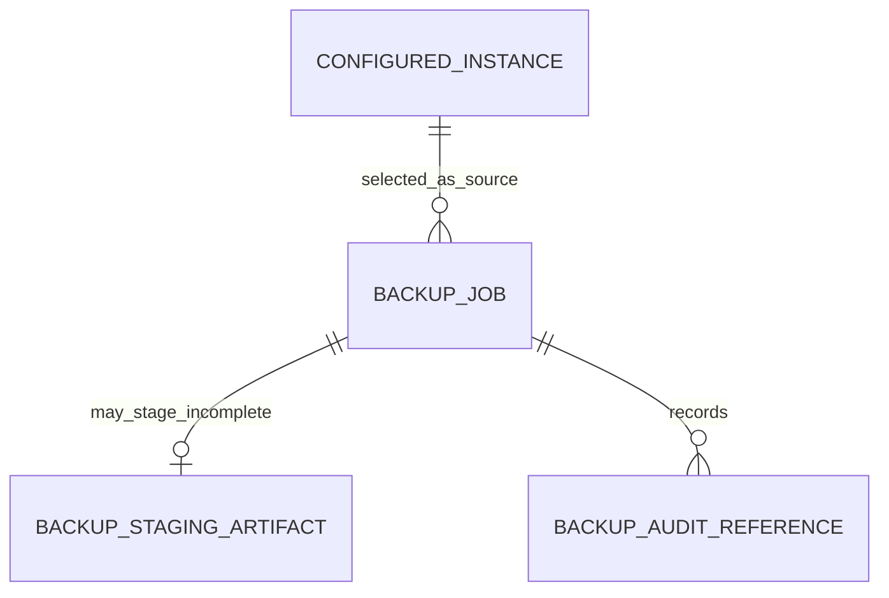

# Đặc tả chức năng — u1-backup-foundation

## Phạm vi và ownership

Unit U1 `u1-backup-foundation` tạo lát tích hợp localhost cho admin instance selection, durable job creation, local worker và artifact staging database-only. Đây không phải backup hoàn chỉnh: thiếu Auth và Storage bắt buộc khiến job kết thúc `incomplete` hoặc `failed`; không có chuyển trạng thái `succeeded`, không có download như backup hoàn chỉnh. Quy tắc này là fail-closed dù artifact staging được tạo để minh họa integration path.

U1 chịu trách nhiệm cho các acceptance criteria của US1.1 và phần API/job foundation của US1.2; AC của US1.2 về Auth/Storage capture, completed package, object-store retention/download đầy đủ thuộc U2. U1 chịu trách nhiệm phần audit foundation cho các hành động nó thực hiện. Không tái diễn giải các AC deferred thành đáp ứng một phần được coi là hoàn tất story.

Nguồn thiết kế: [`unit-of-work.md`](../../../inception/units-generation/unit-of-work.md), [`unit-of-work-story-map.md`](../../../inception/units-generation/unit-of-work-story-map.md), [`stories.md`](../../../inception/user-stories/stories.md), [`requirements.md`](../../../inception/requirements-analysis/requirements.md), [`components.md`](../../../inception/domain-design/components.md), [`contract-summary.md`](../../../inception/contract-design/contract-summary.md), và mockup admin [`mockups.md`](../../../inception/refined-mockups/mockups.md).

## Actors và boundaries

- **Admin operator:** người dùng đã xác thực và được server xác nhận administrator role.
- **Admin UI:** chọn ID instance đã cấu hình, bắt đầu job, xem trạng thái an toàn. U1 sở hữu UI tối thiểu này; các workflow/màn hình được mô tả ở đây vì Unit kind là `service` và không sinh `frontend-components.md`.
- **BackupAdminApi:** HTTP boundary; xác thực quyền, resolve configured ID, idempotency và safe DTO.
- **BackupPersistence:** lưu job, state version, idempotency digest và audit references bền vững.
- **BackupWorker:** claim/execute job local trong gateway process; không coi task sống trong memory là durable recovery.
- **DatabaseBackupAdapter + ArchiveIntegrity:** thu một lát database-only localhost, tính checksum cho artifact staging; không tuyên bố package đủ để restore.

Các connection details/credentials chỉ đến từ server-side config/secret facilities. Endpoint, connection string, service-role key và credentials do client gửi không được chấp nhận.

## Use case: Liệt kê instance và trạng thái trang

1. UI yêu cầu danh sách instance qua API đã bảo vệ.
2. API xác thực admin trước khi đọc danh sách.
3. API trả ID ổn định, label và environment label không bí mật; không trả endpoint/credential.
4. Nếu danh sách rỗng hoặc mọi lựa chọn bị disable, UI hiển thị empty/configuration-required state và vô hiệu hóa thao tác bắt đầu job.
5. Với lỗi auth/config, UI hiển thị thông báo an toàn và hành động phù hợp, không lộ dữ liệu cấu hình.

## Use case: Tạo job backup skeleton

1. Admin chọn `sourceInstanceId` từ danh sách server-configured và bấm bắt đầu.
2. API xác thực actor/role, kiểm tra ID tồn tại/được enable, xác thực body allowlist và kiểm tra `Idempotency-Key`.
3. Persistence tạo job `queued` cùng actor, source ID, request digest, state version và audit reference trong giao dịch bền vững. API chỉ trả `202` sau khi commit thành công.
4. Cùng actor/operation/key và cùng digest trả về job đã tồn tại; key trùng với digest khác bị từ chối `409`. Client không thể chọn URL, endpoint hay credential.
5. Worker claim job bằng state/version guard, chuyển `queued → running`, ghi thời gian bắt đầu và audit event.
6. Worker kiểm tra capability cho các thành phần bắt buộc. Ở U1, Auth và Storage chưa được capture/verify; đây là điều kiện không thể thành backup hoàn chỉnh.
7. Khi staging policy/limits hợp lệ, worker có thể thu database slice vào private staging, tạo checksum và ghi `BackupStagingArtifact(completeness=incomplete)`. Artifact không được expose qua download route và không được đóng gói/đánh dấu complete.
8. Khi xác nhận thiếu Auth/Storage, worker kết thúc job `incomplete` (nếu có artifact nội bộ) hoặc `failed` (nếu không thể tạo staging), ghi reason code/an toàn và outcome audit.
9. Nếu staging limits, expiry hoặc storage configuration bắt buộc thiếu/invalid, worker từ chối trước khi ghi bytes, kết thúc `failed`, và không để artifact mồ côi.
10. UI nhận job ID và status; status polling/refresh đọc `GET /jobs/{jobId}` theo authorization. UI chỉ hiển thị progress nếu có số đo thực, nếu không hiển thị trạng thái chữ.
11. Download một artifact/job `incomplete` hoặc `failed` bị từ chối, kể cả khi requester biết ID.

## UI workflows (U1 sở hữu)

### Admin navigation và chọn instance

- Đặt màn hình trong Backup & Restore của Admin UI hiện có; tái sử dụng selector/search pattern, localization, theme, focus ring và layout hiện tại.
- Hiển thị source selector với label/environment; không hiển thị endpoint, connection string, key hay secret.
- Khi không có instance: empty state giải thích chưa cấu hình, vô hiệu hóa bắt đầu job.
- Khi request/loading lỗi: error state có bước khắc phục an toàn; retry chỉ lặp list request, không tạo side effect.

### Bắt đầu và theo dõi job

- Nút bắt đầu disabled khi chưa chọn instance hợp lệ hoặc request đang gửi.
- Double submit dùng idempotency key; UI không tạo job thứ hai cho cùng hành động.
- Sau `202`, hiển thị job ID, trạng thái queued/running và thời gian.
- Kết quả `incomplete` phải ghi rõ “chưa phải backup hoàn chỉnh; Auth/Storage chưa được bao gồm”, không dùng màu/icon thành dấu hiệu duy nhất và không có nút Download.
- Job `failed` hiển thị safe reason code/translation key và hành động tiếp theo; không show raw adapter error.
- Thiết kế responsive theo mockup; thao tác core bằng keyboard; status có text và biểu tượng/treatment phụ trợ.

## Job lifecycle và state machine

`queued → running → incomplete | failed`

- U1 không khai báo `succeeded` là trạng thái hợp lệ cho DB-only flow.
- Chuyển trạng thái dùng expected state + state version để từ chối stale/duplicate worker transition.
- Terminal states không tự được nâng lên `succeeded`; status `incomplete` không đồng nghĩa `recovery-required`.
- Timeout/crash/unknown side effect không chứng minh “không có side effect”; U1 bảo toàn trạng thái non-success và ghi lỗi an toàn. Lease, heartbeat, restart/reconciliation policy chi tiết là open design item; không giả định process task tự phục hồi.
- Cancellation semantics, job history list/pagination, lease recovery và staging cleanup schedule là open contract/design items; U1 không được phơi API hủy nếu chưa định nghĩa an toàn.

```mermaid
stateDiagram-v2
  [*] --> queued
  queued --> running: worker claims with expected state/version
  running --> incomplete: database slice staged; required Auth/Storage absent
  running --> failed: configuration, source, archive, audit, or worker failure
  incomplete --> [*]
  failed --> [*]
```

Text fallback: Một job bắt đầu ở queued, worker claim thành running, rồi kết thúc incomplete khi chỉ có database slice hoặc failed khi không thể xử lý an toàn. U1 không có success transition.

## Entity relationship view

Text fallback: Configured instance có thể là nguồn của nhiều job; một job có zero hoặc một staging artifact private chưa hoàn chỉnh và nhiều audit references. Source database entities không được BackupRestore sở hữu.

## API behaviour used by U1

U1 cung cấp phần tối thiểu của OpenAPI admin contract:

- `GET /api/admin/backup-restore/instances`: authorized configured instance projection.
- `POST /api/admin/backup-restore/backups`: create durable job; request chứa `sourceInstanceId`; response `202` gồm `jobId` và `queued`; idempotency key bắt buộc.
- `GET /api/admin/backup-restore/jobs/{jobId}`: authorized safe status projection; resource access được kiểm tra trên mỗi lần đọc.
- No U1 complete-package download route. C2/C3 package download only applies after U2 can produce a verified complete package.

Errors have stable safe codes, non-sensitive messages and correlation/job ID. Authorization failures, invalid/disabled source, duplicate key with different request, persistence failure, staging-limit failures and missing capabilities do not disclose credentials or raw source content.

## Rules summary

- BR1.1–BR1.2: server admin auth and allowlisted configured instance IDs only.
- BR1.3: persist-before-accept and idempotent job creation.
- BR1.4–BR1.6: incomplete status is truthful, non-downloadable and cannot become succeeded in U1.
- BR1.7: staging requires valid finite bounds/expiry; otherwise refuse before bytes are written.
- BR1.8: audit actor/source/job/digest/outcome without secrets or contents.
- BR1.9: UI distinguishes empty/loading/error/incomplete states; never fabricate progress.

## Acceptance-criteria partition for U1

| Story / criterion | U1 disposition | Design outcome |
|---|---|---|
| US1.1 / AC1.1.1 | In scope | Configured instance labels shown to authorized admin. |
| US1.1 / AC1.1.2 | In scope | Empty config disables job creation with clear explanation. |
| US1.1 / AC1.1.3 | In scope | Server rejects unauthorized list request. |
| US1.1 / AC1.1.4 | In scope | Client-provided endpoints/credentials rejected/not accepted by schema. |
| US1.2 / AC1.2.1 | In scope | Durable job ID/status returned for valid request. |
| US1.2 / AC1.2.2 | Deferred to U2 | Complete DB/Auth/Storage manifest/package belongs to complete-backup Unit. |
| US1.2 / AC1.2.3 | Partial U1 + remainder U2 | U1 can checksum private database staging; U2 verifies all required component digests before any complete success. |
| US1.2 / AC1.2.4 | In scope | Missing required components prevents success/download. |
| US1.2 / AC1.2.5 | In scope | U1 DB/config errors are safe; U2 extends Auth/Storage cases. |
| US1.2 / AC1.2.6 | In scope | U1 status/metadata do not claim point-in-time; best-effort scope disclosed. |
| US3.2 / AC3.2.1–AC3.2.3 | Partial U1 | Audit for U1 actions only; each later Unit owns audit for its own sensitive operations. |
| NFR1, NFR3, NFR4, NFR6, NFR7 | U1 applicable portions | Auth boundary, honest integrity, finite staging bounds, tests, keyboard/text status and safe UI are specified. |

## Open questions and deferred design

- Exact configured instance registry and secret/config provider implementation; no client-controlled values are accepted.
- Persistence schema/migration ownership and transaction mechanics; existing domains retain source table ownership.
- Worker lease/heartbeat, restart recovery, unknown side-effect reconciliation, cancellation and staging cleanup scheduler.
- Actual database export method, allowlisted schemas/tables, and source/target compatibility.
- Auth export/import/password/session semantics and Storage object scope are not implemented in U1 and remain fail-closed.
- Numeric upload/archive/time/concurrency bounds and object-store retention/encryption are not invented here; required configuration must exist before staging or real-data use.
- Job history list/pagination and cancellation API semantics remain unpinned; only authorized single-job status read is specified for this U1 slice.
