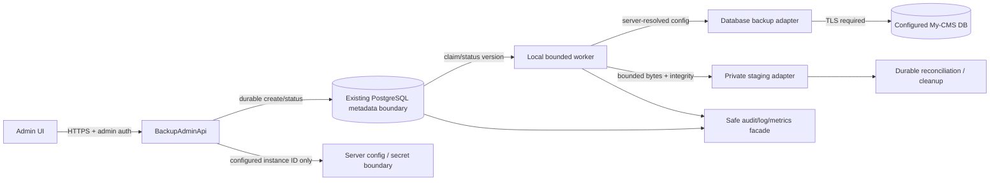

# Logical Components — u1-backup-foundation

## Scope and component view

U1 remains embedded in the existing `my-cms-api` gateway; these are logical boundaries, not separately deployed services. Existing source-domain ownership stays unchanged. This inventory derives from [`components.md`](../../../inception/domain-design/components.md), U1 Unit definition and contracts, and NFR requirements. Current source implementation details remain to be verified before coding.

Text fallback: Admin UI calls a protected gateway API. The API persists an authorized job and opaque instance ID. A bounded local worker resolves source config server-side, captures only the U1 database slice, and may write an explicitly incomplete private staging artifact. A durable metadata/reconciliation path owns cleanup; if TLS, bounded storage or cleanup guarantees are missing, the real-data write path is disabled. Safe audit/log/metrics share a privacy-filtered facade.

## Components and failure domains

| Component | Responsibility | Sensitive data boundary | Failure behavior |
|---|---|---|---|
| Admin UI | Instance select, start job, safe status/incomplete UX | Receives configured labels/IDs and safe DTO only | No arbitrary endpoint/credential fields; no download for incomplete. |
| BackupAdminApi | Authn/authz, input allowlist, idempotency, durable job commit, resource-protected reads | Handles request token transiently; never persists it | Reject unauthenticated/non-admin/config-invalid; response after durable commit only. |
| ConfiguredInstanceResolver | Resolve opaque source ID to server-owned connection capability | Secret provider boundary | Missing/invalid configuration disables job before data access; no secret in DTO. |
| BackupPersistence | Durable job, state version, idempotency digest, audit reference | Metadata only | Atomic conditional transitions; persistence uncertainty means no success. |
| Local bounded worker | Claim and run job under concurrency/time/byte budgets | Orchestrates handles, not client-supplied secrets | Crash/timeout leaves non-success; no automatic resume without lease protocol. |
| Database adapter | U1 localhost DB-only export within verified scope | Reads source rows and streams bytes | Missing scope/TLS/limits or uncertain outcome fails closed. |
| Private staging adapter | Write private incomplete bytes, compute/record integrity | Stores sensitive bytes under approved protection | No write without private/TLS/encryption/expiry/cleanup gates; no public URL. |
| Reconciliation/cleanup worker | Discover expired/orphaned artifacts and delete | Storage metadata and private object refs | Bounded retry; observable delete failure; real-data writes disabled if cleanup state unresolved. |
| Audit/telemetry facade | Structured safe events/metrics and correlation | No raw payloads/secrets | Pre-side-effect audit outage rejects execution; external exporter off by default. |

## Failure-domain and blast-radius controls

- API request handling is isolated from long-running export by durable job creation.
- Worker concurrency, queue, deadlines and bytes are configured finite; one job cannot consume unbounded process resources.
- Storage cleanup failure is isolated as a security incident/state; it blocks new real-data staging for affected scope.
- U1 cannot mutate a restore target. Restore, target locks and cross-system recovery belong to later Units.
- No horizontal scaling or multi-host guarantee; each worker claim uses atomic state version, but lease ownership requires later design.

## Open design gates

- Verify gateway TLS and admin auth integration, database connection TLS, staging object-store TLS/at-rest protection.
- Define persistent orphan index/namespace and cleanup/reconciliation mechanism with crash tests.
- Define finite config schema and default policy; missing required values refuse.
- Confirm existing DB schema/migration ownership and safe route registration.
- No component claims production support, complete Auth/Storage capture, automatic restart recovery, or absolute deletion guarantee under unavailable storage.
