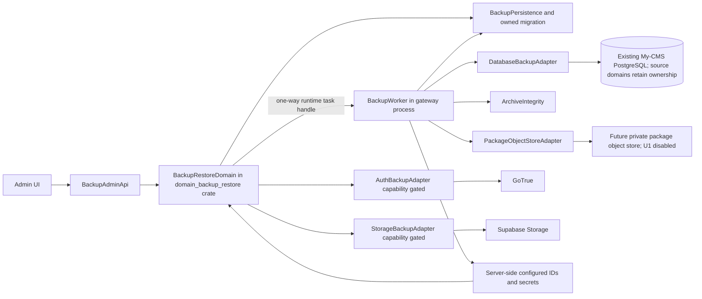

# Components — Backup & Restore

## Component catalogue

```yaml
components:
  - name: BackupRestoreDomain
    summary: Gateway-registered `domain_backup_restore` crate owning backup workflows and durable backup metadata.
    behaviour: >
      Implements a DomainService registered by the existing API gateway in the same
      process. Owns backup job/package metadata, lifecycle rules and migration identity.
      It never owns source CMS/Auth/Storage data. It coordinates DatabaseBackupAdapter,
      AuthBackupAdapter, StorageBackupAdapter and ArchiveIntegrity through typed ports;
      a runtime dispatch handle schedules the bounded worker without creating a reverse
      domain-worker service dependency. The first U1 slice is localhost-only; until
      private encrypted staging, finite bounds and restart-safe cleanup are verified,
      it creates durable job outcomes only and writes no real source data or staging
      bytes. A missing required Auth/Storage capability fails the job; it cannot
      report a complete backup.
    responsibilities:
      - Own backup lifecycle policy, configured-ID validation and safe status projection
      - Define the BackupJob/BackupPackage/BackupAuditEvent contracts implemented by BackupPersistence
      - Coordinate database/Auth/Storage/archive ports as later Units enable capabilities
      - Schedule bounded worker work through a one-way runtime handle
      - Enforce failed/incomplete/succeeded semantics and prevent false complete-backup claims
    depends_on:
      - component: BackupPersistence
        interaction: Persist job/package/audit records and perform guarded state transitions
        style: sync
      - component: DatabaseBackupAdapter
        interaction: Capture the approved database slice through a narrow port
        style: sync
      - component: AuthBackupAdapter
        interaction: Query and use only verified GoTrue capabilities
        style: sync
      - component: StorageBackupAdapter
        interaction: Query and use only verified Storage capabilities
        style: sync
      - component: ArchiveIntegrity
        interaction: Validate bounded manifest/archive/digest operations
        style: sync
      - component: PackageObjectStoreAdapter
        interaction: Access private package-byte boundary when policy is approved
        style: sync
      - component: BackupWorker
        interaction: Schedule a bounded operation through a one-way runtime handle; worker does not call back into the domain
        style: async
    dependents:
      - component: BackupAdminApi
        interaction: API handlers call domain use cases and safe projections
        style: sync
    external_dependencies:
      - name: Existing My-CMS gateway and PostgreSQL connection
        kind: database
        purpose: Compose the service in-process and store backup-domain metadata without source-table ownership
      - name: Server-side configured instance/secret source
        kind: other
        purpose: Resolve opaque configured instance IDs to connection capabilities
    entities:
      - name: BackupJob
        identifier: job_id
        attributes: [operation, public_status, artifact_completeness, actor_id, source_instance_id, request_digest, state_version, timestamps, safe_reason, recovery_state]
        references:
          - entity: BackupPackage
            owned_by: BackupRestoreDomain
            relationship: A complete future backup job may produce one verified package; U1 cannot produce one
      - name: BackupPackage
        identifier: package_id
        attributes: [source_instance_id, format_version, manifest_ref, archive_ref, bytes, checksum, inventory, consistency, retention_until]
        references:
          - entity: BackupJob
            owned_by: BackupRestoreDomain
            relationship: A complete package is associated with its originating job
      - name: BackupAuditEvent
        identifier: audit_id
        attributes: [actor_id, operation, job_id, package_id, source_instance_id, target_instance_id, digest, occurred_at, outcome, safe_reason]
        references:
          - entity: BackupJob
            owned_by: BackupRestoreDomain
            relationship: Many lifecycle audit events may refer to one job
          - entity: BackupPackage
            owned_by: BackupRestoreDomain
            relationship: An audit event may refer to a package

  - name: BackupPersistence
    summary: Persistence adapter and migration implementation owned by the `domain_backup_restore` crate.
    behaviour: >
      Stores backup-domain metadata only, in a domain-owned schema/migration.
      Does not write CMS posts/users/media source tables and does not store raw
      credentials, DB rows or object bytes. Idempotency uniqueness is scoped by
      actor, operation and key digest; request digest distinguishes key reuse.
      It owns job and package metadata, not the private staging/package bytes.
      Object-byte storage is deferred to a separately configured private object
      store only after TLS, at-rest encryption, finite bounds and durable cleanup
      policy are verified; no new provider is selected in U1.
    responsibilities:
      - Own the domain_backup_restore migration and metadata entities
      - Enforce composite idempotency and optimistic state-version transitions
      - Persist one-to-many audit events and safe reason codes
      - Provide durable staging lifecycle/reconciliation metadata if staging is enabled later
    depends_on: []
    dependents:
      - component: BackupRestoreDomain
        interaction: Implement domain-owned repository/transaction ports
        style: sync
    external_dependencies:
      - name: Existing gateway PostgreSQL connection
        kind: database
        purpose: Store backup metadata in the schema owned by domain_backup_restore
    entities: []

  - name: BackupAdminApi
    summary: Administrator-only API routes registered by the backup domain service in the gateway.
    behaviour: >
      Receives authenticated actor context from the gateway Administrator mount,
      accepts opaque configured IDs and strict DTOs, authorizes every resource
      read/write, and returns safe responses. U1 has no complete-package download.
    responsibilities:
      - List safe configured instance labels and IDs
      - Create durable backup jobs and return a job ID only after persistence
      - Return a single authorized safe job-status projection
      - Reject arbitrary endpoint/credential fields and incomplete artifact downloads
    depends_on:
      - component: BackupRestoreDomain
        interaction: Invoke authorized domain operations
        style: sync
    dependents: []
    external_dependencies:
      - name: Gateway Administrator mount and AuthenticatedActor
        kind: other
        purpose: Apply existing server-side JWT/administrator authorization
    entities: []

  - name: BackupWorker
    summary: Bounded in-process worker implementation invoked through a runtime handle; not a separately deployed service.
    behaviour: >
      Implements the worker execution port used by BackupRestoreDomain and persists
      state through BackupPersistence. The domain schedules the worker via an injected
      one-way runtime handle; the worker does not call back into the domain service,
      avoiding a dependency cycle. Tokio task execution is not durable by itself.
      Stale or unknown outcomes remain non-success and require reconciliation. U1
      writes no real-data staging until TLS, private encryption, finite bounds and
      restart-safe cleanup are verified.
    responsibilities:
      - Claim and execute backup jobs outside HTTP request lifetime
      - Maintain safe non-success outcomes for incomplete/failed capabilities
      - Enforce configured finite bounds and cleanup/reconciliation gates
      - Never infer success from an artifact's existence after restart
    depends_on:
      - component: BackupPersistence
        interaction: Claim and persist guarded job state through repository port
        style: sync
      - component: DatabaseBackupAdapter
        interaction: Execute the approved database slice when permitted
        style: sync
      - component: ArchiveIntegrity
        interaction: Validate permitted private test artifact bytes
        style: sync
      - component: PackageObjectStoreAdapter
        interaction: Perform permitted private byte operations
        style: sync
    dependents: []
    external_dependencies:
      - name: Gateway worker runtime handle
        kind: other
        purpose: Invoke bounded local worker operation one-way from the domain without a callback; no durable queue or restart-resume promise
    entities: []

  - name: PackageObjectStoreAdapter
    summary: Future private object-byte adapter; no provider is selected and U1 real-data staging remains disabled.
    behaviour: >
      Owns the storage-byte boundary for completed packages and optional private
      staging, separate from BackupPersistence metadata. It is enabled only after
      a provider, TLS identity, encryption-at-rest, finite bounds, retention and
      durable orphan cleanup policy are approved and verified.
    responsibilities:
      - Put/get/delete package or staging bytes through a private configured client
      - Enforce finite byte and expiry budgets before writes
      - Return opaque references/digests, never public URLs by default
      - Discover/reconcile orphaned bytes and surface cleanup failure
    depends_on: []
    dependents:
      - component: BackupRestoreDomain
        interaction: Domain requests package byte operations and applies policy
        style: sync
      - component: BackupWorker
        interaction: Worker performs permitted byte operations through the adapter
        style: sync
    external_dependencies:
      - name: Future configured private object store
        kind: object-store
        purpose: Store package/staging bytes once security and retention controls are approved
    entities: []

  - name: DatabaseBackupAdapter
    summary: Narrow adapter for the approved My-CMS database slice; source tables remain domain-owned.
    behaviour: >
      Reads only an allowlisted scope after database owner/method/version are approved.
      Reports safe capability and integrity metadata. No database export occurs while
      scope, TLS or data-boundary policy is unresolved.
    responsibilities:
      - Validate configured database capability and version
      - Export an approved schema/table slice through a bounded interface
      - Provide counts/bytes/digest evidence without exposing raw rows in metadata/logs
    depends_on: []
    dependents:
      - component: BackupRestoreDomain
        interaction: Domain invokes export capability
        style: sync
      - component: BackupWorker
        interaction: Worker invokes the approved database export port
        style: sync
    external_dependencies:
      - name: Existing My-CMS PostgreSQL instance
        kind: database
        purpose: Read approved source data under current domain ownership
    entities: []

  - name: AuthBackupAdapter
    summary: Capability-gated adapter for GoTrue/Auth, deferred until platform semantics are verified.
    behaviour: >
      Does not assume password hashes or sessions are exportable/restorable. Missing
      or unverified required Auth capability causes backup failure and blocks any
      complete-package claim.
    responsibilities:
      - Verify supported GoTrue version/API and password/session effects
      - Provide a typed safe capability result
      - Export/import only an approved identity scope in later Units
    depends_on: []
    dependents:
      - component: BackupRestoreDomain
        interaction: Domain checks capability and invokes supported export/import
        style: sync
      - component: BackupWorker
        interaction: Worker invokes the verified Auth capability when enabled in a later Unit
        style: sync
    external_dependencies:
      - name: Supabase GoTrue
        kind: third-party-api
        purpose: Identity capability, still subject to platform verification
    entities: []

  - name: StorageBackupAdapter
    summary: Capability-gated adapter for Supabase Storage objects and metadata, deferred until verified.
    behaviour: >
      Requires an approved bucket scope, pagination/completeness evidence, TLS and
      private bounded staging/cleanup before reading or writing real object bytes.
    responsibilities:
      - Verify configured bucket/object capability and safe paths
      - Enumerate/download/upload only an approved scope in later Units
      - Report safe counts, byte sizes and digest evidence
    depends_on: []
    dependents:
      - component: BackupRestoreDomain
        interaction: Domain checks capability and invokes supported capture/restore
        style: sync
      - component: BackupWorker
        interaction: Worker invokes the verified Storage capability when enabled in a later Unit
        style: sync
    external_dependencies:
      - name: Supabase Storage
        kind: object-store
        purpose: Source object bytes and metadata, capability unresolved
    entities: []

  - name: ArchiveIntegrity
    summary: Bounded archive/manifest validation and digest services; U1 is test-fixture-only until staging gates pass.
    behaviour: >
      Rejects unsafe paths, symlinks, conflicts, bombs and finite limit violations.
      Never executes package content. A digest validates bytes only; it does not
      establish completeness or restoreability.
    responsibilities:
      - Serialize/version manifest formats after contract approval
      - Compute/verify SHA-256 and size/count inventory
      - Enforce bounded processing and safe relative paths
      - Deny promotion/download of incomplete artifacts
    depends_on: []
    dependents:
      - component: BackupRestoreDomain
        interaction: Domain requests bounded integrity operations
        style: sync
      - component: BackupWorker
        interaction: Worker invokes digest/validation operations
        style: sync
    external_dependencies: []
    entities: []
```

## Component Diagram



Text fallback: The gateway registers `domain_backup_restore` as an in-process domain crate. The crate owns backup job/package/audit metadata and its migration; API routes use the gateway's administrator mount. The domain schedules the worker through a one-way runtime handle; the worker uses persistence, database/archive and package-byte adapter ports without calling back into the domain. PackageObjectStoreAdapter owns bytes, while BackupPersistence stores metadata and opaque references only. No separate process or AWS resource is introduced. Database/Auth/Storage source data remain platform/domain owned. U1 performs no real-data staging until protection and cleanup gates pass.

## Component Summary

| Component | Purpose | Depends On | Dependents | Entities Owned |
|---|---|---|---|---|
| BackupRestoreDomain | `domain_backup_restore` crate; use cases, state rules, service registration | BackupPersistence, adapters, ArchiveIntegrity; schedules worker by one-way runtime handle | BackupAdminApi | BackupJob, BackupPackage, BackupAuditEvent |
| BackupPersistence | Durable metadata repository and migration owned by new domain crate | Existing gateway PostgreSQL connection | BackupRestoreDomain, BackupWorker | Backup-only metadata |
| BackupAdminApi | Protected configured-instance/job routes | BackupRestoreDomain | None | None |
| BackupWorker | Bounded in-process execution; no callback to domain service | BackupPersistence, DatabaseBackupAdapter, ArchiveIntegrity, PackageObjectStoreAdapter | BackupPersistence | None |
| PackageObjectStoreAdapter | Future private byte-storage port; provider not selected | Future configured private object store | BackupRestoreDomain, BackupWorker | No metadata/source entities |
| DatabaseBackupAdapter | Approved DB slice capability | Existing PostgreSQL | BackupRestoreDomain, BackupWorker | No source entities |
| AuthBackupAdapter | Verified GoTrue capture/import capability | GoTrue | BackupRestoreDomain | No source entities |
| StorageBackupAdapter | Verified Storage object capability | Supabase Storage | BackupRestoreDomain | No source entities |
| ArchiveIntegrity | Bounded validation and checksum | None | BackupRestoreDomain, BackupWorker | None |

## Entity Ownership

| Entity | Owning Component | Identifier | Attributes | References |
|---|---|---|---|---|
| BackupJob | BackupRestoreDomain | job_id | public status, completeness, actor/source, idempotency/request digest, state version, timestamps, safe reason, recovery state | BackupPackage, many audit events |
| BackupPackage | BackupRestoreDomain | package_id | format, manifest/archive refs, `byte_size`, checksum, inventory, consistency, retention | BackupJob |
| BackupAuditEvent | BackupRestoreDomain | audit_id | actor, operation, job/package, source/target, digest, time, outcome, safe reason | BackupJob and optional BackupPackage |

CMS source rows, GoTrue identities and Storage objects are not re-owned by BackupRestoreDomain; adapters access them only through verified interfaces.

## External Dependencies

| Component | Dependency | Kind | Purpose |
|---|---|---|---|
| BackupRestoreDomain | Existing gateway composition/shared PostgreSQL connection | database/other | Register service in-process; run domain-owned migration and persist backup-only metadata |
| PackageObjectStoreAdapter | Future configured private object store | object-store | Adapter owns package/private staging byte operations after provider and policy approval; no U1 real-data use |
| DatabaseBackupAdapter | My-CMS PostgreSQL | database | Approved source rows; existing domains retain ownership |
| AuthBackupAdapter | GoTrue | third-party-api | Supported identity capability; verification pending |
| StorageBackupAdapter | Supabase Storage | object-store | Source object bytes/metadata; TLS/private staging gates pending |
| BackupWorker | Tokio runtime in gateway | other | Bounded execution only; no durable queue claim |

## Rationale and boundary decisions

| Decision | Rationale | Alternatives Rejected |
|---|---|---|
| Add `domain_backup_restore` as an in-process gateway-registered crate | User selected this crate as the owner of job metadata and migration. It reuses gateway composition/shared pool without creating an independent deployment. | Put backup metadata in `domain_posts`, `domain_user`, `domain_media`, or `domain_seo`; create a new service/process; let gateway write unowned tables. |
| BackupRestoreDomain owns only backup lifecycle metadata | Distinct lifecycle and migration ownership, while source rows remain with current domains/platforms. | Transfer CMS/Auth/Storage data ownership to backup crate. |
| API + bounded worker + durable state | Long-running tasks need status and persistence before `202`; Tokio alone is not crash-safe. | Long synchronous HTTP request; in-memory-only job; uncoordinated adapters. |
| No real-data staging in U1 until infrastructure gates pass | TLS, private encryption, finite bounds and durable cleanup are unverified prerequisites. | Implicit localhost exception or default temp storage. |
| Saga/state machine for later restore | DB/Auth/Storage do not share atomic transactions; honest recovery states are required. | Claim global ACID or partial success. |

## Explicit consequences and follow-up decisions

Adding this crate revises the previously approved gateway-only construction implementation detail; the existing workflow plan, Units, contracts, and per-Unit Functional/NFR/Infrastructure artifacts must be synchronized before construction resumes. The new domain's Cargo manifest/workspace registration, gateway manifest registration, migration registry, backup-status schema, migration idempotency/rollback, and test ownership must be specified in revised design artifacts. Deployment remains the same gateway process; do not infer a separate service or production target. Real-data storage still remains disabled until cleanup and TLS gates are verified.
