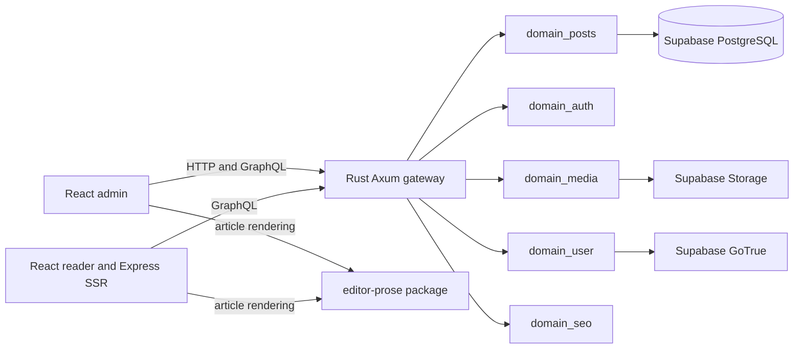
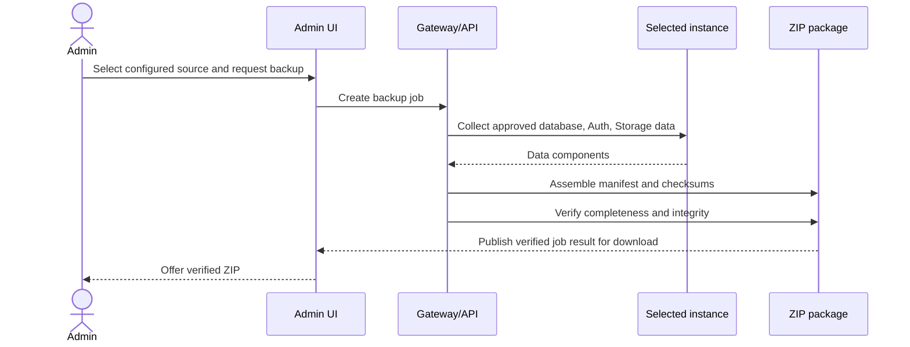
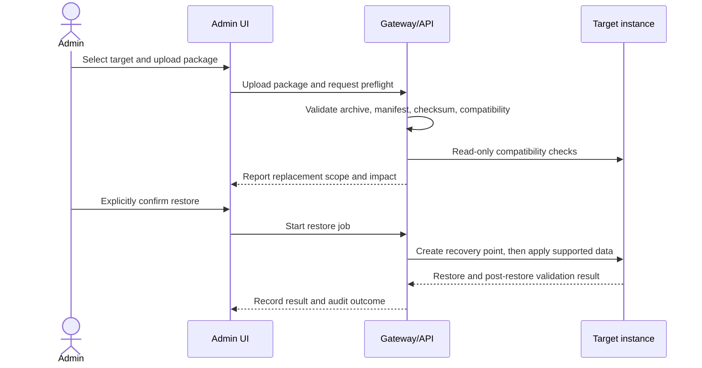

# Architecture

## Architecture Analysis

### System Overview
A multi-application CMS: a Rust Axum gateway composes domain crates, a React admin client, and a React/Express public reader. Shared frontend article prose is packaged separately. PostgreSQL/Supabase services and object storage support backend persistence and media. This description reflects the scan and project architecture documentation; details outside inspected paths are not asserted as fully verified.

### Architectural Style
Hybrid modular monolith: one shipped API binary composed from domain crates, with separately built web applications and shared frontend package. Evidence includes the gateway and domain Cargo workspace, app manifests, and documented sole binary `my-cms-api`.

### Component Relationships

Text fallback: the gateway composes five domains; the admin and public reader call the API and share article rendering; backend domains connect to PostgreSQL, Storage, or GoTrue according to ownership.

### Data Flow
The gateway builds shared application services and mounts domain routes. Frontend applications issue API/GraphQL requests. In the backup feature's documented target flow, an administrator selects a configured source, a job gathers approved database/Auth/Storage components and packages/verifies them; restore upload and preflight are read-only against the target until explicit confirmation. The latter is a specification, not verified deployed behavior.

### Key Design Decisions
- The gateway is the shipped API composition root; domain crates retain domain logic and owned migrations, with post migrations owned by `domain_posts`.
- The backup/restore spec treats restore as replacement within supported scope rather than merge, requires preflight and explicit confirmation, and prohibits executing commands supplied by an uploaded archive.
- The scan did not validate complete backup implementation; the feature document says no complete ZIP flow, admin UI, upload/import restore, or instance selection exists.

### Improvement Opportunities
Deeply verify route and authorization boundaries, backup package format and integrity checks, archive safety limits, supported Supabase/Auth/Storage export mechanisms, cancellation/retry and concurrency controls, rollback guarantees, and audit behavior before treating backup/restore as operational.

## Interaction Diagrams

### Backup target flow (specified behavior)

Text fallback: the admin requests a job; the backend collects and verifies all required components before exposing a downloadable package. This diagram represents the feature specification, not confirmed implementation.

### Restore target flow (specified behavior)

Text fallback: upload and preflight must not modify the target; only a separately confirmed restore may apply changes, with recovery and validation. This is specified behavior, not verified implementation.
