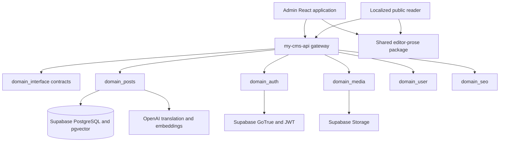
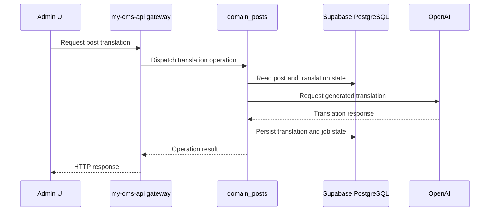

# Architecture

## System Overview

The application is a hybrid system: one Rust/Axum API gateway composes domain libraries, alongside separate React administration and public-reader applications. A shared React prose package supplies article presentation and Mermaid enhancement. Docker Compose/Swarm and Helm/Kubernetes deployment definitions are present.

## Architectural Style

Modular monolith at the API process boundary, with domain-oriented Rust crates behind a single gateway, plus separately built frontend applications. This description is grounded in the scanned workspace manifests and selected service/entry-point files; deployment runtime topology was not validated by execution.

## Component Relationships

Text fallback: the gateway composes the five domain crates under `domain_interface`; the frontends use the shared prose package and communicate with backend capabilities. Posts use PostgreSQL and external AI integration; auth and media integrate with Supabase identity and storage. The exact client-to-service request paths were not exhaustively traced.

## Data Flow

The admin authoring UI submits content operations to the API. The posts domain owns content persistence and translation behavior; media operations use the storage adapter. The public reader obtains content and renders localized pages with the shared prose package. Detailed request payloads, caching behavior, and all persistence flows remain unverified beyond the scan's selected entry points.

## Key Design Decisions Evidenced

- One gateway binary composes domain services; project knowledge explicitly identifies it as the sole shipped API binary.
- Domain capabilities are separated into Rust crates implementing shared service/route contracts.
- Admin and public reader are separate React applications; both consume a shared article-prose library.
- Supabase and OpenAI provide external platform capabilities; credentials and runtime configuration were not inspected in this synthesis.

## Improvement Opportunities

- Decompose the 1,144-line translation handler by responsibility and add focused tests around failure and persistence paths.
- Resolve whether `.github/workflows/ci-my-cms.yml` is intentionally disabled before treating it as an active quality gate.
- Validate deployment topology and end-to-end data flow in a later operational review; no programs or tests were run here.

## Interaction Diagrams

Text fallback: the admin requests translation through the gateway; the posts domain interacts with the database and OpenAI and returns a result. This sequence is an evidence-based high-level synthesis, not a validated complete request trace; exact job scheduling and transaction semantics were not fully scanned.