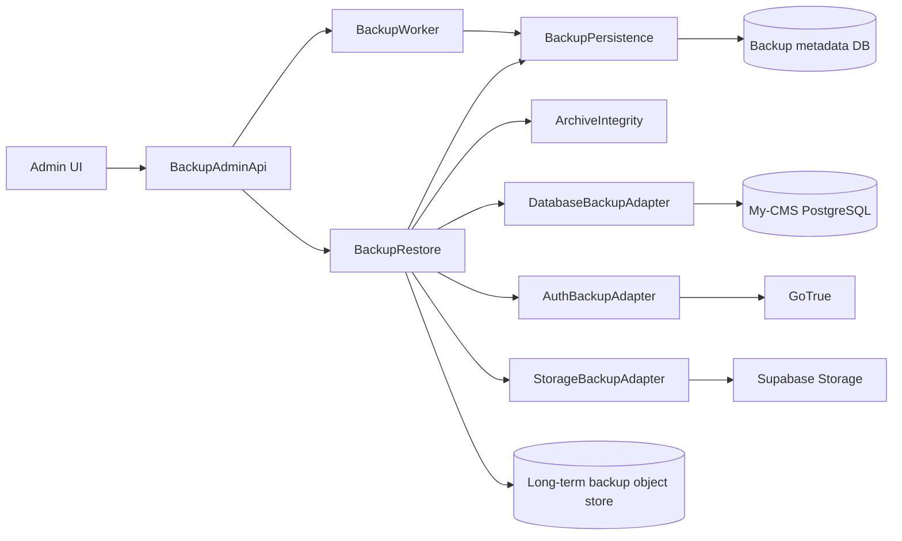

# Components — Backup & Restore

## Component catalogue

```yaml
components:
  - name: BackupRestore
    summary: Điều phối tạo backup, preflight và restore của instance My-CMS/Supabase đã cấu hình.
    behaviour: >
      Quản lý state machine cho backup/restore jobs; xác thực quyền admin tại API boundary;
      phối hợp exporter/importer theo domain/platform adapters; dựng và kiểm tra package ZIP;
      không nhận credentials/endpoints tùy ý từ client; chỉ đánh dấu thành công sau integrity
      checks và post-restore validation; dùng best-effort consistency và không hứa atomicity
      xuyên database, Auth và Storage. Backup component sở hữu job và package metadata,
      không sở hữu các source data entities.
    responsibilities:
      - Job lifecycle, idempotency, concurrency lock theo target và safe status/error projection
      - Manifest, inventory, checksum, package format version và compatibility preflight
      - Archive validation, path/symlink/size/entry limits và staging cleanup policy
      - Điều phối recovery point, restore order, checkpoint, rollback/recovery-required và post-validation
      - Audit references cho actor, source/target, job/package, digest và outcome
    depends_on:
      - component: BackupPersistence
        interaction: Đọc/ghi job, package metadata và audit references
        style: sync
      - component: DatabaseBackupAdapter
        interaction: Export/import dữ liệu My-CMS trong phạm vi được hỗ trợ
        style: sync
      - component: AuthBackupAdapter
        interaction: Export/import GoTrue/Auth theo phương thức nền tảng hỗ trợ
        style: sync
      - component: StorageBackupAdapter
        interaction: Enumerate, capture và restore object bytes cùng metadata
        style: sync
      - component: ArchiveIntegrity
        interaction: Assemble/extract ZIP, manifest và checksum có giới hạn an toàn
        style: sync
    dependents:
      - component: BackupAdminApi
        interaction: Protected API boundary invokes use cases and returns results
        style: sync
    external_dependencies:
      - name: PostgreSQL
        kind: database
        purpose: Lưu dữ liệu My-CMS hiện hữu; ownership tiếp tục ở domain chủ quản
      - name: GoTrue
        kind: third-party-api
        purpose: Identity service; export/restore capability cần được xác minh
      - name: Supabase Storage
        kind: object-store
        purpose: Lưu object bytes và metadata của media
      - name: Configured backup object store
        kind: object-store
        purpose: Lưu package backup dài hạn theo retention/encryption policy
    entities:
      - name: BackupJob
        identifier: job_id
        attributes: [job_id, operation, status, actor_id, source_instance_id, target_instance_id, started_at, completed_at, consistency_mode, error_code, recovery_state]
        references:
          - entity: BackupPackage
            owned_by: BackupRestore
            relationship: job tạo zero hoặc one package backup đã hoàn tất
      - name: RestoreJob
        identifier: job_id
        attributes: [job_id, package_id, target_instance_id, status, confirmed_by, confirmed_at, recovery_state, started_at, completed_at]
        references:
          - entity: BackupPackage
            owned_by: BackupRestore
            relationship: restore job tiêu thụ một package đã preflight
      - name: BackupPackage
        identifier: package_id
        attributes: [package_id, source_instance_id, format_version, manifest_path, archive_path, size_bytes, checksum, component_inventory, consistency_statement, created_at, retention_until]
        references:
          - entity: BackupJob
            owned_by: BackupRestore
            relationship: package được tạo bởi một backup job
      - name: BackupAuditReference
        identifier: audit_id
        attributes: [audit_id, actor_id, operation, job_id, package_id, source_instance_id, target_instance_id, digest, occurred_at, outcome, recovery_state]
        references:
          - entity: BackupJob
            owned_by: BackupRestore
            relationship: audit reference có thể liên kết job
          - entity: BackupPackage
            owned_by: BackupRestore
            relationship: audit reference có thể liên kết package

  - name: BackupAdminApi
    summary: API được bảo vệ cho admin UI quản lý instance choices, jobs, upload, preflight và package download.
    behaviour: >
      Kiểm tra administrator role server-side cho mọi route và resource; instance IDs map tới
      server-configured allowlist; không nhận credentials hay arbitrary endpoint từ browser;
      enforce body/upload bounds; kiểm tra quyền đọc job/package; trả safe DTO/error.
    responsibilities:
      - Admin-only routes cho configured instances, job create/status, upload/preflight, restore confirm và download
      - Chống CSRF phù hợp với auth/session model hiện hữu và giới hạn request body
      - Idempotency/duplicate-submit semantics tại boundary
      - Response localization keys và field validation errors
    depends_on:
      - component: BackupRestore
        interaction: Gọi use cases và trả job/preflight/download result
        style: sync
    dependents:
      - component: BackupRestore
        interaction: BackupRestore khởi tạo/đăng ký API boundary trong gateway composition
        style: sync
    external_dependencies:
      - name: Supabase GoTrue JWT/auth middleware
        kind: third-party-api
        purpose: Xác thực actor và role admin theo gateway contract
    entities: []

  - name: BackupWorker
    summary: Thực hiện job backup/restore dài hạn qua orchestrator đã persisted.
    behaviour: >
      Claim job theo lock/concurrency policy, thực hiện state transitions, áp dụng timeout
      và cleanup; restart sau crash không được báo thành công hoặc để restore partial không được nhận diện.
    responsibilities:
      - Claim/lease jobs và cập nhật trạng thái tiến độ theo component
      - Thực thi backup/restore sequence theo BackupRestore orchestration state
      - Resume/fail safe sau interruption; phát hiện stuck jobs theo timeout/heartbeat policy
      - Dọn staging upload/archive theo retention policy
    depends_on:
      - component: BackupRestore
        interaction: Nạp job plan và callback kết quả/component transitions
        style: sync
      - component: BackupPersistence
        interaction: Claim/update durable job state
        style: sync
    dependents:
      - component: BackupAdminApi
        interaction: Nhận job đã persisted để thực thi nền và trả status transition
        style: async
    external_dependencies:
      - name: Tokio task trong gateway process (dự kiến; phải xác nhận lease/restart khi Functional Design)
        kind: other
        purpose: Chạy task dài hạn có timeout và bounded concurrency; production runtime ngoài phạm vi phiên bản localhost đầu tiên
    entities: []

  - name: BackupPersistence
    summary: Lưu bền vững job/package metadata và audit references, không lưu source business entities.
    behaviour: >
      Đảm bảo job state, idempotency key, package inventory và restore recovery state tồn tại
      qua restart; database/schema được thiết kế ở stage sau. Không giữ raw object contents hoặc
      credentials trong metadata store.
    responsibilities:
      - Persist BackupJob, RestoreJob, BackupPackage metadata và audit references
      - Enforce unique/idempotency constraints và target restore lock
      - Store lifecycle events and timestamps; redact sensitive fields
    depends_on: []
    dependents:
      - component: BackupRestore
        interaction: Đọc/ghi backup job và package metadata qua persistence interface
        style: sync
      - component: BackupWorker
        interaction: Claim/update jobs
        style: sync
    external_dependencies:
      - name: PostgreSQL metadata store
        kind: database
        purpose: Lưu job/package/audit metadata; exact DB/schema ownership cần thiết kế sau
    entities: []

  - name: DatabaseBackupAdapter
    summary: Adapter giới hạn cho export/restore database tables thuộc phạm vi My-CMS đã xác nhận.
    behaviour: >
      Giữ data ownership của domain hiện hữu; không tự quyết schema tùy ý. Chỉ chạy thao tác
      trong allowlisted scope/version; trả inventory, counts và integrity evidence. Cách capture
      self-hosted PostgreSQL và recovery point cần được xác minh trước khi implementation.
    responsibilities:
      - Export/import dữ liệu My-CMS đã được cho phép
      - Kiểm tra engine/version/schema compatibility
      - Trả counts/references cần cho post-restore validation
    depends_on: []
    dependents:
      - component: BackupRestore
        interaction: Orchestrator gọi export/import theo kế hoạch job
        style: sync
    external_dependencies:
      - name: My-CMS PostgreSQL database
        kind: database
        purpose: Source/target business data; tables vẫn thuộc domain owners hiện hữu
    entities: []

  - name: AuthBackupAdapter
    summary: Adapter cho GoTrue users/identities theo export/import capability được xác minh.
    behaviour: >
      Không khẳng định Admin API có thể export password hashes. Chỉ triển khai path nền tảng
      self-hosted hỗ trợ; nếu password/session semantics chưa chốt hoặc capability thiếu thì
      preflight/backup từ chối claim đầy đủ Auth recovery.
    responsibilities:
      - Kiểm tra Auth service/version/capability
      - Export/import user/identity records theo policy được duyệt
      - Báo rõ password hash/session impact và validation result
    depends_on: []
    dependents:
      - component: BackupRestore
        interaction: Orchestrator gọi Auth export/import khi package scope yêu cầu
        style: sync
    external_dependencies:
      - name: Supabase GoTrue
        kind: third-party-api
        purpose: Identity records; khả năng export/import/password preservation cần xác minh
    entities: []

  - name: StorageBackupAdapter
    summary: Adapter cho bucket inventory và Supabase Storage object bytes/metadata.
    behaviour: >
      Enumerate đầy đủ theo page, đọc bytes/metadata, phát hiện object missing/changed/permission
      errors và restore theo cùng bucket/key khi target tương thích. Không claim consistency xuyên DB.
    responsibilities:
      - Liệt kê buckets/objects theo scope allowlist và paging
      - Download/upload object bytes và metadata; kiểm tra counts/digests
      - Từ chối object/key path nguy hiểm hoặc mapping không hỗ trợ
    depends_on: []
    dependents:
      - component: BackupRestore
        interaction: Orchestrator gọi capture/restore object operations
        style: sync
    external_dependencies:
      - name: Supabase Storage API/object backend
        kind: object-store
        purpose: Lưu source và target media objects
    entities: []

  - name: ArchiveIntegrity
    summary: Tạo/đọc ZIP backup packages, manifest, checksums và kiểm tra archive safety.
    behaviour: >
      ZIP paths phải relative và an toàn; reject traversal, symlink, duplicate/conflicting entries,
      archive bombs và limits. Không thực thi bất kỳ script/command bên trong package. Verify
      checksums trước khi restore. Package là data; server-side implementation sở hữu execution.
    responsibilities:
      - Serialize versioned manifest and component inventory
      - Package/extract data with bounded resource use
      - Generate/verify per-component SHA-256 digests
      - Validate format compatibility and archive safety
    depends_on: []
    dependents:
      - component: BackupRestore
        interaction: Orchestrator dùng package/integrity operations trước publish/download/restore
        style: sync
    external_dependencies: []
    entities: []
```

## Component Diagram



Text fallback: Admin UI talks only to protected BackupAdminApi. BackupAdminApi persists metadata and dispatches BackupWorker; BackupWorker invokes BackupRestore for orchestration/use cases. BackupRestore persists state through BackupPersistence and calls ArchiveIntegrity plus separate source adapters for My-CMS DB, GoTrue and Storage. Source data ownership remains with existing domains/platforms; BackupRestore owns backup-job metadata only.

## Component Summary

| Component | Purpose | Depends On | Dependents | Entities Owned |
|---|---|---|---|---|
| BackupRestore | Orchestrate backup/preflight/restore and job state machine | BackupWorker, BackupPersistence, adapters, ArchiveIntegrity | BackupAdminApi, BackupWorker | BackupJob, RestoreJob, BackupPackage, BackupAuditReference |
| BackupAdminApi | Protected admin API boundary | BackupRestore | BackupRestore, BackupWorker | None |
| BackupWorker | Execute long-running jobs, timeout/recovery | BackupPersistence | BackupRestore | None |
| BackupPersistence | Persist job/package/audit metadata | None | BackupRestore, BackupAdminApi, BackupWorker | None |
| DatabaseBackupAdapter | Export/restore approved My-CMS tables | None | BackupRestore | None; business entities remain domain-owned |
| AuthBackupAdapter | Export/restore supported GoTrue records | None | BackupRestore | None; identity remains GoTrue-owned |
| StorageBackupAdapter | Enumerate/read/write media objects | None | BackupRestore | None; objects remain Storage-owned |
| ArchiveIntegrity | ZIP/manifest/checksum/safety | None | BackupRestore | None |

## Entity Ownership

| Entity | Owning Component | Identifier | Attributes | References |
|---|---|---|---|---|
| BackupJob | BackupRestore | job_id | operation, status, actor, source, timestamps, consistency, error, recovery | BackupPackage |
| RestoreJob | BackupRestore | job_id | package, target, status, confirmation, recovery, timestamps | BackupPackage |
| BackupPackage | BackupRestore | package_id | source, format, paths, size, digest, inventory, consistency, retention | BackupJob |
| BackupAuditReference | BackupRestore | audit_id | actor, operation, job/package, source/target, digest, time, outcome | BackupJob, BackupPackage |

Source entities in My-CMS, GoTrue and Storage are not re-owned by BackupRestore; adapters read/write them only through verified platform/domain interfaces.

## External Dependencies

| Component | Dependency | Kind | Purpose |
|---|---|---|---|
| DatabaseBackupAdapter | My-CMS PostgreSQL | database | Source/target business rows under existing domain ownership |
| AuthBackupAdapter | GoTrue | third-party-api | Supported identity export/import |
| StorageBackupAdapter | Supabase Storage | object-store | Media object bytes/metadata |
| BackupPersistence | PostgreSQL metadata store | database | Durable backup job/package state |
| BackupRestore | Long-term backup object store | object-store | Retain ZIP packages per configured policy |
| BackupWorker | Job runtime/executor | other | Bounded async job execution and recovery |

## Rationale and boundary decisions

| Decision | Rationale | Alternatives Rejected |
|---|---|---|
| BackupRestore is a dedicated orchestration component | Owns cross-system job lifecycle, manifest/package consistency and safety policy in one bounded context | Duplicating business rules in posts/user/media domains; client orchestration |
| Existing domains/platform adapters retain source data ownership | Prevents backup feature from taking ownership of posts/Auth/media schemas and preserves domain boundaries | Moving every source entity into backup component; gateway direct schema coupling |
| API + worker split | Jobs are long-running; API remains responsive while worker owns bounded execution and progress | Long synchronous HTTP request; direct admin-to-service calls |
| Saga/state machine, not global ACID | Database/Auth/Storage do not share one transaction; checkpoints and component-specific recovery are honest semantics | Claiming one atomic transaction; independent adapters with no aggregate job state |
| BackupRestore owns metadata entities | Job/package/audit references have their own lifecycle while source payload remains external | No durable job state; assigning backup-job metadata to `domain_posts` |

## Significant decisions

See `decisions.md` for ADRs covering ownership boundaries, API/worker orchestration, and multi-system recovery semantics.
