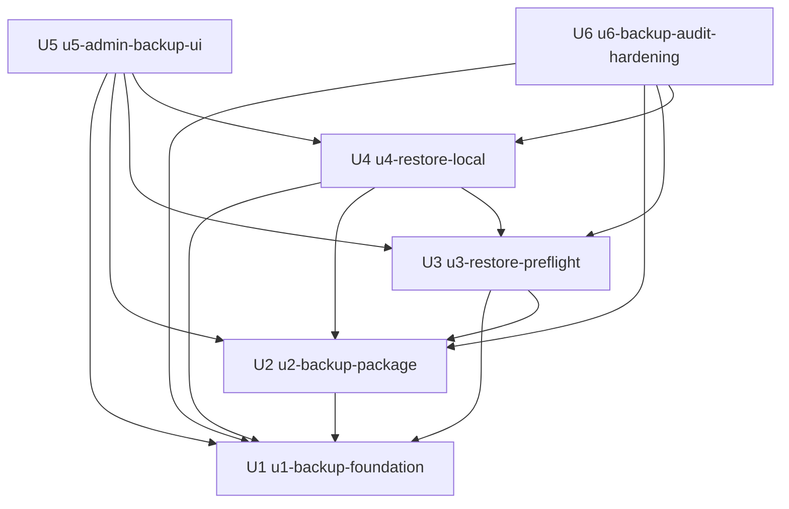

# Unit Dependency DAG — Backup & Restore

## Dependency definition

An edge `A -> B` means **A depends on B**: code/tests for A require B's contract or implementation to build/pass. Independent units may be implemented in parallel. The graph expresses technical prerequisites only; Delivery Planning chooses what value/risk to prioritize first.

## DAG



## Machine-readable dependency block

```yaml
units:
  - name: u1-backup-foundation
    kind: service
    depends_on: []
  - name: u2-backup-package
    kind: library
    depends_on: [u1-backup-foundation]
  - name: u3-restore-preflight
    kind: library
    depends_on: [u1-backup-foundation, u2-backup-package]
  - name: u4-restore-local
    kind: service
    depends_on: [u1-backup-foundation, u2-backup-package, u3-restore-preflight]
  - name: u5-admin-backup-ui
    kind: ui
    depends_on: [u1-backup-foundation, u2-backup-package, u3-restore-preflight, u4-restore-local]
  - name: u6-backup-audit-hardening
    kind: library
    depends_on: [u1-backup-foundation, u2-backup-package, u3-restore-preflight, u4-restore-local]
```

## Dependency rationale and integration boundaries

- `u1-backup-foundation` defines instance IDs, auth boundary, durable job/package metadata and API contract; no other unit's code is required to define its interface.
- `u2-backup-package` requires foundation metadata/job contract and configured instance boundary.
- `u3-restore-preflight` requires package format/manifest/integrity behavior from U2 plus target/metadata boundary from U1.
- `u4-restore-local` requires job lifecycle/recovery persistence, package format, and preflight compatibility result.
- `u5-admin-backup-ui` consumes the stable API, job status, package download and preflight/restore behavior. UI tests require those API contracts; implementation may use mocks until integrated.
- `u6-backup-audit-hardening` adds policy and verification across the complete local flow; it depends on the job, package, preflight and restore surfaces it hardens.

Source domain owners remain existing components and are external/integration dependencies, not Units that re-own their data. The database/Auth/Storage adapters are represented in the component catalogue and are implemented within the relevant backend Units unless later design establishes an independent bounded deliverable.

## Parallel development opportunities

No independence beyond U1 is asserted in this initial DAG: U2 requires the metadata/source-instance contract; U3 requires U2's package shape; U4 requires preflight and adapters; U5 consumes complete flows; U6 hardens those flows. If Contract Design later establishes mockable contracts that allow UI or security work to pass independently, Delivery Planning may sequence them as separate Bolts without changing this DAG only where code/tests truly have no dependency.

## Skeleton applicability

The team affirmed a thin end-to-end slice for backup/restore. U1 is deliberately scoped to the smallest integrated foundation: configured localhost instance selection, protected admin API, persisted job record and visible status. It is an integrated but limited slice; it does not claim a complete restorable backup. A true backup-download slice requires U2 and should be included in the walking-skeleton verification plan at Delivery Planning before later feature expansion. Production restore remains excluded.
