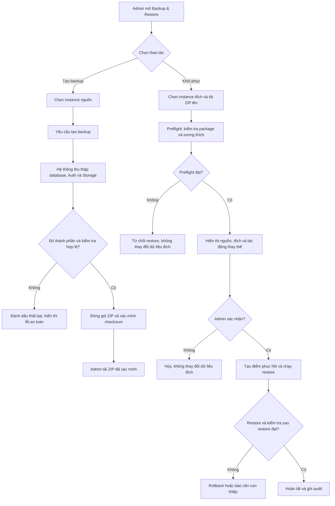

# Đặc tả nghiệp vụ: Sao lưu và khôi phục My-CMS

## 1. Tổng quan

### 1.1 Mục tiêu

Cho phép quản trị viên sao lưu dữ liệu của một instance My-CMS/Supabase thành một tệp ZIP có thể tải xuống, sau đó tải ZIP lên từ giao diện admin để khôi phục vào một instance đích được cấu hình sẵn.

Feature phải hỗ trợ chọn instance nguồn khi sao lưu và chọn instance đích khi khôi phục. Cả thao tác tạo backup và upload/import để restore đều phải thực hiện được từ UI admin.

### 1.2 Đối tượng sử dụng

- **Quản trị viên hệ thống:** chọn instance, tạo/tải backup, tải ZIP lên, xem kết quả kiểm tra và xác nhận restore.
- **Người vận hành:** theo dõi tiến trình, xử lý lỗi và thực hiện quy trình khôi phục khi có sự cố.
- **Người dùng CMS:** đối tượng được bảo vệ dữ liệu; không trực tiếp thao tác feature này.

### 1.3 Thuật ngữ

| Thuật ngữ | Ý nghĩa |
| --- | --- |
| Instance | Một môi trường My-CMS/Supabase đã được cấu hình và được phép chọn trong admin, ví dụ staging hoặc production. |
| Backup package | Tệp ZIP chứa dữ liệu backup, thông tin kiểm tra tính toàn vẹn và hướng dẫn/công cụ restore tương thích. |
| Restore | Khôi phục dữ liệu từ backup package vào instance đích. |
| Preflight | Bước kiểm tra package, khả năng tương thích, phạm vi dữ liệu và tác động lên instance đích trước khi restore. |

## 2. Phạm vi nghiệp vụ

### 2.1 Dữ liệu cần sao lưu

Một backup hoàn chỉnh phải bao gồm các nhóm dữ liệu thuộc phạm vi được phê duyệt cho instance:

1. **Database:** dữ liệu My-CMS trong PostgreSQL, gồm các schema/bảng và quan hệ thuộc hệ thống.
2. **GoTrue/Auth:** người dùng và dữ liệu định danh cần thiết để khôi phục tài khoản theo phương thức được Supabase hỗ trợ.
3. **Storage:** toàn bộ object/blob bytes thuộc các bucket trong phạm vi backup, cùng bucket, đường dẫn và metadata cần thiết để nhận diện object.
4. **Thông tin gói backup:** manifest, phiên bản định dạng, danh mục thành phần, dung lượng và checksum.
5. **Restore:** hướng dẫn và restore command/tool tương thích với định dạng package.

Không được tuyên bố package bao gồm dữ liệu hoặc cấu hình mà quy trình thực tế không thể xuất và khôi phục. Khả năng xuất/khôi phục GoTrue, schema do Supabase quản lý, cấu hình Auth và các thành phần nền tảng phải được xác minh theo phiên bản và mô hình hosting được hỗ trợ.

### 2.2 Ngoài phạm vi mặc định

Trừ khi được bổ sung và phê duyệt riêng, package không bao gồm project settings, secrets, cấu hình nhà cung cấp đăng nhập, edge functions, cấu hình triển khai hoặc các thiết lập Supabase không nằm trong dữ liệu database/Storage đã thống nhất.

### 2.3 Quy tắc khôi phục mặc định

Restore thay thế dữ liệu thuộc phạm vi đã chọn trên instance đích; không phải thao tác merge. Trước khi chạy, admin phải thấy rõ instance đích và tác động thay thế, sau đó xác nhận riêng. Không được thay đổi dữ liệu đích trong bước upload hoặc preflight.

## 3. Sơ đồ quy trình người dùng

## 4. User stories và tiêu chí chấp nhận

### US-01 — Chọn instance nguồn để tạo backup

**Là** quản trị viên, **tôi muốn** chọn một instance nguồn đã được cấu hình, **để** sao lưu đúng môi trường cần bảo vệ.

**Acceptance criteria**

- **Given** tôi đã đăng nhập với quyền quản trị viên và có ít nhất một instance được phép backup, **When** tôi mở trang Backup & Restore, **Then** hệ thống hiển thị danh sách instance được phép chọn cùng nhãn môi trường dễ nhận biết.
- **Given** tôi không có quyền quản trị viên, **When** tôi truy cập trang hoặc gọi trực tiếp chức năng liệt kê instance, **Then** hệ thống từ chối và không tiết lộ danh sách instance.
- **Given** không có instance nào được cấu hình hoặc khả dụng, **When** trang được tải, **Then** hệ thống thông báo không thể tạo backup và không cho bắt đầu job.

### US-02 — Tạo và tải backup ZIP

**Là** quản trị viên, **tôi muốn** tạo backup từ UI và tải xuống một ZIP hoàn chỉnh, **để** lưu trữ hoặc dùng cho khôi phục.

**Acceptance criteria**

- **Given** tôi đã chọn instance nguồn hợp lệ, **When** tôi yêu cầu tạo backup, **Then** hệ thống tạo một job và UI hiển thị mã job cùng trạng thái.
- **Given** job đang chạy, **When** tôi xem trang trạng thái, **Then** UI hiển thị trạng thái hiện tại, thời điểm và tiến độ nếu đo được; lỗi được diễn đạt an toàn, không lộ dữ liệu nhạy cảm.
- **Given** một thành phần bắt buộc như database, Auth hoặc object Storage không thể thu thập đầy đủ, **When** job kết thúc, **Then** job được đánh dấu thất bại và package không được hiển thị như một backup có thể restore.
- **Given** mọi thành phần bắt buộc đã được thu thập và xác minh, **When** job hoàn tất, **Then** package ZIP chứa các thành phần đã thống nhất, manifest, checksum và restore command/tool hoặc hướng dẫn tương thích.
- **Given** package chưa hoàn tất hoặc checksum không hợp lệ, **When** tôi yêu cầu tải xuống, **Then** hệ thống từ chối tải package đó như một bản backup hợp lệ.
- **Given** package đã được xác minh, **When** tôi tải ZIP, **Then** hệ thống cung cấp đúng package gắn với job và instance nguồn đã chọn.

### US-03 — Tải ZIP lên và kiểm tra trước restore

**Là** quản trị viên, **tôi muốn** upload package và chạy preflight trước khi restore, **để** biết package có thể được áp dụng an toàn vào instance đích hay không.

**Acceptance criteria**

- **Given** tôi có quyền quản trị viên, **When** tôi chọn instance đích và tải ZIP từ UI admin, **Then** hệ thống tiếp nhận package trong vùng lưu trữ riêng tư và hiển thị trạng thái upload/kiểm tra.
- **Given** ZIP bị lỗi, thiếu manifest/thành phần bắt buộc, checksum sai, định dạng không được hỗ trợ hoặc package không tương thích với target, **When** preflight chạy, **Then** hệ thống từ chối package, giải thích lý do ở mức an toàn và không thay đổi dữ liệu đích.
- **Given** ZIP vượt giới hạn dung lượng/số lượng entry hoặc có đường dẫn không an toàn, **When** package được kiểm tra, **Then** hệ thống từ chối package trước khi thực hiện restore.
- **Given** preflight thành công, **When** kết quả hiển thị, **Then** admin thấy được nguồn package, instance đích, phạm vi thành phần, khả năng tương thích, tác động thay thế và cảnh báo liên quan.

### US-04 — Xác nhận và thực hiện restore

**Là** quản trị viên, **tôi muốn** xác nhận rõ instance đích trước khi restore, **để** tránh ghi đè nhầm môi trường.

**Acceptance criteria**

- **Given** preflight đã thành công, **When** hệ thống yêu cầu xác nhận, **Then** màn hình nêu rõ tên/môi trường instance đích, package được dùng và dữ liệu nào sẽ bị thay thế.
- **Given** tôi chưa xác nhận hoặc hủy thao tác, **When** tôi rời bước xác nhận, **Then** restore không chạy và dữ liệu đích không bị thay đổi.
- **Given** tôi xác nhận restore, **When** hệ thống bắt đầu công việc, **Then** hệ thống ghi nhận job/audit và tạo hoặc xác nhận có điểm phục hồi đủ để xử lý lỗi trước khi thay đổi dữ liệu đích.
- **Given** restore hoàn tất, **When** kiểm tra sau restore thành công, **Then** job được đánh dấu thành công và kết quả kiểm tra được ghi nhận.
- **Given** một thành phần restore hoặc kiểm tra sau restore thất bại, **When** job kết thúc, **Then** hệ thống không báo thành công; hệ thống rollback hoặc hiển thị rõ trạng thái cần khôi phục/can thiệp thủ công.

### US-05 — Ngăn truy cập và thao tác trái phép

**Là** chủ sở hữu hệ thống, **tôi muốn** các thao tác backup/restore chỉ dành cho quản trị viên được cấp quyền, **để** bảo vệ dữ liệu và bí mật của các instance.

**Acceptance criteria**

- **Given** người dùng không có quyền quản trị viên, **When** họ gọi trực tiếp bất kỳ chức năng liệt kê instance, tạo job, upload, preflight, download hoặc restore nào, **Then** hệ thống từ chối ở phía server.
- **Given** người dùng không được phép truy cập một job/package, **When** họ đoán hoặc sử dụng ID của job/package đó, **Then** hệ thống không trả dữ liệu hay tệp của tài nguyên đó.
- **Given** backup hoặc restore được thực hiện, **When** audit được ghi, **Then** audit ghi actor, instance nguồn/đích, package/job, thời điểm và kết quả nhưng không ghi credentials, token, mật khẩu hay nội dung object/database.
- **Given** package được tạo hoặc upload, **When** dữ liệu được truyền hoặc lưu tạm/lưu trữ, **Then** dữ liệu được bảo vệ theo chính sách mã hóa và quyền truy cập đã phê duyệt.

### US-06 — Theo dõi kết quả và xử lý lỗi

**Là** quản trị viên hoặc người vận hành, **tôi muốn** xem trạng thái cuối cùng và hướng xử lý khi job thất bại, **để** biết dữ liệu đang an toàn hay cần can thiệp.

**Acceptance criteria**

- **Given** backup hoặc restore đang chạy, **When** tôi xem job, **Then** hệ thống hiển thị trạng thái và mã tham chiếu có thể dùng để tra cứu.
- **Given** job thất bại, **When** kết quả được hiển thị, **Then** thông báo nêu thành phần/bước thất bại ở mức an toàn và trạng thái rollback hoặc yêu cầu can thiệp.
- **Given** job đã kết thúc, **When** người có quyền xem audit, **Then** họ có thể xác định ai thực hiện, instance liên quan, thời điểm, kết quả và package/job tương ứng.

## 5. Quy tắc nghiệp vụ

| ID | Quy tắc |
| --- | --- |
| BR-01 | Chỉ instance được cấu hình phía server và được phép theo quyền người dùng mới xuất hiện trong UI. |
| BR-02 | Thông tin kết nối, database credentials, service-role key và endpoint tùy ý không được gửi từ browser để lựa chọn instance. |
| BR-03 | Một backup chỉ được coi là hoàn tất khi mọi thành phần bắt buộc đã được thu thập, đóng gói và xác minh theo tiêu chuẩn đã công bố. |
| BR-04 | Restore mặc định thay thế dữ liệu thuộc phạm vi được hỗ trợ trên instance đích; không âm thầm merge. |
| BR-05 | Upload và preflight không được thay đổi dữ liệu instance đích. Chỉ job restore sau xác nhận tường minh mới được phép thay đổi dữ liệu. |
| BR-06 | Không thực thi script hoặc command do ZIP tải lên cung cấp. Restore phải dùng công cụ đã được hệ thống phê duyệt và hỗ trợ phiên bản package đó. |
| BR-07 | Khi restore lỗi, hệ thống phải rollback hoặc báo trạng thái recovery-required; không được báo thành công một phần. |
| BR-08 | Chặn job restore đồng thời có khả năng xung đột trên cùng target; tránh tạo job trùng do submit lặp. |
| BR-09 | Package backup chứa dữ liệu nhạy cảm, không chứa credentials/secrets và phải tuân thủ chính sách lưu trữ, mã hóa, retention và xóa đã được phê duyệt. |

## 6. Yêu cầu phi chức năng và kiểm soát

- **Bảo mật:** phân quyền server-side cho mọi thao tác; bảo vệ dữ liệu truyền và lưu; che giấu thông tin nhạy cảm trong log, lỗi, audit và metric.
- **An toàn ZIP:** từ chối path traversal, đường dẫn tuyệt đối, symlink, entry trùng/xung đột, archive bomb, file quá lớn và package vượt giới hạn cấu hình.
- **Tính toàn vẹn:** kiểm tra checksum trước khi restore và xác minh dữ liệu sau restore theo phạm vi đã định nghĩa.
- **Tính nhất quán:** công bố phương thức và giới hạn nhất quán của backup. Không gọi là point-in-time nếu chưa chứng minh được sự nhất quán giữa database, Auth và object storage.
- **Khả năng phục hồi:** có quy trình rollback/khôi phục, giới hạn thời gian lưu bản tạm và bài kiểm tra restore định kỳ trước khi bật production.
- **Vận hành:** ghi nhận thời lượng, số byte/object, kết quả theo thành phần và thời gian phục hồi; metric không chứa thông tin định danh cá nhân hoặc bí mật.

## 7. Điều kiện phát hành

Không bật restore cho production trước khi các điều kiện sau được xác minh và phê duyệt:

1. Phạm vi schema/bảng và phương thức khôi phục GoTrue/Auth được xác nhận cho phiên bản Supabase hỗ trợ.
2. Phương thức lấy/khôi phục object Storage, bucket metadata và liên kết dữ liệu được kiểm chứng.
3. Mức nhất quán được công bố; giới hạn và ảnh hưởng lên session người dùng được nêu rõ.
4. Có mã hóa và quản lý khóa, giới hạn upload/package, chính sách retention/xóa.
5. Quy trình tạo điểm phục hồi, rollback và xử lý restore thất bại đã được kiểm thử.
6. Restore drill thành công trên môi trường đại diện; có tiêu chí thời gian phục hồi và mức mất dữ liệu chấp nhận được.
7. Với production, quyền xác nhận bổ sung/second-person approval được quyết định và áp dụng nếu chính sách yêu cầu.

## 8. Giả định và câu hỏi cần BA/Product xác nhận

1. Những môi trường Supabase nào được hỗ trợ: self-hosted, Supabase hosted hay cả hai? Phiên bản nào?
2. “Toàn bộ dữ liệu Supabase” có nghĩa là dữ liệu My-CMS cùng GoTrue và Storage, hay bao gồm cả schema/dữ liệu hệ thống do Supabase quản lý? Cần chốt danh sách bao gồm/loại trừ.
3. Có yêu cầu giữ password hash để user đăng nhập bằng mật khẩu cũ sau restore không? Phương thức khôi phục được nền tảng hỗ trợ là gì?
4. Tạo backup có được phép tạm dừng ghi dữ liệu không? Nếu không, mức độ nhất quán chấp nhận được là gì?
5. Instance đích có thể khác instance nguồn không? Có cần ánh xạ ID, URL, domain hoặc bucket giữa hai môi trường không?
6. Giới hạn dung lượng ZIP, thời gian giữ backup và nơi lưu package là gì?
7. Ai được restore vào production? Có cần người thứ hai phê duyệt không?
8. Mục tiêu RPO/RTO cần đạt là bao nhiêu và tần suất restore drill ra sao?

## 9. Hiện trạng triển khai

> Cập nhật: đoạn dưới đây mô tả hiện trạng trước lát U1. Hiện trạng U1 (synthetic-only, database slice, không restore) nằm ở mục 14; các tiêu chí ZIP, upload/import restore và download ở mục 4 vẫn chưa được triển khai.

Gateway hiện có CLI skeleton tại `apps/api/gateway/src/backup_cli.rs`, nhưng lệnh backup/list chưa có S3 transfer adapter và restore đang từ chối chạy vì quy trình phục hồi đầy đủ cho Supabase chưa được xác minh. Chưa có luồng ZIP hoàn chỉnh hoặc upload/import restore. Vì vậy, các mục 1-8 là đặc tả mục tiêu; không nên coi các tiêu chí đó là đã được triển khai.

## 10. Yêu cầu phi chức năng chi tiết (từ thiết kế U1 localhost)

Phạm vi U1 là localhost-only; chưa có SLO số, RPO/RTO hay dataset size được phê duyệt. Các giới hạn số chỉ được đặt sau benchmark và owner approval; thiếu giá trị vận hành bắt buộc thì từ chối thay vì dùng default không giới hạn.

### 10.1 Bảo mật

- Mọi endpoint yêu cầu actor xác thực và role administrator, kiểm tra server-side trước khi chạm configuration/job/metadata; mỗi lần đọc job kiểm tra quyền trên resource.
- API chỉ nhận configured instance ID thuộc server allowlist; từ chối mọi endpoint, connection string, credential hoặc service-role key từ browser.
- Credentials chỉ resolve trong server-side secret/config boundary; không xuất hiện trong response, browser bundle, error, audit, log hay metric (kiểm tra bằng secret-canary scan).
- Backup staging chỉ ghi vào private server-side storage, mã hóa at-rest, least-privilege; không có public URL/download route. Staging chỉ bắt đầu khi byte/time/temp limits, expiry, cleanup policy và storage protection đều hữu hạn và hợp lệ.
- Idempotency key lưu dạng digest scoped theo actor+operation; raw key không lưu/log. Adapter errors ánh xạ thành stable safe reason code; không lộ raw upstream response, SQL rows, auth data hay object bytes.
- Audit trước side effect nhạy cảm: nếu audit store không khả dụng thì từ chối thao tác. Audit chỉ chứa actor/source/job/time/digest/outcome/reason code.
- Transport admin↔API, API↔database, API↔object store dùng TLS; exception local loopback không mã hóa chỉ giới hạn localhost và không mang sang remote deployment.

### 10.2 Độ tin cậy

- Job được persist trước khi API trả accepted; persistence failure không tạo response accepted hoặc job giả.
- Worker chỉ transition theo expected status/state version; idempotency chống duplicate submit; retry chỉ cho lỗi transient trên thao tác idempotent.
- Timeout, crash hoặc kết quả adapter không rõ giữ job ở trạng thái non-success; không suy luận success từ file tồn tại hay process exit.
- Job backup U1 chỉ kết thúc `incomplete` hoặc `failed`; không có trạng thái `succeeded` cho database-only slice vì Auth/Storage bắt buộc chưa được capture.
- Staging có finite expiry và durable cleanup/reconciliation nhận diện orphan sau crash; cleanup retry bounded, lỗi không bỏ qua. Trước khi cơ chế này được thiết kế/tested, real-data staging bị disable.
- Recovery/lease/restart semantics chưa chứng minh thì không claim automatic job resume hay exactly-once processing.

### 10.3 Quan sát hệ thống

- Structured events ghi job/correlation ID, actor ID, configured source ID, operation, from/to state, safe reason code, timestamp và digest/byte count nếu có. Tuyệt đối không ghi credential, token, password, connection string, raw DB row, object content, raw idempotency key hay upstream error body.
- Error projection dùng stable safe code/message key + correlation/job ID cho admin; raw adapter detail chỉ giữ ở kênh bảo vệ nếu policy phê duyệt.
- Metrics: đếm job theo operation/status, component capability unavailable, duration, bytes staging, cleanup success/failure, configured-limit rejection. Không dùng actor ID, secret, object key, email, raw path hay data content làm label. Không báo progress percentage nếu không có counter completed/total đáng tin.
- Alerting/SLO thresholds chưa đặt (workload localhost); trước production cần owner xác nhận SLI/SLO/RPO/RTO. Tracing propagate correlation ID; span attributes chỉ dùng operation/component/status/code.

### 10.4 Hiệu năng và mở rộng

- API create-job chỉ làm authentication, allowlist/config validation, idempotency và durable commit; capture/archive chạy ngoài HTTP request với deadline hữu hạn từ cấu hình.
- Worker tuân thủ finite whole-job, per-operation, temp-byte, archive-byte, concurrency và staging-expiry limits; không dùng "unbounded localhost" làm fallback.
- Progress chỉ phát khi có số liệu đo thực; không giả lập phần trăm. Backup chỉ đọc/copy phần cần thiết cho database slice; không giữ toàn bộ raw rows trong process hay job metadata.
- U1 không yêu cầu multi-process/multi-host coordination; local Tokio execution không được mô tả như scale-out hay crash-recovery guarantee. Mọi giới hạn/throughput benchmark trên dataset/fixture đại diện trước khi mở rộng; nếu cần nhiều worker/host, dataset vượt staging budget hoặc nhiều instance đồng thời thì phải bổ sung thiết kế concurrency/lease, streaming, backpressure và recovery trước.

## 11. Lịch sử chính sách backup

- **Chính sách S3 thủ công (intent 261116, đã thay thế):** backup thủ công vào S3 bucket `backup-system`, giữ đến khi xóa tay, operator có server access restore vào cùng môi trường theo kiểu thay thế, capture best-effort kèm kiểm tra toàn vẹn archive. Không hỗ trợ backup theo lịch, retention tự động, restore khác môi trường hay snapshot nhất quán xuyên store. Chính sách này đã được thay bằng luồng ZIP qua admin UI mô tả ở các mục 1–8.
- **Phạm vi U1 (intent 261117):** lát localhost database-only; job chỉ terminal `incomplete` hoặc `failed`; artifact incomplete không downloadable; real-data staging disabled đến khi cleanup/reconciliation sau crash được chứng minh.

## 12. Trạng thái triển khai U1 và điều kiện tiếp tục

> Lịch sử: mục này ghi nhận điểm dừng của lượt Code Generation đầu tiên. Các điều kiện tiếp tục đã được giải quyết trong thiết kế đã duyệt và các work unit WU-01..WU-14; trạng thái hiện tại nằm ở mục 14.

Code Generation U1 kết thúc mà không thay đổi mã nguồn ứng dụng nào (không sửa source, schema/migration, manifest hay UI; không chạy test trong lượt đó). Nguyên nhân dừng:

1. Chưa quyết định owner persistence/migration và thiết kế cleanup/reconciliation bền vững có thể phục hồi.
2. Mâu thuẫn contract/schema: contract công khai enum `queued | running | succeeded | failed | recovery-required`, trong khi functional spec và reliability design cho phép `incomplete` khi có artifact — chưa có mapping được phê duyệt.
3. Chưa xác nhận schema/migration ownership, durable orphan index/cleanup mechanism, DB migration ownership và provider staging.

Điều kiện tiếp tục: cần plan/design cập nhật và được phê duyệt giải quyết các mục trên trước khi quay lại Code Generation. Baseline suite được ghi nhận tại thời điểm đó: 8 lỗi `domain_posts`, 2 ignored do thiếu Docker trên Windows; các crate khác pass.

## 13. Bối cảnh dự án liên quan

- Brownfield: Rust API gateway + Supabase self-hosted; đợt đầu chỉ phát triển và kiểm thử localhost, không hỗ trợ restore production, không có bước phát hành/release riêng.
- Thực hành nhóm: `test-after`, triển khai rồi kiểm thử từng lớp, mục tiêu bao phủ dòng 80%, CI xanh trước khi hợp nhất. CI/coverage tại thời điểm ghi nhận tạm vô hiệu hóa; cơ chế coverage/CI phải được khôi phục hoặc xác minh trước khi tiêu chí chất lượng được coi là khả thi.
- Tài liệu coverage-report-failure (intent 261116-coverage-report-failure) thuộc CI coverage (`grcov` binary-path), không liên quan backup-restore và được giữ nguyên ngoài feature này.

## 14. Trạng thái U1 hiện tại (verification sweep WU-15)

Phạm vi được duyệt chỉ là lát U1: localhost, dữ liệu synthetic-only, chỉ administrator, database slice, không restore. Nhánh U1 nằm trên feature branch và không được merge vào `main` trong Develop (quyết định owner 2026-11-22; RK-16). Quyết định release-candidate gate chưa được đưa ra trong tài liệu này; bằng chứng nằm trong intent `use-dtech-aidlc-to-develop-the-backup-and-restor` (`.aidlc/intents/.../develop/build-and-verify/`).

### 14.1 Đã có

- **API** (`apps/api/domain_backup`, mount `Mount::AdministratorIngress` dưới `/backup`, gateway bọc timeout, giới hạn header và auth administrator): `GET /backup/status`, `GET /backup/instances`, `POST` và `GET /backup/jobs`, `GET /backup/jobs/{id}`, `GET /backup/jobs/{id}/download` (luôn 403 `DOWNLOAD_DENIED`), `POST /backup/previews/preflight` và `POST /backup/previews/restore-confirmation` (preview synthetic), và các route upload, preflight, restore luôn bị từ chối (capability bị tắt).
- **Job**: persist trước khi trả 202, idempotency key lưu dạng digest, một job active cho mỗi instance, worker chạy ngoài request; job U1 chỉ kết thúc `incomplete` hoặc `failed`. `succeeded` và `recovery-required` không thể đạt được qua state machine, ràng buộc DB `backup_jobs_u1_status_guard` và serializer; UI vẫn render đủ mọi giá trị trạng thái.
- **Vòng đời staging**: allocation ledger, reconciler, cleaner, sweeper và runtime start (khóa namespace, epoch, reconcile, cleanup khi khởi động) trong `domain_backup`.
- **UI admin** (`apps/web/src/app/admin/backup`, route `/admin/backup`): banner trạng thái, chọn instance, tạo job, danh sách và chi tiết job có polling, preview synthetic. UI không có nút tải xuống.
- **Synthetic-only**: phản hồi API mang cờ `synthetic` hoặc `synthetic_only`; UI ghi rõ job là synthetic, database-only và không restore được. Mọi nội dung là fixture, không có dữ liệu thật.

### 14.2 Cách bật (cục bộ)

Backup tắt mặc định. Đặt `BACKUP_ENABLED=true` cùng các khóa `BACKUP_*` bắt buộc (instance, nhãn, storage root, origin được phép, `BACKUP_REQUEST_TIMEOUT_SECS=30`, `BACKUP_MAX_HEADER_BYTES=16384`) và gateway bind loopback. Bảng đầy đủ các khóa, giá trị cố định và lý do `disabled_reason` nằm trong mục "Backup and restore (U1) configuration" của `README.md`. Các khóa CLI `BACKUP_S3_ENDPOINT` và `BACKUP_LOCAL_ROOT` là bề mặt riêng, không liên quan.

### 14.3 Câu hỏi và hạng mục còn mở (không được coi là đã quyết)

- **Q-04**: khôi phục Supabase Auth và Storage.
- **Q-06**: RPO/RTO.
- **Q-07**: chính sách production.
- **Q-10**: mức nhất quán xuyên database, Auth và Storage.
- **Q-11**: mã hóa và quản lý khóa (U1 không tuyên bố mã hóa at-rest).
- **Q-12**: mức sẵn sàng toolchain/chất lượng ở phạm vi rộng hơn (baseline đã chạy và ghi nhận ngày 2026-11-22; CI hiện không chạy test `--ignored`).
- **Audit retention** chưa được quyết định: U1 giữ mọi dòng audit và job purge bỏ qua audit.
- **Non-owner technical guards** (chủ sở hữu có thể xác nhận hoặc thay): giới hạn body JSON 16 KiB, kích thước trang danh sách 20 (tối đa 100), kích thước fixture cố định, chu kỳ dò khôi phục DB 60 s.
- **E2E-ENV-01**: UI chạy ở `localhost:3002` gọi API khác origin; chưa chọn cách kiểm thử trình duyệt, nên kiểm tra UI trong trình duyệt bị chặn (UI được phủ bằng component test).
- **Chưa được cho phép**: staging dữ liệu thật, upload hoặc chấp nhận preflight, restore, download, dùng production, job `succeeded`, kết quả `recovery-required`.
- **Giới hạn đã biết**: kiểm tra quyền chỉ chủ sở hữu (owner-only ACL) trên Windows chưa được xác minh (T-14, owner chấp nhận cho dữ liệu synthetic-only); `migrate down` và `migrate status` chỉ bao phủ migrator của posts nên không có đường rollback bằng CLI cho bảng backup (RK-08); CI hiện không chạy test cần Docker (RK-09), nên không có tuyên bố CI xanh.
